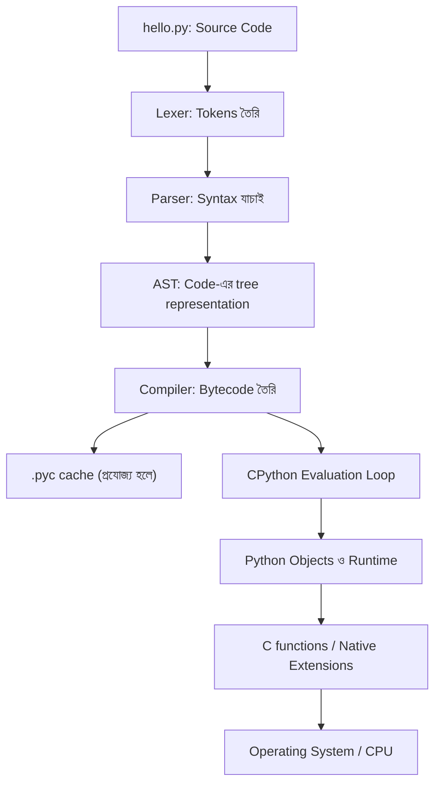
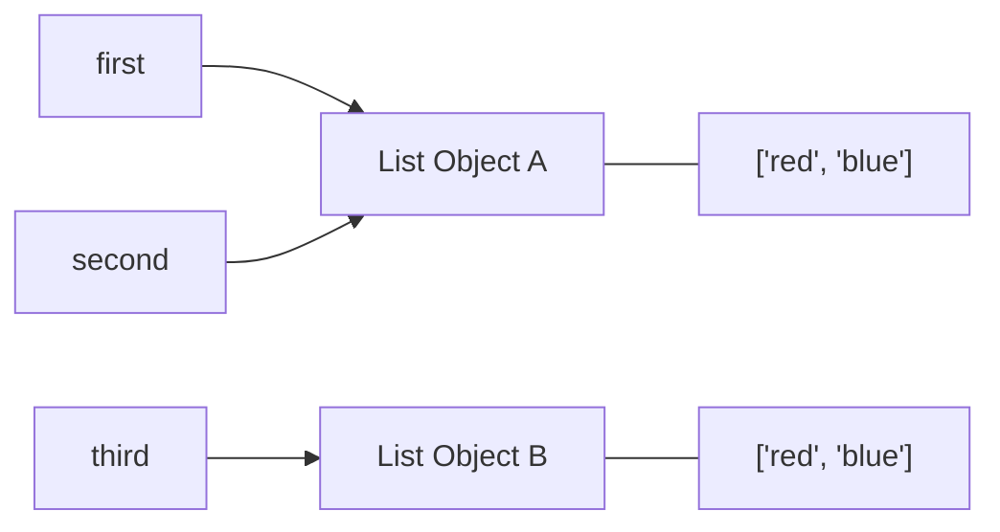
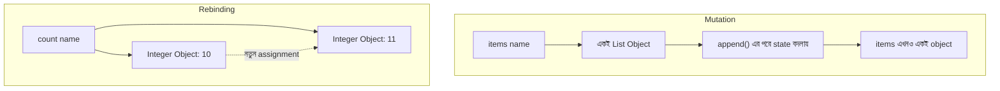
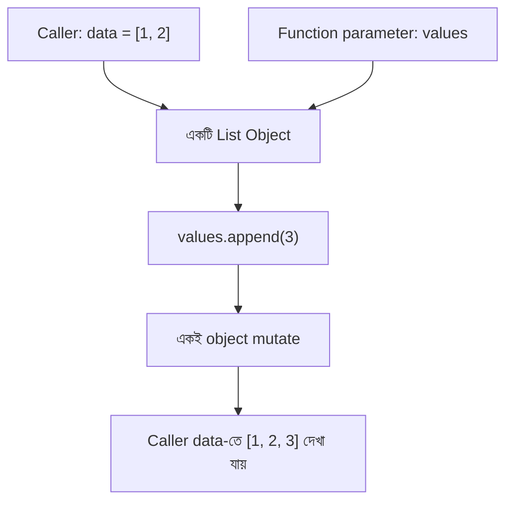
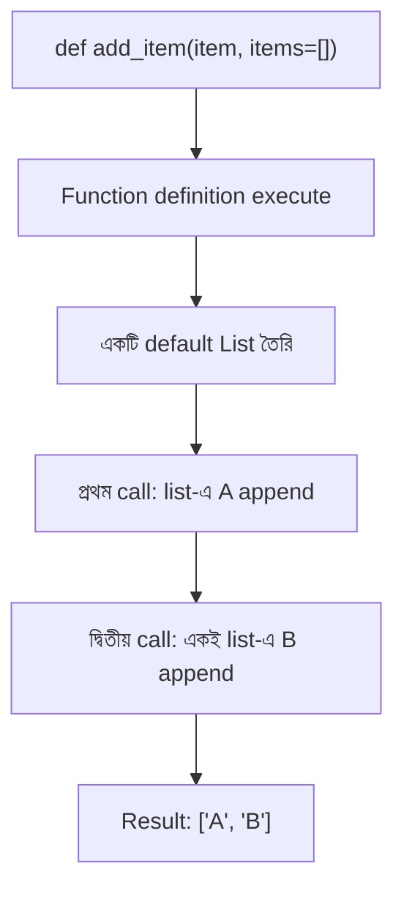
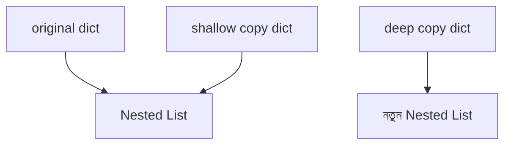
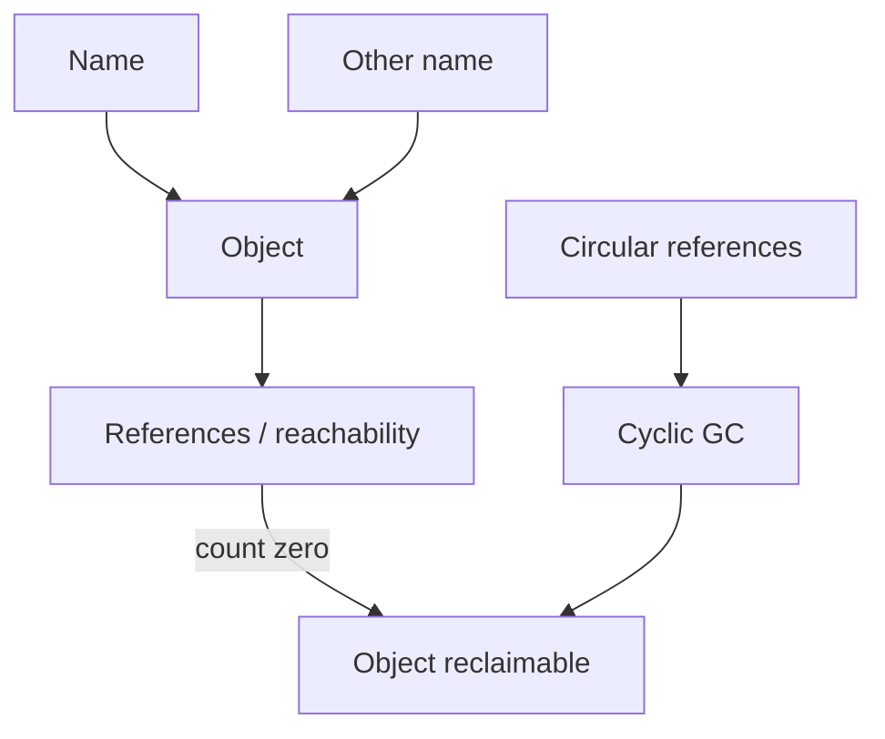

# Python Fundamentals: Execution Model and Object Model

এই অধ্যায়ে Python-এর syntax শেখার পাশাপাশি interpreter-এর ভিতরে code কীভাবে execute হয়, object ও variable কীভাবে কাজ করে এবং mutable/immutable আচরণের কারণ বোঝানো হয়েছে। AI/ML Engineering-এর Python code বুঝতে এই foundation খুব গুরুত্বপূর্ণ।

## ১. Python কী?

Python একটি **high-level, general-purpose, dynamically typed programming language**।

- **High-level:** programmer-কে সাধারণত memory address, register বা machine instruction সরাসরি manage করতে হয় না।
- **General-purpose:** web backend, automation, data analysis, ML, scripting, testing-সহ নানা কাজে ব্যবহার করা যায়।
- **Dynamically typed:** variable-এর type declaration করে দিতে হয় না। Runtime-এ object-এর type নির্ধারিত থাকে।
- **Garbage-collected:** CPython reference counting এবং cyclic garbage collector ব্যবহার করে memory management করে।

Python language specification এবং Python-এর implementation এক জিনিস নয়। Language হলো rules ও semantics; implementation হলো সেই rules execute করার software।

## ২. Python কি compiled, নাকি interpreted language?

এই প্রশ্নের উত্তর এক শব্দে দিলে বিভ্রান্তি তৈরি হয়। Python language-কে প্রায়ই interpreted language বলা হয়, কিন্তু প্রচলিত **CPython implementation** source code-কে প্রথমে bytecode-এ compile করে। তারপর Python Virtual Machine (PVM) সেই bytecode execute করে।

অর্থাৎ CPython-এ compilation এবং interpretation, দুটো ধাপই আছে।

এখানে তিনটি বিষয় আলাদা করে বুঝতে হবে:

1. **Source code:** আমরা যে `.py` file লিখি।
2. **Bytecode:** Python compiler-এর তৈরি intermediate instruction।
3. **Machine code:** CPU সরাসরি যে native instruction execute করে।

CPython-এর সাধারণ execution path-এ Python source code সরাসরি CPU machine code-এ compile হয় না। Bytecode Python runtime execute করে। অন্য implementation যেমন PyPy JIT compilation ব্যবহার করতে পারে।

## ৩. CPython কী?

**CPython হলো Python programming language-এর সবচেয়ে প্রচলিত reference implementation**, যা C programming language দিয়ে implement করা হয়েছে। সাধারণভাবে কেউ Python install করে `python` command চালালে অধিকাংশ ক্ষেত্রে CPython-ই ব্যবহার করে, যদিও environment ভেদে অন্য implementation থাকতে পারে।

CPython-এর কাজের মধ্যে রয়েছে:
- Python source code parse ও compile করা।
- Bytecode execute করার runtime সরবরাহ করা।
- Python object, function, class ও exception-এর runtime behavior পরিচালনা করা।
- Memory allocation ও garbage collection পরিচালনা করা।
- C extension-এর মাধ্যমে native library integration করা।

CPython-কে Python language-এর নাম ভেবে ভুল করবে না। Python হলো language; CPython হলো সেই language-এর একটি implementation।

Implementation check:

```python
import platform
import sys

print(platform.python_implementation())
print(sys.version)
print(sys.executable)
```

সম্ভাব্য output-এর প্রথম লাইন `CPython` হতে পারে।

## ৪. CPython কীভাবে Python code execute করে?

ধরা যাক `hello.py` নামে file আছে:

```python
name = "Shomi"
print(f"Hello, {name}")
```

সাধারণ CPython execution-কে ধারণাগতভাবে এভাবে দেখা যায়:

```text
hello.py (source code)
       |
       v
Lexing / Parsing
       |
       v
AST (Abstract Syntax Tree)
       |
       v
Compilation
       |
       v
Python Bytecode
       |
       v
CPython Virtual Machine
       |
       v
Runtime operations / C implementation / OS
       |
       v
Output
```

### ধাপ ১: Source code পড়া ও tokenize করা

Python source code character-এর sequence। Lexer এগুলোকে token-এ ভাগ করে। যেমন identifier, keyword, operator, literal ইত্যাদি।

### ধাপ ২: Parsing এবং AST তৈরি

Parser token-এর structure grammar-এর সঙ্গে মেলে কি না যাচাই করে এবং Abstract Syntax Tree (AST) তৈরি করে। AST code-এর structural representation।

```python
import ast

source = "total = price * quantity"
tree = ast.parse(source)

print(ast.dump(tree, indent=2))
```

AST দেখে assignment, variable name এবং multiplication operation-এর structure বোঝা যায়।

### ধাপ ৩: Compilation এবং bytecode

CPython AST থেকে bytecode তৈরি করে। Bytecode Python virtual machine-এর জন্য intermediate instruction। এটি CPU machine code নয়।

```python
import dis

def add(a, b):
    return a + b

dis.dis(add)
```

`dis` module function-এর bytecode instruction দেখায়। Python version অনুযায়ী instruction-এর নাম ও sequence বদলাতে পারে।

### ধাপ ৪: Python Virtual Machine bytecode execute করে

CPython-এর evaluation loop bytecode instruction process করে। Instruction অনুযায়ী object load, function call, arithmetic operation বা control flow পরিচালিত হয়। অনেক operation-এর implementation CPython-এর C code-এ থাকে।

### ধাপ ৫: Runtime ও operating system-এর সঙ্গে interaction

File read, network socket, process, thread বা memory allocation-এর মতো কাজের ক্ষেত্রে Python runtime প্রয়োজনমতো operating system ও native library-এর সঙ্গে interaction করে।

### `.pyc` file কী?

CPython import করা module-এর compiled bytecode cache হিসেবে `__pycache__` directory-তে `.pyc` file রাখতে পারে। এটি পরবর্তী import-এ compilation-এর কিছু কাজ এড়াতে সাহায্য করে।

গুরুত্বপূর্ণ:
- `.pyc` হলো bytecode cache, native executable নয়।
- Cache না থাকলেও Python source execute করতে পারে।
- Python version/implementation বদলালে bytecode compatibility বদলাতে পারে।
- সব script run করলেই একইভাবে স্থায়ী `.pyc` file তৈরি হবে, এমন নয়; import mechanism ও execution mode গুরুত্বপূর্ণ।

## ৫. Interpreted language বনাম compiled language

এই labels বাস্তবে অনেক সময় সরলীকরণ। তবুও ধারণা বোঝার জন্য:

| বিষয় | Traditional compiled workflow | CPython-এর সাধারণ workflow |
|---|---|---|
| Input | Source code | Python source code |
| Intermediate step | Compiler native machine code তৈরি করতে পারে | Compiler bytecode তৈরি করে |
| Execution | CPU native machine code execute করে | Python VM bytecode execute করে |
| Build artifact | Executable/object file | Optional bytecode cache `.pyc` |
| Portability | Target platform-এর উপর নির্ভরশীল | Runtime থাকলে source সাধারণত portable |

C-এর মতো language-এ প্রচলিত workflow হলো source থেকে native executable build করা। CPython সাধারণত source থেকে bytecode তৈরি করে এবং runtime-এ execute করে।

তবে compiled/interpreted কোনো language-এর অপরিবর্তনীয় ধর্ম নয়। একই language-এর একাধিক implementation ভিন্ন execution strategy ব্যবহার করতে পারে।

## ৬. CPython, PyPy এবং JIT কী?

- **CPython:** C-তে লেখা বহুল ব্যবহৃত Python implementation; bytecode virtual machine দিয়ে execute করে।
- **PyPy:** Python implementation, যেখানে JIT compiler hot code path-কে runtime-এ native machine code-এ compile করতে পারে।
- **JIT (Just-In-Time) compilation:** Program চলার সময় নির্বাচিত code compile করা, যাতে পুনরাবৃত্ত execution দ্রুত হতে পারে।

JIT থাকলেই সব program দ্রুত হবে না। Workload, warm-up, library, compatibility ও memory overhead বিবেচ্য।

## ৭. Python dynamically typed মানে কী?

Variable-এর সঙ্গে স্থায়ী type declaration বাধ্যতামূলক নয়। Variable কোনো object-এর reference/name binding হিসেবে কাজ করে; object-এর type runtime-এ থাকে।

```python
value = 10
print(type(value))  # <class 'int'>

value = "ten"
print(type(value))  # <class 'str'>
```

এখানে একই variable name প্রথমে integer object, পরে string object-কে refer করছে। Integer object string-এ mutate হয়নি।

**Dynamic typing মানে type নেই, তা নয়।** Object-এর type আছে; শুধু variable declaration-এ type বাধ্যতামূলক নয়।

## ৮. Variable কি object-এর box?

Python শেখানোর সময় variable-কে box হিসেবে আঁকা হয়, কিন্তু সেটি সবসময় সঠিক mental model নয়। আরও ভালো model হলো: **একটি name একটি object-কে refer করে**।

```python
a = [1, 2]
b = a

b.append(3)

print(a)  # [1, 2, 3]
print(b)  # [1, 2, 3]
print(a is b)  # True
```

`b = a` নতুন list তৈরি করেনি। `a` এবং `b` একই list object-এর reference ধরে রেখেছে।

## ৯. Mutable এবং Immutable কী?

এটি Python-এর সবচেয়ে গুরুত্বপূর্ণ foundational concept-গুলোর একটি।

**Mutable object:** object তৈরি হওয়ার পরে তার observable state পরিবর্তন করা যায়, object identity একই রেখেই।

উদাহরণ:
- `list`
- `dict`
- `set`
- অধিকাংশ custom class instance

**Immutable object:** তৈরি হওয়ার পরে object-এর state পরিবর্তন করা যায় না। নতুন value দরকার হলে নতুন object তৈরি হয় বা অন্য object-এর reference bind হয়।

উদাহরণ:
- `int`
- `float`
- `bool`
- `str`
- `bytes`
- `frozenset`
- immutable tuple, যদি এর elements-ও immutable হয়

### Mutable object-এর উদাহরণ

```python
numbers = [10, 20]
original_id = id(numbers)

numbers.append(30)

print(numbers)                  # [10, 20, 30]
print(id(numbers) == original_id)  # True
```

একই list object-এর ভিতরের state বদলেছে। তাই identity একই আছে।

### Immutable object-এর উদাহরণ

```python
name = "Shomi"
original_id = id(name)

name = name + " Khan"

print(name)                      # Shomi Khan
print(id(name) == original_id)   # সাধারণত False
```

String object mutate হয়নি। Concatenation-এর ফলে নতুন string object তৈরি হয়েছে এবং `name` নতুন object-কে refer করছে। `id` comparison-কে language-level identity check হিসেবে দেখবে; memory address নিয়ে assumption করবে না।

### Immutable মানে variable বদলানো যাবে না?

না। Immutable হলো object-এর property, variable name-এর নয়।

```python
age = 31
age = 32
```

এখানে 31-এর integer object mutate হয়ে 32 হয়নি। `age` এখন অন্য integer object-কে refer করছে।

## ১০. Tuple কি সবসময় পুরোপুরি immutable?

Tuple-এর নিজের item reference পরিবর্তন করা যায় না। কিন্তু tuple-এর ভেতরে mutable object থাকলে সেই nested object mutate হতে পারে।

```python
items = ([1, 2], "python")

# items[0] = [3, 4]  # TypeError: tuple item assignment নিষিদ্ধ

items[0].append(3)   # nested list mutate করা যায়
print(items)         # ([1, 2, 3], 'python')
```

Tuple immutable container, কিন্তু তার সব nested object immutable, এমন নিশ্চয়তা নেই।

## ১১. Function-এ Mutable object পাঠালে কী হয়?

Python-এ argument passing-কে প্রায়ই **call by object sharing** বলা হয়। Function parameter নতুন local name, যা caller-এর দেওয়া object-কে refer করে। Object mutable হলে function সেটি mutate করতে পারে।

```python
def add_item(values):
    values.append("new")

data = ["old"]
add_item(data)

print(data)  # ['old', 'new']
```

Function-এর local parameter `values` এবং caller-এর `data` একই list object-কে refer করেছে।

কিন্তু parameter-কে নতুন object assign করলে caller-এর variable rebind হয় না:

```python
def replace_list(values):
    values = ["replacement"]

data = ["original"]
replace_list(data)

print(data)  # ['original']
```

এখানে function-এর local name `values` নতুন list-কে refer করেছে। Caller-এর `data` binding বদলায়নি।

## ১২. Mutable default argument কেন বিপজ্জনক?

Function definition execute হওয়ার সময় default argument একবার evaluate হয়। তাই default হিসেবে list/dict দিলে সেটি পরবর্তী call-গুলোতে shared থাকে।

```python
def add_item(item, items=[]):
    items.append(item)
    return items

print(add_item("a"))  # ['a']
print(add_item("b"))  # ['a', 'b']
```

অনেকে আশা করে দ্বিতীয় call `['b']` ফেরত দেবে। কিন্তু একই default list object reuse হচ্ছে।

নিরাপদ pattern:

```python
def add_item(item, items=None):
    if items is None:
        items = []

    items.append(item)
    return items

print(add_item("a"))  # ['a']
print(add_item("b"))  # ['b']
```

প্রতিটি call-এ `None` default এলে function নতুন list তৈরি করছে।

## ১৩. Mutable ও Immutable-এর ব্যবহারিক পার্থক্য

| বিষয় | Mutable | Immutable |
|---|---|---|
| State change | In-place change সম্ভব | In-place change সম্ভব নয় |
| উদাহরণ | list, dict, set | int, str, bytes |
| Shared reference | Mutation অন্য reference-এও দেখা যায় | Object state change হয় না |
| Hashability | সাধারণত unhashable | উপযুক্ত হলে hashable |
| ব্যবহার | পরিবর্তনশীল collection | fixed value, safe key/value |

### Dictionary key হিসেবে immutable object কেন সুবিধাজনক?

Dictionary key-এর hash stable থাকা দরকার। Mutable list-এর content বদলালে hash বদলে যাওয়ার ঝুঁকি থাকত, তাই list hashable নয় এবং key হতে পারে না। Integer বা string-এর মতো immutable hashable object key হিসেবে নিরাপদ।

```python
lookup = {
    "user-101": "active",
    42: "admin",
}

# lookup[[1, 2]] = "x"  # TypeError: unhashable type: 'list'
```

তবে সব immutable object hashable নয়। যেমন tuple-এর ভেতরে list থাকলে tuple-টিও hashable হবে না।

## ১৪. `is` এবং `==`-এর পার্থক্য

- `==` value equality পরীক্ষা করে।
- `is` object identity পরীক্ষা করে।

```python
a = [1, 2]
b = [1, 2]

print(a == b)  # True: contents equal
print(a is b)  # False: different objects
```

`is` দিয়ে string বা integer value compare করবে না। কিছু ছোট integer বা string interned হওয়ায় identity একই দেখা যেতে পারে, কিন্তু সেটির উপর নির্ভর করা ভুল।

সাধারণত singleton `None` যাচাইয়ে `is None` ব্যবহার করা হয়।

## ১৫. Shallow Copy এবং Deep Copy

`copy.copy()` outer container-এর shallow copy তৈরি করে। Nested object-এর reference share হতে পারে।

`copy.deepcopy()` nested structure recursively copy করার চেষ্টা করে।

```python
import copy

original = {
    "name": "Python",
    "versions": [3, 11, 12],
}

shallow = copy.copy(original)
deep = copy.deepcopy(original)

shallow["versions"].append(13)
print(original["versions"])  # [3, 11, 12, 13]

deep["versions"].append(14)
print(original["versions"])  # [3, 11, 12, 13]
```

Deep copy সবসময় ব্যবহার করবে না। এটি expensive হতে পারে, custom object/resource-এর ক্ষেত্রে surprising behavior হতে পারে এবং file/socket-এর মতো resource meaningfulভাবে copy করা যায় না।

## ১৬. Scope এবং LEGB Rule

Python variable lookup-এর ক্ষেত্রে LEGB rule অনুসরণ করে:

1. **Local:** বর্তমান function scope।
2. **Enclosing:** outer বা enclosing function scope।
3. **Global:** module-level scope।
4. **Built-in:** Python built-in names।

```python
message = "global"

def outer():
    message = "enclosing"

    def inner():
        message = "local"
        print(message)

    inner()

outer()  # local
```

`global` ও `nonlocal` keyword assignment-এর binding scope পরিবর্তন করতে পারে।

## ১৭. `*args` এবং `**kwargs`

- `*args` অতিরিক্ত positional arguments tuple হিসেবে গ্রহণ করে।
- `**kwargs` অতিরিক্ত keyword arguments dictionary হিসেবে গ্রহণ করে।

```python
def report(title, *values, **metadata):
    print(title)
    print(values)
    print(metadata)

report("Sales", 10, 20, region="Asia", year=2026)
```

## ১৮. Python-এ সবকিছু কি object?

Python-এ integer, string, function, class, module-সহ runtime-এর প্রায় সব value object। Function-কে variable-এ রাখা, argument হিসেবে পাঠানো এবং return করা যায়।

```python
def greet(name):
    return f"Hello, {name}"

say_hello = greet
print(say_hello("World"))
```

এই property-র কারণে higher-order function, decorator ও callback design সম্ভব হয়।

## ১৯. Garbage Collection কীভাবে হয়?

CPython প্রধানত reference counting ব্যবহার করে। কোনো object-এর reference count শূন্য হলে সাধারণত object-এর memory release করা যায়। তবে circular reference-এর ক্ষেত্রে reference count একা যথেষ্ট নয়; cyclic garbage collector unreachable cycle detect করে collect করতে পারে।

এটি CPython-এর implementation detail; Python language-এর সব implementation একইভাবে memory manage করে না।

## ২০. Interview-এর জন্য গুরুত্বপূর্ণ ভুল ধারণা

- Python language নিজে CPython নয়; CPython একটি implementation।
- CPython source code bytecode-এ compile করে; bytecode CPU machine code নয়।
- Python dynamically typed, কিন্তু object-এর type থাকে।
- Assignment সাধারণত object copy করে না, name binding তৈরি করে।
- Immutable object মানে variable reassign করা যাবে না, এমন নয়।
- Tuple immutable container হলেও nested mutable object mutate হতে পারে।
- Function-এ mutable object pass করলে in-place mutation caller দেখতে পারে।
- Mutable default argument function definition-এর সময় একবার তৈরি হয়।
- `is` identity, `==` equality।

## Practice

1. `platform.python_implementation()` চালিয়ে implementation identify করো।
2. `dis.dis()` দিয়ে একটি simple function-এর bytecode inspect করো।
3. `ast.parse()` দিয়ে source code-এর AST দেখো।
4. একই list-এ দুইটি name bind করে mutation observe করো।
5. String reassign করে object identity compare করো।
6. Tuple-এর ভিতরের list mutate করে ফলাফল explain করো।
7. Mutable default argument-এর bug reproduce করে `None` pattern দিয়ে fix করো।
8. Shallow copy ও deep copy-এর nested behavior demonstrate করো।


---

# Visual Guide এবং Hands-on Lab

## ২১. Python execution pipeline: প্রতিটি ধাপে কী তৈরি হয়?

উপরের pipeline-টি শুধু ধাপের নাম নয়। প্রতিটি ধাপ আগের representation-কে পরের representation-এ রূপান্তর করে।



**একটি ছোট উদাহরণ দিয়ে দেখি।**

```python
price = 100
quantity = 3
total = price * quantity
print(total)
```

- Source code-এ `price`, `quantity`, `total` হলো identifier।
- Parser বুঝবে এখানে assignment, multiplication এবং function call আছে।
- AST-তে multiplication একটি expression node হিসেবে থাকবে।
- Compiler এই structure থেকে bytecode তৈরি করবে।
- Runtime bytecode execute করার সময় name lookup করবে, integer object নিয়ে multiplication করবে, তারপর `print` call করবে।

AST নিজে code execute করে না। Bytecode-ও CPU-র native instruction নয়। CPython runtime bytecode interpret করে এবং প্রয়োজনে C implementation/OS service call করে।

### নিজে AST ও Bytecode দেখো

```python
import ast
import dis

source = """
price = 100
quantity = 3
total = price * quantity
"""

# ১. Source code থেকে AST
tree = ast.parse(source)
print(ast.dump(tree, indent=2))

# ২. Source code compile করে code object তৈরি
code = compile(source, filename="<demo>", mode="exec")

# ৩. Code object-এর bytecode inspect
dis.dis(code)

# ৪. Code object execute
namespace = {}
exec(code, namespace)
print(namespace["total"])  # 300
```

`compile()` source code-কে code object-এ compile করে। `exec()` সেই code object execute করে। **Untrusted input-এর উপর `exec()` ব্যবহার করবে না**, কারণ এটি arbitrary Python code execute করতে পারে।

## ২২. Variable, object এবং reference: memory-তে সম্পর্কটা কেমন?

নিচের code-টি দেখো:

```python
first = ["red", "blue"]
second = first
third = ["red", "blue"]
```

এখানে তিনটি variable name আছে, কিন্তু list object আছে দুটি। `first` এবং `second` একই object refer করছে; `third` আলাদা object।



চালিয়ে দেখো:

```python
first = ["red", "blue"]
second = first
third = ["red", "blue"]

print(first == third)  # True: value একই
print(first is third)  # False: object আলাদা
print(first is second) # True: object একই

second.append("green")
print(first)           # ['red', 'blue', 'green']
print(third)           # ['red', 'blue']
```

**এখানে মনে রাখবে:** Assignment মানেই copy নয়। `second = first` নতুন list বানায়নি; আর `third = ["red", "blue"]` নতুন list তৈরি করেছে।

## ২৩. Mutable বনাম Immutable: state change আর rebinding-এর পার্থক্য

এই দুইটি operation আলাদা:

- **Mutation:** একই object-এর ভেতরের state পরিবর্তন।
- **Rebinding:** একটি name-কে অন্য object-এর সঙ্গে bind করা।



```python
# Mutation: list object একই থাকে
items = [1, 2]
before = id(items)
items.append(3)
print(items, id(items) == before)  # [1, 2, 3] True

# Rebinding: name নতুন object-এ bind হয়
count = 10
old_object = count
count = 11
print(old_object)  # 10
print(count)       # 11
```

`id()` একটি object-এর identity বোঝায়। CPython-এ এটি object lifetime-এ memory address-এর সঙ্গে সম্পর্কিত হতে পারে, কিন্তু Python language-এর দৃষ্টিতে এটিকে raw memory address ধরে নেওয়া ঠিক নয়। Object lifetime শেষ হলে ID পুনরায় ব্যবহার হতে পারে।

## ২৪. Function call-এর সময় reference sharing কীভাবে ঘটে?



```python
def mutate(values):
    values.append(3)

def rebind(values):
    values = [100, 200]

data = [1, 2]
mutate(data)
print(data)  # [1, 2, 3]

rebind(data)
print(data)  # [1, 2, 3]
```

প্রথম function একই object mutate করেছে। দ্বিতীয় function শুধু local parameter name-কে নতুন list-এ bind করেছে। Caller-এর `data` name বদলায়নি।

## ২৫. Mutable default argument: object কখন তৈরি হয়?

এখানে সবচেয়ে গুরুত্বপূর্ণ বিষয় হলো **function call-এর সময় নয়, function definition execute হওয়ার সময় default object তৈরি হয়**।



প্রমাণ করার জন্য:

```python
def add_item(item, items=[]):
    items.append(item)
    return items

print(add_item.__defaults__)  # default tuple-এর ভিতরের list দেখো
print(add_item("A"))
print(add_item("B"))
print(add_item.__defaults__)  # একই list-এ দুইটি item
```

Safe version:

```python
def add_item(item, items=None):
    if items is None:
        items = []
    items.append(item)
    return items
```

এই pattern-এ প্রতিটি call-এ নতুন list তৈরি হয়, যদি caller নিজে list না দেয়।

## ২৬. Copy করার সময় nested object কীভাবে share হয়?



```python
import copy

original = {"scores": [70, 80]}
shallow = copy.copy(original)
deep = copy.deepcopy(original)

print(original is shallow)                    # False
print(original["scores"] is shallow["scores"]) # True
print(original["scores"] is deep["scores"])    # False

shallow["scores"].append(90)
print(original)  # {'scores': [70, 80, 90]}

deep["scores"].append(100)
print(original)  # deep copy-এর mutation original-এ আসেনি
```

Shallow copy শুধু outer dictionary copy করেছে। Nested list একই। Deep copy nested list-ও copy করেছে।

## ২৭. নিজের কম্পিউটারে code কীভাবে run করবে?

Python 3 install আছে কি না যাচাই:

```bash
python --version
# অথবা
python3 --version
```

একটি file তৈরি করো:

```bash
mkdir python-fundamentals-lab
cd python-fundamentals-lab
python -m venv .venv
```

Virtual environment activate করো:

```bash
# Linux / macOS
source .venv/bin/activate

# Windows PowerShell
.venv\\Scripts\\Activate.ps1
```

এবার `fundamentals.py` file-এ code লিখে run করো:

```bash
python fundamentals.py
```

এই অধ্যায়ের সব উদাহরণ Python standard library দিয়েই চালানো যায়। আলাদা package install করার দরকার নেই।

## ২৮. Interactive Code Lab

এই repository-তে একটি Jupyter Notebook রাখা হয়েছে। Browser থেকেই Google Colab-এ খুলে cell ধরে ধরে run করতে পারবে। Local machine-এ চালাতে চাইলে Jupyter Notebook install করে notebook-টিও run করা যাবে।

- [Google Colab-এ Python Fundamentals Lab খুলুন](https://colab.research.google.com/github/shomi-khan/preparation/blob/main/day1/python-fundamentals-lab.ipynb)
- [Notebook file দেখুন](python-fundamentals-lab.ipynb)

Notebook-এ CPython identity, AST, bytecode, mutable/immutable, aliasing, function argument, default argument এবং shallow/deep copy-এর runnable experiment ও ছোট exercise রয়েছে।

> Code cell নিজে run করে output দেখবে। আগে output না দেখে prediction লিখে নিলে concept অনেক ভালোভাবে আয়ত্ত হবে।


---

# Review Addendum: Python runtime ও object lifetime



## অতিরিক্ত Interview Questions এবং Answers

### 1. id() কি memory address?

id() object-এর lifetime জুড়ে unique identity value দেয়। CPython-এ এটি অনেক সময় memory address-এর সঙ্গে মিলে যায়, কিন্তু Python language এমন guarantee দেয় না।

### 2. del x কি object delete করে?

del x name binding সরায়। অন্য reference থাকলে object বেঁচে থাকে। সব reference চলে গেলে object reclaim করার উপযুক্ত হয়।

### 3. Assignment কি copy তৈরি করে?

না। b = a নতুন name binding তৈরি করে, object copy করে না। আলাদা object চাইলে shallow বা deep copy করতে হয়।

### 4. global ও nonlocal-এর পার্থক্য কী?

global module-level binding reassign করে; nonlocal enclosing function scope-এর binding reassign করে। এগুলো name binding-এর বিষয়, object mutation নয়।

### 5. __name__ == __main__ কেন?

File সরাসরি run হলে __name__ হয় __main__; import হলে module name হয়। তাই reusable code ও script entry point আলাদা রাখা যায়।

## Guided Practice

একটি list তৈরি করে দুইটি name-এ assign করো। এক name দিয়ে mutate, shallow copy ও deep copy করে value, id এবং identity compare করো। id-কে memory address ধরে নিও না।

### Practice workflow

1. আগে input/output contract লিখো।
2. Code লেখার আগে expected result predict করো।
3. Happy path-এর পাশাপাশি empty, invalid ও boundary input test করো।
4. Complexity, memory এবং failure behavior ব্যাখ্যা করো।
5. Notebook-এ observation ও conclusion লিখে রাখো।
