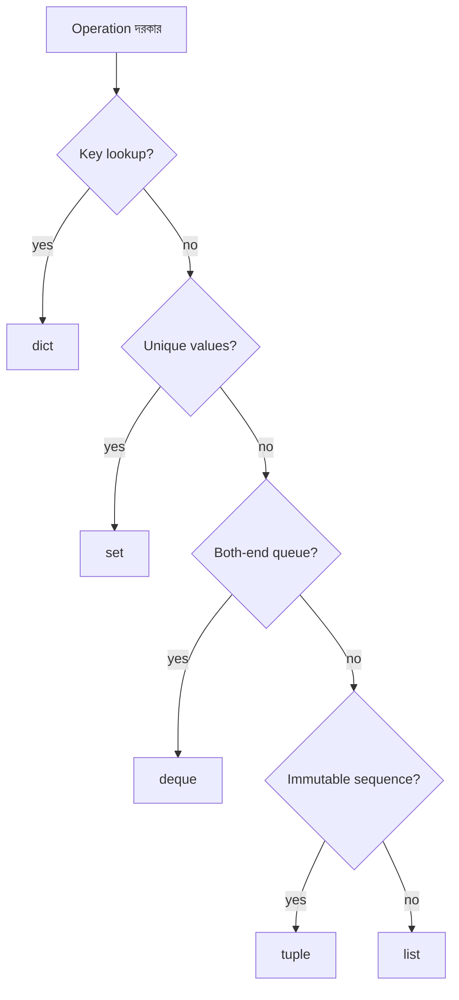

# Python Data Structures

Python-এর built-in collection-গুলো একই ধরনের কাজ করে না। সঠিক structure নির্বাচন করলে code readable হয়, performance ভালো হয় এবং accidental mutation-এর bug কমে।

## ১. List কী?

List হলো ordered, mutable sequence। একই list-এ duplicate এবং বিভিন্ন type-এর object রাখা যায়।

```python
items = ["python", "numpy", "pandas"]
items.append("pytorch")
items[0] = "Python"

print(items)
```

List mutable বলে `append`, `remove`, index assignment ইত্যাদি operation existing list object-এর state বদলায়।

সাধারণ complexity:
- Index access: O(1)
- Append: amortized O(1)
- মাঝখানে insert/delete: O(n), কারণ element shift করতে হয়
- Value search: O(n)

## ২. Tuple কী?

Tuple হলো ordered sequence, যার item binding immutable।

```python
point = (10, 20)
x, y = point
```

Tuple fixed record, coordinate, function থেকে multiple result return ইত্যাদিতে উপযোগী। Tuple-এর element reference বদলানো যায় না, কিন্তু nested mutable object-এর state বদলানো সম্ভব।

```python
data = ([1, 2], "fixed")
data[0].append(3)  # allowed: nested list mutate
# data[0] = [4, 5]  # TypeError
```

Tuple dictionary key হতে পারে শুধু তখনই, যখন এর সব element hashable।

## ৩. Set কী?

Set unique hashable element-এর collection। Duplicate element রাখা হয় না এবং membership test গড়ে O(1)।

```python
tags = {"ai", "python", "ml", "ai"}
print(tags)  # "ai" একবার থাকবে

a = {1, 2, 3}
b = {3, 4, 5}

print(a | b)  # union
print(a & b)  # intersection
print(a - b)  # difference
```

Set duplicate removal, membership check ও mathematical set operation-এ উপকারী। Set mutable; immutable variant হলো `frozenset`।

## ৪. Dictionary কী?

Dictionary হলো key-value mapping। Key hashable হতে হয়। Python 3.7+ থেকে insertion order language guarantee।

```python
user = {"id": 7, "name": "Shomi"}
user["role"] = "engineer"

print(user.get("email"))  # None
print(user.get("email", "not-provided"))
```

Dictionary mutable। Key lookup/insert/delete average case-এ O(1), কিন্তু hash collision বা pathological situation-এ worst-case বেশি হতে পারে।

## ৫. Mutable collection-এ shared reference-এর ঝুঁকি

```python
first = {"roles": ["reader"]}
second = first

second["roles"].append("admin")

print(first)  # {'roles': ['reader', 'admin']}
```

এখানে dictionary copy হয়নি। দুইটি name একই dictionary object refer করেছে। Nested list-টিও একই object।

আলাদা outer dictionary দরকার হলে:

```python
second = first.copy()
```

তবে `dict.copy()` shallow copy, nested list shared থাকবে। Nested structure-ও independent দরকার হলে `copy.deepcopy()` বিবেচনা করো।

## ৬. কোন collection কখন ব্যবহার করবে?

| প্রয়োজন | উপযুক্ত structure |
|---|---|
| Ordered, পরিবর্তনযোগ্য sequence | list |
| Fixed/immutable sequence | tuple |
| Unique values / membership | set |
| Key-value lookup | dict |
| Immutable set | frozenset |
| FIFO queue | collections.deque |

## ৭. List বনাম Set membership

```python
allowed_ids = [101, 102, 103, 104]
allowed_set = set(allowed_ids)

print(103 in allowed_ids)  # O(n)
print(103 in allowed_set)  # average O(1)
```

অনেক membership check হলে set সুবিধাজনক হতে পারে। তবে set তৈরি করার initial cost ও অতিরিক্ত memory বিবেচনা করবে।

## ৮. Stack এবং Queue

Stack: Last In, First Out (LIFO)। List-এর `append()` ও `pop()` ব্যবহার করা যায়।

Queue: First In, First Out (FIFO)। `collections.deque` ব্যবহার করা ভালো; list-এর শুরু থেকে `pop(0)` করলে O(n) সময় লাগে।

```python
from collections import deque

stack = []
stack.append("first")
stack.append("second")
print(stack.pop())  # second

queue = deque()
queue.append("first")
queue.append("second")
print(queue.popleft())  # first
```

## ৯. Dictionary দিয়ে frequency count

```python
from collections import Counter

words = ["ai", "ml", "ai", "python", "ml", "ai"]
counts = Counter(words)

print(counts)
print(counts.most_common(2))
```

## Practice

1. একটি list থেকে duplicate বাদ দিয়ে original order বজায় রাখো।
2. দুটি list-এর common element বের করো।
3. একটি sentence-এর প্রতিটি word কতবার এসেছে তা গণনা করো।
4. List ব্যবহার না করে `deque` দিয়ে queue তৈরি করো।
5. একটি list of dictionaries থেকে নির্দিষ্ট status-এর record filter করো।
6. Nested list-সহ একটি dictionary shallow copy করে mutation observe করো।
7. `set` ও `frozenset` compare করো।


---

# Review Addendum: Data structure নির্বাচন ও complexity



## অতিরিক্ত Interview Questions এবং Answers

### 1. List append সবসময় O(1) নয় কেন?

List dynamic array-এর মতো। Capacity থাকলে append constant time; capacity শেষ হলে নতুন storage allocate ও copy করতে হয়, যা O(n)। অনেক append-এর amortized cost O(1)।

### 2. Set iteration order কি application contract?

না। Set uniqueness ও membership-এর জন্য। Stable insertion order দরকার হলে dict বা ordered sequence ব্যবহার করো।

### 3. Custom object dictionary key হতে কী দরকার?

Object hashable হতে হবে এবং __hash__ ও __eq__ consistent হতে হবে। Equality-তে অংশ নেওয়া mutable state বদলালে hash stability নষ্ট হতে পারে।

### 4. defaultdict কখন get() থেকে সুবিধাজনক?

Frequency count বা grouping-এর মতো repeated initialization দরকার হলে defaultdict সুবিধাজনক। Optional lookup-এর জন্য get() যথেষ্ট।

### 5. deque কেন queue-র জন্য ভালো?

List.pop(0) বাকি element shift করে O(n); deque.popleft() সাধারণত O(1)।

## Guided Practice

deque দিয়ে enqueue, dequeue ও peek implement করো। Empty queue-তে dequeue করলে কী হবে policy ঠিক করে unit test লেখো।

### Practice workflow

1. আগে input/output contract লিখো।
2. Code লেখার আগে expected result predict করো।
3. Happy path-এর পাশাপাশি empty, invalid ও boundary input test করো।
4. Complexity, memory এবং failure behavior ব্যাখ্যা করো।
5. Notebook-এ observation ও conclusion লিখে রাখো।
