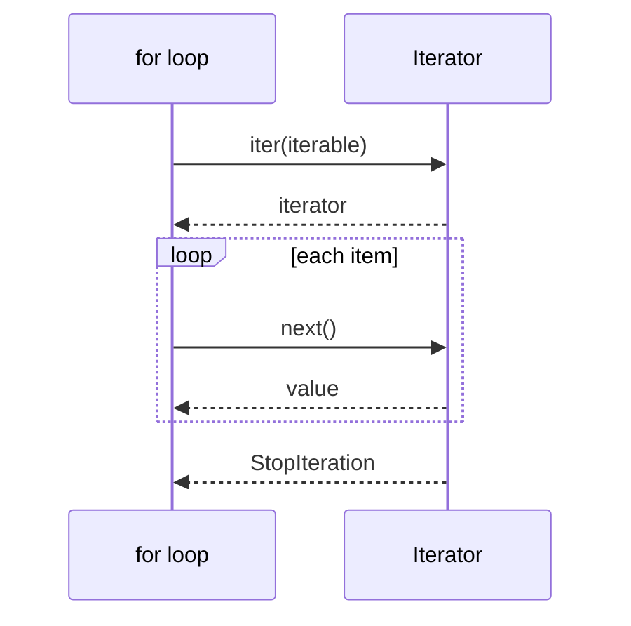

# Iterators and Generators

## ১. Iterable কী?

যে object-এর উপর `for` loop চালানো যায়, সেটি iterable। যেমন: list, tuple, string, dictionary, set এবং file object।

Iterable থেকে `iter()` ব্যবহার করে iterator পাওয়া যায়।

## ২. Iterator কী?

Iterator এমন object যা একবারে একটি item দেয় এবং যার `__next__()` method আছে। item শেষ হলে `StopIteration` raise করে।

```python
numbers = [10, 20, 30]
iterator = iter(numbers)

print(next(iterator))  # 10
print(next(iterator))  # 20
print(next(iterator))  # 30
# next(iterator)  # StopIteration
```

Iterator সাধারণত state ধরে রাখে: পরেরবার কোন item দেওয়া হবে।

## ৩. Iterable এবং Iterator-এর পার্থক্য

- Iterable থেকে iterator তৈরি করা যায়।
- Iterator নিজেই iterator এবং একে একে value দেয়।
- একটি list থেকে একাধিক independent iterator তৈরি করা যায়।
- একটি exhausted iterator আবার শুরু থেকে চলে না, যদি না নতুন iterator তৈরি করা হয়।

## ৪. Generator কী?

Generator হলো iterator তৈরির সহজ উপায়। Generator function-এ `yield` ব্যবহার করলে function call সরাসরি body execute না করে generator object return করে। প্রতিবার `next()` করলে execution আগের `yield` থেকে resume হয়।

```python
def count_up_to(limit):
    number = 1
    while number <= limit:
        yield number
        number += 1

for value in count_up_to(3):
    print(value)
```

Output: 1, 2, 3

## ৫. Generator কেন ব্যবহার করব?

Generator lazy evaluation করে: প্রয়োজন না হওয়া পর্যন্ত সব value তৈরি করে না। বড় file, stream বা বড় dataset sequentially process করতে memory সাশ্রয় হয়।

```python
def read_numbers(path):
    with open(path, encoding="utf-8") as file:
        for line in file:
            line = line.strip()
            if line:
                yield int(line)

for number in read_numbers("numbers.txt"):
    print(number)
```

এখানে পুরো file একসঙ্গে memory-তে load করা হচ্ছে না।

## ৬. List Comprehension বনাম Generator Expression

```python
squares_list = [n * n for n in range(1_000_000)]
squares_gen = (n * n for n in range(1_000_000))
```

- List comprehension সব result তৈরি করে list-এ রাখে।
- Generator expression প্রয়োজন অনুযায়ী result তৈরি করে।
- একাধিকবার iterate করতে হলে list সুবিধাজনক।
- একবার sequentially process করতে হলে generator memory-efficient হতে পারে।

## ৭. Generator কি সবসময় দ্রুত?

না। Generator memory কম ব্যবহার করতে পারে, কিন্তু per-item overhead থাকে। ছোট data-তে list কখনও দ্রুত হতে পারে। কাজের ধরন অনুযায়ী measure করতে হবে।

## ৮. `yield from` কী?

একটি generator-এর ভেতর অন্য iterable/generator-এর value সরাসরি yield করতে ব্যবহার হয়।

```python
def combined():
    yield from [1, 2]
    yield from (3, 4)

print(list(combined()))  # [1, 2, 3, 4]
```

## Interview-এ গুরুত্বপূর্ণ

- `return` function execution শেষ করে; `yield` execution pause করে।
- Generator exhausted হলে আর value দেয় না।
- Generator object সাধারণত একবারই consume করা যায়।
- Lazy processing streaming pipeline তৈরিতে উপকারী।

## Practice

1. ১ থেকে N পর্যন্ত even number yield করে এমন generator লেখো।
2. বড় CSV file line-by-line process করার generator লেখো।
3. একাধিক iterable combine করতে `yield from` ব্যবহার করো।
4. List এবং generator-এর memory usage `sys.getsizeof` দিয়ে তুলনা করো (মনে রাখবে, nested object-এর পূর্ণ memory এটি দেখায় না)।


---

# Review Addendum: Iterator protocol ও generator state



## অতিরিক্ত Interview Questions এবং Answers

### 1. iter(obj) কী করে?

Python obj-এর __iter__ protocol call করে iterator চায়। Iterator-এর __next__ পরের value দেয়; শেষ হলে StopIteration raise করে।

### 2. Iterator ও iterable একই object হতে পারে?

হ্যাঁ। Iterator সাধারণত নিজেই iterable এবং __iter__ থেকে self ফেরত দেয়। List-এর মতো reusable iterable প্রতিবার নতুন iterator দিতে পারে।

### 3. Generator function call করলেই body চলে?

না। Generator object তৈরি হয়। প্রথম next() বা iteration শুরু না হওয়া পর্যন্ত body execute হয় না।

### 4. Generator পুনরায় ব্যবহার করা যায়?

একটি generator object exhausted হলে আবার শুরু হয় না। নতুন iteration চাইলে generator function আবার call করতে হবে।

### 5. Generator close() কী করে?

close() suspended generator-এ GeneratorExit পাঠায়। finally block থাকলে cleanup করার সুযোগ পায়।

## Guided Practice

read_values, positive_only ও square_values নামে generator chain করো। বড় input process করে intermediate list ছাড়াই sum বের করো।

### Practice workflow

1. আগে input/output contract লিখো।
2. Code লেখার আগে expected result predict করো।
3. Happy path-এর পাশাপাশি empty, invalid ও boundary input test করো।
4. Complexity, memory এবং failure behavior ব্যাখ্যা করো।
5. Notebook-এ observation ও conclusion লিখে রাখো।
