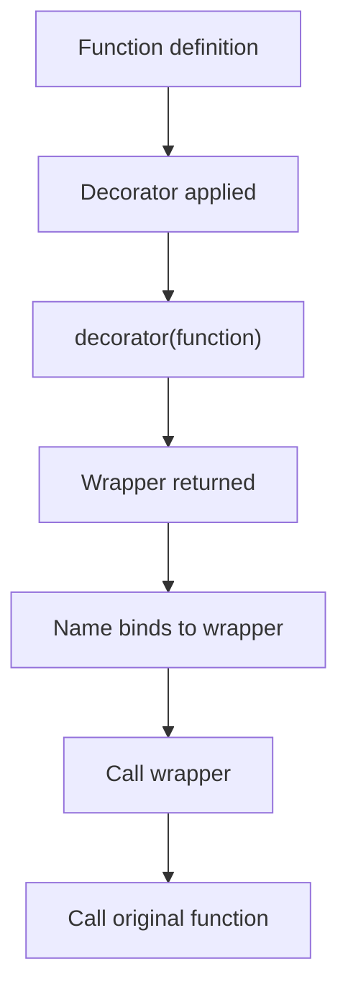

# Decorators and Context Managers

## ১. Decorator কী?

Decorator হলো এমন callable যা অন্য function বা class-কে wrap করে অতিরিক্ত behavior যোগ করে, মূল function-এর source code না বদলিয়েই।

```python
from functools import wraps

def log_call(func):
    @wraps(func)
    def wrapper(*args, **kwargs):
        print(f"Calling {func.__name__}")
        result = func(*args, **kwargs)
        print(f"Finished {func.__name__}")
        return result
    return wrapper

@log_call
def add(a, b):
    return a + b

print(add(2, 3))
```

`@log_call` মূলত `add = log_call(add)`-এর syntactic sugar।

## ২. `functools.wraps` কেন প্রয়োজন?

Wrapper function ব্যবহার করলে মূল function-এর name, docstring ইত্যাদি wrapper-এর metadata দিয়ে replace হতে পারে। `@wraps(func)` metadata preserve করতে সাহায্য করে।

## ৩. Decorator-এর বাস্তব ব্যবহার

- Logging
- Timing
- Authorization
- Caching
- Retry
- Metrics collection

```python
from functools import lru_cache

@lru_cache(maxsize=128)
def fibonacci(n):
    if n < 2:
        return n
    return fibonacci(n - 1) + fibonacci(n - 2)

print(fibonacci(30))
```

Cache কেবল তখনই নিরাপদ যখন function-এর result তার arguments-এর উপর নির্ভরশীল এবং hidden side effect নেই।

## ৪. Decorator with arguments

```python
from functools import wraps

def repeat(times):
    def decorator(func):
        @wraps(func)
        def wrapper(*args, **kwargs):
            result = None
            for _ in range(times):
                result = func(*args, **kwargs)
            return result
        return wrapper
    return decorator

@repeat(3)
def say_hi():
    print("Hi")

say_hi()
```

এখানে outer function decorator configuration গ্রহণ করে।

## ৫. Context Manager কী?

Context Manager resource ব্যবহারের lifecycle manage করে। `with` block শুরু ও শেষ হওয়ার সময় setup এবং cleanup নিশ্চিত করতে সাহায্য করে, exception হলেও cleanup হয়।

```python
with open("notes.txt", "w", encoding="utf-8") as file:
    file.write("Hello")
```

File block থেকে বের হলে close হয়।

## ৬. Context Manager কীভাবে কাজ করে?

একটি class-based context manager সাধারণত `__enter__()` এবং `__exit__()` implement করে।

```python
class ManagedResource:
    def __enter__(self):
        print("Acquire resource")
        return self

    def __exit__(self, exc_type, exc_value, traceback):
        print("Release resource")
        return False  # exception suppress করবে না

with ManagedResource():
    print("Use resource")
```

`__exit__`-এ exception information দেওয়া হয়। True return করলে exception suppress হয়; সাধারণত False/None return করলে exception propagate করে।

## ৭. `contextlib.contextmanager` দিয়ে Context Manager

```python
from contextlib import contextmanager

@contextmanager
def managed_connection():
    print("Open connection")
    try:
        yield "connection"
    finally:
        print("Close connection")

with managed_connection() as connection:
    print("Using", connection)
```

## ৮. AI Engineering-এ কোথায় কাজে লাগবে?

- File processing
- Database transaction/session lifecycle
- Temporary resource management
- Timing বা tracing decorator
- API call retry policy
- Cache decorator

## Practice

1. Function execution time মাপে এমন decorator লেখো।
2. একটি decorator লেখো যা function call count করে।
3. Context Manager দিয়ে temporary file তৈরি করে শেষে delete করো।
4. Exception ঘটলেও cleanup হচ্ছে কি না পরীক্ষা করো।


---

# Review Addendum: Decorator ও Context Manager execution flow



## অতিরিক্ত Interview Questions এবং Answers

### 1. Decorator কীভাবে কাজ করে?

Decorator original function-কে argument হিসেবে নেয় এবং নতুন callable ফেরত দেয়। Logging, authorization, timing, caching বা metrics যোগ করা যায়।

### 2. functools.wraps না দিলে কী সমস্যা?

Wrapper-এর name, docstring ও metadata original function-এর বদলে wrapper-এর হয়ে যায়। Debugging ও framework introspection বিভ্রান্ত হতে পারে।

### 3. Decorator order গুরুত্বপূর্ণ কেন?

একাধিক decorator nestedভাবে apply হয়। Order বদলালে wrapper composition ও behavior বদলে যায়।

### 4. Async function-এর decorator কেমন হবে?

Wrapper-টিও async হতে হবে এবং original coroutine-কে await করতে হবে।

### 5. __exit__ exception কখন suppress করে?

Truthy return করলে suppress করে। False বা None হলে exception propagate করে।

## Guided Practice

elapsed time ও call count track করা decorator লেখো। Context manager দিয়ে temporary directory তৈরি করো এবং exception হলেও cleanup test করো।

### Practice workflow

1. আগে input/output contract লিখো।
2. Code লেখার আগে expected result predict করো।
3. Happy path-এর পাশাপাশি empty, invalid ও boundary input test করো।
4. Complexity, memory এবং failure behavior ব্যাখ্যা করো।
5. Notebook-এ observation ও conclusion লিখে রাখো।
