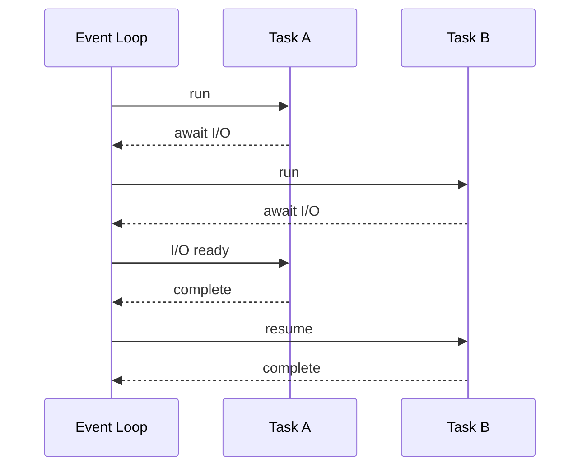

# Asyncio and Concurrency

## ১. Concurrency এবং Parallelism কী?

- **Concurrency:** একাধিক কাজের progress এমনভাবে manage করা, যাতে তাদের execution overlap করতে পারে।
- **Parallelism:** একাধিক কাজ একই সময়ে একাধিক execution unit-এ চলা।

Concurrency মানেই parallel execution নয়।

## ২. I/O-bound এবং CPU-bound কাজ

**I/O-bound:** network request, database query, file বা external service-এর response-এর জন্য অপেক্ষা বেশি।

**CPU-bound:** বড় numerical computation, image processing, compression বা heavy calculation।

Asyncio সাধারণত I/O-bound কাজের concurrency-তে উপকারী। CPU-bound Python code-কে শুধু `async` করলেই দ্রুত parallel হয় না।

## ৩. Coroutine কী?

`async def` দিয়ে coroutine function তৈরি হয়। Call করলে coroutine object পাওয়া যায়; execute করতে সাধারণত `await` বা event loop প্রয়োজন।

```python
import asyncio

async def greet():
    await asyncio.sleep(1)
    return "Hello"

async def main():
    message = await greet()
    print(message)

asyncio.run(main())
```

## ৪. Event Loop কী?

Event loop coroutine ও asynchronous I/O operation schedule এবং resume করে। একটি coroutine `await` করে অপেক্ষায় গেলে event loop অন্য ready task চালাতে পারে।

## ৫. Sequential বনাম Concurrent I/O

```python
import asyncio
import time

async def fetch(name: str) -> str:
    await asyncio.sleep(1)  # network I/O-এর placeholder
    return f"{name} done"

async def main():
    start = time.perf_counter()

    results = await asyncio.gather(
        fetch("service-a"),
        fetch("service-b"),
        fetch("service-c"),
    )

    print(results)
    print(f"Elapsed: {time.perf_counter() - start:.2f}s")

asyncio.run(main())
```

তিনটি operation প্রায় একই সময়ে শুরু হয়। বাস্তব network call-এ অবশ্য timeout, retry এবং concurrency limit প্রয়োজন।

## ৬. `asyncio.gather` কী?

একাধিক awaitable একসঙ্গে schedule করে result collection করতে পারে। Default behavior-এ একটি awaitable exception raise করলে gather সেই exception propagate করে; অন্য task-গুলো সবসময় স্বয়ংক্রিয়ভাবে cancel হয়ে যায়, এমন ধরে নেওয়া যাবে না।

## ৭. Semaphore কেন প্রয়োজন?

একসঙ্গে কতগুলো operation চলবে তা সীমিত করতে semaphore ব্যবহার করা যায়।

```python
import asyncio

semaphore = asyncio.Semaphore(5)

async def limited_request(item: int):
    async with semaphore:
        await asyncio.sleep(0.2)
        return item * 2
```

এটি external API rate limit বা resource capacity মানতে সাহায্য করতে পারে।

## ৮. Threading, Multiprocessing এবং Asyncio

| পদ্ধতি | উপযোগী ক্ষেত্র |
|---|---|
| asyncio | cooperative I/O concurrency |
| threading | blocking I/O ও thread-based integration |
| multiprocessing | CPU-bound parallel work |

CPython-এর GIL সাধারণ Python bytecode এক interpreter-এ একাধিক thread দিয়ে একই সময়ে execute হওয়া সীমিত করে। তবে I/O wait বা কিছু native extension-এ thread কার্যকর হতে পারে। Python version ও build অনুযায়ী GIL-এর আচরণে পার্থক্য থাকতে পারে।

## ৯. Common Mistakes

- Async function-কে await না করা।
- Async code-এর ভেতরে দীর্ঘ blocking call চালানো।
- সীমাহীন task তৈরি করা।
- Timeout না রাখা।
- Exception ও cancellation handle না করা।

## ১০. Timeout example

```python
import asyncio

async def slow_operation():
    await asyncio.sleep(5)

async def main():
    try:
        await asyncio.wait_for(slow_operation(), timeout=1)
    except TimeoutError:
        print("Operation timed out")

asyncio.run(main())
```

## Interview-এ মনে রাখবে

- `async`/ `await` concurrency API, automatic parallelism নয়।
- Event loop cooperative scheduling করে।
- Blocking function event loop আটকে দিতে পারে।
- Production integration-এ timeout, cancellation, retry ও concurrency limit গুরুত্বপূর্ণ।

## Practice

1. তিনটি simulated API call concurrently চালাও।
2. Semaphore দিয়ে concurrency ৩-এ সীমিত করো।
3. একটি task-এ timeout যোগ করো।
4. একই কাজ sequential ও concurrent করে elapsed time তুলনা করো।


---

# Review Addendum: Asyncio scheduling ও concurrency



## অতিরিক্ত Interview Questions এবং Answers

### 1. async def call করলেই execute হয়?

না। Coroutine object তৈরি হয়। await বা task scheduling দরকার।

### 2. create_task কী করে?

Coroutine-কে event loop-এ schedule করে Task object ফেরত দেয়। Task-এর result ও exception retrieve করতে হবে।

### 3. gather ও TaskGroup-এর পার্থক্য?

দুটিই concurrent awaitable চালায়। TaskGroup structured concurrency দেয় এবং child task lifecycle scope-এর মধ্যে রাখে। TaskGroup Python 3.11+ এ আছে।

### 4. Cancellation কীভাবে কাজ করে?

Task-এ cancellation exception inject হয়। finally দিয়ে cleanup করো এবং cancellation অযথা swallow করো না।

### 5. Asyncio কি CPU-bound task দ্রুত করে?

না। CPU-heavy কাজ event loop block করতে পারে। Process pool বা native/vectorized code বিবেচনা করো।

## Guided Practice

২০টি simulated API call চালাও। Semaphore(4) দিয়ে active call চারটির বেশি হতে দিও না। Counter দিয়ে limit prove করো; timeout ও cancellation test করো।

### Practice workflow

1. আগে input/output contract লিখো।
2. Code লেখার আগে expected result predict করো।
3. Happy path-এর পাশাপাশি empty, invalid ও boundary input test করো।
4. Complexity, memory এবং failure behavior ব্যাখ্যা করো।
5. Notebook-এ observation ও conclusion লিখে রাখো।
