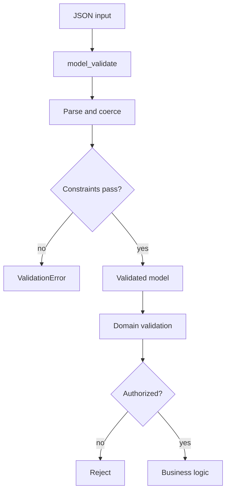

# Pydantic

## ১. Pydantic কী?

Pydantic Python type hints ব্যবহার করে data parsing ও runtime validation করার library। API request body, configuration এবং external JSON payload validate করতে এটি খুব উপকারী।

## ২. Basic Model

```python
from pydantic import BaseModel, EmailStr, Field

class UserCreate(BaseModel):
    name: str = Field(min_length=2, max_length=80)
    age: int = Field(ge=18, le=120)
    email: EmailStr

user = UserCreate(
    name="Shomi Khan",
    age=32,
    email="shomi@example.com",
)

print(user.name)
print(user.model_dump())
```

Email validation-এর জন্য environment-এ `email-validator` dependency প্রয়োজন হতে পারে।

## ৩. Invalid Data

```python
from pydantic import ValidationError

try:
    UserCreate(name="A", age=12, email="invalid")
except ValidationError as error:
    print(error)
```

Pydantic field constraints পরীক্ষা করে এবং validation error-এ কোন field-এ সমস্যা হয়েছে তা জানায়।

## ৪. Serialization এবং Deserialization

```python
payload = {
    "name": "Shomi Khan",
    "age": 32,
    "email": "shomi@example.com",
}

user = UserCreate.model_validate(payload)
json_text = user.model_dump_json()
restored = UserCreate.model_validate_json(json_text)
```

- `model_validate`: Python object/dictionary থেকে model তৈরি।
- `model_validate_json`: JSON string/bytes থেকে model তৈরি।
- `model_dump`: Python dictionary তৈরি।
- `model_dump_json`: JSON string তৈরি।

## ৫. Field default এবং Optional

```python
from pydantic import BaseModel, Field

class SearchRequest(BaseModel):
    query: str
    limit: int = Field(default=10, ge=1, le=100)
    cursor: str | None = None
```

এখানে `limit` না দিলে ১০ হবে এবং `cursor` না দিলে None হবে।

## ৬. Custom Validator

```python
from pydantic import BaseModel, field_validator

class Product(BaseModel):
    sku: str

    @field_validator("sku")
    @classmethod
    def normalize_sku(cls, value: str) -> str:
        value = value.strip().upper()
        if not value:
            raise ValueError("sku cannot be empty")
        return value
```

## ৭. Pydantic কি security boundary?

Pydantic input shape ও constraints validate করতে সাহায্য করে, কিন্তু authorization, business permission, SQL injection protection বা arbitrary payload-এর সব semantic risk নিজে থেকে সমাধান করে না। Validation-এর পাশাপাশি domain rule ও authorization আলাদাভাবে implement করতে হবে।

## ৮. FastAPI-তে ব্যবহার

FastAPI Pydantic model ব্যবহার করে request body validation ও OpenAPI schema তৈরি করতে পারে।

```python
from fastapi import FastAPI
from pydantic import BaseModel

app = FastAPI()

class PromptRequest(BaseModel):
    prompt: str
    max_tokens: int = 200

@app.post("/generate")
async def generate(request: PromptRequest):
    return {"received": request.prompt}
```

## Interview Questions

1. Pydantic কী সমস্যা সমাধান করে?
2. Type Hints এবং runtime validation-এর পার্থক্য কী?
3. `model_dump()` ও `model_dump_json()`-এর পার্থক্য কী?
4. Field validator কেন ব্যবহার করা হয়?
5. Pydantic validation কি authorization-এর বিকল্প?

## Practice

1. AI chat request-এর জন্য Pydantic model তৈরি করো।
2. `max_tokens` ১ থেকে ২০০০-এর মধ্যে সীমাবদ্ধ করো।
3. Empty prompt reject করো।
4. Model-কে dictionary ও JSON-এ serialize/deserialize করো।


---

# Review Addendum: Pydantic validation pipeline



## অতিরিক্ত Interview Questions এবং Answers

### 1. Pydantic ও dataclass-এর পার্থক্য?

Dataclass data container boilerplate কমায়। Pydantic parsing, coercion, validation ও serialization দেয়। Untrusted input boundary-তে Pydantic উপযোগী।

### 2. Pydantic কি সব input strict reject করে?

না। অনেক ক্ষেত্রে coercion করতে পারে। Strict behavior চাইলে strict configuration বা strict field ব্যবহার করো।

### 3. Optional type এবং optional field কি একই?

Type-এ None allow করা আর field omit করা আলাদা। Pydantic v2-এ field: str | None required হতে পারে, কিন্তু None value গ্রহণ করে।

### 4. field_validator ও model_validator কখন?

একটি field normalize/check করতে field_validator; একাধিক field-এর relationship যাচাই করতে model_validator।

### 5. Pydantic SQL injection আটকায়?

না। Query parameterization, authorization ও safe SQL construction আলাদা দায়িত্ব।

## Guided Practice

PredictionRequest ও PredictionResult model বানাও। features non-empty, confidence 0..1, label নির্দিষ্ট Literal values-এর একটি। Valid ও invalid payload পরীক্ষা করো।

### Practice workflow

1. আগে input/output contract লিখো।
2. Code লেখার আগে expected result predict করো।
3. Happy path-এর পাশাপাশি empty, invalid ও boundary input test করো।
4. Complexity, memory এবং failure behavior ব্যাখ্যা করো।
5. Notebook-এ observation ও conclusion লিখে রাখো।
