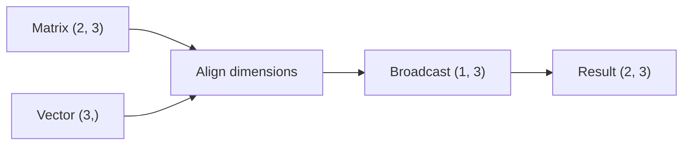

# NumPy

## ১. NumPy কী?

NumPy Python-এর numerical computing library। এর প্রধান data structure হলো homogeneous, N-dimensional `ndarray`। Matrix operation, numerical transformation এবং ML data preparation-এ এটি বহুল ব্যবহৃত।

## ২. Array তৈরি

```python
import numpy as np

a = np.array([1, 2, 3])
matrix = np.array([[1, 2], [3, 4]])

print(a)
print(matrix)
```

## ৩. Shape, Dimension এবং Data Type

```python
x = np.array([[1, 2, 3], [4, 5, 6]])

print(x.shape)  # (2, 3)
print(x.ndim)   # 2
print(x.size)   # 6
print(x.dtype)  # integer dtype
```

- `shape`: প্রতিটি dimension-এর size।
- `ndim`: dimension সংখ্যা।
- `size`: মোট element।
- `dtype`: element-এর data type।

## ৪. Indexing এবং Slicing

```python
x = np.array([[10, 20, 30], [40, 50, 60]])

print(x[0, 1])   # 20
print(x[:, 1])   # দ্বিতীয় column
print(x[1, :2])  # দ্বিতীয় row-এর প্রথম দুইটি item
```

Basic slicing প্রায়ই view দেয়, copy নয়। তাই slice পরিবর্তন করলে original array-ও পরিবর্তিত হতে পারে।

## ৫. Vectorization কী?

Python loop দিয়ে প্রতিটি element process করার বদলে NumPy array operation ব্যবহার করে পুরো array-এর উপর operation করা যায়। এতে Python-level loop কমে এবং optimized native implementation কাজে লাগে।

```python
prices = np.array([100, 200, 300])
discounted = prices * 0.9
print(discounted)
```

## ৬. Broadcasting কী?

Broadcasting হলো compatible shape-এর array-এর মধ্যে operation করার নিয়ম, যেখানে ছোট shape-এর array-কে conceptually বড় shape-এর সঙ্গে align করা হয়।

```python
matrix = np.array([
    [1, 2, 3],
    [4, 5, 6],
])

bias = np.array([10, 20, 30])
print(matrix + bias)
```

শেষ dimension-এর size সমান অথবা কোনো dimension-এর size 1 হলে broadcasting সম্ভব হতে পারে।

## ৭. Aggregation

```python
scores = np.array([[80, 90], [70, 85]])

print(scores.mean())
print(scores.mean(axis=0))  # column-wise
print(scores.mean(axis=1))  # row-wise
print(scores.max())
print(scores.sum())
```

Axis বুঝতে হবে: 2D array-তে `axis=0` row direction collapse করে column-wise result দেয়; `axis=1` column direction collapse করে row-wise result দেয়।

## ৮. Reshape

```python
values = np.arange(12)
matrix = values.reshape(3, 4)
print(matrix)
```

Reshape করতে element count একই থাকতে হবে।

## ৯. Matrix Multiplication

```python
a = np.array([[1, 2], [3, 4]])
b = np.array([[5, 6], [7, 8]])

print(a @ b)
# অথবা np.matmul(a, b)
```

Element-wise multiplication-এর জন্য `a * b`; matrix multiplication-এর জন্য `a @ b`।

## ১০. Random Data এবং Reproducibility

```python
rng = np.random.default_rng(seed=42)
samples = rng.normal(loc=0, scale=1, size=5)
print(samples)
```

Seed নির্দিষ্ট করলে একই environment/version-এ reproducible workflow সহজ হয়।

## ১১. Python List বনাম NumPy Array

| বিষয় | Python List | NumPy Array |
|---|---|---|
| Data type | বিভিন্ন type থাকতে পারে | সাধারণত এক dtype |
| Numerical operation | loop বা comprehension | vectorized operation |
| Multidimensional data | nested list | native N-D array |
| Memory layout | object reference | compact typed storage |
| Use case | general collection | numerical computation |

NumPy সব ক্ষেত্রে list-এর চেয়ে দ্রুত নয়; operation, data size এবং conversion cost গুরুত্বপূর্ণ।

## ১২. AI/ML-এ NumPy কেন গুরুত্বপূর্ণ?

- Dataset numerical array-এ represent করা।
- Feature scaling ও transformation।
- Matrix ও vector operation।
- Model-এর input/output process করা।
- Statistical calculation।

## Practice

1. ১ থেকে ২০ পর্যন্ত integer-এর array তৈরি করো।
2. সব element-এর mean, median ও standard deviation বের করো।
3. একটি ৩x৩ matrix তৈরি করে row-wise ও column-wise sum বের করো।
4. Broadcasting দিয়ে প্রতিটি row-তে bias যোগ করো।
5. দুইটি compatible matrix multiply করো।
6. List loop এবং NumPy vectorization-এর execution time তুলনা করো।


---

# Review Addendum: NumPy ndarray ও shape reasoning



## অতিরিক্ত Interview Questions এবং Answers

### 1. shape, ndim, size?

shape প্রতিটি axis-এর length tuple; ndim axis count; size মোট element count। (2,3,4) shape হলে ndim 3, size 24।

### 2. reshape কি সবসময় copy?

না। সম্ভব হলে view দেয়; layout-এর কারণে copy লাগতে পারে। shares_memory দিয়ে পরীক্ষা করা যায়।

### 3. axis=0 কেন column-wise result দেয়?

Reduction-এ axis 0 collapse হয়, তাই প্রতিটি column-এর aggregation থাকে। axis=1 collapse করলে row-wise result হয়।

### 4. * এবং @?

* element-wise multiplication; @ matrix multiplication। Shape compatibility জরুরি।

### 5. Vectorization-এর trade-off?

Python loop overhead কমায়, কিন্তু intermediate array memory বাড়াতে পারে। Workload benchmark করো।

## Guided Practice

(100, 4) feature matrix ও (4, 2) weight matrix নিয়ে X @ W করো। প্রতিটি operation-এর output shape আগে predict করো, পরে verify করো।

### Practice workflow

1. আগে input/output contract লিখো।
2. Code লেখার আগে expected result predict করো।
3. Happy path-এর পাশাপাশি empty, invalid ও boundary input test করো।
4. Complexity, memory এবং failure behavior ব্যাখ্যা করো।
5. Notebook-এ observation ও conclusion লিখে রাখো।
