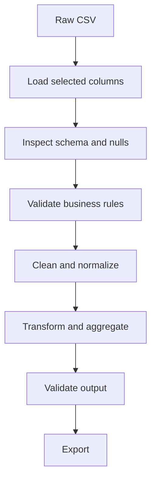

# Pandas

## ১. Pandas কী?

Pandas হলো Python-এর data analysis ও manipulation library। Tabular data load, inspect, clean, transform, join, group ও aggregate করতে এটি ব্যবহৃত হয়।

দুটি মূল data structure:

- **Series:** এক-dimensional labeled array।
- **DataFrame:** দুই-dimensional labeled table।

## ২. CSV load এবং inspect

```python
import pandas as pd

df = pd.read_csv("transactions.csv")

print(df.head())
print(df.tail())
print(df.shape)
print(df.columns)
print(df.dtypes)
print(df.info())
print(df.describe(include="all"))
```

## ৩. Column select এবং row filter

```python
amounts = df["amount"]
subset = df[["customer_id", "amount"]]

large_transactions = df[df["amount"] > 1000]
successful = df[df["status"] == "success"]
```

একাধিক condition-এ `&` এবং `|` ব্যবহার করতে হবে; প্রতিটি condition parentheses-এ রাখবে।

```python
filtered = df[(df["amount"] > 1000) & (df["status"] == "success")]
```

## ৪. Missing Values

```python
print(df.isna().sum())

df["amount"] = df["amount"].fillna(0)
df = df.dropna(subset=["customer_id"])
```

Missing value fill বা drop করার আগে কেন missing হয়েছে এবং business meaning কী, তা বুঝতে হবে। Blindly zero fill করলে ভুল analysis হতে পারে।

## ৫. Duplicate Record

```python
print(df.duplicated().sum())
df = df.drop_duplicates()
```

কোন columns ধরে duplicate নির্ধারণ করবে তা স্পষ্ট করা যায়:

```python
df = df.drop_duplicates(subset=["transaction_id"], keep="last")
```

## ৬. Data Type Conversion

```python
df["amount"] = pd.to_numeric(df["amount"], errors="coerce")
df["created_at"] = pd.to_datetime(df["created_at"], errors="coerce")
```

`errors="coerce"` invalid value-কে missing value-তে রূপান্তর করে। পরে সেগুলো inspect করতে হবে।

## ৭. GroupBy এবং Aggregation

```python
summary = (
    df.groupby("status")["amount"]
      .agg(["count", "sum", "mean", "max"])
      .reset_index()
)
print(summary)
```

এটি split-apply-combine pattern: group তৈরি, প্রতিটি group-এ calculation, তারপর result combine।

## ৮. একাধিক column aggregate

```python
summary = df.groupby("customer_id").agg(
    transaction_count=("transaction_id", "count"),
    total_amount=("amount", "sum"),
    average_amount=("amount", "mean"),
)
```

## ৯. Sorting

```python
top_customers = summary.sort_values(
    "total_amount",
    ascending=False
).head(10)
```

## ১০. Merge / Join

```python
transactions = pd.DataFrame({
    "customer_id": [1, 2],
    "amount": [100, 200],
})

customers = pd.DataFrame({
    "customer_id": [1, 2],
    "name": ["A", "B"],
})

result = transactions.merge(customers, on="customer_id", how="left")
```

Common join types: `inner`, `left`, `right`, `outer`।

## ১১. Apply বনাম Vectorized Operation

সম্ভব হলে built-in vectorized operation ব্যবহার করো। Row-by-row `apply(axis=1)` অনেক ক্ষেত্রে ধীর হতে পারে।

```python
# Vectorized
df["amount_with_tax"] = df["amount"] * 1.15

# তুলনামূলকভাবে সাধারণত ধীর
# df["amount_with_tax"] = df.apply(
#     lambda row: row["amount"] * 1.15, axis=1
# )
```

## ১২. CSV এবং JSON export

```python
df.to_csv("cleaned.csv", index=False)
df.to_json("cleaned.json", orient="records", indent=2)
```

## ১৩. বড় Dataset-এর ক্ষেত্রে

- অপ্রয়োজনীয় column load করবে না (`usecols`)।
- উপযুক্ত `dtype` ব্যবহার করবে।
- বড় CSV chunk করে পড়বে (`chunksize`)।
- সম্ভব হলে vectorized operation ব্যবহার করবে।
- Data size বড় হলে database query, Parquet বা distributed processing tool বিবেচনা করবে।

```python
for chunk in pd.read_csv("large.csv", chunksize=50_000):
    successful = chunk[chunk["status"] == "success"]
    print(successful["amount"].sum())
```

## ১৪. AI/ML workflow-এ Pandas

- Raw dataset inspect করা।
- Missing ও invalid data handle করা।
- Feature তৈরি করা।
- Label distribution দেখা।
- Group-wise analysis করা।
- Model training-এর আগে data প্রস্তুত করা।

## Practice

একটি transaction CSV-তে নিচের কাজ করো:

1. Dataset load ও inspect।
2. Duplicate transaction remove।
3. Missing `customer_id` বাদ।
4. `amount` numeric-এ convert।
5. Invalid amount identify।
6. Successful transaction filter।
7. Customer-wise total amount ও count বের করো।
8. Top 10 customer বের করো।
9. Monthly transaction summary তৈরি করো।
10. Cleaned data CSV-তে export করো।


---

# Review Addendum: Pandas data quality pipeline



## অতিরিক্ত Interview Questions এবং Answers

### 1. loc ও iloc?

loc label-based; iloc integer-position-based। Integer index থাকলেও loc label বোঝে।

### 2. SettingWithCopyWarning কেন?

Chained assignment-এ view নাকি copy ambiguous হতে পারে। স্পষ্ট .loc assignment এবং প্রয়োজনমতো .copy() ব্যবহার করো।

### 3. merge(validate=...) কেন?

Expected one-to-one বা many-to-one cardinality enforce করে। Duplicate key থাকলে silent row explosion-এর বদলে error পাওয়া যায়।

### 4. apply(axis=1) কেন ধীর?

Python-level row iteration overhead থাকে। Built-in vectorized operation বা groupby aggregation সাধারণত ভালো।

### 5. Imputation-এর আগে কী ভাববে?

Missing কেন, distribution কী, bias তৈরি হচ্ছে কি না, train/test leakage হচ্ছে কি না। Imputer train data-তে fit করে test data-তে transform করো।

## Guided Practice

Duplicate ID, missing customer, invalid amount ও malformed date-সহ DataFrame তৈরি করো। Cleaning rule apply করে accepted + rejected row count reconcile করো।

### Practice workflow

1. আগে input/output contract লিখো।
2. Code লেখার আগে expected result predict করো।
3. Happy path-এর পাশাপাশি empty, invalid ও boundary input test করো।
4. Complexity, memory এবং failure behavior ব্যাখ্যা করো।
5. Notebook-এ observation ও conclusion লিখে রাখো।
