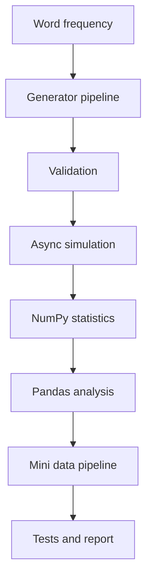

# Day 1 Practical Exercises

এই exercise-গুলো Day 1-এর concept একত্রে ব্যবহার করার জন্য। আগে নিজে চেষ্টা করবে, তারপর reference solution দেখবে।

## Exercise 1: Word Frequency

একটি sentence থেকে প্রতিটি word কতবার এসেছে বের করো।

Requirements:
- Case-insensitive হবে।
- Punctuation সরাবে।
- সবচেয়ে বেশি ব্যবহৃত ৩টি word দেখাবে।

Hint: `str.lower()`, `re`, `collections.Counter`।

## Exercise 2: Generator Pipeline

একটি generator তৈরি করো যা file থেকে line পড়ে:
1. Empty line বাদ দেবে।
2. Integer parse করবে।
3. শুধু positive number yield করবে।

Invalid integer-এর ক্ষেত্রে কী করবে, তা নিজে নির্ধারণ করে implement করো।

## Exercise 3: Timing Decorator

একটি decorator লেখো যা function কত সময় নিয়েছে তা print করবে। `time.perf_counter()` ব্যবহার করো। `functools.wraps` যোগ করো।

## Exercise 4: Pydantic Request Model

একটি `PredictionRequest` model তৈরি করো:

- `features: list[float]`
- `model_name: str`
- `request_id: str`
- features খালি হতে পারবে না।
- model_name empty হতে পারবে না।

Invalid input দিয়ে validation test করো।

## Exercise 5: Async API Simulation

তিনটি async function লেখো, প্রতিটি আলাদা service-এর response simulate করবে। `asyncio.gather` দিয়ে concurrently চালাও। এরপর semaphore দিয়ে concurrency limit ২ করো।

## Exercise 6: NumPy Statistics

একটি 2D array তৈরি করো যেখানে row হলো student এবং column হলো subject। বের করো:

- প্রতিটি student-এর average।
- প্রতিটি subject-এর average।
- সর্বোচ্চ score।
- ৮০-এর বেশি score-এর count।

## Exercise 7: Pandas Transaction Analysis

নিচের sample data ব্যবহার করো:

```python
import pandas as pd

df = pd.DataFrame([
    {"id": 1, "customer": "A", "amount": 100, "status": "success", "month": "2026-01"},
    {"id": 2, "customer": "B", "amount": 250, "status": "failed",  "month": "2026-01"},
    {"id": 3, "customer": "A", "amount": 300, "status": "success", "month": "2026-02"},
    {"id": 4, "customer": "C", "amount": 150, "status": "success", "month": "2026-02"},
    {"id": 5, "customer": "B", "amount": 400, "status": "success", "month": "2026-02"},
])
```

Tasks:
1. Successful transaction filter করো।
2. Customer-wise total amount বের করো।
3. Month-wise total amount বের করো।
4. সবচেয়ে বেশি revenue করা customer বের করো।
5. Summary CSV export করো।

## Exercise 8: Mini Data Pipeline

একটি ছোট pipeline তৈরি করো:

```text
CSV file
   |
   v
Pandas Load
   |
   v
Data Validation
   |
   v
Clean / Transform
   |
   v
NumPy Statistics
   |
   v
Summary JSON
```

Requirements:
- Function ছোট ও single-purpose রাখবে।
- Type hints ব্যবহার করবে।
- Invalid input-এর জন্য meaningful exception দেবে।
- Logging যোগ করতে পারো।
- একই input দিলে deterministic result হবে।

## Self-review checklist

- [ ] Code নিজে লিখেছি, শুধু copy করিনি।
- [ ] Empty input handle করেছি।
- [ ] Invalid data handle করেছি।
- [ ] Function-এ type hints দিয়েছি।
- [ ] প্রয়োজনীয় জায়গায় exception handle করেছি।
- [ ] বড় input হলে memory impact ভেবেছি।
- [ ] অন্তত একটি test লিখেছি।


---

# Review Addendum: Exercise acceptance criteria ও pipeline



## অতিরিক্ত Interview Questions এবং Answers

### 1. কেন exercise-এ acceptance criteria দরকার?

শুধু code run হওয়া যথেষ্ট নয়। Input/output contract, edge case, deterministic behavior এবং test থাকলে completion যাচাই করা যায়।

### 2. Invalid row silently drop করা উচিত?

না। Business policy অনুযায়ী reject বা repair করতে হবে এবং rejected row-এর কারণ report করতে হবে।

### 3. একটি mini pipeline কীভাবে test করবে?

Happy path, empty input, malformed schema, duplicate record, invalid values এবং deterministic output পরীক্ষা করবে।

### 4. Pipeline function ছোট রাখবে কেন?

Single responsibility থাকলে test, debug ও reuse সহজ হয়। Loader, validator, transformer এবং aggregator আলাদা রাখা যায়।

## Guided Practice

Word frequency থেকে শুরু করে generator, validation, async, NumPy, Pandas হয়ে mini pipeline পর্যন্ত ধাপে ধাপে implement করো। অন্তত পাঁচটি automated test লিখো।

### Practice workflow

1. আগে input/output contract লিখো।
2. Code লেখার আগে expected result predict করো।
3. Happy path-এর পাশাপাশি empty, invalid ও boundary input test করো।
4. Complexity, memory এবং failure behavior ব্যাখ্যা করো।
5. Notebook-এ observation ও conclusion লিখে রাখো।
