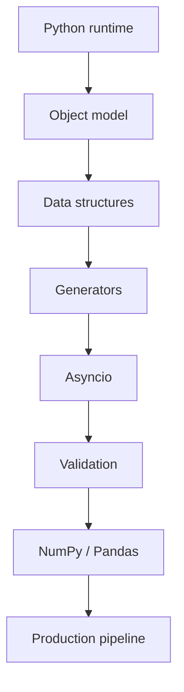

# Day 1 Interview Questions and Detailed Answers

এই প্রশ্নগুলো definition মুখস্থ করার জন্য নয়। Interview-তে concept, execution model, practical consequence এবং trade-off ব্যাখ্যা করতে পারা জরুরি।

## Python Fundamentals and Execution Model

### ১. Python কি interpreted language, নাকি compiled language?

সাধারণভাবে Python-কে interpreted language বলা হয়। কিন্তু প্রচলিত CPython implementation source code-কে bytecode-এ compile করে এবং Python Virtual Machine সেই bytecode execute করে। তাই CPython-এর ক্ষেত্রে compilation ও interpretation দুটোই ঘটে।

C-এর মতো traditional compiled workflow-তে compiler native machine code তৈরি করতে পারে, যা CPU সরাসরি execute করে। CPython-এর সাধারণ workflow-তে bytecode তৈরি হয়, যা CPython runtime execute করে। অন্য Python implementation যেমন PyPy JIT compilation ব্যবহার করতে পারে। তাই উত্তর দেওয়ার সময় language এবং implementation আলাদা করে বলা উচিত।

### ২. CPython কী?

CPython হলো Python language-এর সবচেয়ে প্রচলিত implementation, যা C দিয়ে লেখা। এটি source code parse ও compile করে bytecode তৈরি করে, runtime-এ সেই bytecode execute করে এবং Python object, memory management, exception ও native extension integration পরিচালনা করে।

Python language হলো specification/semantics; CPython হলো সেই language চালানোর একটি implementation। PyPy আরেকটি implementation।

### ৩. Python code execute হওয়ার ধাপগুলো কী?

CPython-এর সাধারণ flow:

1. Source code read করা হয়।
2. Lexer source-কে token-এ ভাগ করে।
3. Parser token থেকে AST তৈরি করে।
4. Compiler AST থেকে bytecode তৈরি করে।
5. CPython virtual machine bytecode execute করে।
6. Runtime প্রয়োজনমতো OS ও native library-এর সঙ্গে কাজ করে।

এই flow বোঝার জন্য `ast` এবং `dis` module ব্যবহার করা যায়।

```python
import ast
import dis

source = "def add(a, b):\n    return a + b"
print(ast.dump(ast.parse(source), indent=2))

namespace = {}
exec(source, namespace)
dis.dis(namespace["add"])
```

### ৪. Bytecode কী? এটি কি machine code?

Bytecode হলো Python VM-এর জন্য intermediate instruction। এটি CPU-র native machine instruction নয়। CPython bytecode execute করার জন্য runtime-এর evaluation loop ব্যবহার করে। Bytecode instruction Python version অনুযায়ী পরিবর্তিত হতে পারে।

### ৫. Python Virtual Machine (PVM) কী?

PVM বলতে Python runtime-এর সেই execution machinery বোঝায় যা Python bytecode process করে। CPython-এ এটি evaluation loop ও সংশ্লিষ্ট runtime implementation-এর মাধ্যমে bytecode instruction execute করে। একে আলাদা করে install করা virtual computer ভাবার দরকার নেই; এটি Python interpreter-এর অংশ।

### ৬. `.pyc` file কী?

CPython import system compiled bytecode cache হিসেবে `.pyc` file রাখতে পারে, সাধারণত `__pycache__` directory-তে। পরবর্তী import-এ source অপরিবর্তিত থাকলে compilation-এর কিছু কাজ এড়াতে সাহায্য করে। এটি native executable নয় এবং Python runtime ছাড়া সরাসরি CPU-তে execute হয় না।

### ৭. CPython ও PyPy-এর পার্থক্য কী?

CPython সবচেয়ে প্রচলিত implementation এবং C extension ecosystem-এর সঙ্গে ব্যাপক compatibility আছে। PyPy Python implementation, যেখানে JIT compiler hot code optimize করে native machine code-এ compile করতে পারে। কিছু pure-Python workload-এ PyPy দ্রুত হতে পারে; কিন্তু সব workload-এ নয়। Library compatibility, startup time, memory use ও workload benchmark করে সিদ্ধান্ত নিতে হয়।

### ৮. JIT compilation কী?

Just-In-Time compilation হলো program চলার সময় code-এর নির্বাচিত অংশ compile করা। JIT runtime-এ frequently executed path শনাক্ত করে machine code তৈরি করতে পারে। এতে repeated execution দ্রুত হতে পারে, তবে warm-up ও compilation overhead থাকে। PyPy একটি পরিচিত Python implementation যা JIT ব্যবহার করে।

### ৯. Python dynamically typed মানে কী?

Variable-এর type declaration বাধ্যতামূলক নয়; runtime-এ object-এর type নির্ধারিত থাকে। একই name বিভিন্ন সময়ে ভিন্ন type-এর object refer করতে পারে।

```python
value = 42
print(type(value))  # int

value = "forty two"
print(type(value))  # str
```

এখানে integer object string-এ mutate হয়নি; name `value` নতুন string object-কে refer করছে। Dynamic typing মানে type নেই, তা নয়।

### ১০. Python strongly typed কি?

Python সাধারণভাবে strongly typed language হিসেবে বিবেচিত। অর্থাৎ incompatible type-এর operation স্বয়ংক্রিয়ভাবে নির্বিচারে convert করে না। যেমন `"3" + 4` TypeError দেয়। তবে কিছু operation-এ explicit বা implicit conversion rules আছে। Dynamic typing ও strong typing আলাদা ধারণা: dynamic typing বলে type কখন জানা হয়, strong typing বলে type mismatch কীভাবে handle হয়।

## Python Object Model, Mutability and Copying

### ১১. Python-এ variable কী? Variable কি box-এর মতো?

Python-এ name একটি object-এর সঙ্গে bind হয়। Assignment সাধারণত object copy করে না; name binding তৈরি বা পরিবর্তন করে।

```python
a = [1, 2]
b = a
b.append(3)

print(a)  # [1, 2, 3]
print(a is b)  # True
```

দুইটি name একই list object refer করছে। তাই এক reference দিয়ে mutable object পরিবর্তন করলে অন্য reference দিয়েও পরিবর্তনটি দেখা যায়।

### ১২. Mutable এবং Immutable object-এর পার্থক্য কী?

Mutable object-এর state তৈরি হওয়ার পরে পরিবর্তন করা যায়, object identity একই রেখেই। যেমন list, dict ও set।

Immutable object-এর state পরিবর্তন করা যায় না। নতুন value দরকার হলে নতুন object তৈরি হয় বা অন্য object-এ name rebind হয়। যেমন int, float, bool, str ও bytes।

```python
items = [1, 2]
before = id(items)
items.append(3)
print(id(items) == before)  # True: same list mutated

name = "AI"
old_name_id = id(name)
name += " Engineer"
print(name)  # AI Engineer
print(id(name) == old_name_id)  # সাধারণত False: new string object
```

Mutable/immutable বিষয়টি variable-এর নয়, object-এর বৈশিষ্ট্য।

### ১৩. Immutable object-এর value কি পরিবর্তন করা যায় না, নাকি variable reassign করা যায় না?

Immutable object-এর internal value পরিবর্তন করা যায় না। কিন্তু variable name-কে অন্য object-এ reassign করা যায়।

```python
count = 10
count = 11
```

এখানে 10-এর integer object 11 হয়ে যায়নি। `count` name এখন 11 value-র integer object refer করছে।

### ১৪. Tuple immutable হলেও এর ভিতরের list পরিবর্তন হয় কেন?

Tuple-এর item reference পরিবর্তন করা যায় না, কিন্তু tuple-এর ভিতরে থাকা list আলাদা mutable object। Tuple শুধু সেই list-এর reference ধরে রেখেছে। List object-এর state পরিবর্তন করা tuple-এর item assignment নয়।

```python
data = ([1, 2], "python")
data[0].append(3)
print(data)  # ([1, 2, 3], 'python')

# data[0] = [4, 5]  # TypeError
```

তাই tuple immutable container হলেও nested object-এর immutability নিশ্চিত করে না।

### ১৫. Mutable object function-এ pass করলে caller-এর data বদলে যেতে পারে কেন?

Python-এ function parameter একটি নতুন local name, যা passed object-কে refer করে। Mutable object হলে function in-place mutation করতে পারে, যা caller-এর reference দিয়েও দেখা যাবে।

```python
def add_role(roles):
    roles.append("admin")

user_roles = ["reader"]
add_role(user_roles)
print(user_roles)  # ['reader', 'admin']
```

কিন্তু function-এর ভিতরে parameter-কে নতুন list assign করলে caller-এর binding বদলায় না:

```python
def replace_roles(roles):
    roles = ["guest"]

user_roles = ["reader"]
replace_roles(user_roles)
print(user_roles)  # ['reader']
```

এটিকে call by object sharing বলা হয়।

### ১৬. Mutable default argument-এর সমস্যা কী?

Function definition execute হওয়ার সময় default argument একবার evaluate হয়। তাই default list বা dictionary সব call-এ একই object হিসেবে reuse হয়।

```python
def collect(value, result=[]):
    result.append(value)
    return result

print(collect(1))  # [1]
print(collect(2))  # [1, 2]
```

নিরাপদ pattern:

```python
def collect(value, result=None):
    if result is None:
        result = []
    result.append(value)
    return result
```

এখানে প্রতিটি call-এ default `None` এলে নতুন list তৈরি হয়। তবে caller ইচ্ছা করে list পাঠালে সেটিই mutate হবে; প্রয়োজন হলে defensive copy করতে হবে।

### ১৭. Shallow copy ও Deep copy-এর পার্থক্য কী?

Shallow copy নতুন outer object তৈরি করে, কিন্তু nested object-এর reference share করে। Deep copy nested object-ও recursively copy করার চেষ্টা করে।

```python
import copy

original = [[1, 2], [3, 4]]
shallow = copy.copy(original)
deep = copy.deepcopy(original)

shallow[0].append(99)
print(original)  # [[1, 2, 99], [3, 4]]

deep[1].append(88)
print(original)  # deep-এর change original-এ আসবে না
```

Deep copy বেশি memory/time নিতে পারে এবং সব object-এর ক্ষেত্রে meaningful নয়। File handle, socket বা external resource সাধারণভাবে deep-copy করার উপযোগী নয়।

### ১৮. `is` এবং `==`-এর পার্থক্য কী?

`==` value equality পরীক্ষা করে; `is` object identity পরীক্ষা করে।

```python
a = [1, 2]
b = [1, 2]

print(a == b)  # True
print(a is b)  # False
```

`None` check করতে `is None` ব্যবহার করবে। String বা integer value compare করতে `is` ব্যবহার করবে না। কিছু immutable object interned হতে পারে, কিন্তু সেটির উপর নির্ভর করা যাবে না।

### ১৯. Hashable object কী? Dictionary key হিসেবে list ব্যবহার করা যায় না কেন?

Hashable object-এর hash value lifetime জুড়ে স্থিতিশীল থাকতে হয় এবং equality contract মানতে হয়। Dictionary hash ব্যবহার করে key locate করে। List mutable, তাই এর content বদলাতে পারে; সে কারণে list hashable নয় এবং dictionary key হতে পারে না।

String, integer এবং উপযুক্ত tuple hashable হতে পারে। Tuple-এর সব element hashable না হলে tuple-ও hashable হবে না।

### ২০. Python-এ garbage collection কীভাবে কাজ করে?

CPython মূলত reference counting ব্যবহার করে। কোনো object-এর reference count শূন্য হলে সাধারণত সেটি deallocate করা যায়। Circular reference হলে object-গুলো একে অন্যকে refer করার কারণে reference count শূন্য নাও হতে পারে; cyclic garbage collector unreachable cycle শনাক্ত করে collect করতে পারে।

এটি CPython implementation detail; অন্য Python implementation-এর memory management আলাদা হতে পারে।

## Data Structures

### ২১. List এবং Tuple-এর পার্থক্য কী?

List mutable sequence; tuple immutable sequence। পরিবর্তনশীল ordered collection-এর জন্য list, আর fixed record বা immutable grouping-এর জন্য tuple ব্যবহার করা যায়। Tuple hashable হতে পারে যদি সব element hashable হয়।

### ২২. List-এর বদলে Set কখন ব্যবহার করবে?

Unique value দরকার হলে বা repeated membership check করতে হলে set উপযোগী। Set-এর membership average O(1), list-এর O(n)। তবে set order/index-based access-এর জন্য নয় এবং hashable element প্রয়োজন।

### ২৩. Dictionary lookup সাধারণত O(1) কেন?

Dictionary hash table ব্যবহার করে। Key-এর hash থেকে সম্ভাব্য slot নির্ধারণ করা হয় এবং collision resolution দিয়ে key খুঁজে পাওয়া হয়। Average lookup O(1), কিন্তু worst case O(n) হতে পারে।

### ২৪. Stack ও Queue-এর পার্থক্য কী?

Stack হলো LIFO: Last In, First Out। Queue হলো FIFO: First In, First Out। Python list দিয়ে stack করা যায়; efficient queue-এর জন্য `collections.deque` উপযোগী, কারণ শুরু থেকে list pop করলে element shift করতে হয়।

### ২৫. `dict.get()` ও indexing-এর পার্থক্য কী?

`data[key]` key না থাকলে `KeyError` raise করে। `data.get(key)` key না থাকলে default হিসেবে `None` দেয়; দ্বিতীয় argument দিলে সেটি default হয়। Key না থাকলে error চাও কি optional value, তার উপর method বেছে নেবে।

## Iterators and Generators

### ২৬. Iterable এবং Iterator-এর পার্থক্য কী?

Iterable এমন object, যার থেকে `iter(obj)` দিয়ে iterator পাওয়া যায়। Iterator `next()` দিয়ে একবারে একটি value দেয় এবং শেষ হলে `StopIteration` raise করে। List iterable; `iter(list)` থেকে iterator পাওয়া যায়।

### ২৭. Generator কী?

`yield`-যুক্ত function call করলে generator object তৈরি হয়। প্রতিবার `next()` বা iteration করলে function আগের yield point থেকে resume করে এবং পরবর্তী value দেয়। Generator iterator protocol implement করে।

### ২৮. Generator কেন memory efficient হতে পারে?

Generator সব result একসঙ্গে list-এ রাখে না। প্রয়োজন অনুযায়ী item produce করে। বড় file, stream বা pipeline process করতে memory সাশ্রয় হতে পারে। তবে per-item overhead থাকে; সব ক্ষেত্রে generator দ্রুত নয়।

### ২৯. Generator কি পুনরায় ব্যবহার করা যায়?

একটি generator object সাধারণত একবার consume হয়। Exhausted হলে নতুন item দেয় না। আবার iteration দরকার হলে generator function পুনরায় call করে নতুন generator object তৈরি করতে হবে।

## Decorators and Context Managers

### ৩০. Decorator কী?

Decorator একটি callable যা অন্য function বা class-কে wrap করে অতিরিক্ত behavior যোগ করে। `@decorator` syntax মূলত function-কে decorator-এ pass করে returned callable-কে একই name-এ bind করে। Logging, timing, caching ও authorization-এ ব্যবহার হয়।

### ৩১. `functools.wraps` কেন ব্যবহার করা হয়?

Wrapper function original function-এর name, docstring ও metadata ঢেকে দিতে পারে। `@wraps(func)` original metadata preserve করতে সাহায্য করে, ফলে debugging, documentation ও introspection ভালো থাকে।

### ৩২. Context Manager কী?

Context Manager resource lifecycle manage করে। `with` block-এ ঢোকার সময় setup এবং block থেকে বের হওয়ার সময় cleanup হয়, exception ঘটলেও। File, lock, database transaction ও temporary resource manage করতে উপযোগী।

### ৩৩. `__enter__` ও `__exit__` কী করে?

`__enter__` resource acquire/setup করে এবং তার return value `as` variable-এ bind হয়। `__exit__` block শেষে cleanup করে। Exception হলে type/value/traceback পায়; truthy return করলে exception suppress হয়।

## Exceptions and Type Hints

### ৩৪. `finally` কেন ব্যবহার করা হয়?

Success বা exception, সাধারণ flow-তে দুই ক্ষেত্রেই cleanup চালাতে `finally` ব্যবহার হয়। যেমন lock release বা temporary state cleanup। তবে process forcibly kill হলে বা machine crash করলে finally execute হওয়ার guarantee নেই।

### ৩৫. কেন broad exception catch করা উচিত নয়?

`except Exception:` সব unexpected application error গিলে ফেলতে পারে। এতে bug লুকায় এবং debugging কঠিন হয়। Expected exception নির্দিষ্টভাবে handle করবে; unexpected exception যথাযথভাবে propagate করবে বা top-level boundary-তে log করবে।

### ৩৬. Type Hints কি runtime-এ enforce হয়?

না। Python নিজে সাধারণভাবে type hints enforce করে না। এগুলো IDE, documentation এবং mypy/pyright-এর মতো static type checker-কে সাহায্য করে। External input-এর runtime validation-এর জন্য Pydantic-এর মতো tool দরকার হতে পারে।

## Asyncio and Concurrency

### ৩৭. Concurrency ও Parallelism-এর পার্থক্য কী?

Concurrency হলো একাধিক কাজের progress interleave বা overlap করে manage করা। Parallelism হলো একাধিক কাজ একই সময়ে একাধিক execution unit-এ execute হওয়া। Asyncio concurrency দেয়, কিন্তু CPU-bound code-কে নিজে থেকে parallel করে না।

### ৩৮. Asyncio কখন ব্যবহার করবে?

Network request, async database query বা অন্য I/O-bound operation-এ অপেক্ষার সময় অন্য coroutine চালাতে। Async-compatible client ব্যবহার করতে হবে। CPU-heavy Python calculation-এর জন্য process pool বা native numerical library বিবেচনা করা যায়।

### ৩৯. Event Loop কী?

Event loop coroutine ও asynchronous I/O operation schedule করে। একটি coroutine `await` করে অপেক্ষায় গেলে event loop অন্য ready task চালাতে পারে। দীর্ঘ blocking call event loop আটকে দেয়।

### ৪০. Async function-এর ভিতরে blocking call করলে কী সমস্যা?

Blocking call event loop-এর thread আটকে দিতে পারে। ফলে একই loop-এর অন্য coroutine progress করতে পারে না। Async-compatible library ব্যবহার করো, অথবা blocking I/O-কে thread executor-এ চালাও।

### ৪১. GIL কী?

GIL (Global Interpreter Lock) CPython-এর ঐতিহাসিক/প্রচলিত build-এ interpreter-এর shared runtime state সুরক্ষিত রাখার lock, যা সাধারণত এক সময়ে একটি thread-কে Python bytecode execute করতে দেয়। ফলে CPU-bound pure Python thread সাধারণত একাধিক core ব্যবহার করে linear parallel speedup পায় না। I/O wait-এর সময় বা GIL release করা native extension-এ threading কার্যকর হতে পারে। Python version ও free-threaded build-এর কারণে GIL behavior সম্পর্কে version-specific context উল্লেখ করা উচিত।

## Pydantic

### ৪২. Pydantic কেন ব্যবহার করবে?

Pydantic type hints ও validation rules ব্যবহার করে external data parse ও validate করে। API request, configuration এবং structured LLM output-এর schema enforcement-এ উপকারী। Validation business authorization-এর বিকল্প নয়।

### ৪৩. Pydantic কি authorization নিশ্চিত করে?

না। Pydantic নিশ্চিত করতে পারে input-এর field/type/constraint প্রত্যাশামতো কি না। কিন্তু user কোনো resource access করতে পারবে কি না, সেটি authentication/authorization layer-এ check করতে হবে।

## NumPy

### ৪৪. NumPy Array এবং Python List-এর পার্থক্য কী?

Python list general-purpose collection এবং বিভিন্ন type-এর object রাখতে পারে। NumPy ndarray সাধারণত homogeneous dtype-এর numerical data compactভাবে রাখে এবং vectorized operation দেয়। বড় numerical workload-এ এটি দ্রুত হতে পারে, তবে conversion cost ও operation size বিবেচনা করতে হবে।

### ৪৫. Vectorization কী?

Python-level element-by-element loop না লিখে array operation দিয়ে পুরো array process করা। NumPy optimized native implementation ব্যবহার করতে পারে, ফলে loop overhead কমে। Vectorization সবসময় কম memory ব্যবহার করবে এমন নয়; intermediate array তৈরি হতে পারে।

### ৪৬. Broadcasting কী?

Compatible shape-এর array-কে element-wise operation করতে দেওয়ার shape alignment rule। কোনো dimension equal অথবা 1 হলে broadcasting সম্ভব হতে পারে। এটি conceptually ছোট array expand করে, সবসময় physical copy তৈরি করে না।

### ৪৭. `axis=0` এবং `axis=1` কী বোঝায়?

2D array-তে `axis=0` row dimension collapse করে column-wise result দেয়; `axis=1` column dimension collapse করে row-wise result দেয়। ছোট matrix হাতে লিখে calculation করলে axis পরিষ্কার হয়।

### ৪৮. `a * b` এবং `a @ b`-এর পার্থক্য কী?

`a * b` element-wise multiplication। `a @ b` matrix multiplication (উপযুক্ত dimension থাকতে হবে)। ML-এর linear algebra বুঝতে এই পার্থক্য গুরুত্বপূর্ণ।

## Pandas

### ৪৯. Series এবং DataFrame-এর পার্থক্য কী?

Series হলো এক-dimensional labeled array; DataFrame হলো দুই-dimensional tabular structure, যেখানে প্রতিটি column সাধারণত Series হিসেবে বিবেচনা করা যায়।

### ৫০. Missing value কীভাবে handle করবে?

প্রথমে missing-এর কারণ ও business meaning বুঝব। তারপর drop, fill, imputation বা explicit missing category বেছে নেব। সব missing value zero দিয়ে fill করা ভুল হতে পারে, কারণ zero নিজেই valid measurement হতে পারে।

### ৫১. GroupBy কীভাবে কাজ করে?

GroupBy split-apply-combine pattern অনুসরণ করে: data group করা হয়, প্রতিটি group-এ aggregation বা transformation চালানো হয়, তারপর result combine হয়। Customer-wise revenue বা month-wise transaction count বের করতে উপযোগী।

### ৫২. Pandas-এ merge কেন ব্যবহার হয়?

দুইটি DataFrame common key/column ধরে relational join করতে `merge()` ব্যবহার হয়। Inner, left, right ও outer join করা যায়। Duplicate key থাকলে row count অপ্রত্যাশিতভাবে বাড়তে পারে, তাই join cardinality বুঝতে হবে।

### ৫৩. বড় CSV কীভাবে memory-efficientভাবে process করবে?

শুধু প্রয়োজনীয় column load করব, উপযুক্ত dtype ব্যবহার করব, `chunksize` দিয়ে batch process করব, vectorized operation করব এবং partial aggregate রাখব। খুব বড় workload-এ DuckDB, Polars বা distributed processing বিবেচনা করব।

## Scenario-based Questions

### ৫৪. একটি ১০ GB CSV file process করতে হলে কী করবে?

পুরো file একবারে DataFrame-এ load করব না। `read_csv(chunksize=...)` ব্যবহার করে batch পড়ব, প্রয়োজনীয় column select করব, dtype optimize করব এবং batch-wise aggregation করব। Dataset ও query pattern অনুযায়ী DuckDB বা অন্য columnar engine-ও বিবেচনা করব।

### ৫৫. API থেকে পাওয়া JSON কীভাবে process করবে?

প্রথমে schema ও field constraint validate করব, যেমন Pydantic দিয়ে। এরপর authenticated user-এর identity অনুযায়ী authorization এবং domain-specific business rule enforce করব। Invalid payload-এর error handle করব এবং sensitive data অযথা log করব না।

### ৫৬. Async API call কখন ব্যবহার করবে?

একাধিক independent I/O-bound request থাকলে এবং HTTP/database client async support করলে। Timeout, bounded concurrency, retry policy, cancellation ও rate limit রাখতে হবে। CPU-bound কাজকে শুধু async function বানালে দ্রুত হবে না।

### ৫৭. NumPy operation-এর memory usage হঠাৎ বেড়ে গেলে কী করবে?

Array-এর shape ও dtype inspect করব, অপ্রয়োজনীয় copy/intermediate array খুঁজব, view সম্ভব হলে ব্যবহার করব, dtype size বিবেচনা করব এবং বড় dataset chunk করে process করব। Profiling ছাড়া অনুমান করে optimization করব না।

### ৫৮. DataFrame-এ duplicate transaction থাকলে কী করবে?

প্রথমে business অনুযায়ী duplicate definition নির্ধারণ করব। একই transaction ID duplicate, নাকি একই customer/amount/time duplicate, তা আলাদা হতে পারে। তারপর `duplicated(subset=...)` দিয়ে inspect করে rule অনুযায়ী retain/drop করব। Blindly সব duplicate row drop করব না।

## নিজের উত্তর যাচাই

প্রতিটি প্রশ্নের উত্তর:
- ১ মিনিটের মধ্যে পরিষ্কারভাবে বলতে পারি কি?
- একটি practical example দিতে পারি কি?
- কীভাবে কাজ করে এবং কেন এমন হয় ব্যাখ্যা করতে পারি কি?
- কখন ব্যবহার করব ও limitation কী তা বলতে পারি কি?
- প্রয়োজন হলে ছোট code লিখতে পারি কি?

শুধু definition মুখস্থ না করে reasoning, trade-off ও real-world consequence ব্যাখ্যা করার অনুশীলন করো।


---

# Review Addendum: Python interview reasoning ও production scenarios



## অতিরিক্ত Interview Questions এবং Answers

### 1. GIL থাকলে threading useless?

না। I/O-bound workload-এ thread wait-এর সময় অন্য কাজ করতে পারে। Conventional GIL-enabled CPython build-এ pure Python CPU-bound thread সাধারণত multi-core parallel speedup দেয় না।

### 2. gather-এ একটি task fail করলে অন্য task কী হয়?

Default behavior-এ exception caller-এর কাছে propagate হতে পারে, কিন্তু অন্য submitted awaitable সবসময় স্বয়ংক্রিয়ভাবে cancel হয় না। return_exceptions=True exception result হিসেবে ফেরায়।

### 3. Async API retry-এর ঝুঁকি কী?

Client timeout হলেও remote server operation সম্পন্ন করে থাকতে পারে। Blind retry duplicate side effect ঘটাতে পারে। Idempotency key, bounded retry, backoff ও jitter ব্যবহার করো।

### 4. Pandas join-এর পরে row count বেড়ে গেলে কী পরীক্ষা করবে?

দুই side-এ join key duplicate কি না, expected cardinality কী, null key কীভাবে handle হচ্ছে। merge(validate=...) এবং row-count reconciliation ব্যবহার করো।

### 5. ML preprocessing-এ data leakage কীভাবে হয়?

Train/test split-এর আগে পুরো dataset দিয়ে scaler বা imputer fit করলে test information training-এ ঢুকে যায়। Train set-এ fit করে test set-এ transform করো।

## Guided Practice

প্রতিটি প্রশ্নের উত্তর Definition, Mechanism, Example, Trade-off এবং Failure mode এই পাঁচ ধাপে ১-২ মিনিটে বলার অনুশীলন করো।

### Practice workflow

1. আগে input/output contract লিখো।
2. Code লেখার আগে expected result predict করো।
3. Happy path-এর পাশাপাশি empty, invalid ও boundary input test করো।
4. Complexity, memory এবং failure behavior ব্যাখ্যা করো।
5. Notebook-এ observation ও conclusion লিখে রাখো।
