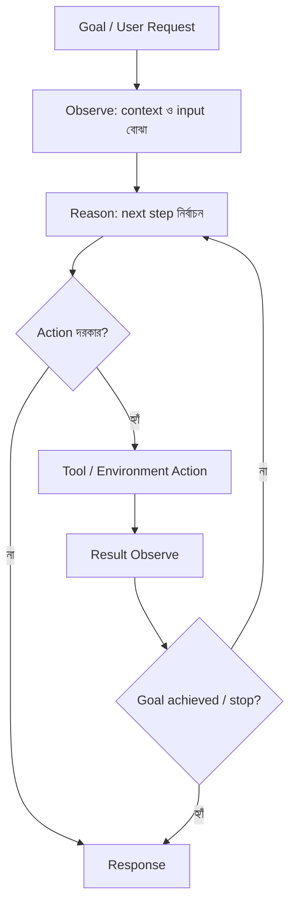

# 01. What Makes Something an Agent?

> Chapter alignment: 00:03:26 — What Makes Something an Agent

## 1. শুরুতে পার্থক্যটি ধরো

একটি সাধারণ chatbot প্রশ্নের উত্তর দেয়। একটি agent কোনো লক্ষ্য পেলে সেই লক্ষ্য পূরণের জন্য পরিস্থিতি বোঝে, সিদ্ধান্ত নেয়, প্রয়োজনে tool ব্যবহার করে, ফলাফল দেখে আবার পরবর্তী পদক্ষেপ ঠিক করে।

**Agent মানে শুধু LLM + prompt নয়।** Agentic system-এ model-এর সিদ্ধান্তের চারপাশে execution loop, tools, state/context, এবং control logic থাকে।

উদাহরণ: Customer বলল, “আমার অর্ডারের পণ্য ভাঙা এসেছে, refund চাই।”

- Chatbot: refund policy বুঝিয়ে উত্তর দিতে পারে।
- Tool-enabled assistant: order lookup tool চালিয়ে order খুঁজতে পারে।
- Agentic workflow: order যাচাই, eligibility পরীক্ষা, প্রয়োজনীয় তথ্য সংগ্রহ, অনুমোদিত refund action নেওয়া বা human review-এ পাঠানো, তারপর customer-কে জানানো।

## 2. Agent-এর সাধারণ loop

এই loop-টাই agent-এর মূল intuition: **একটি action-এর ফল পরবর্তী সিদ্ধান্তকে প্রভাবিত করে**। সব agent একই algorithm বা loop ব্যবহার করে না; কিছু workflow deterministic state machine, কিছু model-driven loop, কিছু hybrid।

## 3. LLM, Chatbot, Tool-using Assistant, Agent

| System | কী করে | সীমাবদ্ধতা / বৈশিষ্ট্য |
|---|---|---|
| LLM | input থেকে text/token generate করে | নিজে environment-এ action নেয় না |
| Chatbot | conversation interface-এ LLM ব্যবহার করে | মূলত response-centric |
| Tool-using assistant | নির্দিষ্ট tool invoke করতে পারে | tool-use থাকলেই autonomy বেশি, এমন নয় |
| Agent | goal অনুযায়ী observe-decide-act loop চালাতে পারে | loop, state, stop condition, permissions গুরুত্বপূর্ণ |

সীমানা সবসময় কঠোর নয়। “Agent” শব্দটি industry-তে নানা মাত্রার autonomy বোঝাতে ব্যবহৃত হয়। তাই interview-তে label না ধরে architecture ও behavior বর্ণনা করো।

## 4. Agent-এর উদাহরণ: Refund assistant

ধরা যাক, customer-এর request: “Order #812 এসেছে ভাঙা অবস্থায়।”

Agent-কে কী করতে হতে পারে?

1. Request ও order identifier বুঝতে হবে।
2. Order system থেকে order details retrieve করতে হবে।
3. Refund policy / eligibility যাচাই করতে হবে।
4. প্রয়োজন হলে customer-এর কাছ থেকে ছবি বা অতিরিক্ত তথ্য চাইতে হবে।
5. অনুমোদিত হলে refund tool invoke করতে হবে, নইলে human support-এ escalate করতে হবে।
6. Action সফল হয়েছে কি না tool result দেখে নিশ্চিত হতে হবে।
7. Customer-কে status জানাতে হবে।

**গুরুত্বপূর্ণ:** model-এর “refund করে দিয়েছি” বলা আর backend-এ refund transaction সফল হওয়া এক জিনিস নয়। Action-এর success tool/system result দ্বারা যাচাই করতে হয়।

## 5. Agent design-এর গুরুত্বপূর্ণ building blocks

- **Goal:** সফলতার অর্থ কী?
- **Observation/Input:** agent কী তথ্য দেখতে পাচ্ছে?
- **State:** আগের ধাপের তথ্য কোথায় রাখা হচ্ছে?
- **Reasoning/Decision:** পরবর্তী পদক্ষেপ নির্বাচন।
- **Action/Tool:** বাস্তব কাজ করার interface।
- **Feedback:** action-এর ফলাফল।
- **Stop condition:** কখন থামবে?
- **Guardrails:** কোন কাজ অনুমোদিত, কোনটি নয়?
- **Human handoff:** অনিশ্চয়তা বা উচ্চ ঝুঁকিতে মানুষকে যুক্ত করা।

## 6. Agent সবসময় autonomous হওয়া উচিত?

না। বেশি autonomy মানেই ভালো system নয়। Refund, payment, account deletion বা sensitive data পরিবর্তনের মতো কাজে policy, permission, confirmation এবং audit trail দরকার হতে পারে।

Design-এ autonomy-কে risk অনুযায়ী সীমাবদ্ধ করা যায়:

- Read-only action: কম ঝুঁকি, তবু access control দরকার।
- Reversible action: সীমিত permission ও validation।
- Irreversible/high-impact action: explicit approval বা human review।

## 7. Interview-ready উত্তর

**প্রশ্ন: AI agent কী?**

একটি ভালো উত্তর:

“AI agent হলো এমন system যা কোনো goal বা task পেয়ে context observe করে, সিদ্ধান্ত নেয়, প্রয়োজন হলে tools বা environment-এ action চালায়, action-এর ফল পর্যবেক্ষণ করে এবং goal পূরণ না হওয়া পর্যন্ত বা stop condition না আসা পর্যন্ত পরবর্তী পদক্ষেপ নির্ধারণ করে। LLM agent-এর reasoning component হতে পারে, কিন্তু agent system-এর মধ্যে state, tool execution, control loop, permissions ও error handling-ও থাকে।”

**Follow-up: LLM থাকলেই কি agent?**  
না। LLM শুধু response generate করলেও সেটি agent নয়। Agentic behavior-এর জন্য goal-directed control, action/feedback loop ও execution context গুরুত্বপূর্ণ।

**Follow-up: Tool calling থাকলেই agent?**  
Tool calling agent-এর ক্ষমতা হতে পারে, কিন্তু একটি fixed tool call-সহ deterministic assistant-ও হতে পারে। Agent কতটা সিদ্ধান্ত নেয়, loop আছে কি না, state ও goal কীভাবে পরিচালিত হয়, তা দেখে বিচার করতে হবে।

## 8. ভুল ধারণা

- Agent = prompt-এর মধ্যে “You are an agent” লেখা নয়।
- Agent = সবসময় multi-agent নয়।
- Agent = সবসময় নিজের পরিকল্পনা বানায় না; planner/control logic code-এ থাকতে পারে।
- Agent-এর কাজ সফল হয়েছে কি না, শুধু final text দেখে বিচার করা যায় না।
- Autonomy বাড়ালে reliability স্বয়ংক্রিয়ভাবে বাড়ে না।

## 9. নিজেকে যাচাই করো

1. একটি chatbot এবং agent-এর মধ্যে behavior-level পার্থক্য কী?
2. Refund agent-এর ক্ষেত্রে tool result কেন গুরুত্বপূর্ণ?
3. Agent loop-এর stop condition না থাকলে কী সমস্যা হতে পারে?
4. Agent-এর action permission কে নির্ধারণ করবে: LLM, application code, নাকি policy layer?
5. একটি agent ভুল সিদ্ধান্ত নিলে সেটি কোথায় catch করা যায়?

উত্তর দেওয়ার সময় architecture, failure mode ও trade-off উল্লেখ করার চেষ্টা করো।