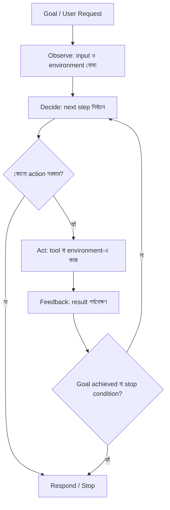

# 01. What Makes Something an Agent?

> Chapter alignment: 00:03:26 — What Makes Something an Agent

## 1. প্রথমে একটি বাস্তব সমস্যা দিয়ে শুরু করি

ধরো, একজন customer support-এ লিখল:

“আমার অর্ডারের জিনিসটা ভাঙা অবস্থায় এসেছে। আমি refund চাই।”

একটি সাধারণ language model এই বাক্যের অর্থ বুঝে refund policy ব্যাখ্যা করতে পারে। কিন্তু customer-এর সত্যিকারের সমস্যাটি সমাধান করতে হলে আরও কাজ দরকার: order খুঁজতে হবে, order status দেখতে হবে, policy পড়তে হবে, প্রমাণ দরকার কি না বুঝতে হবে, refund অনুমোদিত কি না যাচাই করতে হবে এবং অনুমোদিত হলে refund system-এ action নিতে হবে।

এই পার্থক্য থেকেই Agent ধারণাটি বোঝা সহজ।

- **LLM:** ভাষা বোঝে ও generate করে।
- **Chatbot:** user-এর সঙ্গে কথোপকথনের interface দেয়।
- **Tool-using assistant:** নির্দিষ্ট tool call করতে পারে।
- **Agent:** একটি goal পূরণের জন্য context দেখে সিদ্ধান্ত নেয়, action চালায়, ফলাফল পর্যবেক্ষণ করে এবং প্রয়োজন হলে আবার সিদ্ধান্ত নেয়।

এগুলো সম্পূর্ণ আলাদা বাক্স নয়। একটি chatbot-এর ভেতরেও agent থাকতে পারে। মূল পার্থক্য হলো system-এর behavior ও control flow।

## 2. Agent-এর সংজ্ঞা

AI Agent হলো এমন একটি system, যা কোনো goal বা task পেয়ে তার environment/context থেকে তথ্য সংগ্রহ করে, পরবর্তী পদক্ষেপ নির্ধারণ করে, প্রয়োজনে tools বা environment-এ action চালায় এবং action-এর ফলাফল দেখে goal পূরণ না হওয়া বা stop condition না আসা পর্যন্ত কাজ চালায়।

একটি গুরুত্বপূর্ণ বিষয়: **Agent মানে শুধু LLM + prompt নয়।** LLM reasoning বা decision-এর অংশ হতে পারে। কিন্তু বাস্তব agentic system-এ সাধারণত execution loop, tools, state/context, control logic, permissions, error handling এবং stopping rule থাকে।

## 3. Agent loop: Observe → Decide → Act → Feedback

এই loop-এর আসল শক্তি হলো feedback। Agent শুধু একবার উত্তর তৈরি করে থেমে যায় না। সে action-এর ফলাফল ব্যবহার করে পরবর্তী সিদ্ধান্ত নিতে পারে।

### Refund উদাহরণে loop-টি চালিয়ে দেখি

1. **Goal:** damaged product-এর refund request resolve করা।
2. **Observe:** customer message থেকে intent, order ID ও complaint বোঝা।
3. **Decide:** order details না দেখে eligibility নির্ধারণ করা যাবে না, তাই order lookup করতে হবে।
4. **Act:** order lookup tool call।
5. **Feedback:** order পাওয়া গেল, কিন্তু delivery date ও item status জানা গেল।
6. **Decide:** policy অনুযায়ী damaged item-এর photo দরকার।
7. **Act:** customer-এর কাছে photo চাওয়া।
8. **Feedback:** customer photo দিল।
9. **Decide:** policy check ও refund eligibility যাচাই।
10. **Act:** অনুমোদিত refund request পাঠানো।
11. **Feedback:** payment system refund accepted/failed status দিল।
12. **Stop:** authoritative result যাচাই করে customer-কে জানানো।

এখানে agent-এর প্রতিটি সিদ্ধান্ত আগের step-এর result-এর ওপর নির্ভর করছে।

## 4. LLM, Chatbot, Tool-using Assistant ও Agent-এর পার্থক্য

| System | মূল কাজ | Example | সীমাবদ্ধতা/বৈশিষ্ট্য |
|---|---|---|---|
| LLM | input থেকে text/token generate | policy ব্যাখ্যা | নিজে external system-এ action নেয় না |
| Chatbot | conversational interface | FAQ bot | response-centric হতে পারে |
| Tool-using assistant | নির্দিষ্ট function/tool invoke | order lookup | tool call থাকলেই autonomy বা goal loop প্রমাণ হয় না |
| Agent | goal-directed observe-decide-act loop | refund resolution | state, feedback, control, permission ও stop condition দরকার |

**সীমানা সবসময় কঠোর নয়।** Industry-তে “agent” শব্দটি অনেক সময় সাধারণ tool-enabled assistant-এর জন্যও ব্যবহার করা হয়। Interview-তে শুধু নাম বলবে না; system কীভাবে কাজ করে তা ব্যাখ্যা করবে।

## 5. Tool call থাকলেই কি Agent?

না। ধরো, user “আজকের আবহাওয়া বলো” বলল। Application সবসময় একই weather API call করে এবং result দেখায়। এখানে tool আছে, কিন্তু workflow পুরোপুরি fixed হতে পারে।

অন্যদিকে, agent পরিস্থিতি দেখে ঠিক করতে পারে:
- location জানা না থাকলে user-কে জিজ্ঞাসা করবে;
- location জানা থাকলে weather tool call করবে;
- API failure হলে retry বা alternative source ব্যবহার করবে;
- forecast-এ rain chance বেশি হলে user-এর প্রশ্ন অনুযায়ী ব্যাখ্যা করবে;
- পর্যাপ্ত তথ্য পেলে থামবে।

অর্থাৎ tool হলো capability; agentic behavior আসে goal-directed decision ও feedback/control loop থেকে। তবে deterministic workflow-ও production system-এর জন্য যথার্থ design হতে পারে। সব কাজ agent-কে দিতে হবে এমন নয়।

## 6. Agent-এর building blocks

### 6.1 Goal
System কী অর্জন করতে চাইছে? Goal অস্পষ্ট হলে success নির্ধারণ কঠিন। “Customer-কে সাহায্য করো” খুব broad; “order যাচাই করে refund eligibility জানাও, অনুমোদন ছাড়া refund execute করবে না” বেশি নির্দিষ্ট।

### 6.2 Observation / Input
Agent কী দেখতে পাচ্ছে? User message, database record, API response, document, image, event ইত্যাদি। Agent যা দেখতে পায় না, সে সম্পর্কে নির্ভরযোগ্য সিদ্ধান্ত আশা করা যায় না।

### 6.3 State / Context
এখন পর্যন্ত কী ঘটেছে, কোন tool call হয়েছে, কোন তথ্য পাওয়া গেছে, কোন step pending? State ছাড়া multi-step কাজের continuity নষ্ট হয়।

### 6.4 Reasoning / Decision
পরবর্তী পদক্ষেপ কী হবে? LLM, rules, planner, state machine অথবা hybrid logic সিদ্ধান্ত নিতে পারে।

### 6.5 Action / Tool
বাস্তবে কী করা যাবে? Search, database query, ticket creation, notification, refund request ইত্যাদি।

### 6.6 Feedback
Action সফল হয়েছে, ব্যর্থ হয়েছে, নাকি আংশিক হয়েছে? শুধু tool call পাঠানো মানেই কাজ শেষ নয়।

### 6.7 Stop condition
কখন কাজ থামবে? Goal achieved, missing information, permission denied, max attempts, timeout বা human escalation হতে পারে।

### 6.8 Guardrails ও permissions
কোন কাজ করা যাবে, কোনটি যাবে না? Model-এর ইচ্ছা permission তৈরি করে না। Trusted application/backend layer-এ authorization enforce করতে হবে।

### 6.9 Human handoff
যখন uncertainty বেশি, policy ambiguous, বা action high-impact, তখন মানুষকে সিদ্ধান্ত বা approval-এর জন্য যুক্ত করা যায়।

## 7. Autonomy: Agent-কে কতটা স্বাধীনতা দেব?

বেশি autonomy মানেই ভালো agent নয়। Autonomy বাড়লে ভুল সিদ্ধান্তের সম্ভাব্য impact-ও বাড়ে।

একটি practical risk-based model:

| Action | উদাহরণ | সাধারণ control |
|---|---|---|
| Read-only | order status দেখা | authentication, authorization, data minimization |
| Low-impact reversible | draft ticket তৈরি | validation, limited scope |
| External communication | customer-কে email পাঠানো | content review/approval policy |
| High-impact | refund, payment, account deletion | strict server-side policy, confirmation/approval, audit |
| Irreversible | permanent deletion | strong authorization, explicit confirmation, recovery plan where possible |

সব system-এ একই policy হবে না। Business risk, regulation ও user expectation অনুযায়ী control নির্ধারণ করতে হয়।

## 8. Agent সফল হয়েছে কীভাবে বুঝব?

Final response সুন্দর হলেই agent সফল নয়। Success evaluate করতে হবে task outcome দিয়ে।

Refund example-এ success criteria:
- সঠিক order শনাক্ত হয়েছে?
- সঠিক policy version ব্যবহার হয়েছে?
- Eligibility ঠিকভাবে যাচাই হয়েছে?
- অনুমোদন ছাড়া কোনো side effect ঘটেনি?
- Refund action-এর authoritative status পাওয়া গেছে?
- Customer-কে সত্য status জানানো হয়েছে?
- Audit trail আছে?

এখানে “model বলেছে refund complete” যথেষ্ট evidence নয়। Payment/refund service-এর result দরকার।

## 9. Failure কোথায় হতে পারে?

| Stage | Failure | সম্ভাব্য control |
|---|---|---|
| Observe | ভুল order ID extract | schema/format validation, clarification |
| Decide | policy ভুল বোঝা | authoritative policy retrieval, deterministic checks |
| Act | wrong arguments | tool schema + business validation |
| Execute | API timeout | bounded retry, status reconciliation |
| Feedback | result ভুল interpret | structured result, explicit status |
| Stop | loop চলতেই থাকা | max turns, budget, deadline |
| Permission | unauthorized refund | server-side authorization |
| Response | success না হয়েও success claim | authoritative outcome verification |

## 10. Interview: গভীর প্রশ্ন ও ব্যাখ্যাসহ উত্তর

### Q1. AI Agent কী? Chatbot থেকে পার্থক্য কী?

**সংক্ষিপ্ত উত্তর:** AI Agent হলো goal-directed system, যা context observe করে, সিদ্ধান্ত নেয়, tools/environment-এ action চালায় এবং feedback ব্যবহার করে পরবর্তী পদক্ষেপ ঠিক করে।

**বিস্তারিত ব্যাখ্যা:** Chatbot-এর প্রধান কাজ conversation-এর মাধ্যমে উত্তর দেওয়া। Agent-এর কাজ goal সম্পন্ন করা। ধরো, “আমার flight cancel হয়েছে, alternative flight খুঁজে দাও।” Chatbot airline-এর policy ব্যাখ্যা করতে পারে। Agent booking details retrieve, alternative flight search, constraints compare এবং user approval পেলে booking change workflow শুরু করতে পারে। Agent-এর মধ্যে একাধিক model call ও tool call হতে পারে। পার্থক্যটি interface-এ নয়, control flow-এ।

**Follow-up: তাহলে chatbot কি agent হতে পারে?**  
হ্যাঁ। Chatbot হলো user interaction-এর একটি interface। তার পেছনে যদি goal-directed decision/action loop থাকে, সেটি agentic system হতে পারে।

### Q2. LLM থাকলেই কি Agent হয়?

না। LLM হলো model capability; Agent হলো system architecture/behavior। একটি LLM শুধু text generate করতে পারে। Agent system LLM-কে reasoning component হিসেবে ব্যবহার করতে পারে, কিন্তু পাশাপাশি state, tools, execution runtime, feedback, permission ও stopping condition লাগে। যেমন, একটি text summarizer-এ LLM আছে, কিন্তু সে নিজে goal অনুযায়ী environment-এ action নিয়ে ফলাফল দেখে পরবর্তী step ঠিক না করলে তাকে agent বলা যথার্থ নয়।

### Q3. Tool calling থাকলেই কি Agent?

না। Tool calling একটি capability, agent হওয়ার পূর্ণ সংজ্ঞা নয়। Fixed rule-এ সবসময় একটি API call করা tool-enabled application হতে পারে। Agentic system-এ tool selection বা next action context অনুযায়ী বদলাতে পারে এবং tool result পরবর্তী সিদ্ধান্তকে প্রভাবিত করে। তবে autonomy-এর মাত্রা ভিন্ন হতে পারে। Interview-তে tool আছে কি না জিজ্ঞাসার পাশাপাশি কে সিদ্ধান্ত নিচ্ছে, loop আছে কি না, state কীভাবে manage হচ্ছে এবং stop condition কী তা ব্যাখ্যা করো।

### Q4. Agent loop-এর প্রতিটি অংশ ব্যাখ্যা করো।

- **Observe:** user/environment থেকে relevant data সংগ্রহ ও বুঝে নেওয়া।
- **Decide:** goal ও বর্তমান state দেখে next action বেছে নেওয়া।
- **Act:** tool বা environment-এ operation চালানো।
- **Feedback:** operation-এর result/error সংগ্রহ।
- **Repeat/Stop:** feedback দেখে পরের action বা completion নির্ধারণ।

Feedback বাদ দিলে agent action সফল হয়েছে কি না বুঝতে পারবে না। Stop condition বাদ দিলে infinite loop, অপ্রয়োজনীয় tool call ও cost বৃদ্ধি হতে পারে।

### Q5. Agent কি সবসময় নিজে plan তৈরি করবে?

না। Planning model-এর মাধ্যমে হতে পারে, আবার deterministic code, workflow engine বা state machine-এও থাকতে পারে। Payment/refund-এর মতো sensitive flow-এ business rules code-এ enforce করা বেশি নিরাপদ। Model অস্পষ্ট user request বুঝতে বা তথ্যের ভিত্তিতে next step বাছতে সাহায্য করতে পারে। ভালো architecture সাধারণত judgment-heavy কাজ model-কে এবং strict business invariant code/service-কে দেয়।

### Q6. Agent-এর কাজ সফল হয়েছে কীভাবে নিশ্চিত করবে?

Task-specific success criteria define করতে হবে। Tool call পাঠানো, HTTP 200 পাওয়া বা model-এর success text যথেষ্ট নয়। Downstream system-এর authoritative state যাচাই করতে হবে। Refund-এর ক্ষেত্রে refund transaction ID/status, booking-এর ক্ষেত্রে confirmed booking record। Side effect-এর পরে reconciliation, audit log ও user-facing status দরকার। Evaluation-এ task success rate, correctness, policy violation ও false-success rate মাপা যায়।

### Q7. Agent ভুল সিদ্ধান্ত নিলে কোথায় ধরবে?

একটি layer-এর ওপর নির্ভর করবে না। Input validation ভুল তথ্য ধরতে পারে; retrieval validation ভুল policy ধরতে পারে; business service invalid operation reject করতে পারে; permission layer unauthorized action আটকায়; post-action verification execution failure ধরতে পারে; monitoring ও human review anomaly ধরতে পারে। Defense-in-depth দরকার, কারণ model-এর reasoning সবসময় সঠিক হবে ধরে design করা উচিত নয়।

### Q8. Agent loop infinite হলে কী করবে?

প্রথমে stop condition ও resource budget নির্ধারণ: max iteration, max tool calls, deadline, token/cost budget। একই tool একই arguments-এ বারবার call হচ্ছে কি না loop detection করা যায়। Progress না হলে agent-কে থামিয়ে partial result, clarification request বা human escalation দিতে হবে। শুধু “আরও চেষ্টা করো” instruction দিয়ে infinite loop ঠেকানো যায় না; runtime-enforced limit দরকার।

### Q9. Agent-এর action permission কে নির্ধারণ করবে?

LLM নয়। Model action propose করতে পারে, কিন্তু trusted application/backend/policy layer identity, role, resource ownership, scope, amount limit ও approval যাচাই করে। Prompt-এ “কখনো refund কোরো না” বলা useful guidance, কিন্তু security control নয়। Prompt injection বা model error instruction অমান্য করতে পারে। তাই side-effecting operation-এর authorization server-side enforce করতে হবে।

### Q10. Agent autonomous নাকি human-in-the-loop হওয়া উচিত?

Task risk অনুযায়ী। Read-only lookup অনেক ক্ষেত্রে automatic হতে পারে। Refund amount বেশি, identity uncertain বা policy ambiguous হলে approval দরকার হতে পারে। Human review latency ও operational cost বাড়ায়, কিন্তু high-impact error কমাতে পারে। তাই threshold, escalation reason ও reviewer decision audit করতে হবে। লক্ষ্য হলো অন্ধ automation নয়, risk-appropriate automation।

## 11. নিজেকে যাচাই করো

1. Agent ও chatbot-এর পার্থক্য একটি real-world example দিয়ে বোঝাও।
2. Tool call proposal এবং successful execution কেন এক নয়?
3. Agent loop-এ feedback না থাকলে কী কী failure হতে পারে?
4. Goal ও stop condition কীভাবে define করবে?
5. কোন decision model নেবে, কোনটি deterministic code নেবে?
6. High-impact action-এ human approval কোথায় বসবে?
7. Agent success-এর জন্য কোন authoritative evidence দরকার?
8. Infinite loop, repeated tool call ও API timeout কীভাবে handle করবে?

## 12. Practice: Refund Agent-এর design

একটি diagram আঁকো যেখানে থাকবে: User request, input parsing, order lookup, policy retrieval, eligibility check, evidence request, approval, refund tool, result verification ও final response।

প্রতিটি arrow-এর পাশে লিখবে:
- কী input যাচ্ছে?
- কী output আসছে?
- Failure হলে কী হবে?
- কোন layer permission enforce করছে?

শেষে ব্যাখ্যা করো: কোন কাজ LLM করবে, কোন কাজ code করবে এবং কেন।
