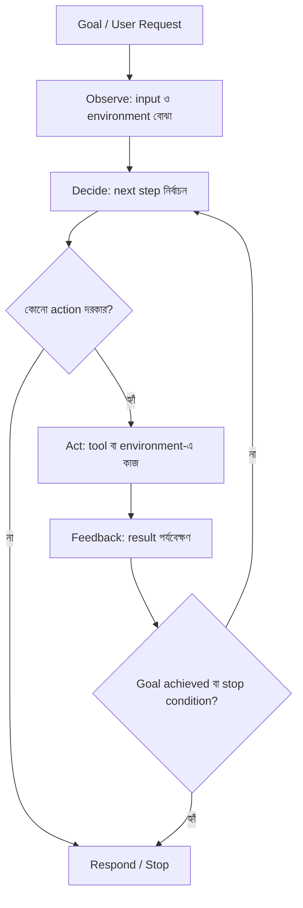

# 01. What Makes Something an Agent?

> Chapter alignment: 00:03:26 — What Makes Something an Agent

## 1. Agent বোঝার আগে একটি কাজের গল্প

ধরো, একটি e-commerce platform-এর customer support-এ একজন customer লিখল:

“আমার অর্ডারের জিনিসটা ভাঙা অবস্থায় এসেছে। আমি refund চাই।”

একটি সাধারণ language model এই বাক্যটি পড়ে বুঝতে পারে যে customer পণ্যটি damaged পেয়েছেন এবং refund চান। সে refund policy ব্যাখ্যা করতে পারে, ভদ্রভাবে উত্তরও লিখতে পারে। কিন্তু customer-এর আসল সমস্যাটি এখনো সমাধান হয়নি। কারণ refund পাওয়া যাবে কি না, তা শুধু customer-এর বাক্য থেকে জানা যায় না।

System-কে জানতে হবে কোন order-এর কথা বলা হচ্ছে, order-টি সত্যিই delivered হয়েছে কি না, কোন item কেনা হয়েছিল, damage claim-এর জন্য ছবি বা অন্য evidence দরকার কি না, সেই order-এর ক্ষেত্রে কোন policy প্রযোজ্য এবং refund-এর সিদ্ধান্ত নেওয়ার অধিকার কার আছে। Refund অনুমোদিত হলে payment service-এ request পাঠাতে হবে। Request পাঠানোর পর সেটি সফল হয়েছে, pending আছে, নাকি ব্যর্থ হয়েছে, সেটিও যাচাই করতে হবে।

এই কাজটি একটি বাক্যের উত্তর তৈরির চেয়ে অনেক বড়। এখানে তথ্য সংগ্রহ, সিদ্ধান্ত, action, ফলাফল পর্যবেক্ষণ এবং প্রয়োজনে নতুন সিদ্ধান্ত দরকার। এই ধরনের goal-directed কাজের architecture বুঝতেই আমরা **AI Agent** ধারণাটি ব্যবহার করি।

একটি গুরুত্বপূর্ণ পার্থক্য শুরুতেই পরিষ্কার করি: Agent মানেই সবকিছু নিজে নিজে করে ফেলা কোনো জাদুকরী AI নয়। Agent একটি software system। এর মধ্যে model থাকতে পারে, কিন্তু model ছাড়াও deterministic code, tools, state, permissions এবং execution runtime থাকে। বাস্তব কাজটি সম্পন্ন হয় এই অংশগুলোর সমন্বয়ে।

## 2. LLM, Chatbot, Tool-using Assistant ও Agent: একই জিনিস নয় কেন?

এই শব্দগুলো অনেক সময় পরস্পরের বদলে ব্যবহার করা হয়। এতে ধারণাগত বিভ্রান্তি তৈরি হয়। পার্থক্যটি বোঝার জন্য একই refund সমস্যাকে চারটি system-এ কল্পনা করি।

**LLM:** Customer-এর message পেলে model বলতে পারে, “আপনার পণ্যটি ক্ষতিগ্রস্ত অবস্থায় পৌঁছেছে বলে দুঃখিত। Refund policy অনুযায়ী...”। এটি ভাষা বুঝে এবং উত্তর তৈরি করে। কিন্তু নিজে থেকে order database খুলে দেখে না বা payment system-এ refund চালায় না। LLM হলো একটি model capability, সম্পূর্ণ application নয়।

**Chatbot:** Customer-এর সঙ্গে কথোপকথনের interface দেয়। এটি FAQ থেকে উত্তর দিতে পারে, form পূরণে সাহায্য করতে পারে, এমনকি পেছনে LLM-ও ব্যবহার করতে পারে। কিন্তু chatbot হলেই যে সেটি কোনো goal সম্পন্ন করার জন্য একাধিক ধাপ চালাবে, এমন নয়। অনেক chatbot-এর কাজ উত্তর দেওয়া পর্যন্ত সীমাবদ্ধ।

**Tool-using Assistant:** Order lookup-এর মতো নির্দিষ্ট tool ব্যবহার করতে পারে। Customer order number দিলে assistant tool call করে order details দেখাতে পারে। কিন্তু একটি tool call থাকলেই system agent হয়ে যায় না। Application যদি প্রতিবার একই নির্ধারিত function call করে এবং result দেখায়, তাহলে সেটি tool-enabled application-ও হতে পারে।

**Agent:** Customer-এর goal বুঝে বর্তমান তথ্যের ভিত্তিতে পরবর্তী পদক্ষেপ বেছে নেয়। Order ID না থাকলে সেটি চাইতে পারে, order খুঁজে পেলে policy যাচাই করতে পারে, evidence অনুপস্থিত থাকলে সেটি চাইতে পারে, আর refund অনুমোদিত হলে নির্দিষ্ট permission ও policy মেনে refund workflow শুরু করতে পারে। প্রতিটি action-এর ফলাফল দেখে পরবর্তী সিদ্ধান্ত বদলাতে পারে।

তাই পার্থক্যটি শুধু “কোনটিতে AI আছে” বা “কোনটিতে tool আছে” তা নয়। মূল প্রশ্ন হলো: **System কি একটি goal নিয়ে context ও feedback অনুযায়ী পরবর্তী পদক্ষেপ নির্ধারণ করে, নাকি আগে থেকে নির্ধারিত একটিমাত্র response/action চালায়?**

এগুলো অবশ্য কঠোর আলাদা বাক্স নয়। Chatbot-এর পেছনে agent থাকতে পারে। একটি agent-ও chatbot interface দিয়ে ব্যবহারকারীর সঙ্গে কথা বলতে পারে। Industry-তে “agent” শব্দটি কখনো খুব ঢিলেঢালাভাবেও ব্যবহৃত হয়। তাই নামের চেয়ে system-এর control flow ব্যাখ্যা করা বেশি গুরুত্বপূর্ণ।

## 3. Agent-এর একটি কার্যকর সংজ্ঞা

AI Agent হলো এমন একটি software system, যা একটি goal বা task পায়, তার environment ও বর্তমান state থেকে প্রাসঙ্গিক তথ্য পর্যবেক্ষণ করে, পরবর্তী পদক্ষেপ নির্বাচন করে, প্রয়োজনে tools বা environment-এ action চালায় এবং সেই action-এর ফলাফল ব্যবহার করে পরবর্তী সিদ্ধান্ত নেয়। Goal পূরণ, প্রয়োজনীয় তথ্যের অভাব, permission boundary, resource limit অথবা অন্য কোনো stop condition এলে system কাজ থামায় বা মানুষের কাছে handoff করে।

এই সংজ্ঞার প্রতিটি অংশের আলাদা ভূমিকা আছে:

- **Goal:** কী অর্জন করতে হবে তা নির্ধারণ করে।
- **Environment:** যে বাইরের system বা তথ্যের সঙ্গে agent কাজ করে, যেমন database, API, file, browser বা user।
- **Observation:** Environment থেকে agent যে তথ্য দেখতে ও ব্যবহার করতে পারে।
- **Decision:** বর্তমান state ও goal বিবেচনা করে পরবর্তী পদক্ষেপ বেছে নেওয়া।
- **Action:** Tool বা environment-এ বাস্তব operation চালানো।
- **Feedback:** Action-এর ফলাফল, error বা নতুন state পর্যবেক্ষণ করা।
- **Stop condition:** কখন কাজ শেষ, থামানো বা escalate করতে হবে তা নির্ধারণ করা।

এখানে একটি সূক্ষ্ম কিন্তু জরুরি বিষয় আছে: Model কোনো action-এর প্রস্তাব দিতে পারে, কিন্তু সেটি বাস্তবে execute করে না। Model বলতে পারে “order lookup tool call করা উচিত” এবং arguments তৈরি করতে পারে। Runtime সেই call যাচাই করে, permission পরীক্ষা করে, tool চালায় এবং result model-এর কাছে ফেরত দেয়। অর্থাৎ agentic system-এর behavior model ও execution infrastructure একসঙ্গে তৈরি করে।

## 4. Agent loop: Observe → Decide → Act → Feedback

Agent-এর কাজকে বোঝার সবচেয়ে সহজ উপায় হলো একটি loop হিসেবে দেখা।

এই diagram-এ loop-এর কেন্দ্রবিন্দু হলো **feedback**। Feedback না থাকলে system জানতেই পারবে না তার আগের action সফল হয়েছে কি না। সে হয়তো order lookup request পাঠিয়েছে, কিন্তু order পাওয়া যায়নি; অথবা refund request পাঠিয়েছে, কিন্তু payment service timeout করেছে। Request পাঠানো আর কাজ সম্পন্ন হওয়া এক জিনিস নয়।

### Refund সমস্যায় loop-টি ধাপে ধাপে

**ধাপ ১: Goal বোঝা।** Customer-এর লক্ষ্য হলো damaged item-এর জন্য refund পাওয়া। Agent প্রথমে message থেকে intent ও উপলব্ধ তথ্য বের করে। Order ID নেই? তাহলে এখনই refund eligibility নিয়ে সিদ্ধান্ত দেওয়া যাবে না।

**ধাপ ২: Observe করা।** Agent conversation history, authenticated customer identity এবং প্রাসঙ্গিক order information দেখতে পারে। তবে customer-এর পরিচয় জানা থাকলেই সব order বা payment data দেখার অনুমতি পাওয়া যায় না। Observation-ও access control-এর অধীন।

**ধাপ ৩: Decide করা।** Order ID না থাকলে customer-কে সেটি জিজ্ঞাসা করা যুক্তিযুক্ত। Order ID থাকলে order lookup করা যেতে পারে। কোন পদক্ষেপটি সঠিক, তা বর্তমান state-এর ওপর নির্ভর করে।

**ধাপ ৪: Act করা।** Runtime order lookup tool চালায়। Tool order status, delivery date এবং item details ফেরত দেয়।

**ধাপ ৫: Feedback থেকে নতুন সিদ্ধান্ত।** ধরা যাক order পাওয়া গেল, কিন্তু damaged item-এর প্রমাণ হিসেবে ছবি দরকার। Agent তখন customer-এর কাছে ছবি চাইতে পারে। Customer ছবি দিলে সেটি পরবর্তী পর্যবেক্ষণ হিসেবে যুক্ত হয়।

**ধাপ ৬: Policy ও eligibility যাচাই।** Agent প্রাসঙ্গিক policy পড়তে পারে, কিন্তু refund amount, time window বা eligibility-র মতো কঠোর business invariant trusted backend/service-এ যাচাই হওয়া উচিত। Model-এর policy ব্যাখ্যা authoritative business decision-এর বিকল্প নয়।

**ধাপ ৭: অনুমোদিত action।** Refund অনুমোদিত হলে agent refund request পাঠাতে পারে। কিন্তু refund-এর মতো side effect-এর আগে authorization, amount limit, duplicate request প্রতিরোধ এবং প্রয়োজনীয় human approval enforce করতে হবে।

**ধাপ ৮: ফলাফল যাচাই ও stop।** Payment service যদি refund-এর status `accepted` বা `pending` ফেরত দেয়, agent সেটিকে “টাকা ইতিমধ্যে customer-এর account-এ পৌঁছে গেছে” বলে চালাতে পারবে না। Authoritative status যতটুকু নিশ্চিত করে, customer-কে ততটুকুই জানাতে হবে। এরপর goal পূরণ বা handoff condition অনুযায়ী কাজ থামবে।

লক্ষ করো, প্রতিটি ধাপে agent-এর পরবর্তী কাজ আগের ধাপের ফলাফলের ওপর নির্ভর করছে। এটাই feedback-driven behavior।

## 5. Tool call থাকলেই কি Agent?

না। Tool হলো কোনো capability ব্যবহার করার interface; Agent হলো goal-directed system behavior। এই দুইটি আলাদা ধারণা।

ধরো, একটি weather application-এ user শহরের নাম লিখল। Application সবসময় একই weather API call করে এবং response দেখায়। এখানে API/tool আছে, কিন্তু flow পুরোপুরি deterministic। এটি খারাপ design নয়। কাজটি সহজ ও predictable হলে deterministic implementation-ই সাধারণত বেশি সহজ, দ্রুত এবং testable।

এবার অন্য একটি system ভাবো। User বলল, “আগামীকাল বাইরে যাব। বৃষ্টির সম্ভাবনা থাকলে আমাকে জানিও।” System-কে হয়তো প্রথমে জানতে হবে user কোন শহরে আছেন। Location না থাকলে প্রশ্ন করতে হবে। Location থাকলে forecast আনতে হবে। API unavailable হলে সীমিত retry করতে পারে বা জানাতে পারে যে forecast পাওয়া যায়নি। Forecast-এ rain probability থাকলে user-এর নির্ধারিত threshold-এর সঙ্গে তুলনা করতে হবে। Alert পাঠানোর permission থাকলে notification পাঠাতে পারে। এখানে context অনুযায়ী next action ও feedback গুরুত্বপূর্ণ।

তবু মনে রাখতে হবে, সব agentic behavior-এর জন্য unrestricted autonomy দরকার নেই। এই weather workflow-এর অনেক অংশ deterministic code-এ রাখা যায়। Model কেবল natural-language request বুঝতে বা অস্পষ্টতা দূর করতে সাহায্য করতে পারে। **ভালো system design মানে সবকিছু model-কে দিয়ে করানো নয়; যেখানে deterministic logic যথেষ্ট, সেখানে সেটিই ব্যবহার করা।**

## 6. একটি Agent system-এর ভেতরে কী কী অংশ থাকে?

“Agent” বললে একটি একক model বা class কল্পনা করলে বাস্তব architecture বোঝা কঠিন হয়। একটি কার্যকর agentic system-এ সাধারণত নিচের দায়িত্বগুলো থাকে। সব implementation-এ এগুলো আলাদা service বা package হবে এমন নয়; এগুলো logical responsibility।

### 6.1 Goal এবং success criteria

Goal বলে system কী অর্জন করতে চায়। কিন্তু goal অস্পষ্ট হলে completion যাচাই করা যায় না। “Customer-কে সাহায্য করো” একটি অস্পষ্ট goal। “Customer-এর নির্দিষ্ট order যাচাই করো, refund eligibility নির্ধারণ করো এবং explicit approval ছাড়া refund execute কোরো না” অনেক বেশি actionable।

Goal-এর সঙ্গে success criteria-ও থাকা দরকার। যেমন: সঠিক order শনাক্ত, policy অনুযায়ী eligibility যাচাই, unauthorized side effect শূন্য, এবং refund service-এর authoritative status পাওয়া। সুন্দর final message এই criteria-গুলোর বিকল্প নয়।

### 6.2 Observation এবং input

Agent কী দেখতে পাচ্ছে তা তার সিদ্ধান্তের সীমা নির্ধারণ করে। User message, conversation history, database record, API response, document, image বা event observation-এর উৎস হতে পারে।

একটি সাধারণ ভুল হলো ধরে নেওয়া যে agent-এর কাছে পুরো application-এর সব তথ্য আছে। বাস্তবে agent কেবল তাকে দেওয়া context বা অনুমোদিত tool দিয়ে পাওয়া তথ্য ব্যবহার করতে পারে। তাই missing information থাকলে অনুমান না করে clarification বা retrieval দরকার।

### 6.3 State এবং context

একটি multi-step task-এর মধ্যে আগের কাজের ফলাফল ধরে রাখতে হয়। কোন order খোঁজা হয়েছে, customer ছবি দিয়েছেন কি না, policy check হয়েছে কি না, refund request পাঠানো হয়েছে কি না, কোন step pending, এগুলো state-এর অংশ।

State ছাড়া agent একই কাজ বারবার করতে পারে, আগের ফল ভুলে যেতে পারে বা ভুল ক্রমে action নিতে পারে। তবে conversation history-ই সব state নয়। গুরুত্বপূর্ণ business state authoritative database বা service-এ থাকতে হবে। Model context-এ থাকা তথ্য stale বা ভুল হতে পারে।

### 6.4 Reasoning এবং decision

বর্তমান state থেকে পরবর্তী পদক্ষেপ কী হবে, সেটি নির্ধারণের কাজ। এটি LLM করতে পারে, আবার rules, state machine, workflow engine বা hybrid logic-ও করতে পারে।

যেখানে ভাষা বোঝা, ambiguity সামলানো বা unstructured তথ্য থেকে সিদ্ধান্তের প্রস্তাব দরকার, সেখানে LLM উপকারী। কিন্তু exact amount calculation, eligibility invariant, permission check বা financial transaction-এর মতো কাজ deterministic service-এ enforce করা উচিত।

### 6.5 Action এবং tools

Agent-এর বাইরের জগতে কাজ করার উপায় হলো tools। যেমন order lookup, policy search, ticket create, email send বা refund request। Tool description ও schema model-কে জানায় কোন capability কীভাবে ব্যবহার করা যায়। কিন্তু tool call-এর arguments validate করা এবং authorization enforce করা runtime/backend-এর দায়িত্ব।

### 6.6 Feedback এবং observation of outcome

Tool call-এর পর result ফেরত আসে। Result success, failure, partial success, timeout বা pending হতে পারে। Agent-কে result-এর অর্থ বুঝে পরবর্তী সিদ্ধান্ত নিতে হবে।

বিশেষত side effect-এর ক্ষেত্রে timeout মানেই operation ব্যর্থ হয়েছে এমন নয়। Server কাজটি সম্পন্ন করে response ফেরানোর আগেই connection বিচ্ছিন্ন হতে পারে। তাই blindly retry করলে duplicate refund হতে পারে। Idempotency key এবং operation status reconciliation-এর মতো ব্যবস্থা দরকার।

### 6.7 Stop condition এবং resource budget

Agent কখন থামবে তা স্পষ্ট না হলে loop অনির্দিষ্টকাল চলতে পারে। Stop condition হতে পারে goal achieved, তথ্যের অভাব, permission denied, human approval দরকার, deadline শেষ, সর্বোচ্চ iteration অতিক্রম বা budget শেষ।

Runtime-এ max tool calls, max turns, timeout, token/cost budget এবং retry limit enforce করা উচিত। শুধু prompt-এ “অযথা চেষ্টা করবে না” লিখলে production safety নিশ্চিত হয় না।

### 6.8 Guardrails, authorization এবং human handoff

Guardrails system-কে নির্দিষ্ট সীমার মধ্যে রাখে। তবে prompt instruction আর security boundary এক জিনিস নয়। Model-কে “refund কোরো না” বলা নির্দেশনা; backend-এ refund permission না দেওয়া হলো enforceable control।

যখন uncertainty বেশি, policy conflict আছে বা action-এর impact বেশি, তখন human approval বা escalation দরকার হতে পারে। Human-in-the-loop মানে প্রতিটি ছোট কাজ মানুষ করবে তা নয়; risk অনুযায়ী নির্দিষ্ট সিদ্ধান্তে মানুষকে যুক্ত করা।

## 7. Autonomy: Agent-কে কতটা স্বাধীনতা দেব?

Autonomy বাড়ালে agent কম human intervention-এ বেশি কাজ করতে পারে। এতে speed ও convenience বাড়ে। কিন্তু একই সঙ্গে ভুল সিদ্ধান্তের সম্ভাব্য ক্ষতিও বাড়ে। তাই “আরও autonomous” মানেই “আরও ভালো” নয়।

ধরা যাক agent customer-এর order status পড়ছে। এটি read-only operation; যথাযথ authentication ও authorization থাকলে স্বয়ংক্রিয় করা যেতে পারে। কিন্তু agent যদি customer-এর হয়ে refund execute করে, তবে সেটি financial side effect। সেখানে amount limit, ownership check, duplicate protection, approval policy ও audit trail দরকার হতে পারে।

| Action-এর ধরন | উদাহরণ | সম্ভাব্য control |
|---|---|---|
| Read-only | Order status দেখা | Authentication, authorization, data minimization |
| Reversible low-impact | Draft support ticket তৈরি | Input validation, limited scope |
| External communication | Customer-কে email পাঠানো | Content review বা approval policy |
| High-impact side effect | Refund বা payment initiate | Server-side authorization, amount limit, idempotency, প্রয়োজনে approval |
| Irreversible action | স্থায়ীভাবে account/data delete | Strong authorization, explicit confirmation, audit ও recovery plan যেখানে সম্ভব |

এটি কোনো universal risk table নয়। Business domain, regulation, amount, user expectation এবং operation reversible কি না, সেগুলো বিবেচনা করে policy নির্ধারণ করতে হয়।

## 8. Agent সফল হয়েছে কীভাবে বুঝব?

Agent-এর final response আত্মবিশ্বাসী হলেই কাজ সফল হয়েছে, এমন নয়। Model বলতে পারে “আপনার refund সম্পন্ন হয়েছে”, কিন্তু payment service যদি কেবল request গ্রহণ করে থাকে, তাহলে এই বক্তব্য ভুল।

Refund example-এ success যাচাই করতে প্রশ্ন করো:

1. সঠিক customer ও order শনাক্ত হয়েছে?
2. সঠিক policy version ব্যবহার করা হয়েছে?
3. Eligibility authoritative business logic দিয়ে যাচাই হয়েছে?
4. অনুমোদন ছাড়া কোনো side effect ঘটেনি?
5. Refund request duplicate হয়নি?
6. Refund service-এর authoritative status কী?
7. Customer-কে status সঠিকভাবে জানানো হয়েছে?
8. সিদ্ধান্ত ও action-এর audit trail আছে?

Evaluation-এ task success rate-এর পাশাপাশি policy violation rate, false-success rate, unnecessary tool call, human escalation rate, latency ও cost মাপা যেতে পারে। কোন metric গুরুত্বপূর্ণ হবে তা task-এর risk ও business outcome-এর ওপর নির্ভর করে।

## 9. Failure কোথায় হতে পারে?

Agent loop-এর প্রতিটি ধাপে আলাদা ধরনের failure হতে পারে। তাই শুধু model prompt উন্নত করলেই সব সমস্যা সমাধান হয় না।

| Stage | সম্ভাব্য failure | কেন হয় | প্রতিরোধ বা recovery |
|---|---|---|---|
| Observe | ভুল order ID | অস্পষ্ট input বা extraction error | Schema validation, clarification |
| Observe | অন্য customer-এর data দেখা | দুর্বল access control | Identity ও resource-level authorization |
| Decide | ভুল policy ব্যাখ্যা | stale বা ভুল context | Authoritative policy source, deterministic eligibility check |
| Act | ভুল arguments | model ভুল parameter তৈরি করেছে | Schema validation ও business validation |
| Execute | Timeout | network বা downstream failure | Bounded retry, idempotency, status reconciliation |
| Feedback | Pending-কে success ধরা | status semantics ভুল বোঝা | Explicit state machine ও authoritative status |
| Stop | Loop চলতেই থাকা | stop condition বা budget নেই | Max turns, deadline, tool-call budget |
| Permission | Unauthorized refund | model-কে অতিরিক্ত ক্ষমতা দেওয়া | Server-side authorization ও least privilege |
| Respond | কাজ শেষ না হয়েও success claim | final message যাচাই ছাড়া তৈরি | Response-এর আগে outcome verification |

একটি production system-এ একাধিক defensive layer দরকার। Model ভুল করতে পারে, tool ব্যর্থ হতে পারে, network বিচ্ছিন্ন হতে পারে, আর user input-ও অসম্পূর্ণ হতে পারে। কোনো একটি layer সব failure আটকাবে ধরে নেওয়া নিরাপদ নয়।

## 10. Interview: ধারণা থেকে system reasoning

### Q1. AI Agent কী? Chatbot থেকে পার্থক্য কী?

**মূল উত্তর:** AI Agent হলো goal-directed software system, যা environment ও state observe করে, next action নির্ধারণ করে, প্রয়োজনে tool চালায় এবং feedback ব্যবহার করে কাজ চালিয়ে যায় বা থামে।

**কেন এই সংজ্ঞা গুরুত্বপূর্ণ:** Chatbot মূলত conversation interface; Agent-এর পরিচয় তার control flow ও goal-oriented behavior-এ। একটি chatbot-এর পেছনে agent থাকতে পারে। আবার একটি tool-using chatbot agent নাও হতে পারে, যদি সেটি শুধু fixed API call করে response দেখায়।

**উদাহরণ:** “আমার flight cancel হয়েছে, alternative flight খুঁজে দাও।” Chatbot airline policy ব্যাখ্যা করতে পারে। Agent booking details retrieve করতে, alternative search করতে, user-এর time/price constraints তুলনা করতে এবং user approval পেলে booking change workflow শুরু করতে পারে।

**সম্ভাব্য follow-up: Chatbot কি Agent হতে পারে?**  
হ্যাঁ। Chatbot হলো interaction interface। তার পেছনে goal-directed observe-decide-act loop থাকলে সেটি agentic system হতে পারে।

### Q2. LLM থাকলেই কি Agent হয়?

না। LLM একটি model; Agent একটি system। LLM text generate বা reasoning করতে পারে, কিন্তু নিজে থেকে application-এর database access, authorization, tool execution, retry, state persistence বা side effect পরিচালনা করে না। Agent runtime ও tools এই কাজগুলোর execution infrastructure দেয়।

একটি summarization application-এ LLM ব্যবহার করা হয়েছে বলে সেটিকে Agent বলতে হবে না। যদি application শুধু document নিয়ে summary তৈরি করে, তাহলে সেটি LLM-powered application। Agentic behavior-এর জন্য goal, state, decision, action এবং feedback-এর সম্পর্ক দেখতে হবে।

### Q3. Tool calling থাকলেই কি Agent?

না। Tool calling হলো model/runtime-এর একটি interaction mechanism। Agentic system tool call ব্যবহার করতে পারে, কিন্তু tool call একাই agent-এর প্রমাণ নয়।

একটি fixed workflow-তে user input এলেই একই API call হতে পারে। অন্যদিকে agent context দেখে একাধিক tool-এর মধ্যে নির্বাচন করতে পারে এবং প্রথম tool-এর result অনুযায়ী দ্বিতীয় action বদলাতে পারে। Interview-তে তাই জিজ্ঞাসা করো: কে next action নির্ধারণ করছে? State কোথায়? Tool result কি পরবর্তী decision-কে প্রভাবিত করছে? Stop condition কী?

### Q4. Agent loop-এর প্রতিটি অংশ ব্যাখ্যা করো।

- **Observe:** user ও environment থেকে প্রাসঙ্গিক তথ্য সংগ্রহ।
- **Decide:** goal ও current state দেখে next action নির্বাচন।
- **Act:** tool বা environment-এ operation চালানো।
- **Feedback:** operation-এর result, error বা নতুন state গ্রহণ।
- **Repeat/Stop:** feedback দেখে পরবর্তী action, completion বা escalation নির্ধারণ।

Feedback বাদ গেলে agent বুঝতে পারবে না আগের action সফল হয়েছে কি না। Stop condition বাদ গেলে loop, cost ও latency অনিয়ন্ত্রিত হতে পারে।

### Q5. Agent কি সবসময় নিজে plan তৈরি করবে?

না। Planning model-guided হতে পারে, আবার deterministic workflow, state machine বা workflow engine-এও থাকতে পারে। High-impact business process-এ গুরুত্বপূর্ণ invariant code-এ enforce করা উচিত। Model natural language বুঝতে, missing information শনাক্ত করতে বা পরবর্তী বৈধ step-এর প্রস্তাব দিতে পারে। ভালো design-এ model-এর flexibility এবং deterministic code-এর predictability একসঙ্গে ব্যবহার করা হয়।

### Q6. Agent-এর কাজ সফল হয়েছে কীভাবে নিশ্চিত করবে?

প্রথমে task-specific success criteria নির্ধারণ করতে হবে। Tool call পাঠানো বা HTTP 200 পাওয়া মানেই business operation সম্পন্ন নয়। Refund-এর ক্ষেত্রে payment/refund service-এর transaction ID ও status, booking-এর ক্ষেত্রে confirmed booking record authoritative evidence। Side effect-এর পরে status reconciliation, audit log এবং user-facing status verification দরকার।

### Q7. Agent ভুল সিদ্ধান্ত নিলে কোন layer সেটি ধরবে?

একাধিক layer। Input validation malformed data ধরবে; retrieval validation ভুল বা stale document ধরতে সাহায্য করবে; business service invalid operation reject করবে; authorization layer unauthorized action আটকাবে; post-action verification execution outcome যাচাই করবে; monitoring ও human review anomaly শনাক্ত করতে পারে। এটিই defense-in-depth। Model সবসময় সঠিক হবে ধরে architecture বানানো উচিত নয়।

### Q8. Agent loop infinite হলে কী করবে?

Runtime-এ max iteration, max tool calls, deadline, token/cost budget এবং retry limit enforce করতে হবে। একই tool একই arguments-এ বারবার call হচ্ছে কি না তা detect করা যায়। Progress না হলে agent-কে থামিয়ে partial result, clarification request বা human escalation দিতে হবে। শুধু prompt-এ “infinite loop করবে না” বলা যথেষ্ট নয়, কারণ limit enforce করার দায়িত্ব runtime-এর।

### Q9. Agent-এর action permission কে নির্ধারণ করবে?

LLM নয়। Model action propose করতে পারে, কিন্তু trusted application/backend layer user identity, role, resource ownership, operation scope, amount limit ও approval যাচাই করবে। Prompt instruction useful guidance, security boundary নয়। Prompt injection বা model error-এর পরও backend authorization যেন কাজ করে, সেটি নিশ্চিত করতে হবে।

### Q10. Agent autonomous নাকি human-in-the-loop হওয়া উচিত?

Task-এর risk অনুযায়ী। Read-only lookup স্বয়ংক্রিয় হতে পারে। কিন্তু বড় অঙ্কের refund, uncertain identity বা ambiguous policy-তে human approval দরকার হতে পারে। Human review latency ও operational cost বাড়ায়, তবে high-impact error কমাতে পারে। তাই approval threshold, escalation reason এবং reviewer decision audit করা দরকার। লক্ষ্য সর্বোচ্চ autonomy নয়; উপযুক্ত risk-এ উপযুক্ত autonomy।

### Q11. Agent এবং automation-এর মধ্যে পার্থক্য কী?

Automation সাধারণত আগে থেকে নির্ধারিত rule বা workflow অনুসরণ করে। Agent context দেখে next action নির্বাচন করতে পারে এবং feedback অনুযায়ী পথ বদলাতে পারে। তবে বাস্তব system-এ দুটো একসঙ্গে থাকতে পারে: Agent অস্পষ্ট request বুঝে workflow শুরু করে, আর payment/refund-এর critical steps deterministic automation চালায়। Agentic system মানেই deterministic automation বাদ দেওয়া নয়।

## 11. নিজেকে যাচাই করো

প্রশ্নগুলোর উত্তর শুধু সংজ্ঞা দিয়ে নয়, একটি উদাহরণ ও reasoning দিয়ে দেওয়ার চেষ্টা করো।

1. Agent ও chatbot-এর পার্থক্য একটি real-world scenario দিয়ে বোঝাও।
2. Tool call proposal এবং successful execution কেন এক জিনিস নয়?
3. Agent loop-এ feedback বাদ দিলে কী কী failure হতে পারে?
4. Goal, success criteria এবং stop condition কীভাবে আলাদা?
5. কোন decision model নেবে, কোনটি deterministic code নেবে? কেন?
6. High-impact action-এ human approval কোথায় বসবে?
7. Agent success প্রমাণ করতে কোন authoritative evidence দরকার?
8. API timeout হলে retry করার আগে কী যাচাই করবে?
9. একই refund request দুবার execute হওয়া কীভাবে ঠেকাবে?
10. Prompt instruction কেন authorization-এর বিকল্প নয়?

## 12. Practice: Refund Agent-এর design

একটি refund-resolution workflow design করো। Diagram-এ অন্তত এই অংশগুলো দেখাও: User request, identity verification, input parsing, order lookup, policy retrieval, eligibility check, evidence request, approval, refund tool, result verification এবং final response।

প্রতিটি transition-এর পাশে লিখবে:

- কী input যাচ্ছে এবং output কী?
- কোন component state-এর owner?
- Failure হলে retry, clarification, compensation নাকি human handoff হবে?
- কোন layer authorization enforce করছে?
- Operation timeout হলে duplicate side effect কীভাবে ঠেকবে?
- কোন result-কে authoritative success evidence হিসেবে ধরা হবে?

শেষে একটি ছোট design note লেখো: কোন কাজ LLM করবে, কোন কাজ deterministic code/service করবে, আর কেন। তোমার design-এ যদি model-কে refund amount বা permission নিজে নির্ধারণ করতে দাও, তাহলে সেটি কীভাবে abuse বা ভুলের ঝুঁকি তৈরি করতে পারে, সেটিও ব্যাখ্যা করো।
