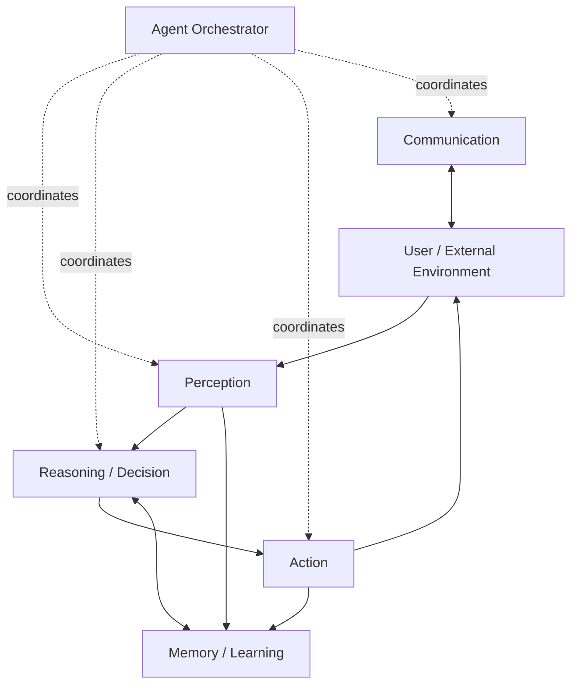
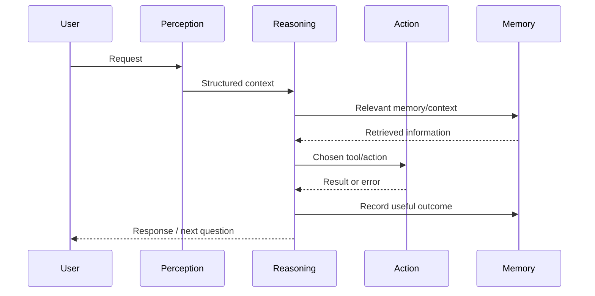

# 02. Agent-এর Core Subsystems

> Chapter alignment: 00:06:08 — Five Core Subsystems Around an Agent: Perception, Reasoning, Action, Learning, Communication

Agent-কে একটি একক “বুদ্ধিমান box” হিসেবে না দেখে কয়েকটি দায়িত্বের সমষ্টি হিসেবে ভাবলে design ও debugging সহজ হয়। এই নোটে পাঁচটি subsystem-এর mental model তৈরি করা হচ্ছে।

## 1. Overview

এটি conceptual diagram, universal implementation blueprint নয়। বাস্তবে subsystem আলাদা service, library, model, code function বা shared component হতে পারে।

## 2. Perception: কী ঘটছে তা বোঝা

Perception হলো environment থেকে agent-এর জন্য অর্থপূর্ণ input তৈরি করা।

উৎস হতে পারে:
- User message
- API response
- Database record
- Image, audio, video
- Tool execution result
- System event

Raw input আর usable representation এক জিনিস নয়। Perception-এ parsing, normalization, classification, extraction বা multimodal processing থাকতে পারে।

**Refund উদাহরণ:** “পণ্যটা ভাঙা” কথাটি থেকে intent (refund/complaint), order number, product, urgency এবং missing information শনাক্ত করা।

**Failure mode:** ভুল parsing, অস্পষ্ট request, missing data, stale data, prompt injection-কে trusted instruction হিসেবে নেওয়া।

## 3. Reasoning / Decision: এরপর কী করা উচিত?

Reasoning হলো বর্তমান context ও goal দেখে next step নির্বাচন করা।

এটি হতে পারে:
- LLM-generated decision
- Rule-based decision
- Planner
- Workflow state transition
- Hybrid approach

Reasoning-এর কাজ সবসময় দীর্ঘ chain-of-thought প্রকাশ করা নয়। System-এর জন্য structured decision বা action নির্বাচনই যথেষ্ট হতে পারে।

**Refund উদাহরণ:** order পাওয়ার পর policy অনুযায়ী damaged item-এর প্রমাণ দরকার কি না, refund eligible কি না, পরবর্তী action কী হবে তা নির্ধারণ।

**Failure mode:** ভুল সিদ্ধান্ত, hallucinated policy, অস্পষ্ট goal, একই action বারবার নেওয়া, context থেকে গুরুত্বপূর্ণ তথ্য বাদ পড়া।

## 4. Action: সিদ্ধান্ত বাস্তবে কার্যকর করা

Action subsystem tool বা environment-এর সঙ্গে যোগাযোগ করে। উদাহরণ:
- Search order
- Create support ticket
- Send notification
- Update database
- Initiate refund

Action layer-এ input validation, permission, timeout, retry policy, idempotency, error handling এবং audit logging গুরুত্বপূর্ণ।

**Refund উদাহরণ:** refund tool-এ order ID ও amount পাঠানো। শুধু tool call তৈরি হলেই কাজ সফল নয়; result status যাচাই করতে হবে।

## 5. Learning: অভিজ্ঞতা থেকে উন্নতি

Learning বলতে system-এর behavior বা performance উন্নত করার প্রক্রিয়া বোঝায়। এটি সব agent-এর runtime loop-এ স্বয়ংক্রিয়ভাবে ঘটে না।

Learning-এর উদাহরণ:
- Feedback/ratings সংগ্রহ
- ভুল action ও successful trajectory বিশ্লেষণ
- Evaluation dataset update
- Prompt বা policy পরিবর্তন
- Fine-tuning
- Reinforcement learning

**পার্থক্য:** Memory-তে কোনো তথ্য সংরক্ষণ করা আর model-এর parameters update হওয়া একই নয়। Agent কোনো user preference মনে রাখতে পারে, কিন্তু model weight পরিবর্তন না করেও।

## 6. Communication: অন্যদের সঙ্গে যোগাযোগ

Communication হলো user, অন্য agent, tool, service বা system-এর সঙ্গে তথ্য বিনিময়।

এতে থাকতে পারে:
- User-facing response
- Agent-to-agent message
- API request/response
- Structured event
- Handoff বা escalation

Communication-এ schema, message contract, authentication, authorization, privacy এবং error semantics গুরুত্বপূর্ণ।

## 7. Subsystem-গুলোর সম্পর্ক

একটি কাজের সময় subsystem-গুলো আলাদা ধাপ হতে পারে, আবার feedback-এর মাধ্যমে একে অন্যকে প্রভাবিত করতে পারে।

## 8. Interview deep dive

**প্রশ্ন: Agent subsystem-গুলো আলাদা করলে কী লাভ?**
- Separation of concerns
- Independently test ও replace করা সহজ
- Failure কোথায় হচ্ছে তা শনাক্ত করা সহজ
- Observability ও permission boundary তৈরি করা যায়

**প্রশ্ন: Learning কি Perception-এর অংশ?**  
Architecture-এর ওপর নির্ভর করে। Learning subsystem আলাদা conceptual responsibility হিসেবে দেখানো যায়, কিন্তু বাস্তবে feedback collection, memory, evaluation ও model training pipeline-এ ভাগ হতে পারে।

**প্রশ্ন: Reasoning কি LLM-এর কাজ আর Action কি tool-এর কাজ?**  
এটি প্রচলিত design, কিন্তু বাধ্যতামূলক নয়। Reasoning code-based হতে পারে; action-এর আগে deterministic validation layer থাকতে পারে; tool result আবার model-কে পরবর্তী সিদ্ধান্ত নিতে সাহায্য করতে পারে।

**প্রশ্ন: Agent-এর কোন subsystem সবচেয়ে গুরুত্বপূর্ণ?**  
একটি universal answer নেই। Task অনুযায়ী bottleneck আলাদা। ভুল perception হলে reasoning ভুল context পায়; ভুল reasoning হলে action ভুল হয়; ভুল action interface বা permission থাকলে side effect ঘটে; feedback না থাকলে সমস্যা শনাক্ত করা কঠিন।

## 9. নিজেকে যাচাই করো

1. Perception এবং reasoning-এর মধ্যে পার্থক্য কী?
2. Tool call সফল হয়েছে কিনা কোন subsystem বা layer নিশ্চিত করবে?
3. Memory ও learning কেন আলাদা ধারণা?
4. Communication failure কীভাবে agent-এর task failure তৈরি করতে পারে?
5. একটি subsystem-এর failure অন্য subsystem-কে কীভাবে প্রভাবিত করে?