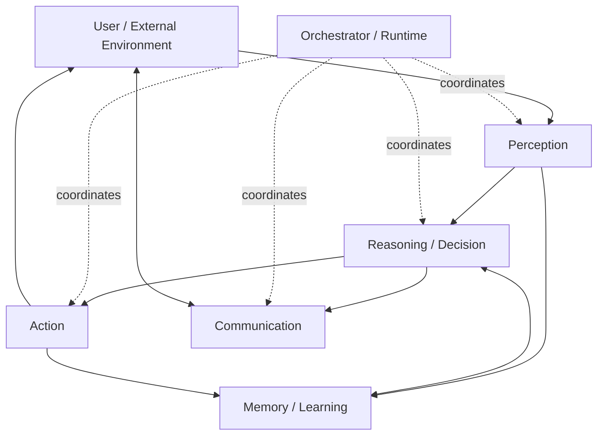
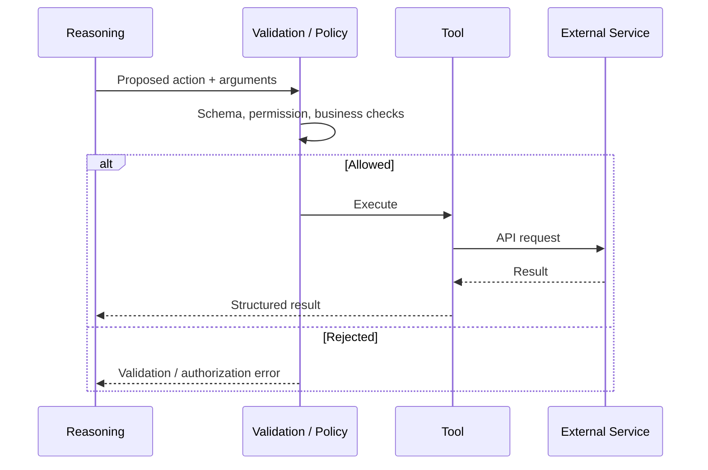
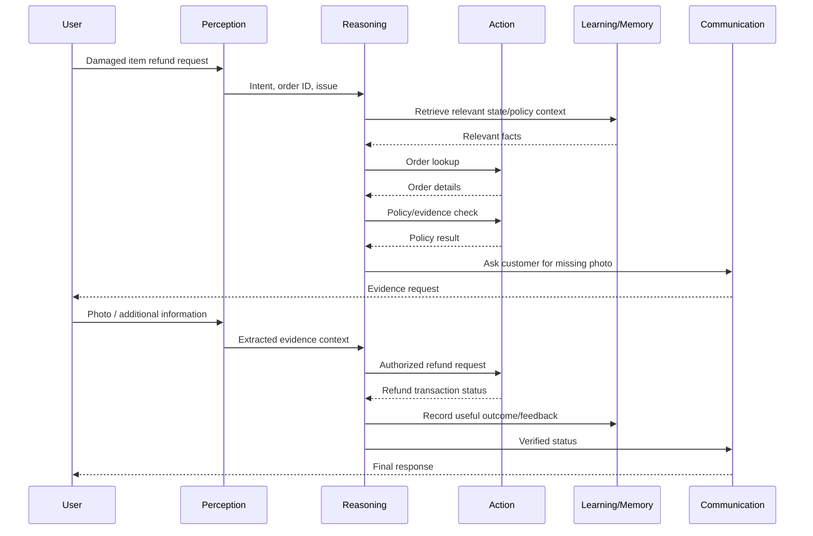

# 02. Agent-এর Core Subsystems

> Chapter alignment: 00:06:08 — Five Core Subsystems Around an Agent: Perception, Reasoning, Action, Learning, Communication

## 1. Agent-কে এক বাক্স হিসেবে দেখলে সমস্যা কোথায়?

একটি agent বাইরে থেকে একটিমাত্র intelligent system মনে হতে পারে। কিন্তু বাস্তবে এর ভেতরে অনেক ধরনের কাজ হচ্ছে: input বোঝা, সিদ্ধান্ত নেওয়া, tool চালানো, outcome সংরক্ষণ, অন্য service বা মানুষের সঙ্গে যোগাযোগ। এগুলোকে আলাদা responsibility হিসেবে দেখলে architecture বোঝা, test করা এবং bug খুঁজে বের করা সহজ হয়।

এই নোটে পাঁচটি conceptual subsystem দেখব:

1. Perception
2. Reasoning
3. Action
4. Learning
5. Communication

এগুলো কোনো universal software package বা বাধ্যতামূলক পাঁচটি microservice নয়। একটি subsystem function, library, model, service বা workflow-এর অংশ হতে পারে।

## 2. Overall architecture

Orchestrator subsystem-গুলোর execution coordinate করতে পারে। বাস্তব implementation-এ communication ও memory অন্য subsystem-এর মধ্যেও ছড়িয়ে থাকতে পারে।

## 3. Perception: Agent কী দেখছে এবং কী বুঝছে?

Perception হলো environment থেকে আসা raw input-কে agent-এর কাজের উপযোগী information-এ রূপান্তর করার responsibility।

### Input source
- User text/message
- API response
- Database record
- File/document
- Image/audio/video
- Sensor বা application event
- অন্য agent-এর message
- আগের tool call-এর result

### Perception-এ কী কাজ হতে পারে?
1. **Parsing:** raw input-এর structure বোঝা। যেমন JSON parse।
2. **Normalization:** একই অর্থের data-কে consistent format-এ আনা। যেমন date/time normalize।
3. **Intent detection:** user কী করতে চাইছে বোঝা।
4. **Entity extraction:** order ID, amount, date, product ID বের করা।
5. **Classification:** request complaint, refund, inquiry নাকি cancellation।
6. **Multimodal processing:** image থেকে damaged item-এর evidence বা audio থেকে speech extract করা।
7. **Context assembly:** বর্তমান task-এর সঙ্গে relevant information যুক্ত করা।

### Example

User লিখল: “গত সপ্তাহে যে blue backpack-টা কিনেছি, সেটা ছেঁড়া। টাকা ফেরত চাই।”

Perception layer সম্ভাব্যভাবে বের করবে:
- Intent: refund request
- Product: blue backpack
- Problem: damaged/torn
- Time reference: last week
- Missing field: exact order ID, যদি একাধিক order থাকে

Perception তথ্য বের করতে পারে, কিন্তু refund অনুমোদিত কি না তা policy reasoning/business validation-এর বিষয়।

### Failure modes
- ভুল entity extraction: order ID ভুল।
- Ambiguous input: “গত সপ্তাহে” কোন date range?
- Missing information: customer ID নেই।
- Stale source: cache-এ পুরনো order status।
- Prompt injection: retrieved document-এ থাকা malicious instruction-কে data না ধরে command হিসেবে নেওয়া।
- Multimodal uncertainty: ছবিতে damage স্পষ্ট নয়।

### Interview: Perception ও Reasoning-এর পার্থক্য কী?

Perception বলে “input-এ কী আছে?” Reasoning বলে “এই তথ্যের ভিত্তিতে এখন কী করা উচিত?”  
উদাহরণ: Perception damaged item ও order ID শনাক্ত করল। Reasoning ঠিক করল order lookup করতে হবে, তারপর policy অনুযায়ী evidence চাইতে হবে। বাস্তবে LLM দুটো কাজ একসঙ্গে করতে পারে, কিন্তু design/debugging-এর জন্য responsibility আলাদা করে ভাবা উপকারী।

## 4. Reasoning / Decision: পরবর্তী পদক্ষেপ কী?

Reasoning subsystem বর্তমান goal, observed information, state, policy ও constraints দেখে next step নির্বাচন করে।

### Reasoning-এর বিভিন্ন ধরন

- **Rule-based:** if/else বা business rule।
- **LLM-based:** language model context থেকে decision/action proposal দেয়।
- **Planner:** goal-কে subtask-এ ভাগ করে plan তৈরি করে।
- **State machine/workflow:** নির্ধারিত state transition অনুসরণ করে।
- **Hybrid:** LLM interpretation করে, deterministic code invariant enforce করে।

### Refund example

1. Order পাওয়া গেছে।
2. Order delivered status।
3. Policy বলছে damaged item report-এর জন্য photo evidence দরকার।
4. Reasoning সিদ্ধান্ত নেয় customer-এর কাছে photo চাইতে হবে।
5. Photo আসার পর eligibility check করা হবে।
6. Eligible হলে refund amount ও approval threshold check।
7. Threshold অতিক্রম করলে human review।

### Reasoning-এর quality কীসের ওপর নির্ভর করে?
- Input-এর accuracy
- Context-এর relevance ও freshness
- Policy source-এর authority
- Goal ও constraints-এর clarity
- Model capability
- Tool descriptions ও output quality
- Decision যাচাইয়ের ব্যবস্থা

### Failure modes
- Hallucinated rule
- Conflicting evidence
- Missing constraint
- Wrong tool selection
- Repeated action
- Premature conclusion
- Overconfident answer

### Interview: Reasoning কি সবসময় LLM করবে?

না। LLM অস্পষ্ট ভাষা বোঝা, evidence summarize, candidate next action প্রস্তাব ইত্যাদিতে ভালো কাজে লাগতে পারে। কিন্তু “refund amount order-এর refundable balance ছাড়াতে পারবে না” একটি strict invariant; এটি trusted business service-এ enforce করা উচিত। Model সিদ্ধান্ত propose করবে, code/policy layer সেটি validate করবে। এতে flexibility ও safety দুটোই পাওয়া যায়।

## 5. Action: সিদ্ধান্তকে বাস্তব কাজে রূপ দেওয়া

Action subsystem tool, API, database বা environment-এর সঙ্গে interaction করে। এটি system-এর “কাজ করার হাত”।

### Action-এর উদাহরণ
- Order retrieve
- Policy search
- Support ticket create
- Email draft/send
- Database update
- Refund initiate
- Calendar event create

### Action pipeline

### Action layer-এ জরুরি design concern

- **Input validation:** type check যথেষ্ট নয়; business constraints-ও যাচাই।
- **Authentication:** request কোন identity থেকে এসেছে?
- **Authorization:** সেই identity এই resource/action করতে পারে?
- **Timeout:** কতক্ষণ অপেক্ষা করবে?
- **Retry:** কোন error retryable?
- **Idempotency:** retry-তে duplicate side effect হবে কি?
- **Rate limiting:** অতিরিক্ত request আটকানো।
- **Audit logging:** কে, কখন, কী action করেছে?
- **Result verification:** operation সত্যিই সফল হয়েছে কি?

### Interview: Tool call পাঠানো মানেই action সফল?

না। Call তৈরি হওয়া, network-এ পাঠানো, server request গ্রহণ করা এবং business operation commit হওয়া আলাদা ঘটনা। Timeout হলে server operation সম্পন্ন করলেও response হারিয়ে যেতে পারে। তাই side-effecting action-এর ক্ষেত্রে idempotency key, transaction status lookup বা reconciliation দরকার। User-কে success বলার আগে authoritative result যাচাই করতে হবে।

## 6. Learning: Feedback থেকে system কীভাবে উন্নত হয়?

Learning subsystem বলতে system-এর future performance উন্নত করার জন্য feedback ব্যবহার করার process বোঝায়। এটি সব agent-এর প্রতিটি request-এর পরে নিজে নিজে model weights বদলে ফেলে, এমন নয়।

### Learning-এর সম্ভাব্য স্তর

1. **Feedback collection:** user rating, correction, task outcome সংগ্রহ।
2. **Trajectory analysis:** agent কী step নিয়েছে, কোথায় ভুল করেছে বিশ্লেষণ।
3. **Evaluation update:** নতুন failure case test set-এ যোগ।
4. **Instruction/prompt improvement:** ভুল নির্দেশনা ঠিক করা।
5. **Tool/policy improvement:** API contract বা business rule bug ঠিক করা।
6. **Fine-tuning:** উপযুক্ত data দিয়ে model parameters update।
7. **Reinforcement learning:** reward/feedback signal ব্যবহার করে behavior optimize।

### Memory ও Learning এক নয়

Agent “এই user email নয়, SMS পছন্দ করে” তথ্যটি save করল। এটি memory update। Model weights পরিবর্তন হয়নি।  
অন্যদিকে, বহু উদাহরণ দিয়ে model fine-tune করা হলে model parameters পরিবর্তিত হয়। এটি learning/training pipeline-এর অংশ।

### Interview: প্রতিটি ভুল থেকে agent-কে নিজে নিজে শিখতে দেওয়া উচিত?

সতর্কভাবে। User feedback ভুল বা malicious হতে পারে। একটি ভুল interaction সরাসরি policy বা model-এ ঢোকালে system degrade বা poison হতে পারে। Feedback সংগ্রহ, validation, offline evaluation, review এবং controlled rollout দরকার। High-impact domain-এ learning pipeline production action path থেকে আলাদা রাখা উচিত।

## 7. Communication: Agent কার সঙ্গে এবং কীভাবে কথা বলে?

Communication subsystem তথ্য আদান-প্রদান করে:
- User ↔ Agent
- Agent ↔ Tool/API
- Agent ↔ Agent
- Agent ↔ Human reviewer
- Service ↔ Event/message broker

### Communication contract

ভালো communication-এর জন্য নির্দিষ্ট contract দরকার:
- Message format/schema
- Sender/receiver identity
- Correlation/trace ID
- Authentication ও authorization
- Timeout ও error format
- Data classification/privacy
- Version compatibility

Agent-to-agent communication-এ শুধু “এই কাজটা করো” পাঠালেই যথেষ্ট নয়। Goal, relevant context, constraints, allowed scope ও expected output format দিতে হয়।

### Interview: Communication কি শুধু user-facing response?

না। Agent-এর communication-এর বড় অংশ user দেখতে পায় না। Tool request/response, event, agent handoff, human approval request, service-to-service message সবই communication। তাই message contract ও access control জরুরি।

## 8. পাঁচ subsystem একসঙ্গে: End-to-end scenario

## 9. Interview: Deep questions ও model answers

### Q1. Agent-এর subsystem আলাদা করে design করার সুবিধা কী?

এটি separation of concerns তৈরি করে। Perception-এর bug, tool execution-এর bug ও policy decision-এর bug আলাদা করে test করা যায়। উদাহরণস্বরূপ, order ID extraction unit test করা যায়; refund permission policy আলাদাভাবে test করা যায়; tool timeout simulation করা যায়। Observability-তেও প্রতিটি stage-এর latency ও failure rate দেখা যায়।

তবে conceptual separation মানেই microservice বানাতে হবে না। ছোট system-এ একই process-এর modular function যথেষ্ট। Deployment boundary কেবল তখনই আলাদা করো, যখন scaling, ownership, isolation বা reliability-এর বাস্তব কারণ আছে।

### Q2. পাঁচটি subsystem কি সব agent-এ আলাদা করে থাকতে হবে?

না। এগুলো responsibility বোঝানোর conceptual model। Simple agent-এ perception ও reasoning একই LLM call-এ হতে পারে। Communication সাধারণ tool runtime-এর অংশ হতে পারে। Learning offline evaluation pipeline-এ থাকতে পারে। Architecture-এ responsibility স্পষ্ট থাকাই গুরুত্বপূর্ণ, আলাদা process হওয়া নয়।

### Q3. Learning subsystem runtime-এর অংশ নাকি offline?

দুইভাবেই হতে পারে। Runtime-এ feedback/event collect করা যায় এবং limited memory update হতে পারে। কিন্তু model training, evaluation, policy change ও deployment সাধারণত offline বা controlled pipeline-এ করা নিরাপদ। Runtime-এর user input-কে সরাসরি model behavior পরিবর্তনের অনুমতি দিলে poisoning risk থাকে।

### Q4. Reasoning ও Action-এর boundary কোথায়?

Reasoning সিদ্ধান্ত বা action proposal তৈরি করে; Action সেই proposal execute করে। উদাহরণ: Reasoning বলে “order #123-এর refund initiate করা দরকার”। Action layer arguments validate করে, permission check করে, refund API call করে এবং result ফেরত দেয়। Boundary থাকলে model ভুল সিদ্ধান্ত নিলেও action layer unauthorized বা invalid request reject করতে পারে।

### Q5. Perception ভুল হলে downstream কী হয়?

ভুল input downstream reasoning-কে ভুল পথে নিতে পারে, তারপর ভুল action-ও ঘটতে পারে। একে garbage-in, garbage-out সমস্যা বলা যায়। তাই critical entity extraction confidence, format validation, source verification এবং ambiguity হলে clarification দরকার। High-impact action-এর আগে order/customer identity পুনরায় verify করা উচিত।

### Q6. Communication failure কীভাবে handle করবে?

Timeout, unavailable receiver, malformed message, duplicate delivery ও version mismatch ধরতে হবে। Retry policy, idempotency, dead-letter handling, correlation ID ও structured error দরকার। Human handoff pending থাকলে state persist করতে হবে, যাতে process restart হলেও workflow হারিয়ে না যায়।

### Q7. Agent subsystem-এর performance কীভাবে মাপবে?

প্রতিটি layer-এর metric এবং end-to-end metric দুটোই দরকার:
- Perception: extraction accuracy, ambiguity detection।
- Reasoning: decision correctness, policy violation।
- Action: tool success rate, latency, duplicate side effect।
- Learning: evaluation improvement, regression rate।
- Communication: delivery success, timeout, handoff latency।
- End-to-end: task success, user satisfaction, cost, time, safety incident।

শুধু LLM response quality দিয়ে পুরো agent evaluate করা যায় না।

## 10. Practice

একটি refund agent-এর architecture আঁকো। প্রতিটি subsystem-এর পাশে লিখো:
- Input
- Output
- Responsibility
- Failure mode
- Test strategy
- Security boundary

শেষে ব্যাখ্যা করো, কোন responsibility একই process-এ থাকবে এবং কোনটি আলাদা service হওয়ার কারণ আছে।
