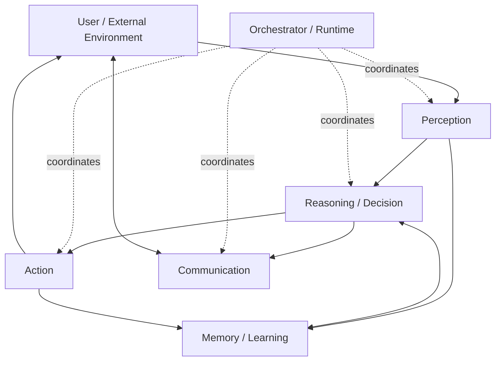
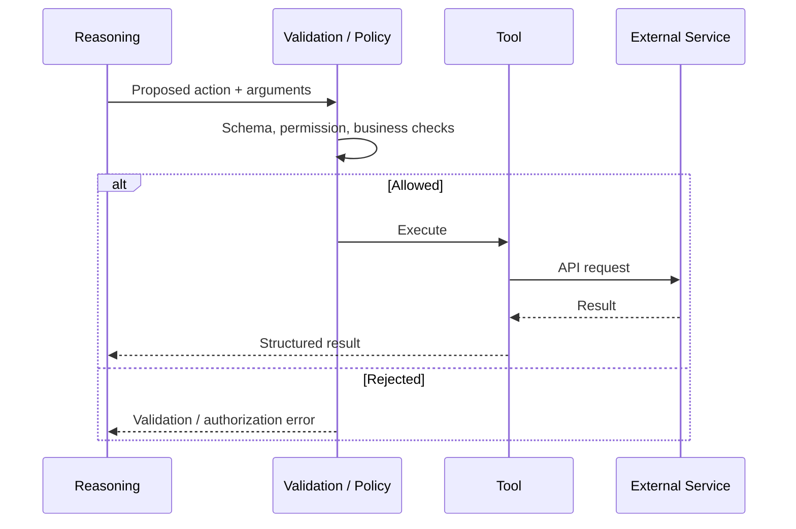
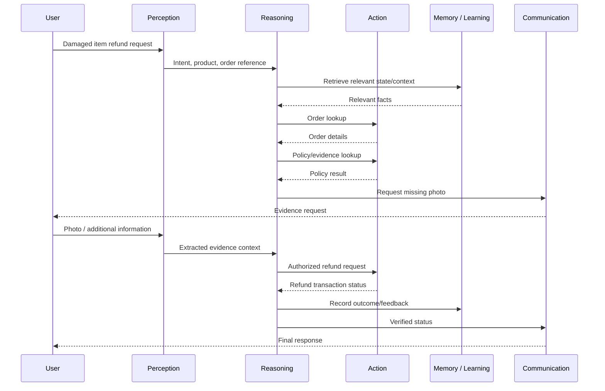

# 02. Agent-এর Core Subsystems

> Chapter alignment: 00:06:08 — Five Core Subsystems Around an Agent: Perception, Reasoning, Action, Learning, Communication

## 1. বাইরে থেকে একটি Agent, ভেতরে অনেকগুলো দায়িত্ব

একটি agent-কে আমরা সাধারণত একটি নাম দিই: “Support Agent”, “Research Agent” বা “Coding Agent”। কিন্তু নামটি শুনে যেন মনে না হয়, ভেতরে একটি মাত্র intelligent box বসে আছে। একটি support agent যখন refund request সামলায়, তখন অন্তত পাঁচ ধরনের কাজ ঘটতে পারে: customer-এর message বোঝা, কী করা উচিত তা নির্ধারণ করা, order বা payment service-এ action চালানো, আগের outcome থেকে system উন্নত করা এবং customer বা অন্য service-এর সঙ্গে তথ্য আদান-প্রদান করা।

এই দায়িত্বগুলো একসঙ্গে গুলিয়ে ফেললে একটি গুরুত্বপূর্ণ সমস্যা হয়: ভুল কোথায় ঘটেছে তা বোঝা কঠিন হয়ে যায়। Customer-এর order ID ভুল extract হয়েছে, নাকি reasoning ভুল policy বেছে নিয়েছে? Model সঠিক action প্রস্তাব করেছে, কিন্তু API call ব্যর্থ হয়েছে? নাকি refund সফল হয়েছে, কিন্তু communication layer customer-কে ভুল status জানিয়েছে? সবকিছুকে “agent ভুল করেছে” বললে root cause পাওয়া যায় না।

তাই agent architecture বোঝার সুবিধার জন্য আমরা পাঁচটি **conceptual subsystem** আলাদা করে দেখি:

1. **Perception:** input ও environment থেকে কী তথ্য পাওয়া যাচ্ছে?
2. **Reasoning:** সেই তথ্যের ভিত্তিতে কী করা উচিত?
3. **Action:** সিদ্ধান্তকে বাস্তব operation-এ কীভাবে রূপ দেওয়া হবে?
4. **Learning:** feedback থেকে ভবিষ্যতের performance কীভাবে উন্নত হবে?
5. **Communication:** user, tool, service, agent ও মানুষের মধ্যে তথ্য কীভাবে আদান-প্রদান হবে?

এগুলো পাঁচটি বাধ্যতামূলক microservice নয়। একটি ছোট application-এ পাঁচটি responsibility একই process-এর function বা module হতে পারে। বড় system-এ কিছু responsibility আলাদা service বা offline pipeline-এ থাকতে পারে। **Responsibility আলাদা করে ভাবা জরুরি; deployment boundary আলাদা করতেই হবে, এমন নয়।**

## 2. পুরো ছবিটি একবার দেখি

Diagram-টি একটি teaching model। বাস্তবে subsystem-গুলোর সীমানা implementation অনুযায়ী বদলাতে পারে। যেমন, LLM একই call-এ user-এর intent বুঝতে এবং next action প্রস্তাব করতে পারে। তবু debugging, testing ও security design-এর সময় perception আর reasoning-এর দায়িত্ব আলাদা করে দেখা উপকারী।

আরেকটি পার্থক্য মনে রাখো: **Orchestrator বা runtime subsystem-গুলোর execution coordinate করে; কিন্তু coordination করা মানেই প্রতিটি subsystem-এর business responsibility নিজের হাতে নেওয়া নয়।** Runtime ঠিক করতে পারে কখন model call হবে, কখন tool execute হবে, কতবার retry করা যাবে। কিন্তু refund eligibility-র authoritative business rule refund service-এর দায়িত্বই থাকা উচিত।

## 3. Perception: Agent আসলে কী দেখতে পাচ্ছে?

মানুষের ক্ষেত্রে perception বলতে চোখে দেখা, কানে শোনা এবং পরিবেশ থেকে তথ্য নেওয়া বোঝায়। Agent-এর ক্ষেত্রে ধারণাটি একই রকম, তবে input source অনেক বিস্তৃত। User-এর লেখা message যেমন input, তেমনি database record, API response, PDF, image, audio, event stream বা অন্য agent-এর পাঠানো message-ও input হতে পারে।

ধরো customer লিখল:

“গত সপ্তাহে যে blue backpack-টা কিনেছি, সেটা ছেঁড়া। টাকা ফেরত চাই।”

এই বাক্যে একাধিক তথ্য আছে। Agent-এর আগে বুঝতে হবে customer কী বলছেন:

- Intent: refund request
- Product description: blue backpack
- Problem: torn/damaged
- Time reference: গত সপ্তাহ
- সম্ভাব্য missing information: exact order ID, যদি একই সময়ে একাধিক order থাকে

এই ধাপে system তথ্য শনাক্ত ও সংগঠিত করছে। কিন্তু এখনো refund অনুমোদন করছে না। “Customer damaged বলেছে” এবং “Refund policy অনুযায়ী customer refund পাওয়ার যোগ্য” এক বক্তব্য নয়। প্রথমটি observation; দ্বিতীয়টি business decision।

### 3.1 Perception-এর ভেতরের কাজ

**Parsing:** Raw input-এর structure বোঝা। JSON response parse করা, form field পড়া বা message-এর অংশ আলাদা করা।

**Normalization:** একই ধরনের তথ্যকে consistent representation-এ আনা। যেমন, “গত সোমবার”, “2026-11-16” ও timestamp-কে নির্দিষ্ট timezone-aware date representation-এ রূপ দেওয়া। Normalization-এ timezone বা locale ভুল হলে পরবর্তী সিদ্ধান্তও ভুল হতে পারে।

**Intent detection:** User কী করতে চাইছেন তা শনাক্ত করা। Refund, cancellation, status inquiry নাকি complaint?

**Entity extraction:** Order ID, product name, amount, date, customer ID-এর মতো entity বের করা।

**Classification:** Message বা document-কে category-তে ভাগ করা। যেমন complaint-এর ধরন, urgency বা evidence type।

**Multimodal processing:** Image থেকে দৃশ্যমান বৈশিষ্ট্য, audio থেকে speech বা document থেকে text বের করা। তবে model image দেখে “পণ্যটি নিশ্চিতভাবে এই customer-এর order-এর” এমন সিদ্ধান্ত দিতে পারে না; provenance ও order linkage আলাদাভাবে যাচাই করতে হবে।

**Context assembly:** বর্তমান task-এর জন্য প্রয়োজনীয় conversation history, user identity, retrieved document ও tool result একত্র করা। এখানে সব context জুড়ে দেওয়া নয়, relevant ও authorized context বেছে নেওয়াই মূল কাজ।

### 3.2 Perception-এর failure কেন বিপজ্জনক?

ধরো customer-এর দুটি order আছে। Model ভুল করে পুরোনো order ID বেছে নিল। Reasoning subsystem যদি সেই ভুল ID-কে সত্য ধরে নেয়, তাহলে পরবর্তী policy check-ও ভুল order-এর ওপর হবে। শেষে action layer শক্তিশালী না হলে ভুল refund-ও execute হতে পারে।

তাই critical field-এর ক্ষেত্রে validation, source verification এবং ambiguity detection দরকার। Confidence কম হলে agent-এর উচিত অনুমান করে এগোনোর বদলে clarification চাওয়া। Retrieved document-এ malicious instruction থাকলে সেটিকে trusted command হিসেবে নেওয়া যাবে না; retrieved content হলো data, system instruction নয়।

### Interview: Perception ও Reasoning-এর পার্থক্য কী?

Perception প্রশ্ন করে, “Input-এ কী তথ্য আছে?” Reasoning প্রশ্ন করে, “এই তথ্য ও goal বিবেচনায় এখন কী করা উচিত?”

উদাহরণ: Perception damaged item, product name ও সম্ভাব্য order ID শনাক্ত করল। Reasoning বুঝল যে refund eligibility নির্ধারণের আগে order details ও policy যাচাই করা দরকার। বাস্তবে একই LLM দুটো কাজ একসঙ্গে করতে পারে, কিন্তু architecture-এ আলাদা responsibility রাখলে ভুলের উৎস খুঁজে পাওয়া সহজ হয়।

## 4. Reasoning: পাওয়া তথ্য দিয়ে পরবর্তী পদক্ষেপ বেছে নেওয়া

Perception তথ্য প্রস্তুত করেছে। এবার system-কে সিদ্ধান্ত নিতে হবে। Refund request-এর ক্ষেত্রে পরবর্তী পদক্ষেপ কী: order lookup, customer-এর কাছে order ID চাওয়া, policy retrieve, evidence চাওয়া, নাকি request reject/escalate?

Reasoning subsystem বর্তমান goal, observed information, state, policy ও constraints বিবেচনা করে next step নির্বাচন করে। এটি শুধু “ভেবে উত্তর দেওয়া” নয়; অনেক ক্ষেত্রে কাজকে ছোট subtask-এ ভাগ করা, plan তৈরি করা এবং আগের action-এর ফল অনুযায়ী plan সংশোধন করাও এর অংশ।

### 4.1 Reasoning-এর বিভিন্ন পদ্ধতি

**Rule-based reasoning:** নির্দিষ্ট condition ও business rule অনুসরণ করে। যেমন, refundable balance শূন্য হলে refund amount শূন্যের বেশি হতে পারবে না। Rule স্পষ্ট ও deterministic হলে code-এ enforce করা ভালো।

**LLM-based reasoning:** Language model context ও instruction দেখে সম্ভাব্য next step বা action proposal তৈরি করে। অস্পষ্ট natural-language request বোঝা, document থেকে evidence summarize করা বা বিকল্প ব্যাখ্যা তৈরি করতে এটি কার্যকর।

**Planning:** বড় goal-কে ছোট task-এ ভাগ করে সম্ভাব্য sequence তৈরি করা। যেমন, “refund request resolve” goal-এর জন্য order retrieve → policy check → evidence collect → eligibility verify → approval → refund initiate → status confirm।

**State machine বা workflow:** অনুমোদিত state ও transition আগে থেকে নির্ধারণ করে। যেমন, `REQUESTED` থেকে `EVIDENCE_PENDING`, তারপর `ELIGIBILITY_CHECKED`, `APPROVAL_PENDING`, `REFUND_PENDING`, `REFUNDED` বা `FAILED`। Model কোনো state transition প্রস্তাব করলেও backend-এর state machine সেটি বৈধ কি না যাচাই করতে পারে।

**Hybrid reasoning:** LLM language ও ambiguity সামলায়, আর deterministic code strict invariant enforce করে। Production system-এ এই মিশ্র পদ্ধতি প্রায়ই কার্যকর।

### 4.2 Refund example-এ reasoning

ধরা যাক order পাওয়া গেছে এবং সেটি delivered। Policy অনুযায়ী damaged item-এর ক্ষেত্রে photo evidence দরকার। Reasoning subsystem সিদ্ধান্ত নিতে পারে যে এখন refund tool call করা যাবে না; আগে customer-এর কাছে photo চাইতে হবে। Photo আসার পর eligibility check হবে। Refund amount নির্দিষ্ট threshold ছাড়ালে human approval লাগতে পারে।

এখানে reasoning-এর সিদ্ধান্তও সীমাবদ্ধ। Model policy document পড়ে একটি সম্ভাব্য ব্যাখ্যা দিতে পারে, কিন্তু actual refundable amount বা customer-এর permission নিজে authoritative ভাবে নির্ধারণ করা উচিত নয়। Trusted business service-কে final invariant যাচাই করতে হবে।

### 4.3 Reasoning ভুল হওয়ার সাধারণ কারণ

- **Hallucinated rule:** context-এ নেই এমন policy ধরে নেওয়া।
- **Conflicting evidence:** পুরোনো order record ও নতুন payment status পরস্পরবিরোধী।
- **Missing constraint:** refund amount limit বা approval threshold উপেক্ষা করা।
- **Wrong tool selection:** policy lookup-এর বদলে refund execution tool বেছে নেওয়া।
- **Premature conclusion:** evidence না পেয়েই eligibility ঘোষণা।
- **Repeated action:** আগের tool result উপেক্ষা করে একই operation বারবার প্রস্তাব করা।
- **Overconfidence:** uncertainty থাকা সত্ত্বেও নিশ্চিত ভাষায় উত্তর দেওয়া।

### Interview: Reasoning কি সবসময় LLM করবে?

না। LLM অস্পষ্ট ভাষা বোঝা, evidence summarize করা এবং candidate next action প্রস্তাব করতে পারে। কিন্তু “refund amount refundable balance অতিক্রম করতে পারবে না” একটি strict invariant। এটি trusted backend/service-এ enforce করা উচিত। Model সিদ্ধান্ত propose করতে পারে; code ও policy layer সেটি validate করবে। এতে flexibility এবং safety একসঙ্গে পাওয়া যায়।

## 5. Action: সিদ্ধান্তকে বাস্তব operation-এ রূপ দেওয়া

Reasoning subsystem বলতে পারে, “এই order-এর refund eligibility যাচাই করতে হবে।” কিন্তু সিদ্ধান্ত বলা আর বাস্তবে কাজ করা এক নয়। Order service query করা, policy search চালানো, ticket তৈরি করা বা payment service-এ refund request পাঠানো হলো action।

Action subsystem হলো agent-এর বাইরের environment-এর সঙ্গে কাজ করার mechanism। Tool, API, database operation, browser interaction বা event publish করার মতো capability এর অংশ হতে পারে।

### 5.1 Action pipeline

Model tool call-এর নাম ও arguments প্রস্তাব করতে পারে। কিন্তু execution-এর আগে runtime বা trusted service-কে অন্তত তিনটি আলাদা বিষয় যাচাই করতে হয়:

1. **Schema validation:** arguments-এর shape ও type ঠিক আছে?
2. **Authorization:** এই user/agent এই resource-এ এই operation করতে পারে?
3. **Business validation:** operation-টি বর্তমান business state-এ বৈধ? যেমন refundable balance যথেষ্ট কি না।

এই তিনটি validation এক জিনিস নয়। JSON schema valid হলেই refund business-wise valid হয় না। আবার business rule ঠিক হলেও caller-এর permission না থাকলে action execute করা যাবে না।

### 5.2 Action layer-এর reliability concern

**Timeout:** Downstream service কতক্ষণে response দেবে? Deadline পেরোলে কী হবে?

**Retry:** কোন error retry করা নিরাপদ? Validation error retry করলে সাধারণত লাভ নেই। Temporary network error retryable হতে পারে।

**Idempotency:** একই request retry হলে duplicate side effect হবে কি? Refund, payment বা order creation-এর মতো operation-এ idempotency key গুরুত্বপূর্ণ।

**Rate limiting:** Agent যেন অল্প সময়ে অতিরিক্ত API request না পাঠায়।

**Audit logging:** কোন identity, কোন agent, কখন, কী arguments দিয়ে action করেছে, তার trace থাকতে হবে।

**Result verification:** API response পাওয়া মানেই business outcome সম্পন্ন হয়েছে এমন নয়। `accepted`, `pending`, `completed` ও `failed` আলাদা state হতে পারে।

### Interview: Tool call পাঠানো মানেই action সফল?

না। Model tool call তৈরি করেছে, runtime সেটি পাঠিয়েছে, server request গ্রহণ করেছে এবং business operation commit হয়েছে, এগুলো আলাদা ঘটনা। Timeout হলে server কাজটি সম্পন্ন করেও response ফেরত দিতে ব্যর্থ হতে পারে। তখন blind retry করলে duplicate refund হতে পারে। তাই idempotency key, operation status lookup এবং reconciliation দরকার। User-কে success বলার আগে authoritative outcome যাচাই করতে হবে।

## 6. Learning: Feedback থেকে system কীভাবে উন্নত হয়?

“Agent learning করে” কথাটি শুনে অনেকের মনে হয়, প্রতিটি interaction-এর পর model নিজে নিজে নিজের brain বদলে ফেলছে। সাধারণ production system-এ বিষয়টি এমন নয়। Learning বলতে ভবিষ্যতের performance উন্নত করার জন্য feedback সংগ্রহ, বিশ্লেষণ এবং controlled change বোঝাতে পারে। এই পরিবর্তন model weights-এ হতে পারে, আবার prompt, tool, retrieval, policy বা evaluation suite-এও হতে পারে।

### 6.1 Learning-এর একটি বাস্তব lifecycle

ধরা যাক support agent ভুল করে customer-কে জানিয়েছে যে refund complete, যদিও payment service শুধু request গ্রহণ করেছিল।

প্রথমে system-এর trace ও feedback সংগ্রহ করতে হবে: কোন prompt ব্যবহৃত হয়েছে, tool কী status ফিরিয়েছে, model কীভাবে status interpret করেছে, final response কী ছিল। তারপর failure-এর root cause খুঁজতে হবে। হয়তো tool output-এর status semantics অস্পষ্ট ছিল, অথবা model-এর instruction-এ pending আর completed-এর পার্থক্য শেখানো হয়নি।

এরপর একটি regression test তৈরি করা যায়: tool যদি `PENDING` ফেরত দেয়, agent যেন “refund initiated/pending” বলে, “money returned” না বলে। Tool contract বা instruction সংশোধন করা যায়। প্রয়োজন হলে উপযুক্ত dataset দিয়ে model fine-tune করা যেতে পারে। সবশেষে evaluation চালিয়ে নিশ্চিত হতে হবে যে নতুন change পুরোনো behavior নষ্ট করেনি।

এই lifecycle-এ শেখার অনেক ধাপ আছে, কিন্তু production user-এর প্রতিটি message-এর পর model weights পরিবর্তন হচ্ছে না।

### 6.2 Learning-এর সম্ভাব্য স্তর

1. **Feedback collection:** user rating, correction, task outcome ও reviewer feedback সংগ্রহ।
2. **Trajectory analysis:** agent কী observation, decision ও tool call করেছে তা বিশ্লেষণ।
3. **Evaluation update:** নতুন failure case test set-এ যোগ করা।
4. **Instruction/prompt improvement:** ভুল বা অস্পষ্ট instruction ঠিক করা।
5. **Tool ও policy improvement:** API contract, validation বা business rule-এর bug ঠিক করা।
6. **Fine-tuning:** curated data দিয়ে model parameters update করা।
7. **Reinforcement learning:** reward বা preference signal ব্যবহার করে behavior optimize করা।

সব task-এ সব স্তর প্রয়োজন হয় না। কখনো root cause model নয়, বরং stale data, ভুল tool schema বা দুর্বল permission check।

### 6.3 Memory ও Learning এক নয়

Agent যদি মনে রাখে “এই user email-এর বদলে SMS notification পছন্দ করেন”, সেটি memory update। এটি user-specific তথ্য সংরক্ষণ; model weights বদলানো নয়।

অন্যদিকে বহু curated example দিয়ে model fine-tune করলে model parameters পরিবর্তিত হয়। সেটি training/learning pipeline-এর অংশ। আবার নতুন failure case evaluation suite-এ যোগ করাও system-কে উন্নত করে, যদিও model weights অপরিবর্তিত থাকে।

### Interview: প্রতিটি ভুল থেকে agent-কে নিজে নিজে শিখতে দেওয়া উচিত?

না, সরাসরি নয়। User feedback ভুল, biased বা malicious হতে পারে। একটি ভুল interaction সরাসরি policy বা model-এ ঢোকালে system degrade বা poison হতে পারে। Feedback collection, validation, offline evaluation, human review এবং controlled rollout দরকার। High-impact domain-এ learning pipeline-কে production action path থেকে আলাদা রাখা নিরাপদ।

## 7. Communication: Agent কার সঙ্গে এবং কীভাবে কথা বলে?

Communication শুধু user-কে final answer পাঠানো নয়। Agent-এর ভেতরে এবং বাইরের system-গুলোর মধ্যে বহু ধরনের message আদান-প্রদান হয়:

- User ↔ Agent
- Agent ↔ Tool/API
- Agent ↔ Agent
- Agent ↔ Human reviewer
- Service ↔ Event broker
- Agent ↔ Memory বা retrieval service

যখন agent order service-এ query পাঠায়, সেটিও communication। যখন agent আরেকটি specialized agent-কে research task দেয়, সেটিও communication। যখন human approval দরকার বলে reviewer-এর কাছে case পাঠায়, সেটিও communication।

### 7.1 Message contract কেন দরকার?

দুইটি component একই message-এর অর্থ একইভাবে না বুঝলে failure তৈরি হয়। তাই communication contract-এ সাধারণত কিছু বিষয় স্পষ্ট থাকা দরকার:

- **Message schema:** কোন field থাকবে, type কী, কোন field required?
- **Identity:** message কে পাঠিয়েছে?
- **Correlation/trace ID:** কোন user request বা workflow-এর অংশ?
- **Authentication ও authorization:** sender কে এবং এই message পাঠানোর অধিকার আছে?
- **Timeout ও error format:** receiver সাড়া না দিলে কী হবে?
- **Data classification:** কোন তথ্য sensitive এবং কোথায় পাঠানো যাবে?
- **Version compatibility:** sender ও receiver contract-এর কোন version ব্যবহার করছে?

Agent-to-agent communication-এ শুধু “এই কাজটা করো” পাঠালেই যথেষ্ট নয়। Goal, relevant context, constraints, allowed scope এবং expected output format দিতে হয়। অপ্রয়োজনীয় বা sensitive context পাঠালে privacy ও security risk তৈরি হতে পারে।

### Interview: Communication কি শুধু user-facing response?

না। Tool request/response, event, agent handoff, human approval request এবং service-to-service message সবই communication। তাই message contract, identity, access control, correlation ID এবং failure handling গুরুত্বপূর্ণ।

## 8. পাঁচটি subsystem একসঙ্গে: একটি end-to-end refund scenario

এবার পাঁচটি responsibility-কে একই workflow-তে দেখি।

এই flow-তে Perception customer-এর message ও photo থেকে তথ্য তৈরি করছে। Reasoning ঠিক করছে কোন তথ্যের পর কোন পদক্ষেপ দরকার। Action order ও policy service-এর সঙ্গে কাজ করছে। Communication customer-এর কাছে evidence request ও final status পৌঁছে দিচ্ছে। Learning/Memory ভবিষ্যৎ interaction বা evaluation-এর জন্য প্রাসঙ্গিক state ও feedback ধরে রাখতে পারে।

তবে diagram-এ Learning দেখানো মানে প্রতিটি refund request-এর পর model train হচ্ছে না। Outcome record করা, memory update, evaluation dataset-এ failure case যোগ করা এবং model training আলাদা কাজ। এই পার্থক্য ভুলে গেলে learning architecture অযথা জটিল হয়ে যাবে।

## 9. Architecture design: Responsibility আলাদা করব, নাকি service আলাদা করব?

পাঁচটি subsystem দেখে পাঁচটি microservice বানাতে ইচ্ছা হতে পারে। কিন্তু সেটি সাধারণত ভুল শুরু। প্রথমে responsibility boundary পরিষ্কার করো। তারপর দেখো কোন responsibility-র আলাদা scaling, deployment, security isolation, reliability বা team ownership দরকার।

একটি ছোট refund agent-এ perception, reasoning orchestration ও communication একই application process-এ থাকতে পারে। Order service ও payment service অবশ্যই তাদের নিজস্ব domain-এর owner হতে পারে। Offline learning/evaluation pipeline আলাদা scheduled job বা platform হতে পারে।

আলাদা service করার যুক্তি হতে পারে:
- আলাদা scaling profile;
- sensitive data-এর জন্য isolation;
- ভিন্ন availability requirement;
- independent release cadence;
- আলাদা team ownership;
- failure containment।

কিন্তু network hop, distributed tracing, deployment ও contract maintenance-এর খরচও আছে। তাই শুধু diagram সুন্দর করার জন্য service ভাঙবে না।

## 10. Interview: গভীর প্রশ্ন ও ব্যাখ্যাসহ উত্তর

### Q1. Agent-এর subsystem আলাদা করে design করার সুবিধা কী?

এটি separation of concerns তৈরি করে। Perception-এর bug, tool execution-এর bug এবং policy decision-এর bug আলাদা করে test করা যায়। উদাহরণস্বরূপ, order ID extraction unit test করা যায়; refund permission policy আলাদা test করা যায়; tool timeout simulation করা যায়। Observability-তেও প্রতিটি stage-এর latency ও failure rate দেখা যায়।

তবে conceptual separation মানেই microservice বানাতে হবে না। ছোট system-এ modular function বা package যথেষ্ট। Deployment boundary আলাদা করো তখনই, যখন scaling, ownership, isolation বা reliability-এর বাস্তব কারণ আছে।

### Q2. পাঁচটি subsystem কি সব agent-এ আলাদা করে থাকতে হবে?

না। এগুলো responsibility বোঝানোর conceptual model। Simple agent-এ perception ও reasoning একই LLM call-এ হতে পারে। Communication সাধারণ tool runtime-এর অংশ হতে পারে। Learning offline evaluation pipeline-এ থাকতে পারে। Architecture-এ responsibility স্পষ্ট থাকাই গুরুত্বপূর্ণ, আলাদা process হওয়া নয়।

### Q3. Learning subsystem runtime-এর অংশ নাকি offline?

দুই ধরনের কাজ থাকতে পারে। Runtime-এ feedback/event collect করা যায় এবং সীমিত memory update হতে পারে। কিন্তু model training, evaluation, policy change ও deployment সাধারণত offline বা controlled pipeline-এ করা নিরাপদ। Runtime-এর user input-কে সরাসরি model behavior পরিবর্তনের অনুমতি দিলে poisoning risk থাকে।

### Q4. Reasoning ও Action-এর boundary কোথায়?

Reasoning সিদ্ধান্ত বা action proposal তৈরি করে; Action সেই proposal execute করে। উদাহরণ: Reasoning বলে “order #123-এর refund initiate করা দরকার”। Action layer arguments validate করে, permission check করে, refund API call করে এবং result ফেরত দেয়। Boundary থাকলে model ভুল সিদ্ধান্ত নিলেও action layer unauthorized বা invalid request reject করতে পারে।

### Q5. Perception ভুল হলে downstream কী হয়?

ভুল input downstream reasoning-কে ভুল পথে নিতে পারে, তারপর ভুল action-ও ঘটতে পারে। একে garbage-in, garbage-out সমস্যা বলা যায়। তাই critical entity extraction-এর ক্ষেত্রে confidence, format validation, source verification এবং ambiguity হলে clarification দরকার। High-impact action-এর আগে order/customer identity পুনরায় verify করা উচিত।

### Q6. Communication failure কীভাবে handle করবে?

Timeout, unavailable receiver, malformed message, duplicate delivery ও version mismatch ধরতে হবে। Retry policy, idempotency, dead-letter handling, correlation ID ও structured error দরকার। Human handoff pending থাকলে state persist করতে হবে, যাতে process restart হলেও workflow হারিয়ে না যায়।

### Q7. Agent subsystem-এর performance কীভাবে মাপবে?

প্রতিটি layer-এর metric এবং end-to-end metric দুটোই দরকার:

- Perception: extraction accuracy, ambiguity detection।
- Reasoning: decision correctness, policy violation।
- Action: tool success rate, latency, duplicate side effect।
- Learning: evaluation improvement, regression rate।
- Communication: delivery success, timeout, handoff latency।
- End-to-end: task success, user satisfaction, cost, latency ও safety incident।

শুধু LLM response quality দিয়ে পুরো agent evaluate করা যায় না।

### Q8. Agent-এর subsystem কি সবসময় একই model ব্যবহার করবে?

না। Perception-এ ছোট extraction model বা deterministic parser যথেষ্ট হতে পারে, reasoning-এ বেশি capable model দরকার হতে পারে, আর classification-এর জন্য rule বা specialized model ব্যবহার করা যেতে পারে। আবার ছোট application-এ একটিমাত্র model-ই একাধিক responsibility সামলাতে পারে। Model নির্বাচন করতে হবে accuracy, latency, cost, privacy ও task complexity দেখে। Subsystem-এর সংখ্যা model-এর সংখ্যার সমান নয়।

## 11. নিজেকে যাচাই করো

প্রতিটি প্রশ্নের উত্তরে একটি উদাহরণ এবং failure scenario যোগ করার চেষ্টা করো।

1. Perception কেন refund eligibility নির্ধারণের সমান নয়?
2. একই LLM perception ও reasoning দুটোই করলে responsibility আলাদা করে ভাবার প্রয়োজন কী?
3. Reasoning-এর কোন কাজ LLM-কে দেবে, কোন কাজ deterministic code-এ রাখবে?
4. Tool call তৈরি, request পাঠানো ও business operation commit হওয়ার পার্থক্য কী?
5. Timeout-এর পরে blind retry করলে কী সমস্যা হতে পারে?
6. Memory update ও model learning-এর পার্থক্য কী?
7. User feedback সরাসরি model behavior পরিবর্তন করলে কী risk তৈরি হয়?
8. Agent-to-agent message contract-এ কী কী থাকা দরকার?
9. পাঁচটি conceptual subsystem মানেই পাঁচটি microservice নয় কেন?
10. প্রতিটি subsystem-এর জন্য একটি করে useful metric প্রস্তাব করো।

## 12. Practice: Refund Agent-এর subsystem map

একটি refund agent-এর architecture আঁকো। পাঁচটি subsystem-এর প্রতিটির পাশে লিখো:

- Input ও output কী?
- Responsibility কোথায় শুরু এবং কোথায় শেষ?
- কোন state-এর owner কে?
- অন্তত দুটি failure mode কী?
- Failure test কীভাবে করবে?
- Sensitive data কোথায় যেতে পারবে?
- কোন permission বা policy enforce হবে?

এরপর একটি design decision লেখো: কোন responsibility একই process-এ রাখবে, কোনটি existing domain service-এ থাকবে, আর কোনটি offline pipeline-এ যাবে। প্রতিটি সিদ্ধান্তের পেছনে scaling, reliability, security, latency বা ownership-এর যুক্তি দাও। “Microservice করলে ভালো হবে” একা যথেষ্ট যুক্তি নয়।
