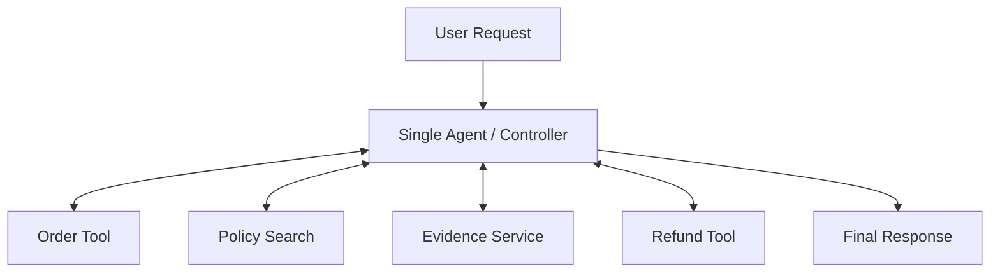
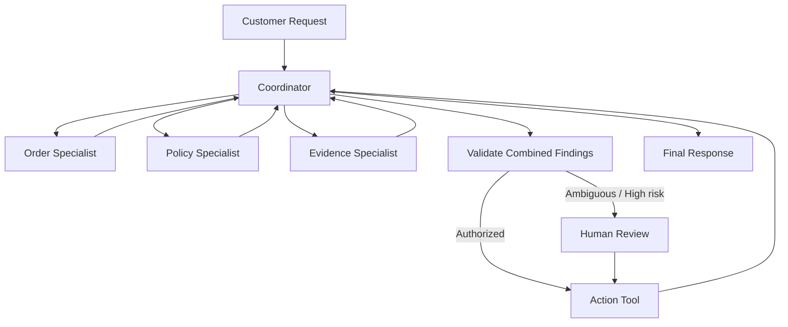
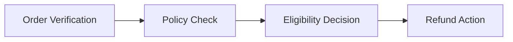
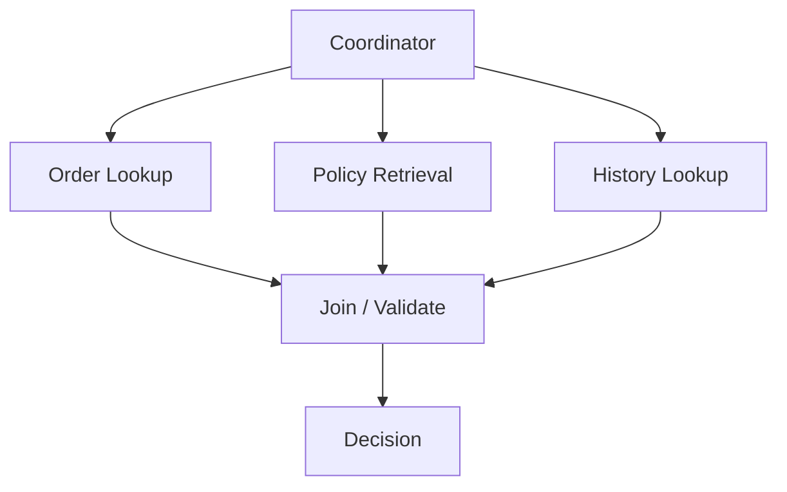
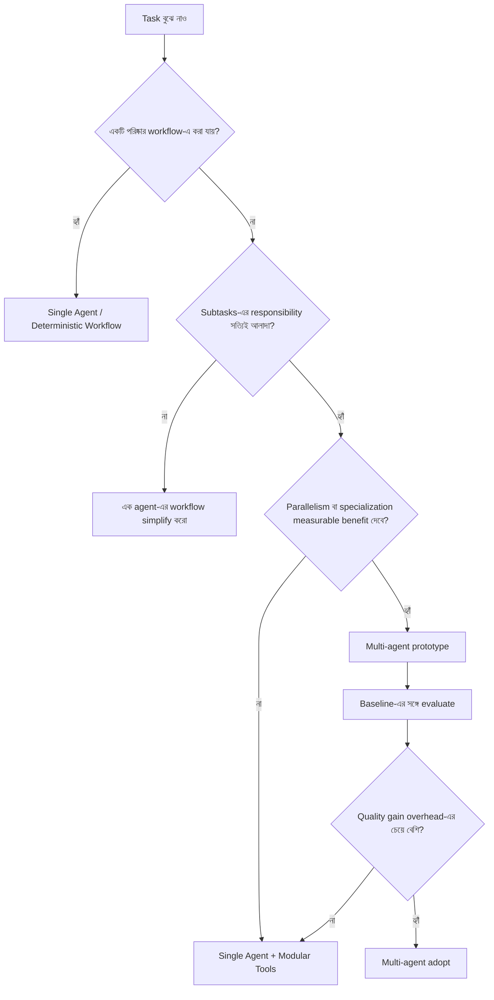

# 03. Single Agent বনাম Multi-Agent: কখন একাধিক Agent দরকার?

> Chapter alignment: 00:09:40 — Single Agent vs. Multi-Agent: When One Isn't Enough

## 1. একটি agent-কে আরও কাজ দিলে কখন সমস্যা শুরু হয়?

ধরো, তুমি একটি customer-support agent তৈরি করেছ। শুরুতে তার কাজ ছিল order status দেখা এবং customer-কে জানানো। পরে refund request, damaged-item evidence, policy lookup, cancellation, payment issue এবং human escalation-ও যোগ হলো। Agent-টির tool সংখ্যা বাড়ল, instruction বড় হলো, context-এ নানা domain-এর তথ্য জমল।

প্রথমে মনে হতে পারে, আরও tool ও instruction যোগ করলেই সব সমস্যা মিটবে। কিন্তু ধীরে ধীরে কয়েকটি সমস্যা দেখা দিতে পারে:

- কোন tool কোন পরিস্থিতিতে ব্যবহার করতে হবে, তা model-এর জন্য জটিল হয়ে উঠছে।
- একই context-এ order, policy, payment ও evidence-এর অপ্রাসঙ্গিক তথ্য জমছে।
- Read-only কাজের সঙ্গে financial side-effect permission একই জায়গায় চলে আসছে।
- আলাদা task একসঙ্গে চালানো সম্ভব হলেও agent একটির পর একটি করছে।
- একটি বড় prompt বা decision path পরিবর্তন করলে অন্য capability-ও regression করছে।

এখানে প্রশ্নটি “আরও agent বানাব কি?” নয়। আসল প্রশ্ন হলো, **বর্তমান architecture-এর কোন নির্দিষ্ট সীমাবদ্ধতা একাধিক independent decision-making role দিয়ে সমাধান করা সম্ভব?**

Multi-agent system সেই সমস্যার একটি সম্ভাব্য সমাধান। কিন্তু এটি বিনামূল্যের upgrade নয়। এক agent-এর complexity কমিয়ে একাধিক agent-এর coordination complexity তৈরি হতে পারে। তাই আগে single-agent architecture কী এবং সেটির সীমা কোথায়, তা বুঝি।

## 2. Single-agent architecture: একজন controller, অনেক capability

Single-agent architecture-এ একটি প্রধান agent task-এর control ও decision-making পরিচালনা করে। সে একাধিক tool ব্যবহার করতে পারে, task-কে subtask-এ ভাগ করতে পারে, বহুবার model call করতে পারে এবং feedback অনুযায়ী plan পরিবর্তন করতে পারে।

এখানে agent order lookup, policy search, evidence service ও refund tool ব্যবহার করছে। Tool আলাদা হলেও decision-making-এর মূল controller একটি।

**Single agent মানেই একটি LLM call নয়।** একটি agent একই task-এর মধ্যে অনেকবার model invoke করতে পারে, state ধরে রাখতে পারে, tool result দেখে নতুন সিদ্ধান্ত নিতে পারে এবং workflow-এর একাধিক ধাপ চালাতে পারে। “এক agent” বলতে এখানে একটি প্রধান decision-making role/control loop বোঝানো হচ্ছে, model call-এর সংখ্যা নয়।

### Single-agent-এর সুবিধা কোথায়?

একটি কেন্দ্রীয় controller থাকলে task state ও context এক জায়গায় রাখা সহজ। কে পরবর্তী পদক্ষেপ নেবে তা নিয়ে agent-দের মধ্যে negotiation দরকার হয় না। Handoff কম হওয়ায় context হারানোর ঝুঁকি ও coordination overhead কমে। Debugging-এও একটি প্রধান trace অনুসরণ করা যায়।

এটি বিশেষত ভালো যখন workflow bounded, domain সীমিত, tool contract পরিষ্কার এবং একটি controller দিয়েই কাজের dependency বোঝা যায়।

### Single-agent-এর সীমা কোথায়?

Tool ও responsibility অনেক বেড়ে গেলে decision space জটিল হতে পারে। Prompt/context-এ অপ্রাসঙ্গিক তথ্য বাড়তে পারে। একই agent-এর read-only research এবং high-impact execution capability থাকলে permission separation দুর্বল হতে পারে। Independent task parallel করার সুযোগও নষ্ট হতে পারে, যদি controller সব কাজ sequentially করে।

তবে এই সমস্যার প্রতিটির সমাধান multi-agent নয়। Tool grouping, modular workflow, deterministic subroutine, context filtering, separate permissioned service বা parallel tool execution-ও যথেষ্ট হতে পারে।

## 3. Multi-agent architecture: একাধিক role, সমন্বিত goal

Multi-agent system-এ একাধিক agent বা agent-like role মিলে একটি বড় task সম্পন্ন করে। প্রতিটি role-এর আলাদা responsibility, instruction, context, tool access বা expertise থাকতে পারে। একটি agent অন্য agent-কে subtask দিতে পারে, অথবা coordinator কাজ ভাগ করে ফলাফল সংগ্রহ করতে পারে।

Refund system-এ একটি illustrative design:

- **Coordinator:** user request গ্রহণ, task decomposition ও coordination।
- **Order specialist:** order details retrieve ও verify।
- **Policy specialist:** policy version ও eligibility rule খুঁজে বের করা।
- **Evidence specialist:** photo/document evidence evaluate।
- **Resolution role:** findings একত্র করে next step প্রস্তাব।
- **Human reviewer:** high-risk বা ambiguous decision approve/reject।

Diagram-টি একটি সম্ভাব্য decomposition, কোনো universal template নয়। Order lookup একটি deterministic API হতে পারে; policy retrieval একটি search service হতে পারে; evidence analysis একটি classifier হতে পারে। প্রতিটি role-কে আলাদা LLM agent বানানো বাধ্যতামূলক নয়।

এখানে coordinator-এর কাজ হলো work allocation, dependency, timeout, result collection ও termination পরিচালনা করা। Coordinator-কে order, policy বা payment-এর business owner বানানো উচিত নয়। প্রতিটি domain-এর authoritative data ও operation সংশ্লিষ্ট service-এর কাছেই থাকা উচিত।

## 4. Tool আর Agent-এর পার্থক্য: এই জায়গায় ভুল হলে architecture ফুলে ওঠে

Tool হলো একটি capability বা operation করার interface। Agent হলো goal নিয়ে সিদ্ধান্ত নেওয়া ও কাজ coordinate করার role/system।

একটি agent-এর কাছে ২০টি tool থাকতে পারে। তাতে ২০টি agent তৈরি হয় না। আবার তিনটি agent একই search tool ব্যবহার করতে পারে, যদি access policy ও ownership design তা অনুমোদন করে।

ধরা যাক refund workflow-এ তিনটি capability আছে:
- Order lookup
- Policy search
- Refund initiate

একটি agent তিনটিই ব্যবহার করতে পারে। তিনটি agent বানালে হয়তো Order Agent, Policy Agent ও Refund Agent হবে। কিন্তু তখন নতুন প্রশ্ন আসবে: কে task assign করবে? Order Agent-এর output কী format-এ যাবে? Policy Agent কোন source-কে authoritative ধরবে? Refund Agent কি নিজে eligibility decide করবে, নাকি verified result চাইবে? Failure হলে কে retry করবে?

অর্থাৎ tool যোগ করলে capability বাড়ে; agent যোগ করলে নতুন decision-making ও coordination boundary তৈরি হয়। এই boundary-র বাস্তব প্রয়োজন না থাকলে agent সংখ্যা বাড়ানো শুধু complexity বাড়ায়।

## 5. Single agent কখন উপযুক্ত?

Single agent বা deterministic workflow দিয়ে শুরু করো যখন:

- Task-এর workflow তুলনামূলক সরল ও bounded।
- Tool সংখ্যা এবং domain সীমিত।
- একই context ধরে রাখলে সিদ্ধান্ত সহজ হয়।
- Task decomposition করলে measurable benefit নেই।
- Low latency ও low cost গুরুত্বপূর্ণ।
- Debugging, audit ও operational simplicity দরকার।
- একটি controller দিয়ে state ও policy flow manage করা সম্ভব।

Single agent দিয়ে শুরু করার আরেকটি সুবিধা হলো baseline পাওয়া। Baseline ছাড়া multi-agent architecture সত্যিই উন্নতি করেছে, নাকি শুধু বেশি model call করেছে, তা বোঝা কঠিন।

## 6. Multi-agent কখন বিবেচনা করা যায়?

Multi-agent যোগ করার আগে একটি নির্দিষ্ট bottleneck শনাক্ত করো। কিছু পরিস্থিতিতে এটি কাজে আসতে পারে।

### 6.1 সত্যিকারের আলাদা specialization

একটি task-এ ভিন্ন ধরনের expertise, instruction বা evaluation criteria দরকার হতে পারে। যেমন, security log analysis ও legal policy review-এর কাজের evidence, vocabulary ও validation criteria আলাদা। Specialist role আলাদা context ও instruction পেলে focus বাড়তে পারে।

তবে একই domain-এর সামান্য আলাদা দুইটি subtask হলেই agent আলাদা করতে হবে এমন নয়। আলাদা module/function যথেষ্ট হতে পারে।

### 6.2 Independent parallel work

কিছু subtask একে অপরের output-এর ওপর নির্ভরশীল নয়। Refund case-এ order details lookup, policy document retrieval এবং customer history lookup parallel হতে পারে, যদি প্রত্যেকটির input আগে থেকেই জানা থাকে এবং access অনুমোদিত হয়।

Parallelism-এর লাভ তখনই হবে, যখন আলাদা কাজগুলো সত্যিই স্বাধীন এবং result join করার cost কম। Dependency থাকলে sequential execution দরকার।

### 6.3 Context isolation

একটি agent-এর context-এ অপ্রাসঙ্গিক তথ্য জমে গেলে decision quality কমতে পারে। Specialist agent-কে শুধু তার task-এর জন্য প্রয়োজনীয় context দিলে signal-to-noise উন্নত হতে পারে। কিন্তু context isolation করতে নতুন agent-ই লাগবে এমন নয়; context filtering ও separate workflow step-ও একই সুবিধা দিতে পারে।

### 6.4 Permission isolation

Order specialist-কে read-only order access দেওয়া যেতে পারে, আর refund executor-কে narrowly scoped write permission। Role আলাদা করলে permission design স্পষ্ট হতে পারে।

কিন্তু agent boundary backend authorization-এর বিকল্প নয়। Model prompt-এ “তুমি শুধু read করবে” লিখলেই security নিশ্চিত হয় না। প্রতিটি tool call-এ trusted service-কে identity, scope ও permission যাচাই করতে হবে।

### 6.5 Independent review বা validation

একটি role evidence summarize করতে পারে, অন্য role policy অনুযায়ী সেই summary review করতে পারে। এতে ভুল ধরার সুযোগ বাড়তে পারে। কিন্তু দুই agent একই ভুল source বা একই ভুল assumption ব্যবহার করলে তাদের agreement correctness-এর প্রমাণ নয়। Independent validation-এর জন্য independent evidence ও explicit criteria দরকার।

## 7. Multi-agent-এর hidden cost: নতুন agent মানেই নতুন coordination problem

Multi-agent diagram দেখতে সুন্দর। কিন্তু production-এ প্রতিটি agent-এর call, context, tool access, timeout, failure ও handoff manage করতে হয়।

**Model-call cost:** প্রতিটি agent-এর inference ও token usage যোগ হয়। Coordinator-এর call-ও খরচ।

**Latency:** Sequential handoff হলে total latency বাড়ে। Parallel task-এও join step-কে সাধারণত slowest required task-এর জন্য অপেক্ষা করতে হয়।

**Coordination:** কে কোন কাজ করবে, dependency কী, result merge কে করবে, conflict হলে final authority কার?

**Context loss:** Handoff-এ গুরুত্বপূর্ণ evidence, source বা constraint বাদ পড়তে পারে।

**Error propagation:** প্রথম agent ভুল তথ্য দিলে পরের agent সেটিকে সত্য ধরে আরও ভুল সিদ্ধান্ত নিতে পারে।

**Shared-state consistency:** একাধিক agent একই record update করলে race condition বা conflicting state তৈরি হতে পারে।

**Debugging:** কোন agent, কোন context ও কোন tool result-এর ভিত্তিতে failure ঘটিয়েছে তা trace করা কঠিন হতে পারে।

**Security surface:** বেশি agent ও message path মানে বেশি identity, permission ও untrusted input boundary।

সুতরাং multi-agent নিজে থেকে বেশি intelligent, accurate বা reliable নয়। Architecture-এ coordination যোগ করার বিনিময়ে বাস্তব benefit পেতে হবে।

## 8. Orchestration pattern: Agent-রা কীভাবে কাজ ভাগ করে?

Multi-agent system-এ শুধু agent list থাকলেই হয় না। তাদের কাজের flow নির্ধারণ করতে হয়।

### 8.1 Sequential

একটির output পরেরটির input। যখন পরবর্তী ধাপ আগের result-এর ওপর নির্ভর করে তখন এটি ব্যবহার করো।

Order verification ছাড়া policy check-এর জন্য নির্দিষ্ট order context না থাকলে sequential dependency থাকতে পারে। এই pattern সহজে trace করা যায়, কিন্তু total latency ধাপগুলোর latency যোগ করে বাড়ে।

### 8.2 Parallel

Independent task একই সময়ে চালানো হয়, পরে result join করা হয়।

Parallelism latency কমাতে পারে, কিন্তু partial failure ও result consistency সামলাতে হয়। কোনো একটি source unavailable হলে system wait করবে, fallback নেবে, নাকি human review করবে, তা আগে নির্ধারণ করো।

### 8.3 Supervisor

Supervisor task assign করে, result evaluate করে, প্রয়োজনে re-delegate বা stop করে। Dynamic task-এ উপকারী হতে পারে। তবে bounded iteration, deadline, budget ও termination condition না থাকলে supervisor বারবার নতুন task তৈরি করতে পারে।

### 8.4 Handoff

এক agent responsibility বা task অন্য agent-এর কাছে transfer করে। Handoff-এ শুধু text পাঠানো নয়; goal, relevant context, evidence/source, constraints, allowed scope, completed steps এবং expected output contract দিতে হয়। কে এখন task-এর owner এবং আগের agent আবার control পাবে কি না, সেটিও স্পষ্ট থাকা দরকার।

## 9. সিদ্ধান্ত নেওয়ার framework: কখন split করব?

একটি practical decision process:

1. Task ও success criteria define করো।
2. Single-agent বা deterministic baseline তৈরি করো।
3. Baseline-এর bottleneck মাপো: context overload, latency, quality, permission coupling, serial dependency?
4. Tool/module/context separation দিয়ে সমস্যাটি সমাধান হয় কি না পরীক্ষা করো।
5. তারপরই smallest multi-agent prototype বানাও।
6. একই test set-এ baseline-এর সঙ্গে তুলনা করো।
7. Quality gain যদি cost, latency, reliability ও maintenance overhead-এর চেয়ে বেশি হয়, তখন adopt করো।

**Rule of thumb:** Single agent বা deterministic workflow দিয়ে শুরু করো। Multi-agent যোগ করো যখন genuine decomposition, parallelism, isolation বা specialization-এর benefit মাপা যায়।

## 10. Single-agent বনাম Multi-agent: তুলনা

| Dimension | Single agent | Multi-agent |
|---|---|---|
| Controller | একটি প্রধান controller | একাধিক role/agent ও coordinator |
| Complexity | তুলনামূলক কম | বেশি coordination |
| Context | সাধারণত কেন্দ্রীভূত | ভাগ করা বা handoff করা |
| Parallelism | Application-managed হতে পারে | Independent task ভাগ করা সহজ |
| Latency | সাধারণত কম handoff | Pattern অনুযায়ী বাড়তে পারে |
| Cost | সাধারণত কম | Model call ও coordination বেশি হতে পারে |
| Debugging | তুলনামূলক সহজ | Distributed trace দরকার |
| Permission isolation | Tool-level policy দিয়ে সম্ভব | Role-specific scope সহজ হতে পারে |
| Failure | Central controller bottleneck হতে পারে | Partial failure ও propagation |
| Best fit | Bounded workflow | Genuine specialization/parallel tasks |

এগুলো সাধারণ প্রবণতা, absolute law নয়। Optimized multi-agent দ্রুত হতে পারে; poorly designed single-agent-ও ব্যয়বহুল হতে পারে। Architecture বিচার করতে বাস্তব measurement দরকার।

## 11. Multi-agent system evaluate করবে কীভাবে?

একই test dataset, task distribution ও success criteria ব্যবহার করে single-agent baseline এবং multi-agent candidate তুলনা করো। শুধু final answer সুন্দর কি না দেখা যথেষ্ট নয়।

- **Task success rate:** end-to-end goal কতবার পূরণ হয়েছে?
- **Decision correctness:** policy বা domain decision সঠিক?
- **Policy violation rate:** অনুমোদনহীন বা নিষিদ্ধ action ঘটেছে?
- **Tool execution success:** tool call সফল ও সঠিকভাবে complete হয়েছে?
- **Human escalation rate:** কতবার মানুষের সাহায্য দরকার হয়েছে?
- **End-to-end latency:** median এবং tail latency কত?
- **Token/inference cost:** প্রতিটি successful task-এর খরচ কত?
- **Duplicate side effect:** একই refund/payment একাধিকবার হয়েছে?
- **Failure recovery:** partial failure থেকে কতটা নির্ভরযোগ্যভাবে recover করেছে?

একটি গুরুত্বপূর্ণ metric হলো **cost per successful task**। Multi-agent-এর প্রতি-request cost বেশি হলেও যদি success rate উল্লেখযোগ্যভাবে বাড়ে, তাহলে কিছু ক্ষেত্রে তা গ্রহণযোগ্য হতে পারে। আবার answer quality সামান্য বাড়লেও latency ও cost দ্বিগুণ হলে production-এ সেটি ভালো trade-off নাও হতে পারে।

## 12. Interview: Deep questions ও reasoning-সহ উত্তর

### Q1. Multi-agent system কি সবসময় single agent-এর চেয়ে ভালো?

না। Multi-agent specialization ও parallelism দিতে পারে, কিন্তু communication, handoff, latency, cost ও failure propagation বাড়ায়। Task যদি একটি পরিষ্কার workflow হয়, single agent ও modular tools অনেক সহজ এবং reliable হতে পারে।

সঠিক সিদ্ধান্তের জন্য single-agent baseline তৈরি করে একই test case-এ task success, correctness, policy violation, latency ও cost তুলনা করতে হবে। Maintenance ও debugging overhead-ও ধরতে হবে। Measurable improvement না থাকলে অতিরিক্ত architecture complexity যুক্ত করার কারণ নেই।

**Follow-up: তাহলে multi-agent কখন ব্যবহার করবে?**  
যখন independent parallel task, genuinely distinct specialization, context isolation বা permission isolation-এর মতো নির্দিষ্ট সমস্যা আছে এবং ছোট prototype দিয়ে benefit মাপা যায়।

### Q2. একটি agent-কে তিনটি tool দেওয়া আর তিনটি agent বানানোর পার্থক্য কী?

তিনটি tool মানে তিনটি capability, যেমন order lookup, policy search ও refund execute। একটি agent এই capability-গুলো ব্যবহার করার সিদ্ধান্ত নিতে পারে।

তিনটি agent বানালে তিনটি decision-making role, context, instruction বা permission boundary তৈরি হয়। তখন task delegation, message contract, result validation ও conflict resolution দরকার হয়। তাই tool count এবং agent count একই metric নয়।

### Q3. Multi-agent system-এর coordination কে করবে?

Explicit coordinator/supervisor, workflow engine অথবা নির্দিষ্ট peer-to-peer protocol coordination করতে পারে। Coordinator task decomposition, assignment, result collection, conflict handling, timeout ও termination পরিচালনা করে।

কোন agent state-এর owner, কে final decision নেবে, কে retry করবে, failure হলে কে escalate করবে, এসব contract-এ নির্দিষ্ট করতে হবে। “Agents নিজেদের মধ্যে কথা বলবে” বললে architecture অসম্পূর্ণ থাকে।

### Q4. Parallel agent চালালে কী সমস্যা হতে পারে?

সব task parallel করা যায় না। Policy check-এর আগে নির্দিষ্ট order দরকার হলে dependency আছে। Parallel request-এ shared rate limit, race condition, duplicate side effect, partial failure ও result inconsistency হতে পারে।

Join step-এ কোন result authoritative তা নির্ধারণ করতে হবে। Timeout হলে সব result না এলেও system proceed করবে, নাকি stop/escalate করবে, সেটি design করতে হবে। Side-effecting action সাধারণত explicit ownership ও idempotency ছাড়া parallel করা উচিত নয়।

### Q5. Multi-agent handoff-এ context loss কীভাবে আটকাবে?

Handoff contract নির্ধারণ করো: task goal, relevant facts, source/provenance, constraints, completed steps, pending questions, allowed tools, deadline এবং expected output schema। পুরো conversation dump পাঠানোর বদলে task-relevant structured context পাঠাও।

Receiver missing field detect করতে পারবে। গুরুত্বপূর্ণ সিদ্ধান্তের সঙ্গে evidence reference রাখলে traceability বাড়ে। Handoff-এর পর sender ও receiver-এর ownership কখন বদলাবে সেটিও স্পষ্ট করো।

### Q6. একাধিক agent একই বিষয়ে ভিন্ন সিদ্ধান্ত দিলে কী করবে?

আগে থেকেই conflict-resolution policy থাকতে হবে। Evidence hierarchy ও authoritative data source নির্ধারণ করো। Refund eligibility-তে official policy এবং order/payment service-এর data agent opinion-এর চেয়ে authoritative। Confidence score একা যথেষ্ট নয়।

Conflict unresolved থাকলে side effect বন্ধ করে human review-এ পাঠাও। দুই agent majority vote করলেই সত্য প্রমাণ হয় না; তারা একই ভুল source ব্যবহার করতে পারে।

### Q7. Multi-agent কি security বাড়ায়?

Role separation ও least-privilege access design সহজ করতে পারে। যেমন policy agent read-only, refund executor narrowly scoped write access। কিন্তু agent সংখ্যা বাড়লে attack surface ও communication path-ও বাড়ে।

প্রত্যেক tool call-এ backend authorization দরকার। Agent-to-agent message-ও untrusted input হিসেবে validate করতে হবে। আলাদা agent বানানো নিজে security control নয়; permission enforcement ও audit দরকার।

### Q8. কীভাবে প্রমাণ করবে multi-agent architecture দরকার?

প্রথমে single-agent baseline implement ও evaluate করো। তারপর নির্দিষ্ট bottleneck identify করো: context overload, independent parallel work, specialist-specific policy বা permission coupling। শুধু সেই bottleneck address করে smallest multi-agent prototype বানাও।

একই dataset-এ success, correctness, latency, cost, failure rate ও safety তুলনা করো। Complexity ও maintenance cost-ও decision-এ ধরো। যদি modular tool/workflow দিয়েই bottleneck মেটে, multi-agent প্রয়োজন নেই।

### Q9. কখন multi-agent নয়, deterministic workflow বেছে নেবে?

যখন step ও transition স্পষ্ট, rule stable এবং auditability গুরুত্বপূর্ণ। যেমন refund amount limit, payment settlement বা account deletion confirmation। LLM user intent বুঝতে সাহায্য করতে পারে, কিন্তু state transition ও invariant code-এ enforce করো। এতে predictable behavior, reproducibility ও testability বাড়ে।

### Q10. Agent failure হলে পুরো system কীভাবে recover করবে?

প্রতিটি task-এর status persist করো: `pending`, `running`, `completed`, `failed`, `needs_review`। Retry budget, timeout ও idempotency রাখো। Partial result store করো, যাতে coordinator restart হলেও task state থেকে resume করতে পারে।

Side effect-এর outcome unknown হলে retry করার আগে external system-এ status reconcile করো। Unrecoverable conflict বা ambiguous outcome human review-এ পাঠাও।

## 13. Practice: একই refund system দুইভাবে design করো

দুটি design তৈরি করো।

**Design A: Single agent + modular tools**

একটি agent order lookup, policy retrieval, evidence collection ও resolution workflow পরিচালনা করবে। Refund execution একটি permissioned service/tool-এর মাধ্যমে হবে।

**Design B: Coordinator + specialist roles**

Coordinator কাজ ভাগ করবে; order specialist, policy specialist ও evidence specialist তাদের নিজ নিজ result দেবে। Final action একটি narrowly scoped service করবে।

প্রতিটি design-এর জন্য লিখো:

1. Agent/role responsibility কী?
2. কোন tool access ও permission থাকবে?
3. কোন state-এর owner কে?
4. কোন task sequential, কোনটি parallel?
5. Handoff contract-এ কী থাকবে?
6. Timeout ও partial failure কীভাবে handle হবে?
7. Human approval কোথায় লাগবে?
8. প্রতি task-এ আনুমানিক model call, latency ও cost কত?

শেষে একটি design বেছে নাও। কোন measurable evidence পেলে অন্য design-এ switch করবে, সেটিও লিখো। এই শেষ প্রশ্নটির উত্তরই architecture decision-কে preference থেকে engineering decision-এ নিয়ে যায়।
