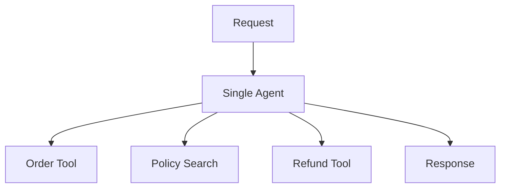
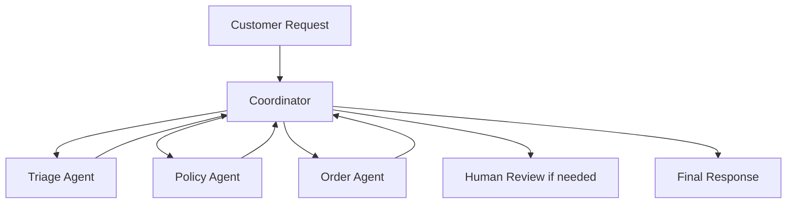
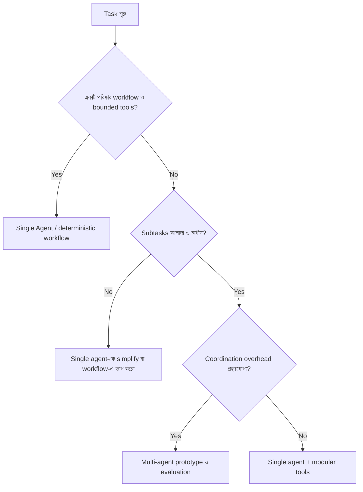

# 03. Single Agent বনাম Multi-Agent: কখন একাধিক agent দরকার?

> Chapter alignment: 00:09:40 — Single Agent vs. Multi-Agent: When One Isn't Enough

## 1. Single agent কী?

Single-agent architecture-এ একটি agent মূল task-এর control ও decision-making পরিচালনা করে। সে বিভিন্ন tool ব্যবহার করতে পারে এবং নিজের কাজকে subtask-এ ভাগ করতে পারে।

Single agent মানেই একটি model call নয়। একটি agent অনেকবার LLM call, tool call, loop, state এবং retry চালাতে পারে।

## 2. Multi-agent কী?

Multi-agent system-এ একাধিক agent বা specialized role সহযোগিতা করে। তাদের আলাদা task, context, tool access বা responsibility থাকতে পারে।

উদাহরণস্বরূপ, refund request:
- Triage agent: request ও intent বুঝবে।
- Policy agent: policy ও eligibility যাচাই করবে।
- Order agent: order তথ্য retrieve করবে।
- Resolution agent: ফলাফল মিলিয়ে সিদ্ধান্ত বা response তৈরি করবে।

Diagram-টি একটি illustrative design; সব agent parallel-এ চালানো যাবে কি না, তা dependency ও policy-র ওপর নির্ভর করবে।

## 3. Single agent কখন ভালো?

- Task ছোট বা মাঝারি এবং workflow সহজ।
- Tool ও policy সীমিত।
- একটি coherent context বজায় রাখা দরকার।
- Debugging, latency ও cost কম রাখতে চাও।
- কাজকে আলাদা agent-এ ভাগ করলে coordination লাভের চেয়ে overhead বেশি।

## 4. Multi-agent কখন বিবেচনা করা যায়?

- Task-এ সত্যিকারের আলাদা domain/responsibility আছে।
- কিছু subtask স্বাধীনভাবে parallel করা যায়।
- Specialist context বা permission আলাদা রাখা দরকার।
- একটি agent-এর prompt/context অতিরিক্ত জটিল হয়ে যাচ্ছে।
- Subtask-এর ফল independently validate করা যায়।

## 5. Multi-agent-এর খরচ ও ঝুঁকি

একাধিক agent মানেই উন্নত intelligence নয়। বরং:
- বেশি model calls → বেশি latency ও cost
- Agent-to-agent communication → coordination overhead
- Context handoff → তথ্য হারানো বা বিকৃতি
- এক agent-এর ভুল → downstream agent-এ ছড়িয়ে পড়া
- Debugging → কোন agent কেন সিদ্ধান্ত নিয়েছে, trace করা কঠিন
- Shared resource → concurrency ও consistency সমস্যা

## 6. Decision framework

**Rule of thumb:** Multi-agent দিয়ে শুরু না করে, single agent বা deterministic workflow দিয়ে শুরু করো। Evaluation-এ প্রমাণ পাওয়া গেলে specialization বা parallelism যোগ করো।

## 7. Single-agent বনাম multi-agent তুলনা

| দিক | Single agent | Multi-agent |
|---|---|---|
| Architecture | সহজ | বেশি জটিল |
| Latency | সাধারণত কম | coordination-এ বাড়তে পারে |
| Cost | তুলনামূলক কম | একাধিক call-এর কারণে বেশি |
| Context | কেন্দ্রীভূত | ভাগ করা বা handoff |
| Parallelism | সীমিত | independent task parallel করা যায় |
| Debugging | তুলনামূলক সহজ | trace/coordination জটিল |
| Specialization | prompt/tools দিয়ে | role/context আলাদা করা সম্ভব |

এগুলো সাধারণ tendency, absolute rule নয়।

## 8. Interview প্রশ্ন

**Multi-agent system কি সবসময় single agent-এর চেয়ে ভালো?**  
না। Multi-agent-এর benefit তখনই যখন decomposition, specialization বা parallelism coordination overhead-এর চেয়ে বেশি value দেয়।

**একটি agent-কে তিনটি tool দেওয়া বনাম তিনটি agent তৈরি করা: পার্থক্য কী?**  
Tools হলো capability/interface; agents হলো আলাদা decision-making ও control responsibility। তিনটি tool ব্যবহার করা একটি agent-কে তিনটি agent বানায় না।

**Multi-agent system-এর coordination কে করবে?**  
Explicit orchestrator, supervisor, workflow engine বা peer coordination protocol হতে পারে। Coordination strategy, timeout, retry, ownership এবং termination design করতে হয়।

**কীভাবে সিদ্ধান্ত নেবে multi-agent উপযুক্ত?**  
Baseline single-agent/workflow তৈরি করে task success, latency, cost, failure rate ও quality measure করবে। Multi-agent design একই evaluation set-এ তুলনা করে measurable improvement থাকলে গ্রহণ করবে।

## 9. Practice

Refund task-কে single-agent ও multi-agent দুইভাবে আঁকো। প্রতিটির জন্য:
- Tool access
- State ownership
- Failure handling
- Human handoff
- Cost/latency estimate করার assumptions

লিখে শেষে বলো কোন design production-এ বেছে নেবে এবং কেন।