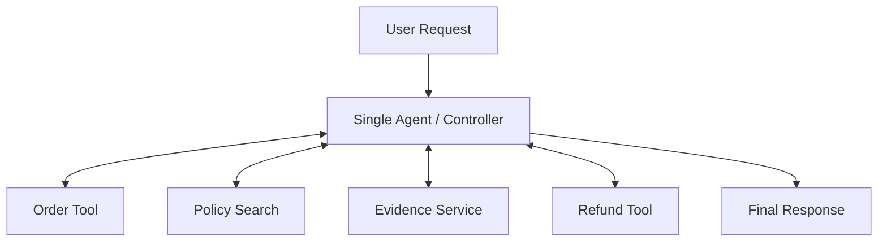
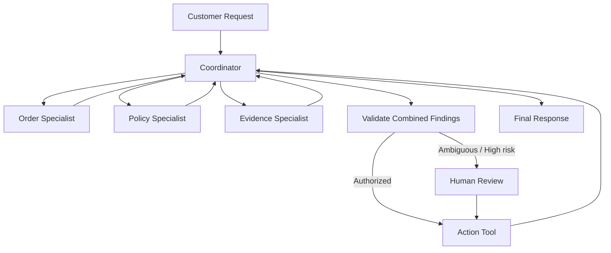
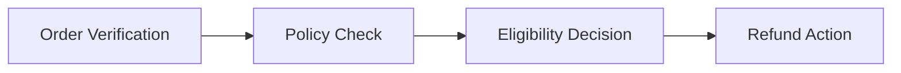
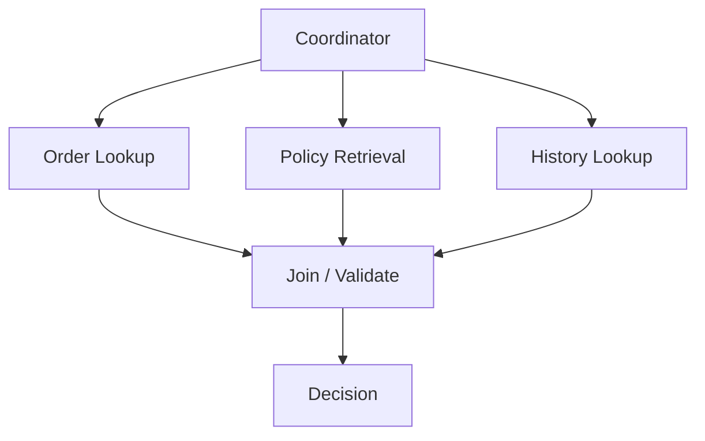
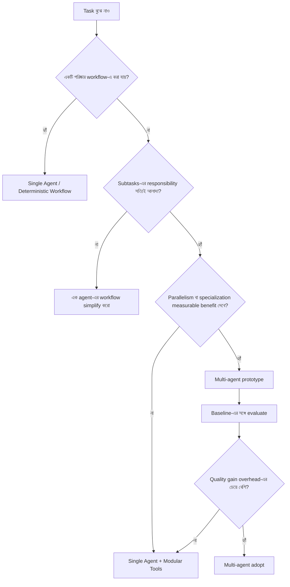

# 03. Single Agent বনাম Multi-Agent: কখন একাধিক Agent দরকার?

> Chapter alignment: 00:09:40 — Single Agent vs. Multi-Agent: When One Isn't Enough

## 1. Single-agent architecture কী?

Single-agent architecture-এ একটি agent মূল task-এর control ও decision-making পরিচালনা করে। সে একাধিক tool ব্যবহার করতে পারে, task-কে subtask-এ ভাগ করতে পারে, বহুবার model call করতে পারে এবং feedback অনুযায়ী loop চালাতে পারে।

**Single agent মানেই একটি LLM call নয়।** Agent একাধিকবার reasoning করতে পারে, tool invoke করতে পারে এবং state maintain করতে পারে; তবুও controller একটি।

Refund workflow-এ একই agent order খুঁজতে পারে, policy পড়তে পারে, evidence চাইতে পারে এবং authorized হলে refund tool ব্যবহার করতে পারে।

## 2. Multi-agent architecture কী?

Multi-agent system-এ একাধিক agent বা agent-like role মিলে একটি বড় task সম্পন্ন করে। প্রতিটি agent-এর আলাদা responsibility, instruction, context, tool access বা expertise থাকতে পারে।

Refund system-এ উদাহরণ:
- **Coordinator:** request গ্রহণ, task decomposition ও coordination।
- **Order specialist:** order details retrieve ও verify।
- **Policy specialist:** policy version ও eligibility rule খুঁজে বের করা।
- **Evidence specialist:** photo/document evidence evaluate।
- **Resolution agent:** findings একত্র করে next step প্রস্তাব।
- **Human reviewer:** high-risk বা ambiguous decision approve/reject।

এটি একটি illustrative architecture। সব specialist-কে আলাদা LLM agent বানাতে হবে না। Order lookup deterministic API, policy search service এবং evidence classifier-ও হতে পারে।

## 3. এক agent-কে অনেক tool দেওয়া বনাম অনেক agent বানানো

এই পার্থক্য interview-তে খুব গুরুত্বপূর্ণ।

- **Tool** হলো কোনো operation করার capability/interface।
- **Agent** হলো goal নিয়ে সিদ্ধান্ত নেওয়া ও কাজ coordinate করার entity/role।

একটি agent-এর কাছে ২০টি tool থাকতে পারে। তাতে ২০টি agent তৈরি হয় না। আবার ৩টি agent একই tool ব্যবহার করতে পারে, যদি permission ও ownership design করা থাকে।

এক agent + অনেক tools:
- Centralized decision/context
- সহজ control flow
- Tool selection জটিল হতে পারে

Many agents:
- Responsibility/context ভাগ করা যায়
- Specialist-specific instruction ও permission সম্ভব
- Coordination ও handoff overhead আসে

## 4. Single agent কখন উপযুক্ত?

- Task-এর workflow তুলনামূলক সরল।
- Tool সংখ্যা ও domain সীমিত।
- একই context ধরে রাখলে সিদ্ধান্ত সহজ হয়।
- Task decomposition করলে বাস্তব benefit নেই।
- Low latency ও low cost গুরুত্বপূর্ণ।
- Debugging ও operational simplicity দরকার।
- একটি controller দিয়ে policy ও state manage করা সম্ভব।

Single agent দিয়ে শুরু করার কারণ হলো এটি baseline তৈরি করে। baseline ছাড়া multi-agent সত্যিই উন্নতি করেছে কি না বোঝা কঠিন।

## 5. Multi-agent কখন বিবেচনা করা যায়?

### 5.1 Distinct specialization
একটি task-এ সত্যিকারের আলাদা domain expertise বা instruction দরকার। যেমন legal policy review ও technical log analysis-এর কাজের ধরন আলাদা।

### 5.2 Independent parallel work
একাধিক subtask একে অন্যের output-এর ওপর নির্ভরশীল নয়। Order lookup, policy retrieval এবং customer history lookup parallel হতে পারে, যদি access ও dependency অনুমতি দেয়।

### 5.3 Context isolation
একটি agent-এর context-এ অপ্রাসঙ্গিক তথ্য জমে যাচ্ছে। আলাদা specialist শুধু নিজের কাজের context পেলে signal-to-noise উন্নত হতে পারে।

### 5.4 Permission isolation
Order specialist read-only access পাবে; refund executor-এর side-effect permission থাকবে। আলাদা agent boundary permission design-এ সাহায্য করতে পারে, তবে backend authorization-এর বিকল্প নয়।

### 5.5 Independent validation
একটি agent result তৈরি করে, অন্য specialist evidence বা policy অনুযায়ী review করতে পারে। তবে দুই agent একই ভুল source ব্যবহার করলে “দুইজন একমত” হওয়া correctness-এর প্রমাণ নয়।

## 6. Multi-agent-এর hidden cost

Multi-agent diagram দেখতে সুন্দর হলেও বাস্তবে কিছু খরচ যোগ হয়।

- **Model-call cost:** প্রতিটি agent-এর call token ও inference cost বাড়ায়।
- **Latency:** sequential handoff হলে মোট সময় বাড়ে; parallel হলেও slowest task-এর জন্য অপেক্ষা করতে হয়।
- **Coordination:** কে কোন কাজ করবে, কে result merge করবে, conflict হলে কে সিদ্ধান্ত নেবে?
- **Context loss:** handoff-এ গুরুত্বপূর্ণ evidence বাদ পড়তে পারে।
- **Error propagation:** প্রথম agent-এর ভুল দ্বিতীয় agent-এর input হয়ে যেতে পারে।
- **Shared-state consistency:** একই record একাধিক agent update করলে race condition হতে পারে।
- **Debugging:** কোন agent-এর কোন সিদ্ধান্তে failure হলো তা trace করা কঠিন।
- **Security:** অতিরিক্ত agent/tool access attack surface বাড়াতে পারে।

অতএব multi-agent নিজে থেকে বেশি intelligent বা reliable নয়।

## 7. Orchestration pattern-এর পরিচয়

### Sequential
একটির output পরেরটির input। Dependency থাকলে ব্যবহার করো।

### Parallel
Independent task একসঙ্গে চলে, পরে result join হয়।

### Supervisor
Supervisor task assign করে, result evaluate করে, প্রয়োজনে re-delegate বা stop করে। Dynamic task-এ useful, কিন্তু bounded iteration ও budget দরকার।

### Handoff
এক agent responsibility অন্য agent-এর কাছে transfer করে। Task, context, constraints, permission ও expected output contract দিতে হয়। Handoff মানে ownership/control বদলানো; শুধু text পাঠানো নয়।

## 8. Decision framework

**Rule of thumb:** Single agent বা deterministic workflow দিয়ে শুরু করো। Multi-agent যোগ করো যখন বাস্তব decomposition, parallelism, isolation বা specialization-এর benefit মাপা যায়।

## 9. তুলনা

| Dimension | Single agent | Multi-agent |
|---|---|---|
| Controller | একটি প্রধান controller | একাধিক role/agent ও coordinator |
| Complexity | তুলনামূলক কম | বেশি |
| Context | কেন্দ্রীভূত | ভাগ করা/হস্তান্তরিত |
| Parallelism | সীমিত বা application-managed | independent agent task সহজে parallel |
| Latency | সাধারণত কম | pattern অনুযায়ী বাড়তে পারে |
| Cost | সাধারণত কম | call ও coordination বেশি হতে পারে |
| Debugging | তুলনামূলক সহজ | distributed trace দরকার |
| Permission isolation | tool-level policy | role-specific scope করা সহজ হতে পারে |
| Failure | central failure | partial failure ও propagation |
| Best fit | bounded workflow | genuine specialization/parallel tasks |

এগুলো সাধারণ প্রবণতা, absolute law নয়। একটি optimized multi-agent system দ্রুত হতে পারে; একটি poorly designed single agent-ও ব্যয়বহুল হতে পারে।

## 10. Multi-agent evaluate করবে কীভাবে?

একই test dataset ও task distribution-এ single-agent baseline এবং multi-agent candidate তুলনা করো।

Metrics:
- Task success rate
- Answer/decision correctness
- Policy violation rate
- Tool execution success
- Human escalation rate
- End-to-end latency (median ও tail latency)
- Token/inference cost
- Duplicate action বা side-effect error
- Failure recovery rate

শুধু “multi-agent বেশি ভালো উত্তর দিয়েছে” যথেষ্ট নয়। Cost ও latency বেড়ে গেলে improvement production-এ গ্রহণযোগ্য কি না বিচার করতে হবে।

## 11. Interview: Deep questions ও বিস্তারিত উত্তর

### Q1. Multi-agent system কি সবসময় single agent-এর চেয়ে ভালো?

না। Multi-agent specialization ও parallelism দিতে পারে, কিন্তু communication, handoff, latency, cost ও failure propagation বাড়ায়। Task যদি একটি পরিষ্কার workflow হয়, single agent ও modular tools অনেক সহজ ও reliable হতে পারে। Multi-agent নেওয়ার আগে baseline তৈরি করে একই test case-এ task success, correctness, policy violation, latency ও cost তুলনা করতে হবে। Measurable improvement না থাকলে অতিরিক্ত architecture complexity যুক্ত করার কারণ নেই।

### Q2. একটি agent-কে তিনটি tool দেওয়া আর তিনটি agent বানানোর পার্থক্য কী?

তিনটি tool মানে তিনটি capability। যেমন order lookup, policy search ও refund execute। একটি agent এই তিন capability ব্যবহার করার সিদ্ধান্ত নিতে পারে। তিনটি agent করলে তিনটি আলাদা decision-making role, context, instruction বা permission boundary তৈরি হয়। Agent-দের মধ্যে task delegation ও result coordination লাগবে। তাই tool count এবং agent count একই metric নয়।

### Q3. Multi-agent system-এর coordination কে করবে?

একটি explicit coordinator/supervisor, workflow engine অথবা peer-to-peer protocol coordination করতে পারে। Coordinator task decomposition, assignment, result collection, conflict resolution, timeout ও termination পরিচালনা করে। কোন agent state-এর owner, কে final decision নেবে, failure হলে কে retry করবে, এসব contract-এ নির্দিষ্ট করতে হয়। “Agents নিজেদের মধ্যে কথা বলবে” বললে architecture অসম্পূর্ণ থাকে।

### Q4. Parallel agent চালালে কী কী সমস্যা হতে পারে?

সব task parallel করা যায় না। Policy check-এর আগে order ID দরকার হলে dependency আছে। Parallel request-এ shared rate limit, race condition, duplicate side effect, partial failure ও result inconsistency হতে পারে। Join step-এ কোন result authoritative তা নির্ধারণ করতে হবে। Timeout হলে সব result না আসলেও system কীভাবে proceed বা stop করবে তা design করতে হবে। Side-effecting action সাধারণত explicit ownership ও idempotency ছাড়া parallel করা উচিত নয়।

### Q5. Multi-agent handoff-এ context loss কীভাবে আটকাবে?

Handoff contract নির্ধারণ করো: task goal, relevant facts, source/provenance, constraints, completed steps, pending questions, allowed tools, deadline এবং expected output schema। পুরো conversation dump পাঠানোর বদলে task-relevant structured context পাঠাও। Receiver agent missing field detect করতে পারবে। গুরুত্বপূর্ণ সিদ্ধান্তের সঙ্গে evidence reference রাখলে traceability বাড়ে।

### Q6. একাধিক agent একই বিষয়ে ভিন্ন সিদ্ধান্ত দিলে কী করবে?

আগে থেকেই conflict-resolution policy থাকতে হবে। Evidence hierarchy ও authoritative data source নির্ধারণ করো। উদাহরণ: refund eligibility-তে official policy ও order service-এর data, agent opinion-এর চেয়ে authoritative। Confidence score একা যথেষ্ট নয়। Conflict unresolved থাকলে action বন্ধ করে human review-এ পাঠাও। দুই agent majority vote করলেই সত্য প্রমাণ হয় না।

### Q7. Multi-agent কি security বাড়ায়?

Role separation ও least-privilege access সহজ করতে পারে। যেমন policy agent read-only, refund executor narrowly scoped write access। কিন্তু agent সংখ্যা বাড়লে attack surface ও communication path-ও বাড়ে। প্রত্যেক tool call-এ backend authorization দরকার। Agent-to-agent message-ও untrusted input হিসেবে validate করতে হবে। আলাদা agent বানানো নিজে security control নয়।

### Q8. কীভাবে প্রমাণ করবে multi-agent architecture দরকার?

প্রথমে single-agent baseline implement ও evaluate করো। তারপর নির্দিষ্ট সমস্যা identify করো: context overload, independent parallel work, specialist-specific policy বা permission isolation। শুধু সেই সমস্যা address করে smallest multi-agent prototype বানাও। একই dataset-এ success, correctness, latency, cost, failure rate ও safety তুলনা করো। Complexity ও maintenance cost-ও decision-এ ধরো।

### Q9. কখন multi-agent নয়, deterministic workflow বেছে নেবে?

যখন step ও transition স্পষ্ট, rule stable এবং auditability গুরুত্বপূর্ণ। যেমন refund amount limit, payment settlement, account deletion confirmation। LLM user intent বোঝাতে সাহায্য করতে পারে, কিন্তু state transition ও invariant code-এ enforce করো। এতে predictable behavior ও testability বাড়ে।

### Q10. Agent failure হলে পুরো system কীভাবে recover করবে?

প্রতিটি task-এর status persist করো: pending, running, completed, failed, needs_review। Retry budget, timeout ও idempotency রাখো। Partial result store করো। Coordinator restart হলেও task state থেকে resume করতে পারবে। Side effect-এর outcome unknown হলে retry করার আগে external system-এ status reconcile করো। Unrecoverable conflict human review-এ পাঠাও।

## 12. Practice: একই refund system দুইভাবে design করো

**Design A:** Single agent + modular tools  
**Design B:** Coordinator + order specialist + policy specialist + action service

প্রতিটির জন্য লিখো:
1. Agent/role responsibility
2. Tool access ও permission
3. State ownership
4. Sequential/parallel dependency
5. Handoff contract
6. Timeout ও partial failure handling
7. Human approval
8. Estimated model calls ও latency assumptions

শেষে বলো কোন design বেছে নেবে এবং কোন measurable evidence পেলে অন্য design-এ যাবে।
