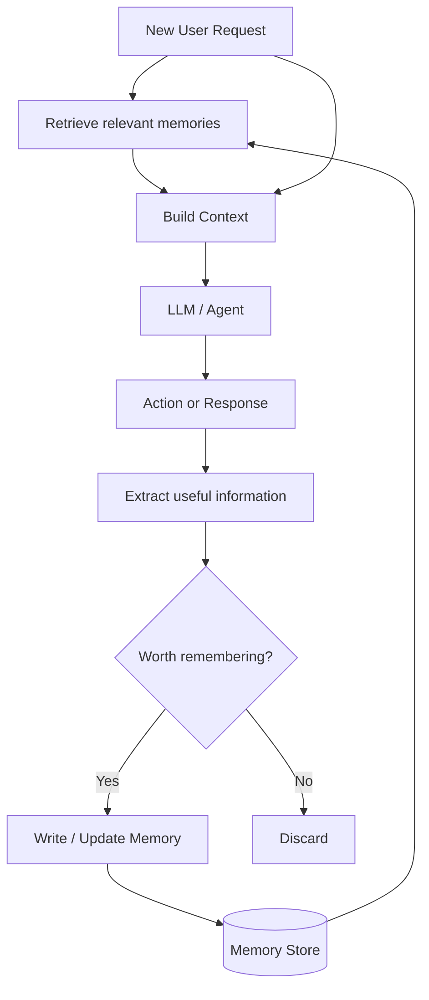

# 04. Agent Memory: কেন Agent ভুলে যায়?

> Chapter alignment: 00:13:09 — Agent Memory: Why Agents Forget

## 1. Memory কেন দরকার?

LLM সাধারণত একটি request-এর সঙ্গে পাঠানো context-এর ভিত্তিতে response তৈরি করে। নতুন request-এ আগের তথ্য না পাঠালে, বা model-এর context থেকে তথ্য বাদ পড়লে, সে আগের কথোপকথন সম্পর্কে নির্ভরযোগ্যভাবে জানবে না।

Agent memory হলো এমন mechanism যার মাধ্যমে প্রয়োজনীয় তথ্য বর্তমান interaction-এর বাইরে সংরক্ষণ, retrieve ও পুনরায় ব্যবহার করা যায়।

**Memory মানেই model-এর brain-এ permanent memory তৈরি হওয়া নয়।** অনেক system-এ memory external storage-এ থাকে, এবং প্রয়োজন অনুযায়ী context-এ যোগ করা হয়।

## 2. Memory-এর প্রধান ধরন

এগুলো conceptual classification; product বা framework অনুযায়ী নাম ও implementation ভিন্ন হতে পারে।

### Short-term / working memory

বর্তমান task বা conversation-এর তথ্য:
- সাম্প্রতিক messages
- চলমান task-এর state
- Tool results
- Intermediate decisions (যেখানে সংরক্ষণ করা উপযুক্ত)

সাধারণত সীমিত lifetime ও context budget থাকে।

### Long-term memory

ভবিষ্যতের interaction-এ কাজে লাগতে পারে এমন তথ্য:
- User preferences
- Stable facts
- পূর্ববর্তী task-এর গুরুত্বপূর্ণ outcome
- Knowledge বা experience থেকে distilled summary

এটি database, document store, vector index বা অন্য storage-এ থাকতে পারে।

### Episodic memory

“কী ঘটেছিল” ধরনের নির্দিষ্ট episode:
- কোন task করা হয়েছিল
- কখন করা হয়েছিল
- কী action নেওয়া হয়েছিল
- কী outcome হয়েছিল

### Semantic memory

“কী জানা আছে” ধরনের facts বা concepts:
- Product policy
- Domain knowledge
- Entities ও তাদের relationships

Episodic বনাম semantic ভাগটি cognitive science-এ পরিচিত; agent architecture-এ এটি একটি useful design lens, rigid standard নয়।

## 3. Memory architecture-এর একটি উদাহরণ

Memory write সবকিছু automatic save করা উচিত নয়। তথ্যের usefulness, privacy, consent, freshness, retention এবং ভুল memory-এর ঝুঁকি বিবেচনা করা দরকার।

## 4. Memory store কী হতে পারে?

| Storage | উপযোগিতা | Trade-off |
|---|---|---|
| Relational DB | structured facts, filtering, consistency | schema ও query design |
| Key-value store | দ্রুত lookup, simple state | সম্পর্ক ও search সীমিত |
| Document store | flexible record | consistency/query trade-off |
| Vector store | semantic similarity retrieval | similarity মানেই factual correctness নয় |
| Files/object store | large documents, artifacts | retrieval/indexing আলাদা লাগতে পারে |

একটি system একাধিক storage ব্যবহার করতে পারে। Vector DB নিজেই “memory” নয়; এটি retrieval mechanism/storage layer-এর একটি option।

## 5. Memory write ও retrieval

Memory pipeline-এর গুরুত্বপূর্ণ কাজ:
1. Candidate information extract করা।
2. তথ্যটি ভবিষ্যতে কাজে লাগবে কি না নির্ধারণ।
3. Sensitivity ও retention policy পরীক্ষা।
4. Deduplicate / merge / update করা।
5. উপযুক্ত storage-এ রাখা।
6. পরবর্তী request-এ query করা।
7. Retrieved information relevance ও freshness যাচাই।

**Memory retrieval ভুল হলে** agent ভুল তথ্য ব্যবহার করতে পারে। তাই memory-কে unquestionable truth হিসেবে ধরে নেওয়া যাবে না।

## 6. Memory-এর failure modes

- **Stale memory:** পুরনো preference বা status।
- **Contradiction:** নতুন তথ্য পুরনো তথ্যের সঙ্গে conflict।
- **Over-retention:** অপ্রয়োজনীয় বা sensitive তথ্য জমা।
- **Retrieval miss:** দরকারি তথ্য খুঁজে না পাওয়া।
- **False memory:** model ভুলভাবে কোনো তথ্য extract করে save করেছে।
- **Memory poisoning:** malicious বা ভুল তথ্য memory-তে ঢুকে পড়েছে।
- **Over-personalization:** পুরনো তথ্য বর্তমান context-এ অযথা প্রয়োগ।

Mitigation: provenance/source, timestamp, confidence, TTL/expiry, correction path, access control, scoped memory এবং retrieval validation।

## 7. Memory বনাম Context Window

| Memory | Context Window |
|---|---|
| তথ্য সংরক্ষণ ও retrieval-এর ব্যবস্থা | model-এর একটি call-এ ব্যবহৃত token context |
| Context-এর বাইরে তথ্য ধরে রাখতে পারে | বর্তমান input-এ model যা দেখতে পাচ্ছে তার সীমা |
| DB/file/vector store ইত্যাদি হতে পারে | model architecture/API দ্বারা সীমিত |
| Retrieve করে context-এ আনতে হয় | Memory থেকে তথ্য আনলে context-এর অংশ হয় |

Memory থাকলেও context window-এর সীমা দূর হয় না। Memory থেকে retrieved data-ও token budget ব্যবহার করে।

## 8. Interview প্রশ্ন

**Memory কি model-এর weights-এ লেখা হয়?**  
সাধারণ agent memory system-এ নয়। বেশিরভাগ ক্ষেত্রে external storage-এ রাখা হয় এবং inference-এর সময় retrieve করা হয়। Fine-tuning model weights পরিবর্তন করতে পারে, কিন্তু সেটি conversational memory-এর সমতুল্য নয়।

**সব conversation কি memory-তে রাখা উচিত?**  
না। Privacy, usefulness, cost, retention ও retrieval noise বিবেচনা করে selective memory দরকার।

**Vector search কি memory-এর জন্য যথেষ্ট?**  
না। Similarity search fuzzy recall-এ সহায়ক, কিন্তু exact facts, permissions, recency ও relational query-এর জন্য structured storage/metadata এবং validation দরকার হতে পারে।

**Memory update conflict হলে?**  
Source, timestamp, scope, confidence ও domain rules অনুযায়ী reconcile করতে হবে। প্রয়োজন হলে user confirmation নিতে হবে।

## 9. Practice

একটি refund agent-এর memory design করো:
- কী short-term state?
- কী long-term memory?
- কোন তথ্য কখন expire হবে?
- Customer-এর sensitive তথ্য কীভাবে সংরক্ষণ/বাদ দেবে?
- ভুল memory সংশোধনের পথ কী?