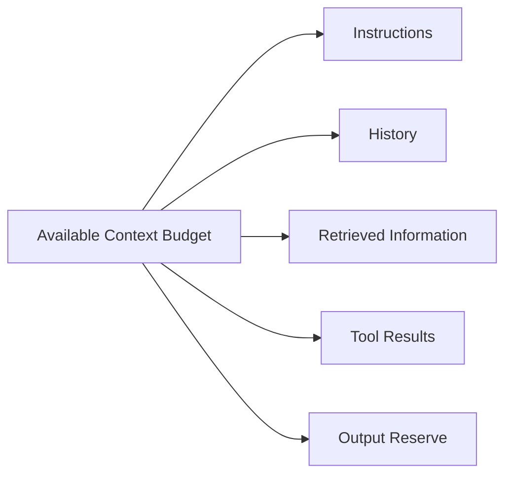
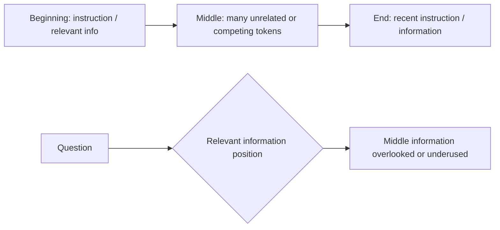

# 05. Context Window as a Budget: Lost in the Middle

> Chapter alignment: 00:16:53 — The Context Window as a Budget: The “Lost in the Middle” Problem

## 1. Context window কী?

LLM input ও output-কে token-এর ধারায় process করে। একটি model/API নির্দিষ্ট সীমার মধ্যে input context এবং generated output পরিচালনা করতে পারে। এই সীমাকে context window বলা হয়।

Context-এ থাকতে পারে:
- System/developer instructions
- User message
- Conversation history
- Retrieved documents
- Tool outputs
- Model response-এর জন্য reserved output tokens

Context window-কে unlimited memory ভাবা ভুল। এটি একটি finite working space।

## 2. Token budget কেন গুরুত্বপূর্ণ?

ধরা যাক, একটি request-এর জন্য মোট context capacity সীমিত। সেখানে instruction, history, retrieved documents এবং output সবাই জায়গা নিতে চায়।



কোনো অংশ বেশি জায়গা নিলে অন্য অংশের জন্য কম budget থাকে। অতিরিক্ত input truncation, retrieval selection বা output-এর জন্য কম room তৈরি করতে পারে।

> Token budget-এর হিসাব model/API অনুযায়ী আলাদা হতে পারে। শুধু character count দেখে token count নির্ভুল জানা যায় না।

## 3. Lost in the Middle কী?

দীর্ঘ context-এর মধ্যে গুরুত্বপূর্ণ তথ্য মাঝামাঝি স্থানে থাকলে model সেটি ব্যবহার করতে তুলনামূলকভাবে ব্যর্থ হতে পারে। কিছু গবেষণায় দেখা গেছে, long-context task-এ তথ্যের অবস্থান performance-কে প্রভাবিত করতে পারে; beginning ও ending-এর তথ্যের তুলনায় middle-এর তথ্য কম কার্যকরভাবে ব্যবহৃত হওয়ার pattern দেখা যায়।

এটি **সব model, সব task, সব prompt-এ একইভাবে ঘটে** এমন নিয়ম নয়। এটি long-context ব্যবহারের একটি পরিচিত failure pattern।



## 4. কেন হতে পারে?

সম্ভাব্য contributing factors:
- দীর্ঘ context-এ signal বনাম noise ratio কমে যায়।
- অনেক তথ্যের মধ্যে attention ও retrieval কার্যকরভাবে বণ্টন করা কঠিন হতে পারে।
- তথ্যের position model-এর learned behavior-কে প্রভাবিত করতে পারে।
- Repeated/irrelevant content গুরুত্বপূর্ণ তথ্যের সঙ্গে competition তৈরি করতে পারে।
- Context বড় হলেও reasoning বা evidence integration-এর ক্ষমতা unlimited নয়।

Context window বড় হওয়া মানেই model প্রতিটি token সমানভাবে ব্যবহার করবে বা সব তথ্য সমানভাবে মনে রাখবে, এমন নয়।

## 5. একটি illustrative example

তুমি agent-কে ৫০টি policy paragraph পাঠালে, refund eligibility-এর একটি critical rule মাঝখানে আছে। শেষে customer-এর question। Agent rule miss করে ভুল সিদ্ধান্ত নিতে পারে।

এটি শুধু context length-এর সমস্যা নয়; retrieval quality, ordering, distractor content, rule clarity ও model capability-ও প্রভাব ফেলতে পারে।

## 6. Mitigation strategy

### 6.1 Relevant information retrieve করো

সব document পাঠানোর বদলে task-এর জন্য প্রাসঙ্গিক chunk retrieve করো। তবে retrieval ভুল বা incomplete হলে গুরুত্বপূর্ণ evidence বাদ পড়তে পারে।

### 6.2 Context trim ও summarize

- Duplicate information বাদ।
- পুরনো conversation-এর useful summary।
- Irrelevant tool output বাদ।
- Structured state দিয়ে repeated history-এর বিকল্প তৈরি।

Summary-তে critical details হারানোর ঝুঁকি থাকে, তাই গুরুত্বপূর্ণ constraints/facts explicit রাখতে হবে।

### 6.3 Information structure

- Clear headings
- Structured fields
- Important constraints আলাদা করে
- Source attribution
- Relevant facts question-এর কাছাকাছি রাখা

### 6.4 Context-এর order পরীক্ষা

একটি prompt-এর জন্য universal best ordering ধরে না নিয়ে evaluation দিয়ে instruction, evidence ও question-এর position পরীক্ষা করা যায়।

### 6.5 Context budget monitor

```text
Context budget =
instructions
+ history
+ retrieved chunks
+ tool outputs
+ current request
+ output reserve
```

Prompt-এর size ও truncation behavior পর্যবেক্ষণ করো। API-এর token usage metadata ব্যবহার করলে estimation-এর চেয়ে ভালো accounting পাওয়া যায়।

## 7. Context window বড় হলে কি Lost in the Middle কমে?

বড় context window আরও তথ্য একসঙ্গে রাখতে সাহায্য করে, কিন্তু সমস্যার নিশ্চয় সমাধান নয়। অনেক বেশি irrelevant information ঢোকালে signal-to-noise ratio খারাপ হতে পারে। Long-context capability এবং information utilization এক বিষয় নয়।

## 8. Interview প্রশ্ন

**Context window ও memory-এর পার্থক্য কী?**  
Context হলো model-এর বর্তমান inference-এ পাঠানো token space। Memory হলো তথ্য সংরক্ষণ ও পুনরুদ্ধারের mechanism, যা context-এর বাইরে থাকতে পারে।

**Lost in the Middle কি context overflow-এর সমান?**  
না। Overflow হলো capacity limit ছাড়িয়ে যাওয়া/প্রয়োজনীয় input বাদ পড়া। Lost in the Middle হলো context-এর মধ্যে থাকা তথ্য position-related কারণে কার্যকরভাবে ব্যবহার না হওয়ার সমস্যা।

**RAG কি এই সমস্যা পুরো সমাধান করে?**  
না। RAG irrelevant context কমাতে পারে, কিন্তু retrieval miss, ranking error, noisy chunks, long retrieved context এবং position effect থাকতে পারে।

**Context বড় করা নাকি ছোট করা ভালো?**  
Task অনুযায়ী। যতটুকু প্রয়োজন তত relevant context, কিন্তু evidence বা constraints বাদ পড়বে না। ছোট context মানেই ভালো নয়, বড় context মানেই ভালো নয়।

## 9. Practice

একটি long-context agent-এর জন্য strategy লেখো:
1. ১০০টি document থেকে কীভাবে relevant information বাছবে?
2. Retrieval-এর পর কতটা context পাঠাবে, কীভাবে ঠিক করবে?
3. গুরুত্বপূর্ণ policy rule হারিয়ে গেলে কীভাবে detect করবে?
4. Context window-এর কত অংশ output-এর জন্য reserve করবে?
5. Lost in the Middle কমেছে কিনা কীভাবে evaluation করবে?