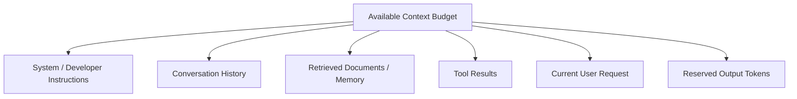
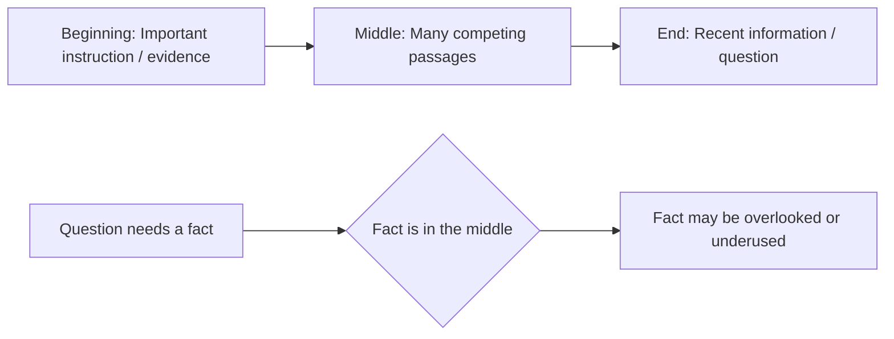

# 05. Context Window as a Budget: Lost in the Middle

> Chapter alignment: 00:16:53 — The Context Window as a Budget: The “Lost in the Middle” Problem

## 1. Context window কী?

LLM text-কে সরাসরি মানুষের মতো “paragraph” হিসেবে নয়, token-এর sequence হিসেবে process করে। Model-এর একটি inference request-এ কত token পর্যন্ত input context ও generated output পরিচালনা করা যাবে, তার সীমাকে context window বলা হয়।

একটি request-এর context-এ থাকতে পারে:
- System/developer instructions
- User message
- Conversation history
- Retrieved documents
- Tool call ও tool result
- Structured state
- Model response-এর জন্য output reserve

Context window-কে unlimited memory ভাবা ভুল। এটি model-এর current working space-এর মতো। এক request-এর বাইরে তথ্য ধরে রাখার জন্য application history বা memory mechanism দরকার হতে পারে।

## 2. Token কী?

Token হলো model-এর text processing unit। Token সবসময় একটি শব্দ নয়। একটি শব্দ একাধিক token হতে পারে, আবার punctuation বা word fragment-ও token হতে পারে। ভাষা, spelling, code ও tokenizer অনুযায়ী tokenization বদলে যায়।

তাই:
- ১ token = ১ word, এমন নয়।
- Character count দিয়ে token count নির্ভুল বলা যায় না।
- একই দৈর্ঘ্যের বাংলা ও ইংরেজি text সমান token নাও হতে পারে।
- Code, JSON ও special characters token budget বাড়াতে পারে।

## 3. Context window-কে budget হিসেবে ভাবো

ধরা যাক, model-এর context capacity সীমিত। সেই জায়গা ভাগ হচ্ছে instruction, history, retrieved data, tool result, current request এবং output-এর মধ্যে।

সব component একসঙ্গে বড় হলে context capacity ছাড়িয়ে যেতে পারে। তখন application/model/API অনুযায়ী request reject, truncation, summarization বা history trimming হতে পারে।

### একটি illustrative হিসাব

ধরা যাক, একটি hypothetical request-এর জন্য 32,000 token budget আছে:
- Instructions: 2,000
- History: 8,000
- Retrieved documents: 12,000
- Tool outputs: 5,000
- Current request: 1,000
- Output reserve: 4,000

মোট = 32,000 token।

এটি কেবল budget বোঝানোর উদাহরণ; বাস্তব model-এর context accounting ও limit আলাদা হতে পারে। Output reserve না রাখলে model-এর final answer generate করার জায়গা কমে যেতে পারে।

## 4. Context overflow ও truncation

Context overflow হলো input ও output-এর প্রয়োজনীয় token capacity সীমা অতিক্রম করা। Application বা API request reject করতে পারে, অথবা application পুরনো/কম গুরুত্বপূর্ণ content বাদ দিতে পারে।

সমস্যা:
- গুরুত্বপূর্ণ instruction বাদ পড়তে পারে।
- Conversation-এর পুরনো constraint হারাতে পারে।
- Retrieved document-এর শেষ অংশ truncate হতে পারে।
- Tool output-এর গুরুত্বপূর্ণ field বাদ যেতে পারে।
- Output-এর জন্য যথেষ্ট token অবশিষ্ট নাও থাকতে পারে।

তাই context management শুধু token count কমানো নয়; কোন তথ্য রাখতে হবে তা সঠিকভাবে নির্বাচন করা।

## 5. Lost in the Middle কী?

Long context-এর মধ্যে relevant information মাঝামাঝি অবস্থানে থাকলে model সেটি তুলনামূলকভাবে কম কার্যকরভাবে ব্যবহার করতে পারে। কিছু long-context research-এ beginning ও end-এর তথ্যের তুলনায় middle-এর তথ্য ব্যবহার কমে যাওয়ার position-related pattern দেখা গেছে।

এটি **সব model, সব prompt ও সব task-এ একইভাবে ঘটে** এমন নয়। Model architecture, task, context length, information density ও prompt structure অনুযায়ী প্রভাব বদলাতে পারে।

## 6. একটি বাস্তবসম্মত example

ধরো, একটি agent-কে ৬০ পৃষ্ঠার refund policy ও customer history দেওয়া হলো। Policy-এর ২৮তম পৃষ্ঠায় একটি গুরুত্বপূর্ণ exception আছে:

“Product damaged হলেও customer যদি delivery-এর ৩০ দিনের বেশি পরে claim করে, standard refund প্রযোজ্য নয়।”

Document-এর শুরুতে general refund rule, শেষে customer-এর request। Agent general rule পড়ে refund eligible বলে ফেলল, কিন্তু মাঝের exception ব্যবহার করল না।

এটি Lost in the Middle-এর সম্ভাব্য উদাহরণ। তবে কারণ শুধু position নাও হতে পারে: retrieval ওই page আনেনি, policy chunk-এর heading অস্পষ্ট, exception-এর scope বোঝা কঠিন, বা model evidence ভুল interpret করেছে। তাই debugging-এ আলাদা করে পরীক্ষা করতে হবে।

## 7. কেন এই সমস্যা হতে পারে?

সম্ভাব্য কারণ:
1. **Position sensitivity:** context-এ তথ্যের অবস্থান model-এর utilization-এ প্রভাব ফেলতে পারে।
2. **Signal-to-noise ratio:** অনেক irrelevant content-এর মধ্যে গুরুত্বপূর্ণ তথ্য হারিয়ে যায়।
3. **Competing information:** একই বিষয়ে বহু passage থাকলে কোনটি relevant তা নির্ধারণ কঠিন।
4. **Long dependency:** শুরুতে দেওয়া constraint পরের বহু step জুড়ে মনে রেখে apply করতে হয়।
5. **Weak structure:** heading, source, date বা scope না থাকলে relevant fact শনাক্ত করা কঠিন।
6. **Retrieval quality:** ভুল chunk বা incomplete evidence দিলে model সঠিক সিদ্ধান্তে পৌঁছাতে পারে না।

Context window বড় হওয়া মানে model প্রতিটি token সমানভাবে ব্যবহার করবে, এমন নয়।

## 8. Mitigation: কীভাবে কমাবে?

### 8.1 Relevant information retrieve করো
সব document context-এ ঢোকানোর বদলে query অনুযায়ী relevant chunk retrieve করো। তবে retrieval recall পরীক্ষা করো; গুরুত্বপূর্ণ exception বাদ পড়লে ছোট context-ও ভুল হবে।

### 8.2 Context trim করো
Duplicate, irrelevant ও stale information বাদ দাও। Tool output থেকে শুধু দরকারি field রাখো। তবে aggressive trimming-এ critical evidence বাদ যেতে পারে।

### 8.3 Summarize, কিন্তু evidence হারিও না
পুরনো conversation summary করা যায়। Summary-তে goal, constraints, decisions, pending steps, source ও exact identifiers রাখো। High-impact decision-এর জন্য original authoritative source reference সংরক্ষণ করো।

### 8.4 Structured context ব্যবহার করো
Unstructured paragraph-এর বদলে:
- Goal
- Constraints
- Known facts
- Unknown facts
- Evidence/source
- Current workflow state
- Next action

এইভাবে context organize করো।

### 8.5 Relevant evidence question-এর কাছে রাখো
কিছু model/task-এ relevant evidence ও question কাছাকাছি রাখলে ব্যবহার উন্নত হতে পারে। কিন্তু universal ordering rule ধরে নিও না; evaluation দিয়ে পরীক্ষা করো।

### 8.6 Context budget monitor করো
Token usage, truncation, retrieval size ও output reserve monitor করো। Model/API-এর usage metadata থাকলে সেটি ব্যবহার করো।

### 8.7 Critical facts পুনরায় validate করো
Refund limit, user identity বা policy version-এর মতো critical fact memory summary থেকে অন্ধভাবে নিও না; authoritative source থেকে verify করো।

## 9. বড় context window কি Lost in the Middle solve করে?

না, নিশ্চিতভাবে নয়। বড় context বেশি তথ্য একসঙ্গে রাখতে সাহায্য করে। কিন্তু:
- সব তথ্য equally relevant নয়;
- model সব position সমানভাবে utilize নাও করতে পারে;
- বেশি noise signal-কে চাপা দিতে পারে;
- retrieval ও reasoning-এর ভুল থাকতে পারে;
- capacity বাড়লেও context quality স্বয়ংক্রিয়ভাবে বাড়ে না।

তাই লক্ষ্য হওয়া উচিত “সবচেয়ে বড় context পাঠানো” নয়, “task-এর জন্য যথেষ্ট ও relevant context পাঠানো”।

## 10. ছোট context কি সবসময় ভালো?

না। খুব ছোট context করলে policy exception, user constraint বা earlier decision বাদ পড়তে পারে। তখন agent ভুল সিদ্ধান্ত নেবে। Context ছোট করার আগে জানতে হবে কোন তথ্য অপরিহার্য। Context optimization হলো relevance ও completeness-এর balance।

## 11. RAG কি Lost in the Middle পুরোপুরি সমাধান করে?

না। RAG retrieval-এর মাধ্যমে relevant document/chunk বেছে context-এ আনে, ফলে পুরো corpus পাঠানোর দরকার কমে। কিন্তু:
- retrieval relevant chunk miss করতে পারে;
- ranking ভুল হতে পারে;
- chunk boundary-তে exception বাদ পড়তে পারে;
- retrieved context এখনও দীর্ঘ/noisy হতে পারে;
- model retrieved evidence ভুল বুঝতে পারে।

RAG-এর সঙ্গে hybrid search, metadata filtering, reranking, source citation, chunk evaluation ও answer verification দরকার হতে পারে।

## 12. Interview: Deep questions ও বিস্তারিত উত্তর

### Q1. Context window কী এবং এটি memory থেকে কীভাবে আলাদা?

Context window হলো একটি model inference-এ model-কে পাঠানো token-এর working space। এতে instructions, user messages, history, retrieved documents ও tool results থাকতে পারে। Memory হলো তথ্য সংরক্ষণ ও পরে retrieve করার mechanism, যা current context-এর বাইরে থাকতে পারে। Memory থেকে তথ্য retrieve করলে সেটি context-এর অংশ হয়ে token budget ব্যবহার করে। তাই memory থাকলেই context limit দূর হয় না।

### Q2. Context window বড় হলেই কি model বেশি intelligent বা capable হয়?

না। বড় context capacity মানে বেশি input ধারণ করা যায়; কিন্তু model সেই তথ্য কতটা নির্ভুলভাবে locate, understand ও apply করতে পারবে তা আলাদা বিষয়। Position sensitivity, distractor, retrieval quality ও reasoning limit থাকতে পারে। তাই context length একটি capacity metric, information utilization বা reasoning quality-এর সরাসরি সমান নয়।

### Q3. Lost in the Middle ও context overflow কি একই সমস্যা?

না। Context overflow capacity limit-এর সমস্যা: request context budget ছাড়িয়ে যায় বা কিছু content বাদ পড়ে। Lost in the Middle হলো context-এর মধ্যে থাকা relevant তথ্য position-related কারণে কম ব্যবহার হওয়ার pattern। Overflow হলে তথ্য model-এর কাছে নাও পৌঁছাতে পারে; Lost in the Middle-এ তথ্য পৌঁছেছে, কিন্তু model সেটি যথাযথভাবে কাজে লাগাতে ব্যর্থ হতে পারে।

### Q4. RAG ব্যবহার করলে কি Lost in the Middle থাকবে না?

থাকতে পারে। RAG corpus থেকে relevant chunk retrieve করে, কিন্তু retrieval ভুল হলে evidence-ই আসবে না। অনেক chunk এলে context আবার noisy হতে পারে। Chunking exception-কে মূল rule থেকে আলাদা করে ফেলতে পারে। তাই retrieval recall/precision, reranking, context length, evidence position এবং answer correctness আলাদা evaluate করতে হবে।

### Q5. Context budget কীভাবে allocate করবে?

প্রথমে task-এর essential instruction ও safety constraints নির্ধারণ। এরপর current request, relevant history/state, retrieved evidence ও tool outputs-এর জন্য budget। Output-এর জন্য reserve রাখতে হবে। কোন component কত token পাবে তা task, model limit ও evaluation অনুযায়ী ঠিক করো। Fixed percentage সব task-এর জন্য সঠিক নয়। API token usage ও truncation behavior monitor করো।

### Q6. গুরুত্বপূর্ণ policy rule model miss করছে কিনা কীভাবে detect করবে?

Test set-এ rule ও exception-সহ adversarial/long-context case রাখো। একই evidence-এর position বদলে test করো। Model-এর decision-এর সঙ্গে cited source/evidence মিলিয়ে দেখো। Critical rule-এর জন্য deterministic policy check বা explicit checklist ব্যবহার করা যায়। শুধু model-এর self-report “আমি সব পড়েছি” evidence নয়।

### Q7. Summary করলে কি তথ্য হারানোর ঝুঁকি আছে?

হ্যাঁ। Summary compression; সব detail রাখা সম্ভব নয়। তাই summary-তে goal, constraints, decisions, pending actions, exact IDs, dates, source reference ও critical exception preserve করো। High-impact decision-এর ক্ষেত্রে original source retrieve করার পথ রাখো। Summary-কে authoritative database-এর replacement বানিও না।

### Q8. Long context debug করার practical পদ্ধতি কী?

১) Model-এ আসলে কোন context পাঠানো হয়েছে তা inspect করো।  
২) Truncation/limit ঘটেছে কি না দেখো।  
৩) Relevant evidence retrieval result-এ ছিল কি না যাচাই করো।  
৪) Evidence position বদলে controlled test চালাও।  
৫) Irrelevant content কমিয়ে result compare করো।  
৬) Source structure ও chunk boundary পরীক্ষা করো।  
৭) Decision rule ও answer citation verify করো।  
এভাবে retrieval failure, context overflow, position effect ও reasoning failure আলাদা করা যায়।

### Q9. Context order-এর কোনো universal best practice আছে?

না। কিছু task/model-এ instruction শুরুতে, question শেষে এবং relevant evidence কাছাকাছি রাখা কার্যকর হতে পারে। কিন্তু universal ordering দাবি করা ঠিক নয়। নিজের model, prompt ও task-এর ওপর controlled evaluation করো। Critical constraints clear heading ও structured field-এ রাখো।

## 13. Practice: Long-context agent design

ধরো, তোমার কাছে ১০০টি policy document আছে। Agent-কে refund eligibility নির্ধারণ করতে হবে।

1. কীভাবে document index করবে?
2. Query থেকে relevant document/chunk কীভাবে retrieve করবে?
3. Policy version ও effective date কীভাবে verify করবে?
4. Exception rule হারিয়ে যাচ্ছে কি না কীভাবে test করবে?
5. Context-এর কতটা output-এর জন্য রাখবে?
6. RAG retrieval miss করলে fallback কী?
7. Model-এর decision-এর evidence কীভাবে audit করবে?
8. Lost in the Middle কমেছে কি না কী metric-এ মাপবে?

একই প্রশ্নের জন্য ৩টি prompt variant বানাও: full document, retrieved chunks, structured evidence summary। Accuracy, latency, token cost ও missed-exception rate তুলনা করো।
