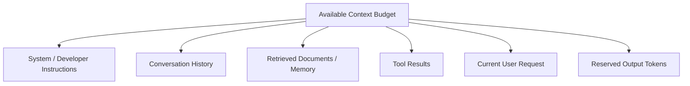
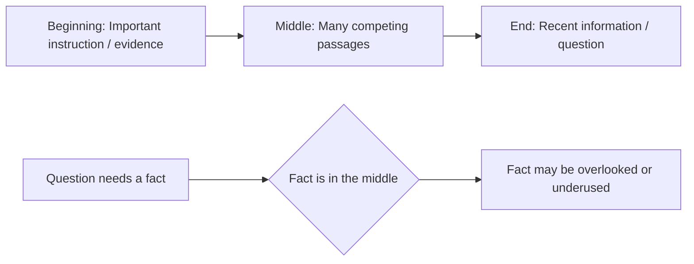

# 05. Context Window as a Budget: Lost in the Middle

> Chapter alignment: 00:16:53 — The Context Window as a Budget: The “Lost in the Middle” Problem

## 1. Model-এর সামনে যে তথ্য থাকে, সেটাই তার কাজের জগৎ

ধরো, তুমি একটি agent-কে বললে: “Refund policy দেখে সিদ্ধান্ত দাও, কিন্তু damaged product-এর exception rule-টি অবশ্যই মানবে।” Agent-এর সামনে policy document, customer history, আগের tool result, system instruction এবং current request সব একসঙ্গে পাঠানো হলো। Model এই তথ্যগুলো থেকেই উত্তর বা পরবর্তী action তৈরি করবে।

কিন্তু model-এর সামনে অসীম জায়গা নেই। একটি inference request-এ কত token input হিসেবে নেওয়া এবং output হিসেবে generate করা যাবে, তার একটি সীমা থাকে। এই সীমিত token capacity-ই **Context Window**।

Context window-কে model-এর স্থায়ী memory ভাবা ভুল। বরং একে একটি নির্দিষ্ট কাজের জন্য model-এর সামনে খোলা working space হিসেবে ভাবো। Application ঠিক করে কোন instruction, history, retrieved document ও tool result এই working space-এ পাঠাবে। পরের request-এ আগের তথ্য আবার পাঠানো না হলে model সেটি নির্ভরযোগ্যভাবে জানবে না।

এখানে দুটি আলাদা engineering problem আছে:

1. **Capacity problem:** প্রয়োজনীয় তথ্য পাঠানোর জায়গা যথেষ্ট আছে কি?
2. **Utilization problem:** পাঠানো তথ্যের মধ্যে গুরুত্বপূর্ণ evidence model সঠিকভাবে খুঁজে ব্যবহার করছে কি?

Context overflow প্রথম সমস্যার উদাহরণ। Lost in the Middle দ্বিতীয়টির একটি পরিচিত উদাহরণ।

## 2. Token কী এবং কেন token budget নিয়ে ভাবতে হয়?

LLM text-কে মানুষের মতো সরাসরি paragraph হিসেবে নয়, token sequence হিসেবে process করে। Token হলো tokenizer-এর নির্ধারিত text unit। একটি token সম্পূর্ণ শব্দ হতে পারে, শব্দের অংশ হতে পারে, punctuation হতে পারে, আবার code বা special marker-এর অংশও হতে পারে।

তাই কয়েকটি ভুল ধারণা এড়িয়ে চলতে হবে:

- ১ token = ১ word নয়।
- Character count দিয়ে token count নির্ভুলভাবে জানা যায় না।
- একই দৈর্ঘ্যের বাংলা ও ইংরেজি text সমান token নাও হতে পারে।
- Code, JSON, URL ও unusual character token budget-এ প্রভাব ফেলে।
- Model ও tokenizer ভেদে একই text-এর token count বদলাতে পারে।

Production application-এ token count আন্দাজের বদলে সংশ্লিষ্ট model/tokenizer বা API usage metadata ব্যবহার করা ভালো। Design পর্যায়ে estimate কাজে লাগে, কিন্তু runtime limit যাচাই করতে actual measurement দরকার।

## 3. Context window-কে budget হিসেবে ভাবো

একটি request-এর context-এ অনেক ধরনের তথ্য জায়গা নেয়:

- System ও developer instruction
- Conversation history
- Current user request
- Retrieved documents ও memory
- Tool call এবং tool result
- Structured workflow state
- Output generation-এর জন্য reserve

ধরা যাক একটি hypothetical model request-এর জন্য 32,000 token budget available। তোমার application যদি instruction-এ 2,000, history-তে 8,000, retrieved documents-এ 12,000, tool result-এ 5,000, current request-এ 1,000 এবং output reserve-এ 4,000 token রাখে, মোট দাঁড়ায় 32,000।

এই হিসাবটি শুধু budgeting বোঝানোর উদাহরণ; বাস্তব model-এর limit, accounting ও input/output capacity আলাদা হতে পারে। গুরুত্বপূর্ণ বিষয় হলো, output reserve ভুলে গেলে model-এর final response generate করার জায়গা কমে যেতে পারে। আবার retrieved document-এর জন্য অতিরিক্ত budget দিলে essential instruction বা current task-এর জায়গা কমে যেতে পারে।

### Budget allocation-এর আসল প্রশ্ন

প্রশ্নটি “কোন অংশ কত token পাবে?” দিয়ে শুরু করা ঠিক নয়। আগে জিজ্ঞাসা করো:

- কোন তথ্য ছাড়া task সঠিকভাবে করা অসম্ভব?
- কোন তথ্য stale বা redundant?
- কোন তথ্য authoritative source থেকে আবার retrieve করা যায়?
- কোন history summary হিসেবে রাখা যায়?
- কোন tool output থেকে শুধু নির্দিষ্ট field দরকার?
- Output-এর expected length কত?

Task ও risk অনুযায়ী allocation বদলাবে। Fixed percentage সব use case-এ ভালো কাজ করবে না।

## 4. Context overflow: প্রয়োজনীয় তথ্যের জন্য জায়গা না থাকা

Context overflow ঘটে যখন request-এর প্রয়োজনীয় input ও output capacity model-এর সীমা ছাড়িয়ে যায়। Application বা API request reject করতে পারে; কিছু application history trim, summarize বা কম গুরুত্বপূর্ণ অংশ বাদ দিতে পারে। ঠিক কী হবে তা platform ও implementation-এর ওপর নির্ভর করে।

ধরা যাক agent-কে ১০০ পৃষ্ঠার policy, ৩০টি tool result এবং দীর্ঘ conversation history পাঠানো হলো। Capacity ছাড়িয়ে গেলে application যদি পুরনো message কেটে দেয়, তাহলে শুরুতে দেওয়া একটি গুরুত্বপূর্ণ user constraint বাদ পড়তে পারে। আবার retrieved document-এর মাঝের বা শেষের অংশ truncate হলে exception rule হারিয়ে যেতে পারে।

সমস্যা শুধু request error নয়। Silent truncation আরও বিপজ্জনক হতে পারে, কারণ agent দেখতে পারে যেন তার কাছে যথেষ্ট তথ্য আছে, অথচ গুরুত্বপূর্ণ evidence বাদ গেছে।

তাই context management শুধু token কমানো নয়। এটি **কোন তথ্য রাখতে হবে, কোনটি বাদ দেওয়া নিরাপদ এবং বাদ দেওয়ার সিদ্ধান্ত কীভাবে যাচাই হবে**, সেই engineering discipline।

## 5. Lost in the Middle: তথ্য পাঠিয়েও model সেটি ঠিকমতো ব্যবহার না করলে

Long-context research-এ একটি position-related pattern দেখা গেছে: কিছু model ও task-এ relevant information context-এর শুরু বা শেষের দিকে থাকলে model সেটি তুলনামূলকভাবে ভালো ব্যবহার করে, কিন্তু মাঝামাঝি অবস্থানে থাকলে ব্যবহার দুর্বল হতে পারে। এই phenomenon-কে সাধারণভাবে **Lost in the Middle** বলা হয়।

এটি কোনো universal law নয়। সব model, সব context length, সব task বা সব prompt-এ একই pattern দেখা যাবে না। Model architecture, information density, competing passages, task design এবং retrieval quality অনুযায়ী প্রভাব বদলায়।

এখানে গুরুত্বপূর্ণ পার্থক্য হলো: Lost in the Middle হলে তথ্য context-এ উপস্থিত থাকতে পারে, কিন্তু model সেটি decision-এ যথাযথভাবে ব্যবহার নাও করতে পারে। Context overflow হলে তথ্য model-এর কাছে পৌঁছায়ইনি বা truncate হয়ে গেছে। Debugging-এ এই দুইটিকে এক করে ফেললে ভুল সমাধান বেছে নেওয়া হবে।

## 6. একটি বাস্তব scenario: Refund policy-র exception হারিয়ে গেল

ধরো, একটি agent-কে customer-এর refund eligibility যাচাই করতে ৬০ পৃষ্ঠার policy document দেওয়া হলো। Policy-এর ২৮তম পৃষ্ঠায় লেখা আছে:

“Product damaged হলেও customer যদি delivery-এর ৩০ দিনের বেশি পরে claim করে, standard refund প্রযোজ্য নয়।”

Document-এর শুরুতে general refund rule আছে, আর context-এর শেষে customer-এর request। Agent general rule দেখে বলে দিল customer refund পাওয়ার যোগ্য। কিন্তু মাঝের exception ব্যবহার করল না।

এটি Lost in the Middle-এর সম্ভাব্য উদাহরণ। তবে শুধু position-কে দায়ী করা যাবে না। আরও কিছু সম্ভাবনা আছে:

- Retrieval system exception-সহ page-টি পাঠায়নি।
- Chunk boundary-তে exception আর তার scope আলাদা হয়ে গেছে।
- Policy document-এর heading অস্পষ্ট ছিল।
- একই বিষয়ে conflicting version ছিল।
- Model exception পড়েছে, কিন্তু “damaged item” ও “30-day window”-এর সম্পর্ক ভুল বুঝেছে।
- Application document-এর মাঝের অংশ truncate করেছে।

সঠিক root cause বের করতে হলে জানতে হবে model-কে আসলে কী context পাঠানো হয়েছিল, retrieved evidence-এ exception ছিল কি না, এবং একই তথ্য position বদলে দিলে result বদলায় কি না।

## 7. কেন Lost in the Middle বা long-context failure ঘটতে পারে?

**Position sensitivity:** Context-এর অবস্থান model-এর information utilization-এ প্রভাব ফেলতে পারে।

**Signal-to-noise ratio:** অনেক irrelevant passage-এর মধ্যে গুরুত্বপূর্ণ তথ্য চাপা পড়ে যায়।

**Competing evidence:** একই বিষয়ে বহু passage থাকলে কোনটি authoritative বা relevant তা বেছে নেওয়া কঠিন।

**Long dependency:** শুরুতে দেওয়া constraint পরের অনেক step জুড়ে মনে রেখে apply করতে হয়।

**Weak structure:** Heading, source, date, scope বা exception marker না থাকলে relevant fact শনাক্ত করা কঠিন।

**Retrieval quality:** ভুল বা incomplete chunk পাঠালে model সঠিক সিদ্ধান্তে পৌঁছাতে পারবে না।

**Context truncation:** প্রয়োজনীয় passage model-এর কাছে পৌঁছায়নি বা কেটে গেছে।

বড় context window থাকলেই model প্রতিটি token সমানভাবে ব্যবহার করবে, এমন নয়। Capacity এবং utilization আলাদা বিষয়।

## 8. Mitigation: Context কীভাবে সাজাবে?

### 8.1 Relevant information retrieve করো, পুরো corpus নয়

সব document context-এ ঢোকানোর বদলে query অনুযায়ী relevant chunk retrieve করো। এতে noise কমতে পারে। তবে retrieval recall পরীক্ষা করতে হবে; গুরুত্বপূর্ণ exception বাদ পড়লে ছোট context-ও ভুল সিদ্ধান্ত দেবে।

### 8.2 Duplicate ও stale information বাদ দাও

একই policy-এর পাঁচটি পুরনো copy context-এ পাঠালে confusion বাড়তে পারে। Version ও effective date দেখে authoritative source বেছে নাও। Tool output থেকেও শুধু প্রয়োজনীয় field রাখো, তবে evidence-এর অর্থ বদলে যায় এমন aggressive trimming কোরো না।

### 8.3 Summary ব্যবহার করো, কিন্তু evidence-এর পথ খোলা রাখো

দীর্ঘ conversation summary করা যায়। Summary-তে goal, constraints, decisions, pending steps, exact identifiers, source এবং critical exception preserve করো। কিন্তু summary-কে authoritative business record বানিও না। High-impact decision-এর আগে original source retrieve করার পথ রাখো।

### 8.4 Structured context তৈরি করো

একটি বড় paragraph-এর বদলে context-কে section-এ ভাগ করা যায়:

- Goal
- Constraints
- Known facts
- Unknown facts
- Evidence and source
- Current workflow state
- Pending decisions
- Next action

এতে model ও developer দুজনের জন্য তথ্যের scope পরিষ্কার হয়। Structure নিজে correctness নিশ্চিত করে না, তবে ambiguity কমাতে সাহায্য করে।

### 8.5 Relevant evidence ও question-এর অবস্থান পরীক্ষা করো

কিছু model/task-এ relevant evidence ও question কাছাকাছি রাখলে utilization উন্নত হতে পারে। আবার কিছু ক্ষেত্রে system instruction শুরুতে এবং task question শেষে রাখা কার্যকর হতে পারে। কিন্তু universal ordering rule ধরে নেওয়া উচিত নয়। নিজের model, prompt ও workload-এ controlled evaluation করো।

### 8.6 Context budget monitor করো

Input token, output reserve, retrieval size, truncation, context compression এবং API usage monitor করো। Request limit-এর কাছাকাছি গেলে কোন content বাদ বা summarize হচ্ছে তা log করা দরকার। Silent truncation থাকলে সেটি detect করার ব্যবস্থা করো।

### 8.7 Critical facts authoritative source থেকে verify করো

Refund limit, customer identity, permission বা current policy version-এর মতো critical fact summary বা stale memory থেকে অন্ধভাবে নিও না। প্রয়োজন হলে domain service বা authoritative source থেকে আবার verify করো।

## 9. বড় context window কি Lost in the Middle solve করে?

না, নিশ্চিতভাবে নয়। বড় context বেশি তথ্য একসঙ্গে রাখতে সাহায্য করে, কিন্তু তথ্য ব্যবহার করার quality স্বয়ংক্রিয়ভাবে বাড়ায় না।

- সব তথ্য equally relevant নয়।
- Model সব position সমানভাবে utilize নাও করতে পারে।
- বেশি noise signal-কে চাপা দিতে পারে।
- Retrieval ও reasoning-এর ভুল থাকতে পারে।
- Long context evaluate করা ও debug করা কঠিন হতে পারে।
- Input capacity বাড়লেও output reserve ও latency/cost বিবেচনা করতে হয়।

বড় context window উপকারী যখন task-এর জন্য সত্যিই বেশি evidence একসঙ্গে দরকার এবং model সেই evidence কার্যকরভাবে ব্যবহার করতে পারে। কিন্তু লক্ষ্য হওয়া উচিত “সবচেয়ে বড় context পাঠানো” নয়; “task-এর জন্য যথেষ্ট, relevant ও trustworthy context পাঠানো”।

## 10. ছোট context কি সবসময় ভালো?

না। Context ছোট করলে irrelevant noise কমতে পারে, কিন্তু খুব aggressive trimming-এ policy exception, user constraint বা earlier decision বাদ পড়তে পারে। তখন agent ভুল সিদ্ধান্ত নেবে।

ধরা যাক refund policy-তে general rule ১ম পৃষ্ঠায়, আর exception ২৮তম পৃষ্ঠায়। শুধু প্রথম পৃষ্ঠা পাঠালে context ছোট হবে, কিন্তু decision ভুল হবে। তাই context optimization হলো **relevance, completeness, freshness ও cost-এর balance**।

## 11. RAG কি Lost in the Middle পুরোপুরি সমাধান করে?

না। RAG retrieval-এর মাধ্যমে relevant document/chunk বেছে context-এ আনে, ফলে পুরো corpus পাঠানোর দরকার কমে। কিন্তু RAG নিজেই failure করতে পারে:

- Retrieval relevant chunk miss করতে পারে।
- Ranking ভুল chunk-কে উপরে রাখতে পারে।
- Chunk boundary-তে exception মূল rule থেকে বিচ্ছিন্ন হতে পারে।
- Retrieved context এখনও দীর্ঘ বা noisy হতে পারে।
- Model evidence ভুল বুঝতে পারে।
- একই policy-এর stale ও current version একসঙ্গে আসতে পারে।

তাই RAG-এর সঙ্গে hybrid search, metadata filtering, reranking, source/version validation, chunk evaluation এবং answer verification দরকার হতে পারে। Retrieval-এর quality এবং model-এর evidence utilization আলাদা করে evaluate করতে হবে।

## 12. কীভাবে পরীক্ষা করবে: Position effect, retrieval miss, নাকি reasoning failure?

একটি controlled debugging process ব্যবহার করো:

1. **Actual context inspect:** Model-কে ঠিক কী পাঠানো হয়েছিল? Token count ও truncation status কী?
2. **Retrieval inspect:** প্রয়োজনীয় exception retrieved result-এ ছিল কি?
3. **Position experiment:** একই evidence beginning, middle ও end-এ রেখে controlled test চালাও।
4. **Noise experiment:** Irrelevant passage কমিয়ে result compare করো।
5. **Structure experiment:** Heading, metadata, source ও exception marker যোগ করে দেখো।
6. **Version check:** Current policy ও stale policy মিশে গেছে কি?
7. **Decision verification:** Final answer-এর claim source evidence-এর সঙ্গে মেলে কি?

এভাবে context overflow, retrieval failure, position sensitivity ও reasoning failure আলাদা করা যায়। একসঙ্গে সব পরিবর্তন করলে কোন change কাজ করেছে বোঝা কঠিন।

## 13. Interview: Context Window ও Lost in the Middle

### Q1. Context window কী এবং এটি memory থেকে কীভাবে আলাদা?

Context window হলো একটি model inference-এ model-কে পাঠানো token-এর working space। এতে instruction, user message, history, retrieved document ও tool result থাকতে পারে। Memory হলো তথ্য সংরক্ষণ ও পরে retrieve করার mechanism, যা current context-এর বাইরে থাকতে পারে। Memory থেকে তথ্য retrieve করলে সেটি context-এর অংশ হয়ে token budget ব্যবহার করে। তাই memory থাকলেই context limit দূর হয় না।

### Q2. Context window বড় হলেই কি model বেশি intelligent বা capable হয়?

না। বড় context capacity মানে বেশি input ধারণ করা যায়; কিন্তু model সেই তথ্য কতটা নির্ভুলভাবে locate, understand ও apply করতে পারবে তা আলাদা বিষয়। Position sensitivity, distractor, retrieval quality ও reasoning limit থাকতে পারে। তাই context length একটি capacity metric, information utilization বা reasoning quality-এর সরাসরি সমান নয়।

### Q3. Lost in the Middle ও context overflow কি একই সমস্যা?

না। Context overflow capacity limit-এর সমস্যা: request context budget ছাড়িয়ে যায় বা কিছু content বাদ পড়ে। Lost in the Middle হলো context-এর মধ্যে থাকা relevant তথ্য position-related কারণে কম ব্যবহার হওয়ার pattern। Overflow হলে তথ্য model-এর কাছে নাও পৌঁছাতে পারে; Lost in the Middle-এ তথ্য পৌঁছেছে, কিন্তু model সেটি যথাযথভাবে কাজে লাগাতে ব্যর্থ হতে পারে।

### Q4. RAG ব্যবহার করলে কি Lost in the Middle থাকবে না?

থাকতে পারে। RAG corpus থেকে relevant chunk retrieve করে, কিন্তু retrieval ভুল হলে evidence-ই আসবে না। অনেক chunk এলে context আবার noisy হতে পারে। Chunking exception-কে মূল rule থেকে আলাদা করে ফেলতে পারে। তাই retrieval recall/precision, reranking, context length, evidence position এবং answer correctness আলাদা evaluate করতে হবে।

### Q5. Context budget কীভাবে allocate করবে?

প্রথমে task-এর essential instruction ও safety constraint নির্ধারণ করো। এরপর current request, relevant history/state, retrieved evidence ও tool output-এর জন্য জায়গা রাখো। Output-এর জন্য reserve দরকার। কোন component কত token পাবে তা task, model limit ও evaluation অনুযায়ী ঠিক করো। Fixed percentage সব task-এর জন্য সঠিক নয়। API token usage ও truncation behavior monitor করো।

### Q6. গুরুত্বপূর্ণ policy rule model miss করছে কি না কীভাবে detect করবে?

Rule ও exception-সহ long-context test case তৈরি করো। একই evidence-এর position বদলে controlled test চালাও। Model-এর decision-এর সঙ্গে cited source/evidence মিলিয়ে দেখো। Critical rule-এর জন্য deterministic policy check বা explicit checklist ব্যবহার করা যায়। Model-এর self-report “আমি সব পড়েছি” correctness-এর evidence নয়।

### Q7. Summary করলে কি তথ্য হারানোর ঝুঁকি আছে?

হ্যাঁ। Summary compression; সব detail রাখা সম্ভব নয়। তাই summary-তে goal, constraints, decisions, pending actions, exact IDs, dates, source reference ও critical exception preserve করো। High-impact decision-এর ক্ষেত্রে original source retrieve করার পথ রাখো। Summary-কে authoritative database-এর replacement বানিও না।

### Q8. Long context debug করার practical পদ্ধতি কী?

প্রথমে inspect করো model-কে আসলে কোন context পাঠানো হয়েছে এবং truncation ঘটেছে কি না। এরপর relevant evidence retrieval result-এ ছিল কি না যাচাই করো। Evidence position বদলে controlled test চালাও, irrelevant content কমিয়ে result compare করো, source structure ও chunk boundary পরীক্ষা করো, শেষে decision ও citation verify করো। এভাবে retrieval failure, context overflow, position effect ও reasoning failure আলাদা করা যায়।

### Q9. Context order-এর কোনো universal best practice আছে?

না। কিছু task/model-এ instruction শুরুতে, question শেষে এবং relevant evidence কাছাকাছি রাখা কার্যকর হতে পারে। কিন্তু universal ordering দাবি করা ঠিক নয়। নিজের model, prompt ও task-এর ওপর controlled evaluation করো। Critical constraints clear heading ও structured field-এ রাখো।

### Q10. Context window capacity এবং effective context length-এর মধ্যে পার্থক্য কী?

Capacity হলো model/API সর্বোচ্চ কত token গ্রহণ করতে পারে। Effective context length বলতে task-এর জন্য কত দূর পর্যন্ত তথ্য নির্ভরযোগ্যভাবে ব্যবহার করা যাচ্ছে, সেই practical ধারণা বোঝানো হয়। একটি model 100k token input নিতে পারলেও নির্দিষ্ট retrieval-heavy task-এ 100k জুড়ে evidence সমানভাবে ব্যবহার নাও করতে পারে। তাই advertised capacity-কে task performance-এর নিশ্চয়তা ভাবা যাবে না।

## 14. Practice: Long-context agent design

ধরো, তোমার কাছে ১০০টি policy document আছে। Agent-কে refund eligibility নির্ধারণ করতে হবে।

1. কীভাবে document index করবে?
2. Query থেকে relevant document/chunk কীভাবে retrieve করবে?
3. Policy version ও effective date কীভাবে verify করবে?
4. Exception rule হারিয়ে যাচ্ছে কি না কীভাবে test করবে?
5. Context budget-এ output-এর জন্য কতটা reserve রাখবে এবং কেন?
6. RAG retrieval miss করলে fallback কী?
7. Model-এর decision-এর evidence কীভাবে audit করবে?
8. Lost in the Middle কমেছে কি না কোন experiment ও metric দিয়ে মাপবে?

একই প্রশ্নের জন্য তিনটি approach তৈরি করো: full document context, retrieved chunks এবং structured evidence summary। একই test set-এ accuracy, missed-exception rate, latency, token cost ও source citation correctness তুলনা করো। শেষে লিখো কোন approach বেছে নেবে এবং কোন workload change হলে সিদ্ধান্ত বদলাবে।
