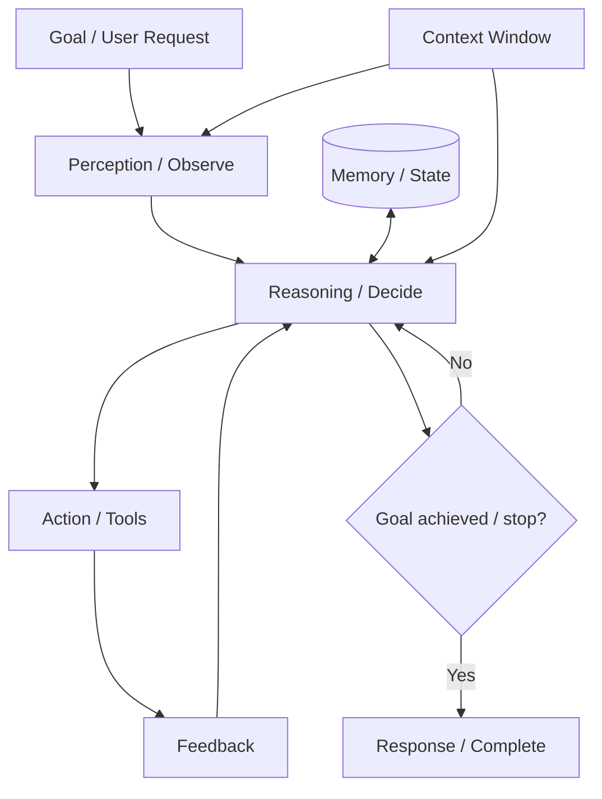

# 06. Module 1 Recap ও Interview Drill

এই অধ্যায়টি শুধু আগের পাঁচটি chapter-এর সংক্ষিপ্ত তালিকা নয়। এখানে আমরা পুরো Module 1-এর ধারণাগুলো একটি mental model-এ যুক্ত করব। তারপর interview প্রশ্নের উত্তর কীভাবে reasoning-সহ সাজাতে হয়, তা অনুশীলন করব।

একটি বিষয় মনে রেখো: interview-তে সংজ্ঞা জানা প্রয়োজন, কিন্তু senior-level discussion-এ সংজ্ঞা দিয়ে উত্তর শেষ হয় না। Interviewer জানতে চাইতে পারেন, design-টি কেন বেছে নিয়েছ, কোন failure হতে পারে, permission কোথায় enforce হবে এবং production-এ success কীভাবে মাপবে। এই recap সেই reasoning অনুশীলনের জন্য।

## 1. Module 1-এর বড় ছবি: একটি Agent আসলে কী করে?

ধরো, customer বললেন, “আমার damaged product-এর refund চাই।” Agent-এর কাজ শুধু refund policy ব্যাখ্যা করা নয়। তাকে goal বুঝতে হবে, order ও customer context দেখতে হবে, missing information শনাক্ত করতে হবে, policy যাচাই করতে হবে, প্রয়োজনে evidence চাইতে হবে, authorized হলে refund workflow চালাতে হবে এবং শেষে authoritative result দেখে customer-কে জানাতে হবে।

এই পুরো system-কে একটি loop হিসেবে ভাবা যায়:

এই ছবিতে কয়েকটি আলাদা concern একসঙ্গে কাজ করছে:

- **Goal** বলে কী অর্জন করতে হবে।
- **Perception** বলে input ও environment থেকে কী তথ্য পাওয়া যাচ্ছে।
- **Reasoning** বলে বর্তমান state অনুযায়ী next step কী হওয়া উচিত।
- **Action** tool বা external system-এ operation চালায়।
- **Feedback** জানায় operation-এর ফল কী।
- **Memory/State** আগের তথ্য ও workflow continuity ধরে রাখতে সাহায্য করে।
- **Context window** নির্ধারণ করে current model call-এ কত token-এর তথ্য দেওয়া সম্ভব।
- **Stop condition** ঠিক করে কখন complete, pause, reject বা escalate করতে হবে।

Agent-এর নাম বা model-এর ক্ষমতা দিয়ে architecture বিচার করো না। System-এর control flow, state ownership, permission এবং feedback mechanism দেখো।

## 2. Module 1-এর ধারণাগুলো কীভাবে একে অপরের সঙ্গে যুক্ত?

### Agent বনাম LLM বনাম Chatbot

LLM হলো model capability; chatbot হলো conversation interface; agent হলো goal-directed system behavior। Chatbot-এর পেছনে agent থাকতে পারে। Tool-enabled assistant-এ tool call থাকলেও সেটি fixed workflow হতে পারে। Agentic behavior বোঝার জন্য দেখতে হবে system কি context ও feedback অনুযায়ী next action নির্বাচন করছে।

### Perception বনাম Reasoning বনাম Action

Perception input থেকে তথ্য বের করে। Reasoning সেই তথ্য ও goal দেখে decision বা action proposal তৈরি করে। Action proposal-কে validate করে external operation execute করে। এই boundary গুরুত্বপূর্ণ, কারণ model-এর ভুল proposal যেন সরাসরি unauthorized side effect না ঘটায়।

### Learning বনাম Memory

Memory useful information সংরক্ষণ ও retrieve করে। Learning feedback ব্যবহার করে future performance উন্নত করে। User preference save করা memory update; নতুন regression test যোগ করা evaluation improvement; fine-tuning model weights পরিবর্তন করে। এগুলো একই ঘটনা নয়।

### Single Agent বনাম Multi-Agent

Single-agent design-এ একটি প্রধান controller task পরিচালনা করে; তার একাধিক tool ও বহু-step workflow থাকতে পারে। Multi-agent design-এ একাধিক decision-making role-এর মধ্যে task ভাগ হয়। এতে specialization ও parallelism পাওয়া যেতে পারে, কিন্তু handoff, coordination, latency, cost ও failure propagation বাড়ে।

### Memory বনাম Context Window

Memory current model call-এর বাইরে তথ্য store করে। Retrieval-এর পরে relevant memory context-এ যোগ হয় এবং token budget ব্যবহার করে। Context window হলো current inference-এর finite working space; এটি persistent storage নয়।

### Context Overflow বনাম Lost in the Middle

Context overflow হলো capacity problem: প্রয়োজনীয় input context limit ছাড়িয়ে যায় বা truncate হয়। Lost in the Middle হলো utilization problem: relevant information context-এ উপস্থিত থাকলেও position-related কারণে model সেটি কম ব্যবহার করতে পারে। দুইটির debugging ও mitigation এক নয়।

## 3. এক নজরে গুরুত্বপূর্ণ পার্থক্য

| Concept A | Concept B | মূল পার্থক্য |
|---|---|---|
| LLM | Agent | Model capability বনাম goal-directed system |
| Chatbot | Agent | Conversation interface বনাম action/feedback loop |
| Tool | Agent | Executable capability বনাম decision-making role |
| Perception | Reasoning | Input বোঝা বনাম next step নির্ধারণ |
| Reasoning | Action | Proposal/decision বনাম validated execution |
| Single agent | Multi-agent | One primary controller বনাম multiple coordinated roles |
| Tool collection | Multi-agent | অনেক capability থাকলেই অনেক agent নয় |
| Memory | Context window | Persistent storage/retrieval বনাম current token workspace |
| Episodic | Semantic memory | Specific event বনাম general fact/knowledge |
| Context overflow | Lost in the Middle | Capacity exceed/truncation বনাম present information underused |
| Memory | Fine-tuning | External stored information বনাম model parameter update |
| RAG | Memory | External knowledge retrieval pattern বনাম agent/user/task continuity |

## 4. Interview answer কীভাবে সাজাবে?

একটি definition মুখস্থ করে বললে প্রথম প্রশ্নের উত্তর হয়তো দেওয়া যায়। কিন্তু interviewer যখন জিজ্ঞেস করবেন “কেন?”, “কীভাবে?”, “কী failure হতে পারে?”, তখন উত্তর ভেঙে পড়তে পারে। তাই প্রতিটি architecture question-এ এই flow ব্যবহার করো:

1. **Definition:** ধারণাটি কী?
2. **Problem:** কোন সমস্যার জন্য এটি দরকার?
3. **Mechanism:** ভেতরে কীভাবে কাজ করে?
4. **Example:** বাস্তব scenario-তে কীভাবে ব্যবহার হবে?
5. **Trade-off:** সুবিধা ও সীমাবদ্ধতা কী?
6. **Failure mode:** কোথায় ভুল হতে পারে?
7. **Mitigation:** কীভাবে নিরাপদে recover করবে?
8. **Design decision:** কোন পরিস্থিতিতে কোন approach বেছে নেবে?

এবার এই structure ধরে প্রশ্নগুলো অনুশীলন করি।

# Part A: Agent Fundamentals

## Q1. AI Agent কী? একটি production example দিয়ে architecture বোঝাও।

**মূল উত্তর:** AI Agent হলো goal-directed software system, যা environment ও context observe করে, decision নেয়, প্রয়োজন হলে tool বা external system-এ action চালায় এবং action-এর result ব্যবহার করে পরবর্তী step নির্ধারণ করে। Goal complete বা stop condition না আসা পর্যন্ত কাজ চলতে পারে।

**Architecture ভেঙে বললে:**
- Goal: কী অর্জন করতে হবে।
- Perception: user request ও environment data বোঝা।
- State/context: এখন পর্যন্ত কী জানা ও করা হয়েছে।
- Reasoning: next action নির্বাচন বা proposal।
- Tools/action: external capability invoke।
- Feedback: result/error সংগ্রহ।
- Control: retry, stop, escalation ও resource budget।
- Guardrails: permission ও policy enforce।

**Example:** Damaged product refund agent প্রথমে order ID বোঝে, order service থেকে order retrieve করে, policy version যাচাই করে, প্রয়োজনীয় evidence চায়, eligibility পরীক্ষা করে, authorized হলে refund service call করে এবং transaction status যাচাই করে customer-কে জানায়।

এখানে LLM intent বুঝতে বা next step propose করতে পারে। কিন্তু refund limit ও authorization backend enforce করবে। Payment system-এর confirmed status ছাড়া agent refund complete দাবি করবে না।

**Follow-up: Agent কি শুধু LLM?**  
না। LLM reasoning component হতে পারে; agent system-এর execution loop, tools, state, policy, error handling ও stopping rule-ও থাকে।

**Follow-up: Agent কি সবসময় autonomous?**  
না। Autonomy risk অনুযায়ী সীমিত করা যায়। High-impact action-এ human approval বাধ্যতামূলক হতে পারে।

## Q2. Chatbot, Tool-using Assistant ও Agent-এর পার্থক্য কী?

Chatbot মূলত conversational interface। Tool-using assistant নির্দিষ্ট function/API invoke করতে পারে। Agent goal পূরণের জন্য context অনুযায়ী একাধিক decision ও action নিতে পারে এবং result দেখে loop চালায়।

একটি chatbot-এর পেছনে agent থাকতে পারে। আবার tool-enabled assistant fixed workflow-এ কাজ করলে সেটি পূর্ণ agentic autonomy নাও হতে পারে। তাই label নয়, behavior ও control flow বিচার করতে হবে।

**Example:** FAQ bot refund policy ব্যাখ্যা করে। Tool assistant order lookup করে। Agent order lookup, policy check, evidence request, approval এবং refund status verification coordinate করে।

**Follow-up: Tool call থাকলেই কি Agent?**  
না। Tool হলো capability; Agent হলো goal-directed control loop। একটি fixed rule সবসময় একই API call করলে tool use আছে, কিন্তু context-driven agentic decision নাও থাকতে পারে।

## Q3. Agent loop-এর প্রতিটি ধাপ ব্যাখ্যা করো। Feedback কেন জরুরি?

Observe ধাপে agent input ও environment state সংগ্রহ করে। Decide ধাপে goal ও state দেখে পরবর্তী action বেছে নেয়। Act ধাপে tool/API call করে। Feedback ধাপে operation-এর result বা error পায়। তারপর goal complete কি না দেখে আবার decide করে অথবা stop করে।

Feedback না থাকলে agent জানবে না action সফল হয়েছে কি না। ধরো refund API call পাঠানোর পর network timeout হলো। Feedback/reconciliation ছাড়া agent ভুলভাবে success বলতে পারে, অথবা একই refund আবার initiate করতে পারে। তাই result verification, idempotency ও stop condition গুরুত্বপূর্ণ।

## Q4. Agent-এর goal এবং stop condition কীভাবে define করবে?

Goal measurable ও task-specific হওয়া উচিত। “Customer-কে সাহায্য করো” অস্পষ্ট। “সঠিক order identify করো, policy অনুযায়ী eligibility যাচাই করো, approval ছাড়া refund execute করবে না এবং verified status জানাও” অনেক স্পষ্ট।

Stop condition হতে পারে:
- Goal achieved।
- Missing information, user clarification দরকার।
- Permission denied।
- Human approval pending।
- Retry/iteration limit reached।
- Deadline বা budget শেষ।
- Unrecoverable error।

Stop condition runtime-এ enforce করা উচিত; prompt instruction একা যথেষ্ট নয়।

## Q5. Agent-এর সব planning কি LLM করবে?

না। LLM অস্পষ্ট user intent বোঝা, information summarize করা ও candidate action propose করতে পারে। কিন্তু stable business rule, state transition, amount limit ও authorization deterministic code/service-এ enforce করা উচিত। Hybrid approach-এ LLM flexibility দেয়, code predictable invariant রক্ষা করে।

**কোন কাজ LLM-কে দেবে?** যেখানে language understanding, ambiguity handling বা contextual judgment দরকার।

**কোন কাজ code-এ রাখবে?** যেখানে exact calculation, invariant, access control, transaction, deterministic validation বা auditability দরকার।

## Q6. Agent-এর reliability কীভাবে মাপবে?

End-to-end task success rate, correctness, policy violation rate, false-success rate, tool failure rate, duplicate side effect, human escalation, latency ও cost মাপবে। Layer-level metric-ও দরকার: extraction accuracy, retrieval recall, decision correctness, tool success। শুধু final answer সুন্দর কি না দিয়ে reliability মাপা যায় না।

# Part B: Agent Core Subsystems

## Q7. পাঁচটি core subsystem ব্যাখ্যা করো।

- **Perception:** raw input/environment থেকে relevant information বের করে।
- **Reasoning:** goal ও context দেখে next step নির্বাচন করে।
- **Action:** tool/API/environment-এ operation চালায়।
- **Learning:** feedback/evaluation ব্যবহার করে future performance উন্নত করে।
- **Communication:** user, tool, service, অন্য agent বা human reviewer-এর সঙ্গে তথ্য বিনিময় করে।

Refund example-এ Perception order ID ও damaged-item intent বের করে; Reasoning policy অনুযায়ী photo চাইবে কি না ঠিক করে; Action photo request বা refund API call করে; Learning outcome ও failure evaluation dataset-এ যোগ করতে পারে; Communication customer ও internal service-কে status জানায়।

এগুলো conceptual responsibility, আলাদা microservice হওয়া বাধ্যতামূলক নয়।

## Q8. Perception ও Reasoning আলাদা রাখার সুবিধা কী?

Perception input থেকে “কী তথ্য আছে” বের করে; Reasoning “এখন কী করা উচিত” নির্ধারণ করে। আলাদা করে ভাবলে extraction bug ও decision bug পৃথকভাবে test করা যায়। যেমন order ID ভুল extract হয়েছে, নাকি সঠিক order ID পেয়েও ভুল policy apply হয়েছে তা বোঝা যায়।

তবে বাস্তবে একই LLM call দুটো কাজই করতে পারে। Logical separation মানেই deployment separation নয়।

## Q9. Reasoning ও Action-এর boundary কেন গুরুত্বপূর্ণ?

Reasoning action proposal দেয়; Action layer সেটি validate ও execute করে। Model যদি ভুল amount propose করে, action/business layer refundable balance check করে reject করতে পারে। Model-এর output-কে সরাসরি privileged API call-এ পরিণত করলে prompt injection বা model error side effect ঘটাতে পারে। Boundary authorization, validation, audit ও recovery-এর জায়গা তৈরি করে।

## Q10. Learning আর Memory কি একই?

না। Memory তথ্য store ও retrieve করে। Learning feedback থেকে system/model-এর future behavior উন্নত করে। User-এর preference save করা memory update; evaluation-এর ভিত্তিতে prompt ঠিক করা workflow improvement; fine-tuning model weights update করে। সব memory update-কে model learning বলা ভুল।

## Q11. Learning কি প্রতিটি interaction-এর পরে automatic হওয়া উচিত?

না। User feedback ভুল বা malicious হতে পারে। Runtime-এ feedback collect করা যায়, কিন্তু model/policy change controlled evaluation ও review-এর মধ্য দিয়ে হওয়া উচিত। নইলে poisoning বা regression হতে পারে। High-impact system-এ offline evaluation, versioning, staged rollout ও rollback দরকার।

## Q12. Communication subsystem-এ কী কী failure হতে পারে?

Timeout, unavailable service, malformed payload, duplicate message, schema version mismatch, unauthorized sender এবং sensitive data leak। সমাধানে typed schema, identity verification, retry policy, idempotency, correlation ID, version compatibility ও redaction দরকার।

# Part C: Single Agent বনাম Multi-Agent

## Q13. Single agent ও Multi-agent architecture তুলনা করো।

Single-agent design-এ একটি controller task ও decision পরিচালনা করে; সে অনেক tools ও বহু-step workflow ব্যবহার করতে পারে। Multi-agent design-এ একাধিক agent/role আলাদা responsibility নিয়ে কাজ করে এবং coordination দরকার হয়।

Single agent সহজ, কম latency/cost হতে পারে এবং debugging সহজ। Multi-agent specialization, context isolation ও parallelism দিতে পারে। কিন্তু coordination, handoff, error propagation, state consistency, cost ও observability জটিল করে।

**Design advice:** Single agent বা deterministic workflow দিয়ে baseline তৈরি করো। Multi-agent যোগ করো যখন distinct responsibility বা parallelism-এর measurable benefit আছে।

## Q14. একটি agent-কে অনেক tools দেওয়া আর multiple agents তৈরি করার পার্থক্য কী?

Tool capability; agent decision-making/control role। একটি agent order lookup, policy search ও refund tools ব্যবহার করতে পারে। এতে তিনটি agent হয় না। তিনটি agent হলে আলাদা context, instruction, task ownership বা permission থাকতে পারে; তাদের মধ্যে handoff/coordination লাগে।

## Q15. Multi-agent কখন ব্যবহার করবে?

যখন task-এর subtask সত্যিকারের independent বা specialized, আলাদা context/permission দরকার, অথবা parallelism end-to-end latency কমাতে পারে। তবে coordinator, contract, failure handling ও evaluation design করতে হবে। শুধু “বড় project” বা “অনেক tool” দেখেই multi-agent নেওয়া উচিত নয়।

## Q16. Multi-agent-এর প্রধান failure mode কী?

- Context handoff-এ evidence হারানো।
- Conflicting result।
- Circular delegation/infinite loop।
- Partial failure/timeout।
- Duplicate work/action।
- Shared-state race condition।
- Permission leakage।
- Cost/latency বৃদ্ধি।
- Debugging কঠিন হওয়া।

প্রতিটি agent-এর task contract, bounded retry/depth, timeout, trace ID, state ownership, idempotency ও escalation path দরকার।

## Q17. Multi-agent architecture-এর improvement কীভাবে prove করবে?

একই test set-এ single-agent baseline ও multi-agent candidate compare করো। Task success, correctness, policy violation, latency, token cost, tool failure, human handoff ও maintenance complexity মাপো। Quality সামান্য বাড়লেও cost/latency অনেক বেড়ে গেলে design গ্রহণযোগ্য নাও হতে পারে।

## Q18. Parallel execution-এ কী সতর্কতা দরকার?

শুধু independent task parallel করো। Dependency থাকলে sequential। Shared resource update, duplicate side effect, rate limit ও partial failure handle করো। Join point-এ missing/conflicting result কীভাবে resolve হবে নির্ধারণ করো। Parallel model call মানেই parallel business transaction safe নয়।

# Part D: Agent Memory

## Q19. Agent memory কীভাবে কাজ করে?

Memory system useful information external store-এ রাখে এবং পরবর্তী interaction-এ query অনুযায়ী retrieve করে current context-এ যোগ করে। Write pipeline-এ extraction, validation, privacy/retention check, deduplication ও metadata থাকে। Read pipeline-এ query, scope filter, retrieval, freshness/relevance validation ও context assembly থাকে।

শুধু vector database যোগ করলেই memory architecture তৈরি হয় না। কোন তথ্য save হবে, কার memory, কতদিন থাকবে, ভুল হলে কীভাবে update হবে এবং source কী তা নির্ধারণ করতে হয়।

## Q20. Short-term, Long-term, Episodic ও Semantic memory ব্যাখ্যা করো।

Short-term/working memory current task state রাখে। Long-term memory future interaction-এ useful stable facts/preferences রাখে। Episodic memory নির্দিষ্ট ঘটনা/interaction record করে। Semantic memory general facts/knowledge রাখে।

Example: বর্তমান refund request-এর pending photo হলো working state; user-এর ভাষা preference long-term; আগের refund ঘটনার record episodic; official refund policy semantic/domain knowledge।

## Q21. Memory কি model weights-এ লেখা হয়?

সাধারণ application memory external database/file/vector store-এ থাকে। Inference-এর সময় retrieve করে context-এ পাঠানো হয়। Model weights training/fine-tuning-এ পরিবর্তিত হয়। User-specific fact update/delete করার জন্য external memory বেশি controllable ও auditable।

## Q22. Vector DB কি memory-এর জন্য যথেষ্ট?

না। Vector DB semantic similarity retrieval-এ সাহায্য করে। Exact ID, account permission, latest policy version বা transactional state-এর জন্য structured DB/authoritative service দরকার। Similarity মানেই truth নয়। Hybrid retrieval, metadata, source validation ও access control দরকার।

## Q23. Memory conflict বা stale হলে কী করবে?

Source, timestamp, scope, authority ও confidence বিবেচনা করো। User preference-এর explicit correction পুরনো preference replace করতে পারে; কিন্তু user statement authoritative business policy override করতে পারে না। TTL/expiry, versioning, provenance ও correction path রাখো। Conflict unresolved হলে clarification বা human review।

## Q24. Memory poisoning কী এবং প্রতিরোধ কীভাবে করবে?

Malicious বা ভুল information memory-তে ঢুকে future behavior manipulate করলে memory poisoning। Untrusted document-কে trusted instruction হিসেবে save করা একটি উদাহরণ। Source validation, write authorization, scope, provenance, review, audit ও correction workflow দরকার। Retrieved text-কে system/developer instruction-এর সমান authority দেওয়া যাবে না।

## Q25. সব conversation memory-তে রাখবে না কেন?

Privacy, retention, storage cost, stale data, retrieval noise ও sensitive information-এর ঝুঁকি আছে। Future usefulness ও user expectation অনুযায়ী selective memory রাখবে। Temporary request-কে permanent preference বানাবে না। Data minimization ও deletion/correction policy দরকার।

# Part E: Context Window ও Lost in the Middle

## Q26. Context window কী?

একটি inference request-এ model যে token sequence পায় ও generate করে, তার capacity সীমাকে context window বলে। এতে instructions, user input, history, retrieved documents ও tool results থাকতে পারে। এটি persistent memory নয়; current model call-এর working space।

## Q27. Context window বড় হলে কি সব সমস্যা মিটে যায়?

না। Capacity বাড়লে বেশি তথ্য পাঠানো যায়, কিন্তু model সব তথ্য সমানভাবে locate বা utilize করবে এমন নিশ্চয়তা নেই। Noise, position sensitivity, retrieval error ও reasoning limitation থাকে। বেশি irrelevant context signal-to-noise ratio খারাপ করতে পারে।

## Q28. Lost in the Middle কী?

Long context-এ relevant information মাঝামাঝি অবস্থানে থাকলে model সেটি তুলনামূলকভাবে কম ব্যবহার করতে পারে। এটি position-related failure pattern, context overflow নয়। সব model/task-এ একই রকম নয়; controlled evaluation দরকার।

## Q29. Lost in the Middle কমাতে কী করবে?

Relevant retrieval, context trimming, duplicate removal, structured evidence, clear heading/source, summary with preserved constraints, evidence ordering experiment এবং token budget monitoring। Critical policy fact authoritative source থেকে verify করবে। RAG helpful, কিন্তু retrieval miss বা noisy context পুরো দূর করে না।

## Q30. Context window আর Memory-এর সম্পর্ক কী?

Memory external store-এ data রাখে। Retrieval-এর পরে relevant memory current context-এ যোগ হয় এবং token budget ব্যবহার করে। Memory store বড় হতে পারে, কিন্তু একবারে সব model-কে পাঠানো উচিত নয়। Retrieval ও context selection আলাদা গুরুত্বপূর্ণ design problem।

# Part F: System Design ও Scenario Questions

## Q31. Damaged-item Refund Agent design করো।

**প্রথমে requirements clarify করো:** কে request করতে পারবে? Refund limit কত? Evidence mandatory? Approval threshold কী? Policy source কোনটি? Duplicate request কীভাবে identify হবে?

**একটি সম্ভাব্য architecture:**

1. User interface request নেবে।
2. Perception intent ও order reference extract করবে।
3. Agent state store current workflow রাখবে।
4. Order service authoritative order details দেবে।
5. Policy service applicable version দেবে।
6. Decision logic eligibility ও missing evidence নির্ধারণ করবে।
7. Human approval high-risk case handle করবে।
8. Refund service idempotent request execute করবে।
9. Result verification transaction status confirm করবে।
10. Audit log ও user notification হবে।

**Security:** User identity, order ownership, least privilege, server-side authorization, amount limit, approval এবং secret management।

**Reliability:** Timeout, bounded retry, idempotency key, reconciliation, durable state এবং human escalation।

**Evaluation:** Correct eligibility, false approval/denial, duplicate refund, task success, latency ও cost।

**কেন single agent দিয়ে শুরু?** এই workflow-এর steps বেশিরভাগই bounded এবং domain service-এ নির্দিষ্ট। Multi-agent যোগ করার আগে context overload, independent parallel work বা specialization-এর বাস্তব bottleneck প্রমাণ করতে হবে।

## Q32. Refund API timeout হলে কী করবে?

প্রথমে বুঝতে হবে request server-এ commit হয়েছে কি না। Timeout মানে operation failed নয়; response হারিয়েও যেতে পারে। একই idempotency key দিয়ে retry করা যায় যদি API সেই contract support করে। না হলে transaction status lookup/reconciliation করতে হবে। Outcome unknown অবস্থায় নতুন refund create করা বিপজ্জনক। User-কে pending/unknown status জানাতে হবে, verified success নয়।

## Q33. Agent ভুল order ID পেলে কী করবে?

Input extraction confidence বা format validation-এর বাইরে order ownership ও customer identity server-side verify করতে হবে। একাধিক matching order থাকলে clarification চাইবে। অন্য customer-এর order access reject করতে হবে। High-impact action-এর আগে order ID, customer ID ও refundable amount পুনরায় check করা উচিত।

## Q34. Retrieved policy-তে malicious instruction থাকলে কী করবে?

Retrieved document-কে data হিসেবে treat করবে, system instruction হিসেবে নয়। Source trust ও integrity যাচাই করবে, policy content ও executable instruction আলাদা রাখবে, tool permission prompt থেকে derive করবে না। Suspicious content flag করা এবং official policy source থেকে verify করা দরকার।

## Q35. Agent-এর memory ও context budget কীভাবে একসঙ্গে design করবে?

Memory store-এ অনেক useful record থাকতে পারে, কিন্তু current task-এর জন্য query ও scope filter দিয়ে অল্প relevant record retrieve করতে হবে। Source, timestamp ও confidence যাচাই করে structured context বানাতে হবে। Token budget-এর মধ্যে history, policy evidence, tool result ও output reserve allocate করতে হবে। Critical rule summary-তে হারালে original source fetch করবে।

# Part G: Mock Interview

## Scenario

“আমাদের e-commerce platform-এ customer damaged product-এর refund request করে। এমন agent বানাতে হবে, যা order verify করবে, policy পড়বে, evidence চাইবে এবং eligible হলে refund initiate করবে। তুমি architecture কীভাবে design করবে?”

### Interviewer-এর কাছে clarification চাইবে

- Refund-এর maximum amount কত?
- Evidence mandatory, নাকি কিছু case-এ optional?
- Policy country/product অনুযায়ী আলাদা?
- Refund immediate নাকি approval-based?
- Duplicate request কীভাবে identify করবে?
- Agent কি customer-কে email/SMS পাঠাতে পারবে?
- Human reviewer কোন case দেখবে?
- Refund service-এর status model কী?

### উত্তর সাজানোর পথ

1. Requirements ও risk define।
2. Single-agent + deterministic services baseline।
3. Perception, state, tools ও workflow explain।
4. Authorization ও approval boundary।
5. Memory/context strategy।
6. Timeout, idempotency ও reconciliation।
7. Audit/observability।
8. Evaluation metric।
9. Multi-agent কেন দরকার বা কেন এখন দরকার নেই তা justify।

### Follow-up challenge

- Policy service unavailable হলে?
- Order lookup timeout হলে?
- User অন্যের order ID দিলে?
- Refund API timeout কিন্তু transaction commit হয়ে গেলে?
- Customer malicious prompt দিলে?
- Agent একই tool বারবার call করলে?
- Human approval pending অবস্থায় process restart হলে?
- Policy version মাঝপথে বদলে গেলে?

প্রতিটি ক্ষেত্রে system-এর state, safe behavior ও recovery path ব্যাখ্যা করো। শুধু “retry করব” বলবে না; retry safe কি না, side effect হয়েছে কি না এবং কোন state-এ workflow থাকবে তা বলবে।

## 4. 60-second recap

AI Agent হলো goal-directed system, যা input observe করে, context/state ব্যবহার করে decision নেয়, tool বা environment-এ action চালায় এবং feedback দেখে পরবর্তী step ঠিক করে। Agent-এর core subsystem হিসেবে Perception, Reasoning, Action, Learning ও Communication ভাবা যায়। Single agent দিয়ে শুরু করা সাধারণত সহজ; multi-agent কেবল specialization, isolation বা parallelism-এর measurable benefit থাকলে যোগ করা উচিত। Memory external information store/retrieve করে; context window হলো current inference-এর finite token space। Long context-এ relevant fact middle-এ থাকলে underuse হতে পারে, তাই retrieval, structure, budget ও evaluation গুরুত্বপূর্ণ।

## 5. নিজের ভাষায় বলার অনুশীলন

নোট বন্ধ করে প্রতিটি বিষয়ে ২-৩ মিনিট কথা বলো:

1. Agent বনাম chatbot।
2. Observe-decide-act-feedback loop।
3. পাঁচটি core subsystem।
4. Single বনাম multi-agent trade-off।
5. Memory type ও storage choice।
6. Context window ও Lost in the Middle।
7. Refund agent-এর production architecture।

যে প্রশ্নে আটকে যাবে, সেটি আবার পড়ে নিজের example দিয়ে ব্যাখ্যা করো। শুধু সংজ্ঞা মুখস্থ নয়; “কেন এই design?”, “কী failure?”, “কীভাবে recover?” এবং “কী metric দিয়ে যাচাই করব?” এই চারটি প্রশ্নের উত্তর দিতে পারলেই ধারণা অনেক বেশি দৃঢ় হবে।
