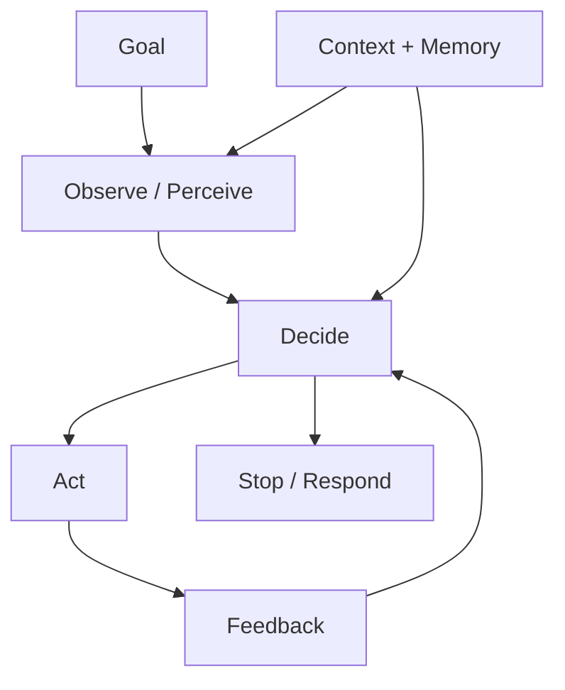

# 06. Module 1 Recap ও Interview Drill

> Chapter alignment: 00:21:05 — Module 1 Recap: The Shape of an Agent

## 1. Module-এর mental model

Agent-কে শুধু model হিসেবে নয়, goal-directed system হিসেবে ভাবো:

- **Goal** বলে কী অর্জন করতে হবে।
- **Perception** input ও environment-এর অবস্থা বুঝতে সাহায্য করে।
- **Reasoning/Decision** পরবর্তী step নির্বাচন করে।
- **Action** tools বা environment-এ কাজ করে।
- **Feedback** action-এর outcome জানায়।
- **Memory** প্রয়োজনীয় তথ্য সংরক্ষণ ও retrieve করে।
- **Context window** বর্তমান model call-এর finite token space।

## 2. মূল ধারণার সংযোগ

| Concept | মূল প্রশ্ন |
|---|---|
| Agent | Goal অর্জনের জন্য কীভাবে সিদ্ধান্ত ও action loop চলে? |
| Subsystems | Agent-এর কাজগুলো কী responsibility-তে ভাগ হয়? |
| Single vs Multi-agent | একটি controller যথেষ্ট, নাকি specialist/parallelism দরকার? |
| Memory | Interaction-এর বাইরে কোন তথ্য ধরে রাখতে হবে? |
| Context window | বর্তমান সিদ্ধান্তে model কী তথ্য দেখতে পাচ্ছে? |
| Lost in the Middle | Context-এ তথ্য থাকলেও কেন model miss করতে পারে? |

## 3. Interview: foundational questions

### Q1. AI Agent-এর architecture ব্যাখ্যা করো।

একটি goal, input/perception, state/context, decision logic, action/tools এবং feedback loop দিয়ে ব্যাখ্যা করো। LLM কোন অংশে ব্যবহৃত হচ্ছে এবং deterministic code কোন অংশে রয়েছে তা আলাদা করে বলো।

### Q2. Agent কি সব কাজ নিজে plan করবে?

না। Planning model-driven হতে পারে, আবার code/workflow-এ deterministic হতে পারে। Task ও risk অনুযায়ী architecture নির্বাচন করা উচিত।

### Q3. Multi-agent system-এর benefit কী?

Specialization, independent context, parallel execution, separate responsibility। কিন্তু coordination, latency, cost, failure propagation ও debugging overhead-ও উল্লেখ করো।

### Q4. Agent memory কীভাবে implement করবে?

Memory candidate extract, validate, metadata/source attach, storage, retrieval, freshness/conflict handling ও privacy policy ব্যাখ্যা করো। শুধু vector database বললে উত্তর অসম্পূর্ণ।

### Q5. Context window বড় হলেই কি agent বেশি capable?

না। Capacity বেশি হলেও relevant information নির্বাচন, attention, reasoning, tool reliability ও context quality সীমাবদ্ধতা হতে পারে।

### Q6. Agent action-এর reliability কীভাবে নিশ্চিত করবে?

Tool input validation, access control, bounded permissions, timeouts, retries, idempotency, action result verification, logging, human approval এবং evaluation।

## 4. Deep follow-up questions

1. একই task single agent-এ ভালো চললে multi-agent যোগ করার measurable justification কী?
2. Agent memory-তে ভুল তথ্য save হলে correction ও propagation কীভাবে সামলাবে?
3. Context budget-এর allocation কীভাবে dynamic করবে?
4. Retrieval-এ relevant chunk বাদ গেলে system কীভাবে বুঝবে?
5. Tool timeout-এর পর retry করলে duplicate refund হওয়া আটকাবে কীভাবে?
6. Agent-এর goal achieved condition কে নির্ধারণ করবে?
7. Reasoning model-কে সব tool access দেওয়া কি নিরাপদ?
8. User prompt, retrieved document ও tool output-এর trust boundary কীভাবে আলাদা করবে?
9. Memory retrieval-এর provenance কেন দরকার?
10. Agent loop infinite হয়ে গেলে কীভাবে stop বা recover করবে?

## 5. Mock interview exercise: Refund agent design

**Problem:** Broken item-এর refund request handle করার agent design করো।

উত্তর দেওয়ার আগে এই checklist ব্যবহার করো:

- [ ] Goal ও success condition
- [ ] Input/perception
- [ ] State ও memory
- [ ] Policy/order retrieval
- [ ] Decision logic
- [ ] Tools ও tool contracts
- [ ] Permission ও human approval
- [ ] Retry, timeout, idempotency
- [ ] Feedback/result verification
- [ ] Logging, tracing, evaluation
- [ ] Stop condition

## 6. 60-second recap

AI Agent হলো goal-oriented system। এটি input observe করে, context/state ব্যবহার করে সিদ্ধান্ত নেয়, প্রয়োজনে tool/environment-এ action চালায় এবং result দেখে পরবর্তী step নির্ধারণ করে। Single agent দিয়ে শুরু করা সাধারণত সহজ ও কম খরচের; multi-agent দরকার হয় specialization বা parallelism-এর বাস্তব benefit থাকলে। Memory context-এর বাইরে useful information ধরে রাখতে সাহায্য করে, আর context window হলো বর্তমান model call-এর সীমিত working space। Long context থাকলেও model সব তথ্য সমানভাবে ব্যবহার করতে পারে না, তাই retrieval, context organization ও evaluation গুরুত্বপূর্ণ।

## 7. নিজের ভাষায় বলার অনুশীলন

নোট বন্ধ করে এই পাঁচটি বিষয় ২ মিনিট করে ব্যাখ্যা করো:

1. Agent vs chatbot
2. Agent subsystem ও feedback loop
3. Single vs multi-agent trade-off
4. Memory architecture
5. Context window ও Lost in the Middle

যে প্রশ্নের উত্তর দিতে আটকে যাবে, সেটি আবার পড়ে নিজের example তৈরি করো।