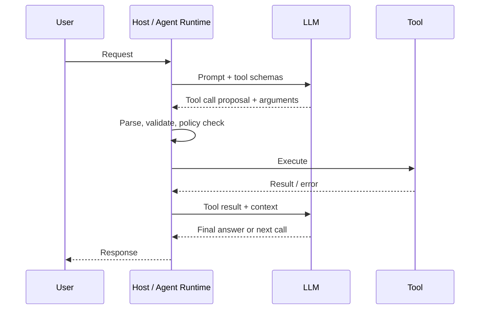
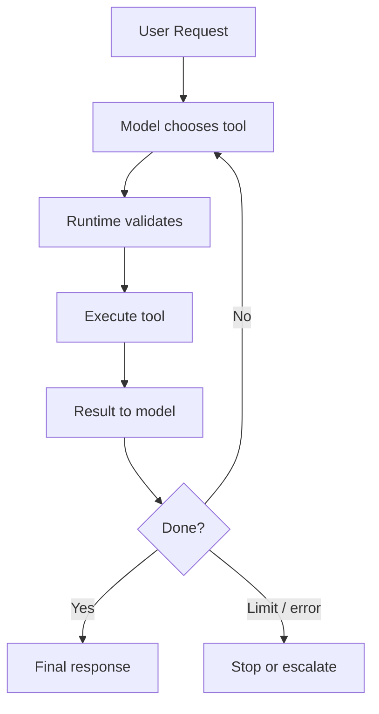
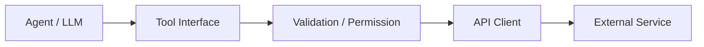

# 01. Tool Calling: Agent কীভাবে বাস্তব কাজ করে?

## LLM-এর knowledge বনাম capability

LLM text generate ও reasoning করতে পারে, কিন্তু model একা তোমার database query, live API request, file write বা refund transaction execute করতে পারে না। Tool একটি বাহ্যিক capability দেয়, যা agent/runtime ব্যবহার করে।

Examples: calculator, search, database/API, email, code execution।

## Tool কী?

Tool একটি নির্দিষ্ট operation/interface। সাধারণত এর অংশ:
- Name: operation-এর পরিচয়
- Description: কী কাজ করে, কখন ব্যবহার করতে হবে
- Input schema: parameters, type, required field, constraint
- Implementation: বাস্তবে কাজ করার code/API
- Output: result structure
- Error behavior: failure কীভাবে প্রকাশ করবে

Tool description model-কে guide করে; security enforcement নয়।

## Tool calling end-to-end



1. User request runtime-এ আসে।
2. Runtime model-কে conversation ও available tool schemas দেয়।
3. Model tool দরকার বুঝলে structured call propose করে।
4. Runtime call parse ও validate করে।
5. Permission/policy/approval check হয়।
6. Application/runtime tool execute করে।
7. Result context-এ যুক্ত হয়।
8. Model final answer দিতে পারে বা next tool call করে।
9. Stop condition বা turn limit loop থামায়।

**Model-এর tool call proposal আর tool execution এক ঘটনা নয়।** Model call চাইতে পারে, runtime সেটি reject বা approve করতে পারে।

## Illustrative pseudo-code

নিচের code framework/provider-neutral; runnable SDK syntax নয়।

    tools = [{
        "name": "get_order",
        "description": "Retrieve order details by ID",
        "parameters": {
            "type": "object",
            "properties": {"order_id": {"type": "string"}},
            "required": ["order_id"]
        }
    }]

    response = model.generate(messages, tools=tools)

    if response.tool_call:
        call = response.tool_call
        args = validate_schema(call.arguments)
        # Application invokes the actual function.
        result = get_order(**args)
        messages.append(response)
        messages.append(tool_result(call.name, result))
        final = model.generate(messages)

Real SDK-তে schema/message format ভিন্ন। Allowlist, validation, authorization, timeout ও error handling application layer-এ থাকা উচিত।

## Agent loop ও multiple tool calls



Refund investigation-এ order lookup → policy retrieval → eligibility check → (authorized) refund request হতে পারে। সব tool call-এর আগে permission ও business rule যাচাই দরকার।

## Tool design

- **Narrow responsibility:** get_order, search_policy, create_ticket আলাদা কাজ।
- **Clear descriptions:** purpose, when to use, constraints।
- **Strict schema:** required field, type, enum, validation।
- **Useful output:** structured status, data, error code।
- **Idempotency:** retry-তে duplicate side effect রোধ।
- **Timeout/retry:** operation-safe retry; uncertain outcome reconcile।
- **Least privilege:** agent শুধু প্রয়োজনীয় tools।
- **Observability:** sanitized args, tool, duration, status, trace ID; secret log নয়।

## Tool calling বনাম API

API হলো service-এর interface। Tool হলো agent/runtime-কে capability হিসেবে দেওয়া interface; tool implementation API call করতে পারে।



## Failure modes

| সমস্যা | সমাধান |
|---|---|
| ভুল tool selection | স্পষ্ট description, routing evaluation |
| ভুল arguments | Schema + business validation |
| API error | Structured error, bounded retry |
| Duplicate side effect | Idempotency, status reconciliation |
| Unauthorized operation | Server-side authorization |
| Tool output injection | Output-কে untrusted data হিসেবে treat |
| Infinite loop | Max turns, budget, loop detection |

## Interview drill

**Tool call কে execute করে?** সাধারণত host/runtime tool proposal parse, validate, authorize ও execute করে।

**Schema থাকলে কি সব ভুল আটকায়?** না। Schema shape/type check করে; business semantics আলাদা validate করতে হয়।

**Timeout হলে retry?** Side effect idempotent কিনা ও outcome unknown কিনা যাচাই করে; blindly retry করা যায় না।

**Practice:** Refund tool-এর input/output schema, authorization, approval, idempotency, timeout এবং audit fields design করো। Refund amount refundable limit অতিক্রম করলে কোথায় reject হবে ব্যাখ্যা করো।

## গভীরে বোঝা: Tool call আসলে কার কাজ?

একটি গুরুত্বপূর্ণ ভুল ধারণা হলো, “LLM tool চালায়।” বাস্তবে LLM সাধারণত tool call-এর একটি structured proposal তৈরি করে। সেটি execute হবে কি না, কীভাবে হবে, তা host application/runtime-এর সিদ্ধান্ত। এই separation-টাই নিরাপত্তা ও নির্ভরযোগ্যতার ভিত্তি।

ধরা যাক, model বলল:

```json
{"name":"refund_order","arguments":{"order_id":"O-42","amount":500}}
```

এটি নিজে টাকা ফেরত দেয়নি। Runtime-কে প্রথমে যাচাই করতে হবে JSON parse হয়েছে কি না, tool allowlist-এ আছে কি না, schema মেনেছে কি না, authenticated user ওই order-এর মালিক কি না, refundable balance কত, approval লাগবে কি না। সব check পাস করলে তবেই trusted service-এ request যাবে। Model-এর confidence বা natural-language assurance authorization-এর বিকল্প নয়।

### Schema validation বনাম business validation

Schema validation প্রশ্ন করে: amount কি number? order_id কি string? required field আছে? Business validation প্রশ্ন করে: order সত্যিই ওই user-এর? amount refundable amount-এর মধ্যে? order কি ইতিমধ্যে refunded? Refund window শেষ? একই request আগে process হয়েছে? প্রথমটি data shape যাচাই, দ্বিতীয়টি domain rule ও state যাচাই। দুই স্তরই দরকার।

### Side effect, idempotency ও timeout

Read operation সাধারণত retry করা তুলনামূলক নিরাপদ। কিন্তু refund, payment, email send বা account update side effect তৈরি করে। Client timeout পেলেই ধরে নেওয়া যাবে না যে operation ব্যর্থ হয়েছে। Server কাজটি করে ফেললেও response হারিয়ে যেতে পারে। তখন blind retry duplicate refund তৈরি করতে পারে।

সমাধান: client একটি unique idempotency key পাঠায়; server সেই key ও operation result durable ভাবে সংরক্ষণ করে। একই key-তে retry এলে নতুন transaction না করে আগের ফল ফেরত দেয়। Timeout-এর পর operation status query করে reconcile করাও দরকার। Idempotency key-এর scope, expiry ও payload mismatch behavior নির্দিষ্ট করতে হবে।

### Tool contract-এর একটি পূর্ণ উদাহরণ

```json
{
  "name": "request_refund",
  "input": {
    "order_id": "string",
    "amount_minor": "integer",
    "currency": "ISO-4217",
    "reason": "enum",
    "idempotency_key": "string"
  },
  "output": {
    "status": "approved|pending|rejected",
    "refund_id": "string|null",
    "reason_code": "string|null"
  }
}
```

টাকার amount floating-point-এ না রেখে minor unit-এ integer রাখা অনেক payment system-এ rounding ambiguity কমায়। বাস্তব contract-এ required/optional, min/max, enum, authorization principal, timeout, error codes এবং versioning-ও লিখতে হবে।

### Tool error কীভাবে model-কে ফেরত দেবে?

Error-কে শুধু “failed” string বানালে agent বুঝতে পারে না recover করবে, user-কে প্রশ্ন করবে, নাকি থামবে। অন্তত error category আলাদা করো: validation_error, permission_denied, not_found, rate_limited, timeout, dependency_unavailable, conflict। Retryable কি না এবং safe retry condition কী, runtime নির্ধারণ করবে। Secret, stack trace বা internal credential model-কে ফেরত দেবে না।

### Interview: “Tool call কি API call-এর সমান?”

ভালো উত্তর: না, দুটো related কিন্তু একই abstraction নয়। API service-এর programmatic interface। Tool হলো agent/runtime-এর সামনে প্রকাশ করা action contract; সেটি API call, database operation, local function বা অন্য workflow invoke করতে পারে। Tool layer-এ model-facing description/schema থাকে, আর runtime policy, validation, authorization, approval ও result handling যোগ করে। ফলে API-কে tool হিসেবে expose করা যায়, কিন্তু প্রতিটি API endpoint সরাসরি model-কে দেওয়া উচিত নয়। Narrow, task-oriented tool দিলে ভুল operation ও অতিরিক্ত privilege কমে।

**Follow-up: “তাহলে tool description-এ permission লিখলেই হবে?”** না। Description model-কে guide করে, কিন্তু malicious বা ভুল model call আটকানোর security boundary নয়। Permission trusted runtime/server-side-এ enforce করতে হবে।

**Follow-up: “১০০টি tool দিলে কী সমস্যা?”** Tool selection ambiguity, prompt/context overhead, wrong selection ও evaluation complexity বাড়ে। Domain অনুযায়ী discover/filter করা, concise description, tool grouping, retrieval-based discovery এবং task-specific allowlist ব্যবহার করা যায়। Success rate, wrong-tool rate, latency ও token cost দিয়ে পরীক্ষা করতে হবে।

### অতিরিক্ত অনুশীলন

1. একটি read-only `get_order` এবং একটি side-effecting `request_refund` contract লিখো।
2. একই idempotency key-তে দুইটি concurrent request এলে server কী করবে, sequence diagram আঁকো।
3. Timeout-এর পর refund success হয়েছে কি না জানার reconciliation flow ব্যাখ্যা করো।
4. Schema-valid কিন্তু অন্য customer-এর order ID হলে কোন layer reject করবে এবং কেন?

