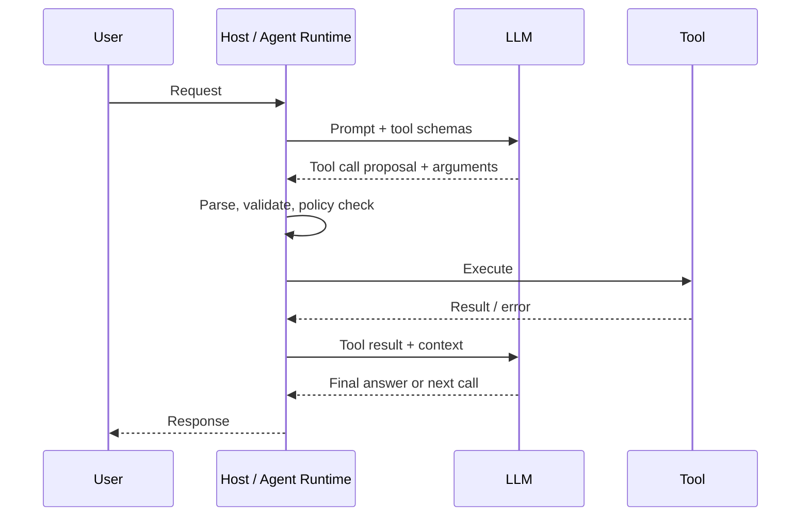
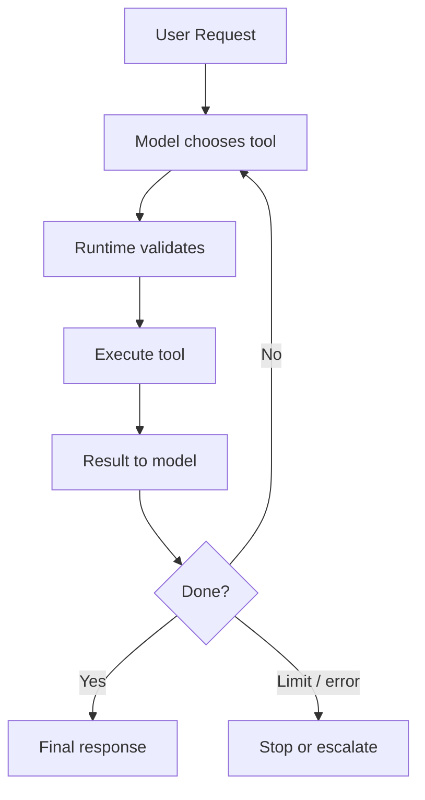
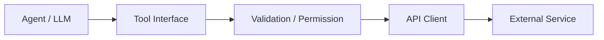

# 01. Tool Calling: Agent কীভাবে বাস্তব কাজ করে?

## LLM-এর knowledge বনাম capability

LLM text generate ও reasoning করতে পারে, কিন্তু model একা তোমার database query, live API request, file write বা refund transaction execute করতে পারে না। Tool একটি বাহ্যিক capability দেয়, যা agent/runtime ব্যবহার করে।

Examples: calculator, search, database/API, email, code execution।

## Tool কী?

Tool একটি নির্দিষ্ট operation/interface। সাধারণত এর অংশ:
- Name: operation-এর পরিচয়
- Description: কী কাজ করে, কখন ব্যবহার করতে হবে
- Input schema: parameters, type, required field, constraint
- Implementation: বাস্তবে কাজ করার code/API
- Output: result structure
- Error behavior: failure কীভাবে প্রকাশ করবে

Tool description model-কে guide করে; security enforcement নয়।

## Tool calling end-to-end

1. User request runtime-এ আসে।
2. Runtime model-কে conversation ও available tool schemas দেয়।
3. Model tool দরকার বুঝলে structured call propose করে।
4. Runtime call parse ও validate করে।
5. Permission/policy/approval check হয়।
6. Application/runtime tool execute করে।
7. Result context-এ যুক্ত হয়।
8. Model final answer দিতে পারে বা next tool call করে।
9. Stop condition বা turn limit loop থামায়।

**Model-এর tool call proposal আর tool execution এক ঘটনা নয়।** Model call চাইতে পারে, runtime সেটি reject বা approve করতে পারে।

## Illustrative pseudo-code

নিচের code framework/provider-neutral; runnable SDK syntax নয়।

    tools = [{
        "name": "get_order",
        "description": "Retrieve order details by ID",
        "parameters": {
            "type": "object",
            "properties": {"order_id": {"type": "string"}},
            "required": ["order_id"]
        }
    }]

    response = model.generate(messages, tools=tools)

    if response.tool_call:
        call = response.tool_call
        args = validate_schema(call.arguments)
        # Application invokes the actual function.
        result = get_order(**args)
        messages.append(response)
        messages.append(tool_result(call.name, result))
        final = model.generate(messages)

Real SDK-তে schema/message format ভিন্ন। Allowlist, validation, authorization, timeout ও error handling application layer-এ থাকা উচিত।

## Agent loop ও multiple tool calls

Refund investigation-এ order lookup → policy retrieval → eligibility check → (authorized) refund request হতে পারে। সব tool call-এর আগে permission ও business rule যাচাই দরকার।

## Tool design

- **Narrow responsibility:** get_order, search_policy, create_ticket আলাদা কাজ।
- **Clear descriptions:** purpose, when to use, constraints।
- **Strict schema:** required field, type, enum, validation।
- **Useful output:** structured status, data, error code।
- **Idempotency:** retry-তে duplicate side effect রোধ।
- **Timeout/retry:** operation-safe retry; uncertain outcome reconcile।
- **Least privilege:** agent শুধু প্রয়োজনীয় tools।
- **Observability:** sanitized args, tool, duration, status, trace ID; secret log নয়।

## Tool calling বনাম API

API হলো service-এর interface। Tool হলো agent/runtime-কে capability হিসেবে দেওয়া interface; tool implementation API call করতে পারে।

## Failure modes

| সমস্যা | সমাধান |
|---|---|
| ভুল tool selection | স্পষ্ট description, routing evaluation |
| ভুল arguments | Schema + business validation |
| API error | Structured error, bounded retry |
| Duplicate side effect | Idempotency, status reconciliation |
| Unauthorized operation | Server-side authorization |
| Tool output injection | Output-কে untrusted data হিসেবে treat |
| Infinite loop | Max turns, budget, loop detection |

## Interview drill

**Tool call কে execute করে?** সাধারণত host/runtime tool proposal parse, validate, authorize ও execute করে।

**Schema থাকলে কি সব ভুল আটকায়?** না। Schema shape/type check করে; business semantics আলাদা validate করতে হয়।

**Timeout হলে retry?** Side effect idempotent কিনা ও outcome unknown কিনা যাচাই করে; blindly retry করা যায় না।

**Practice:** Refund tool-এর input/output schema, authorization, approval, idempotency, timeout এবং audit fields design করো। Refund amount refundable limit অতিক্রম করলে কোথায় reject হবে ব্যাখ্যা করো।