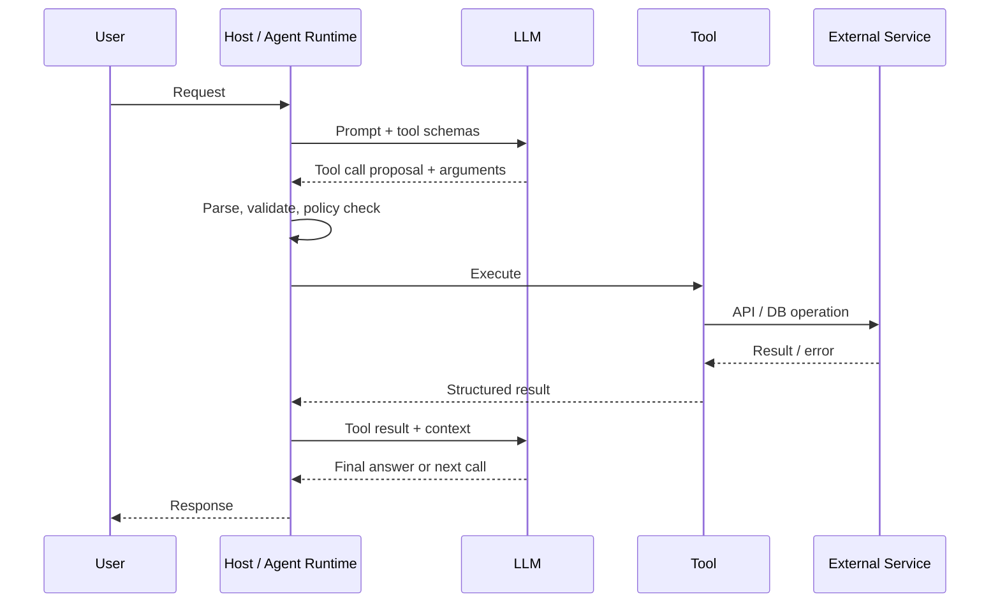
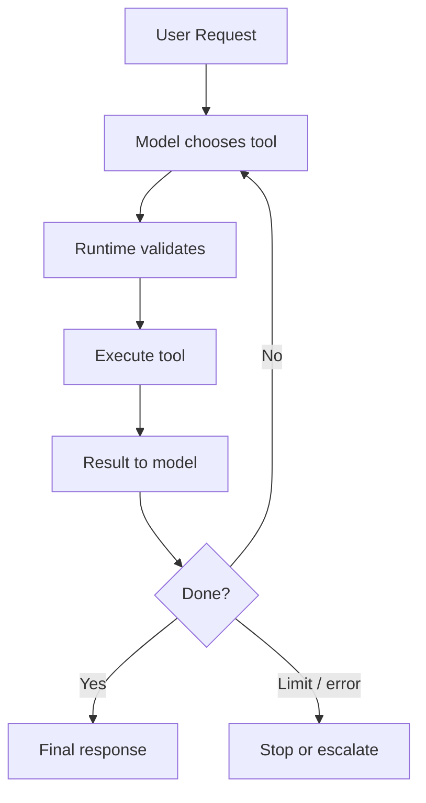
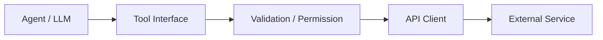

# 01. Tool Calling: Agent কীভাবে বাস্তব কাজ করে?

## 1. LLM অনেক কিছু বলতে পারে, কিন্তু বাস্তবে কাজ করবে কে?

ধরো, তুমি একটি assistant-কে বললে, “আমার order O-42-এর status দেখাও।” LLM ভাষা বুঝতে পারে, order status কী তা ব্যাখ্যা করতে পারে, এমনকি কোন তথ্য দরকার তা অনুমান করতে পারে। কিন্তু model একা তোমার production database-এ query চালায় না। সে নিজে থেকে payment provider-এ request পাঠায় না, file system-এ file লেখে না, কিংবা customer-কে email পাঠায় না।

এই কাজগুলোর জন্য application-কে বাইরের capability দিতে হয়। সেই capability-কে agent-এর কাছে একটি নির্দিষ্ট interface হিসেবে প্রকাশ করার প্রচলিত পদ্ধতি হলো **Tool**।

Tool calling বোঝার জন্য একটি মৌলিক পার্থক্য মনে রাখো:

- LLM সিদ্ধান্ত নিতে পারে যে একটি tool দরকার এবং কী arguments পাঠানো উচিত তার proposal তৈরি করতে পারে।
- Host বা agent runtime সেই proposal গ্রহণ, parse, validate, authorize এবং execute করার দায়িত্ব নেয়।
- Tool implementation বাস্তব operation চালায় এবং structured result ফেরত দেয়।
- Result আবার model context-এ গেলে model পরবর্তী সিদ্ধান্ত নিতে পারে।

অর্থাৎ **model tool call প্রস্তাব করে; runtime tool execute করায়।** এই separation শুধু implementation detail নয়। এটি security, reliability এবং auditability-এর ভিত্তি।

## 2. Tool কী? একটি Tool contract-এ কী থাকে?

Tool হলো agent/runtime-এর সামনে প্রকাশ করা একটি নির্দিষ্ট capability বা operation interface। এটি কোনো external API-কে wrap করতে পারে, local function চালাতে পারে, database query করতে পারে, browser action নিতে পারে বা অন্য workflow trigger করতে পারে।

একটি tool contract-এ সাধারণত থাকে:

**Name:** Operation-এর পরিচয়। যেমন `get_order`, `search_policy`, `request_refund`।

**Description:** Tool কী করে, কখন ব্যবহার করা উচিত, কখন করা উচিত নয় এবং গুরুত্বপূর্ণ constraint কী।

**Input schema:** কোন parameter লাগবে, type কী, কোন field required, enum/range কী।

**Implementation:** বাস্তবে operation চালানোর code বা API client।

**Output contract:** Success, pending, failure এবং returned data কীভাবে প্রকাশ হবে।

**Error contract:** কী ধরনের failure হতে পারে, কোন error retryable, কোনটি user clarification বা escalation চায়।

Tool description model-কে guide করে। কিন্তু description security enforcement নয়। “এই tool কেবল নিজের order-এর জন্য ব্যবহার করো” লিখলেই backend-এ order ownership check বাদ দেওয়া যায় না।

## 3. Tool calling end-to-end: request থেকে result পর্যন্ত



ধাপে ধাপে:

1. User-এর request host/runtime-এ আসে।
2. Runtime conversation context এবং available tool schema model-কে পাঠায়।
3. Model বুঝতে পারে tool দরকার, তাই structured tool call proposal তৈরি করে।
4. Runtime proposal parse করে এবং tool allowlist-এ আছে কি না দেখে।
5. Arguments schema অনুযায়ী validate হয়।
6. Trusted policy ও authorization check হয়; প্রয়োজন হলে approval চাওয়া হয়।
7. সব check পাস করলে runtime tool implementation invoke করে।
8. Tool external service বা database-এর সঙ্গে কাজ করে structured result ফেরত দেয়।
9. Runtime result context-এ যোগ করে model-কে আবার invoke করতে পারে।
10. Model final answer দিতে পারে, আরেকটি tool call propose করতে পারে, অথবা stop করতে পারে।

Model-এর tool call proposal আর বাস্তব execution এক ঘটনা নয়। Runtime চাইলে call reject করতে পারে। Permission না থাকলে, schema invalid হলে বা business rule ভাঙলে operation execute হওয়া উচিত নয়।

## 4. Refund example: Model-এর proposal থেকে actual transaction

ধরা যাক model এই structured proposal দিল:

```json
{
  "name": "request_refund",
  "arguments": {
    "order_id": "O-42",
    "amount_minor": 50000,
    "currency": "BDT"
  }
}
```

এটি refund সম্পন্ন করেনি। এটি কেবল runtime-কে বলছে যে `request_refund` tool ব্যবহার করতে চায়।

Runtime ও backend-কে এরপর যাচাই করতে হবে:

- Tool কি এই task-এর জন্য allow করা হয়েছে?
- Arguments schema-valid কি?
- Request authenticated identity থেকে এসেছে?
- Customer কি order O-42-এর owner?
- Order কি refundable state-এ আছে?
- Refundable balance কি 50000 minor unit বা তার বেশি?
- Currency ও amount unit সঠিক?
- একই refund request আগে process হয়েছে?
- Human approval দরকার কি?
- Caller-এর এই operation করার permission আছে?

সব check পাস করলে trusted refund service request execute করবে। এরপর result-এ `pending`, `approved`, `rejected` বা `completed`-এর মতো state আসতে পারে। Tool যে status দিয়েছে তার অর্থ না বুঝে model-কে “refund complete” বলতে দেওয়া যাবে না।

## 5. Schema validation বনাম Business validation

এই দুইটি validation প্রায়ই এক করে ফেলা হয়, অথচ তাদের প্রশ্ন আলাদা।

### Schema validation

Arguments-এর structure ও data type ঠিক আছে কি?

- `order_id` string কি?
- `amount_minor` integer কি?
- Required field আছে?
- `currency` allowed enum-এর মধ্যে?
- Unexpected field এসেছে কি?

Schema validation malformed input আটকায়। কিন্তু business-wise valid কি না তা বলে না।

### Business validation

Operation বর্তমান domain state-এ বৈধ কি?

- Order সত্যিই এই customer-এর?
- Order delivered হয়েছে?
- Refund window শেষ?
- Refundable balance যথেষ্ট?
- Order আগেই refunded?
- Reason code এই product-এর জন্য allowed?
- Approval threshold অতিক্রম করেছে?

Schema-valid request-ও business-invalid হতে পারে। আবার business rule ঠিক হলেও caller permission না থাকলে operation করা যাবে না।

### Authorization আলাদা

Authentication বলে request কোন identity থেকে এসেছে। Authorization বলে সেই identity এই resource-এ এই action করতে পারে কি না। Business validation বলে domain-এর নিয়ম অনুযায়ী action-টি গ্রহণযোগ্য কি না। তিনটি আলাদা check।

## 6. Tool call loop: একাধিক ধাপে কাজ করা

একটি tool call-এর পরই agent-এর কাজ শেষ হতে হবে এমন নয়। Tool result দেখে পরবর্তী action বদলাতে পারে।



Refund investigation-এ flow হতে পারে:

1. `get_order` দিয়ে order details দেখা।
2. `search_policy` দিয়ে applicable policy retrieve করা।
3. Eligibility service বা deterministic rule দিয়ে eligibility যাচাই।
4. Evidence missing হলে customer-এর কাছে photo চাওয়া।
5. Evidence পাওয়া গেলে আবার eligibility check।
6. Authorized হলে `request_refund` invoke।
7. Refund status verify করে customer-কে update।

এখানে model প্রতিটি step-এর জন্য tool proposal দিতে পারে, কিন্তু state transition ও permission trusted runtime/service enforce করবে। Max turns, max tool calls, deadline ও cost budget না থাকলে loop অপ্রয়োজনীয়ভাবে চলতে পারে।

## 7. Tool design: ভালো contract কেমন হবে?

### Narrow responsibility

একটি tool একটি সুস্পষ্ট কাজ করুক। `get_order`, `search_policy`, `request_refund` আলাদা responsibility। “Manage everything” ধরনের বিশাল tool model-কে অস্পষ্ট ক্ষমতা দেয় এবং test করা কঠিন হয়।

### Clear description

Description-এ purpose, কখন ব্যবহার করতে হবে, required input, side effect আছে কি না এবং গুরুত্বপূর্ণ constraint উল্লেখ করো। Tool description সংক্ষিপ্ত হলেও ambiguity থাকা চলবে না।

### Strict schema

Required field, type, enum, range, format ও unexpected field policy নির্দিষ্ট করো। Schema validation runtime-এ enforce করো।

### Useful structured output

শুধু “Success” string নয়; explicit status, identifiers, timestamps, reason code ও retryability দরকার। যেমন `pending` আর `completed` আলাদা করে প্রকাশ করতে হবে।

### Least privilege

Agent-কে শুধু প্রয়োজনীয় capability দাও। Read-only task-এ refund execution tool expose করার দরকার নেই। Tool availability-ও permission scope অনুযায়ী filter করা যেতে পারে, তবে backend authorization অবশ্যই থাকবে।

### Observability

Tool name, trace ID, duration, outcome category ও sanitized arguments log করো। Secret, access token, full payment detail বা unnecessary personal data log কোরো না।

## 8. Side effect, Idempotency ও Timeout

Read-only operation retry করা সাধারণত তুলনামূলক নিরাপদ। কিন্তু refund, payment, email send, order creation বা account update side effect তৈরি করে। একই request দুবার execute হলে duplicate refund বা duplicate email হতে পারে।

### Timeout মানে operation ব্যর্থ নয়

ধরা যাক runtime refund request পাঠাল। Server transaction commit করল, কিন্তু response ফেরানোর আগেই network connection timeout হলো। Runtime জানে না operation complete হয়েছে কি না। যদি নতুন request দিয়ে blindly retry করে, দ্বিতীয় refund তৈরি হতে পারে।

### Idempotency কীভাবে সাহায্য করে?

Client একটি unique idempotency key তৈরি করে operation-এর সঙ্গে পাঠায়। Server key ও result durable ভাবে সংরক্ষণ করে। একই key-তে retry এলে নতুন operation না করে আগের result ফেরত দেয়।

তবে contract-এ নির্দিষ্ট করতে হবে:
- Key-এর scope কী?
- কতদিন key সংরক্ষিত থাকবে?
- একই key-তে ভিন্ন payload এলে কী হবে?
- Concurrent duplicate request কীভাবে handle হবে?
- Operation pending থাকলে retry কী result দেবে?

### Reconciliation

কোনো operation-এর outcome unknown হলে status endpoint বা transaction lookup দিয়ে external system-এর authoritative state যাচাই করতে হবে। Idempotency না থাকলে reconciliation আরও গুরুত্বপূর্ণ। “Timeout হয়েছে, তাই ব্যর্থ” ধরে নতুন side effect তৈরি করা যাবে না।

## 9. Tool error model: Agent-কে কী ধরনের failure জানাবে?

সব error-কে এক string `failed` হিসেবে ফেরত দিলে model/runtime বুঝতে পারে না recover করবে, clarification চাইবে, নাকি stop করবে।

| Error category | অর্থ | সাধারণ handling |
|---|---|---|
| `validation_error` | Input schema বা business constraint invalid | Arguments ঠিক না হওয়া পর্যন্ত retry নয় |
| `permission_denied` | Caller-এর authorization নেই | Stop বা authorized human handoff |
| `not_found` | Resource পাওয়া যায়নি | Identifier clarify বা not-found response |
| `rate_limited` | Rate limit অতিক্রম | Retry-after থাকলে bounded wait |
| `timeout` | Outcome unknown হতে পারে | Status reconciliation; blind retry নয় |
| `dependency_unavailable` | Downstream service unavailable | Bounded retry/fallback/escalation |
| `conflict` | Current state-এর সঙ্গে request conflict | State refresh ও decision পুনর্বিবেচনা |

Internal stack trace, secret বা credential model-কে ফেরত দেওয়া উচিত নয়। Error message-এ প্রয়োজনীয় safe detail এবং retryable কি না তা structured ভাবে দেওয়া যায়। Retry policy শেষ পর্যন্ত runtime-এ enforce হওয়া উচিত।

## 10. Tool Calling বনাম API

API হলো service-এর programmatic interface। Tool হলো agent/runtime-এর সামনে প্রকাশ করা task-oriented capability interface। Tool implementation একটি API call করতে পারে, database query করতে পারে, local function চালাতে পারে বা অন্য workflow invoke করতে পারে।



সব API endpoint সরাসরি model-কে expose করা উচিত নয়। Internal API-তে low-level operation, administrative capability বা অতিরিক্ত privilege থাকতে পারে। Tool layer দিয়ে task-oriented, narrow operation expose করলে model-এর জন্য সঠিক capability বেছে নেওয়া সহজ হয় এবং application নিরাপত্তা ও validation যোগ করতে পারে।

## 11. Interview: Tool Calling নিয়ে গভীর প্রশ্ন

### Q1. Tool call কে execute করে?

সাধারণত host application বা agent runtime model-এর tool-call proposal parse, validate, authorize এবং execute করে। Model tool name ও arguments propose করে; runtime tool implementation invoke করে এবং result model context-এ ফেরত দেয়। Provider ও framework অনুযায়ী API detail বদলাতে পারে, কিন্তু proposal এবং execution-এর পার্থক্য গুরুত্বপূর্ণ।

### Q2. Schema থাকলে কি সব ভুল আটকানো যায়?

না। Schema structure ও type validate করে। এটি order ownership, refund eligibility, amount limit, duplicate transaction বা caller permission নিশ্চিত করে না। Business validation ও authorization আলাদা trusted layer-এ enforce করতে হবে।

### Q3. Timeout হলে retry করবে?

প্রথমে operation side effect তৈরি করে কি না এবং outcome unknown কি না বুঝতে হবে। Read-only query bounded retry করা তুলনামূলক সহজ। Refund/payment-এর মতো operation-এ idempotency key এবং status reconciliation দরকার। Blind retry duplicate transaction তৈরি করতে পারে।

### Q4. Tool call কি API call-এর সমান?

না, related কিন্তু একই abstraction নয়। API service-এর programmatic interface। Tool হলো agent/runtime-এর সামনে প্রকাশ করা action contract; সেটি API call, database operation, local function বা অন্য workflow invoke করতে পারে। Tool layer-এ model-facing description/schema থাকে, আর runtime policy, validation, authorization, approval ও result handling যোগ করে।

**Follow-up: Tool description-এ permission লিখলেই হবে?**  
না। Description model-কে guide করে, কিন্তু malicious বা ভুল model call আটকানোর security boundary নয়। Permission trusted runtime/server-side-এ enforce করতে হবে।

### Q5. ১০০টি tool দিলে কী সমস্যা?

Tool selection ambiguity, prompt/context overhead, wrong selection ও evaluation complexity বাড়তে পারে। Domain অনুযায়ী discover/filter করা, concise description, tool grouping, retrieval-based discovery এবং task-specific allowlist ব্যবহার করা যায়। Success rate, wrong-tool rate, latency ও token cost দিয়ে পরীক্ষা করতে হবে।

### Q6. Tool output-এ prompt injection থাকলে কী করবে?

Tool output-কে untrusted data হিসেবে treat করতে হবে, বিশেষত browser বা external document থেকে আসা content। Retrieved text system/developer instruction-এর authority পাবে না। Tool output sanitize/label করা, trusted instruction ও data আলাদা রাখা এবং side-effecting tool-এর permission server-side enforce করা দরকার।

### Q7. Tool result model-কে ফেরত দেওয়ার আগে কী বিবেচনা করবে?

Result schema validate, sensitive field redact, oversized output trim, status semantics preserve এবং provenance/correlation ID retain করতে হবে। Result ছোট করার সময় এমন evidence বাদ দেওয়া যাবে না যা পরবর্তী decision-এর জন্য critical। Tool result-এর error category ও retryability structured হওয়া উচিত।

## 12. Practice: Refund Tool-এর পূর্ণ contract design

দুটি tool design করো:

1. Read-only `get_order`
2. Side-effecting `request_refund`

প্রতিটির জন্য লিখবে:
- Name ও description
- Input schema
- Output schema
- Authentication principal
- Authorization rule
- Business validation
- Error categories
- Timeout ও retry policy
- Idempotency behavior
- Audit fields

এরপর তিনটি failure scenario sequence diagram-এ দেখাও:

1. Schema-valid কিন্তু অন্য customer-এর order ID।
2. Refund request server-এ commit হয়েছে, কিন্তু client timeout পেয়েছে।
3. একই idempotency key-তে দুটি concurrent request এসেছে।

শেষে ব্যাখ্যা করো, কোন validation runtime-এ হবে, কোনটি domain service-এর owner-এর কাছে থাকবে এবং কেন।
