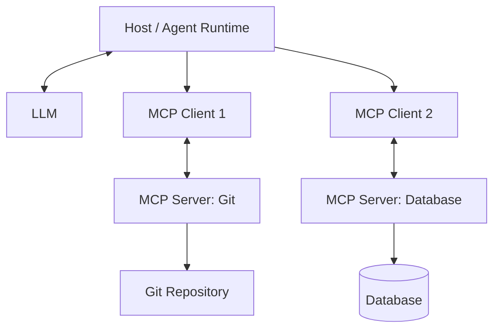
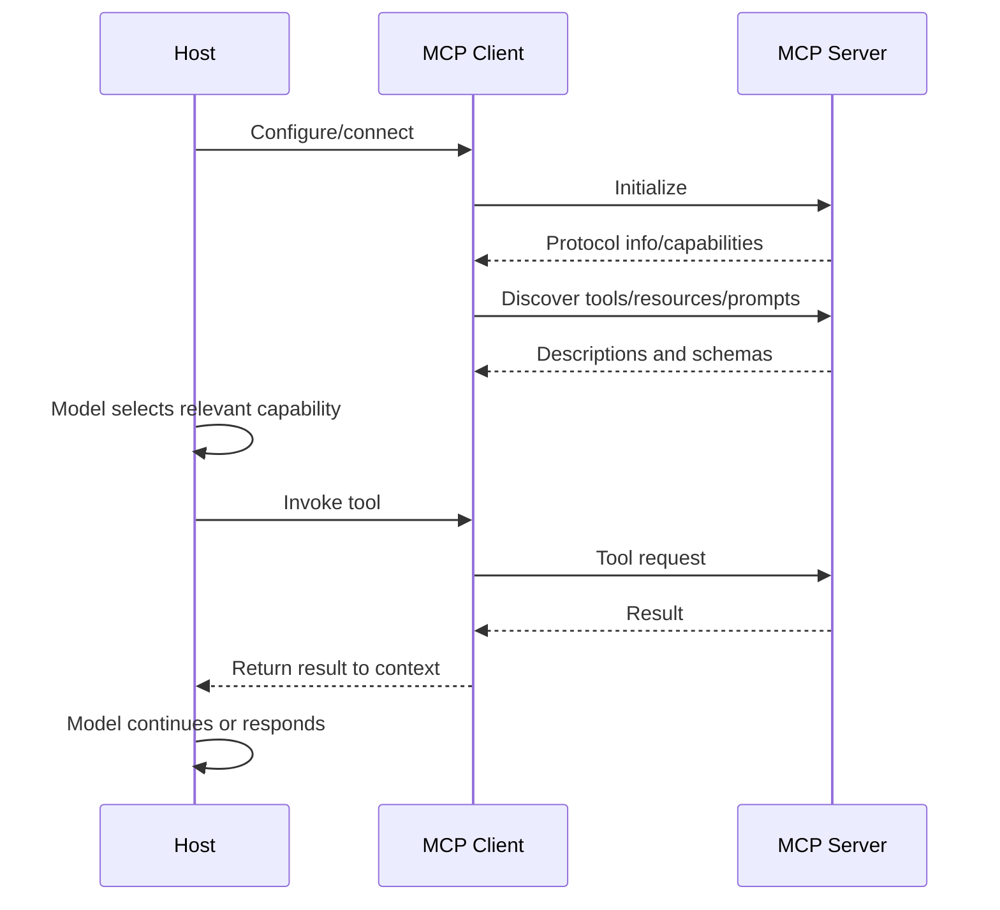

# 02. MCP: Model Context Protocol

## MCP কেন?

Agent-কে GitHub, database, file system, Slack বা internal API-তে connect করতে গেলে প্রতিটি integration-এর custom discovery, schema ও communication code লাগে। Model Context Protocol (MCP) host/client এবং capability server-এর মধ্যে common protocol/interface দেয়, যাতে compatible integrations reuse করা যায়।

MCP model নয়, agent framework নয়, নিজে reasoning engine-ও নয়। এটি capabilities discover ও access করার protocol।

## Architecture: Host, Client, Server

- **Host:** AI application/runtime; conversation, model ও user interaction পরিচালনা করে।
- **MCP Client:** Host-এর অংশ; নির্দিষ্ট server-এর protocol connection/session পরিচালনা করে।
- **MCP Server:** Tools, Resources বা Prompts expose করে।

একটি host একাধিক MCP server connect করতে পারে।

## MCP capabilities

### Tools
Action invoke করার capability: search, create issue, query data, file operation ইত্যাদি।

### Resources
Read/context হিসেবে expose করা data/resource: document, file, snapshot, URI-identified resource ইত্যাদি।

### Prompts
Reusable prompt/template, যা interaction শুরু বা guide করতে সাহায্য করে।

Tools, resources, prompts এক জিনিস নয়। Tool action-oriented; resource data/context-oriented; prompt reusable instruction/template।

## সাধারণ lifecycle

Tool descriptions/schema discover হওয়ার পর model tool call propose করতে পারে; host/client call পাঠায়, server handler চালায়, result ফেরত আসে। Host result context-এ যোগ করে reasoning চালায়।

## Transport ধারণা

Transport message কীভাবে client/server-এর মধ্যে চলবে তা নির্ধারণ করে।

- **stdio:** local process-এর stdin/stdout দিয়ে communication; local server-এ উপযোগী।
- **Streamable HTTP:** HTTP-based transport; remote/service deployment-এর জন্য ব্যবহারযোগ্য।

Transport choice deployment, network boundary, authentication, scaling, session behavior ও security অনুযায়ী। Protocol versions অনুযায়ী details পরিবর্তিত হতে পারে; legacy HTTP+SSE pattern-কে current transport-এর সঙ্গে গুলিয়ে ফেলবে না।

## MCP tool call-এর example flow

1. Client server initialize করে।
2. Available tool schema discover করে।
3. Host relevant schemas model-কে দেয়।
4. Model structured tool request propose করে।
5. Host/runtime validation ও permission check করে।
6. Client server-এ request পাঠায়।
7. Server handler downstream API/data source access করে।
8. Result ফেরত আসে।
9. Host result model context-এ যোগ করে।
10. Model final response বা next call তৈরি করে।

## MCP-এর benefit

- Standardized interface
- Capability discovery
- Integration reuse
- Compatible host/server ecosystem
- Local ও remote integration pattern
- Custom integration boilerplate কমানো

## MCP কী solve করে না?

- Reasoning quality guarantee নয়।
- Tool correctness guarantee নয়।
- Authorization নিজে থেকে enforce হয় না।
- Prompt injection নিজে থেকে prevent করে না।
- Workflow orchestration, memory বা reliability-এর replacement নয়।
- MCP server connect করলেই agent production-ready নয়।

## Security

- Untrusted server/tool blindly connect নয়।
- Tool schema ও implementation review।
- Least privilege credentials।
- Read/write scope separation।
- Server-side authorization।
- Tool outputs untrusted data।
- Sensitive action approval।
- Secrets/network controls।
- Audit/monitoring।
- Dependency/update risk।

## MCP বনাম direct integration

| Direct integration | MCP |
|---|---|
| Application-specific API wrapper | Common protocol/interface |
| Custom discovery/contract | Standard capability discovery |
| বেশি bespoke code হতে পারে | Compatible server reuse |
| Small internal tool-এ সহজ | Ecosystem interoperability-তে useful |

MCP সব tool-এর জন্য বাধ্যতামূলক নয়। ছোট internal function-এ direct wrapper যথেষ্ট হতে পারে।

## Interview drill

- MCP কী এবং কেন?
- Host/client/server roles কী?
- Tool, resource, prompt-এর পার্থক্য?
- MCP কি agent framework?
- MCP কি security নিশ্চিত করে?
- Local stdio বনাম remote HTTP transport কী trade-off?

**Practice:** Order lookup ও policy search tools-সহ MCP server design করো। Input/output schema, credentials, authorization এবং malicious order ID input-এর handling ব্যাখ্যা করো।