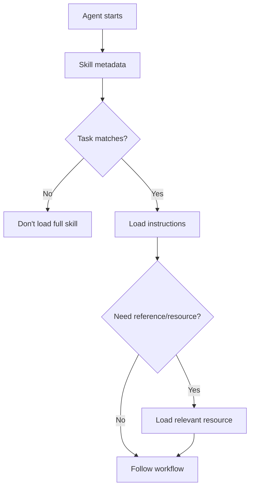
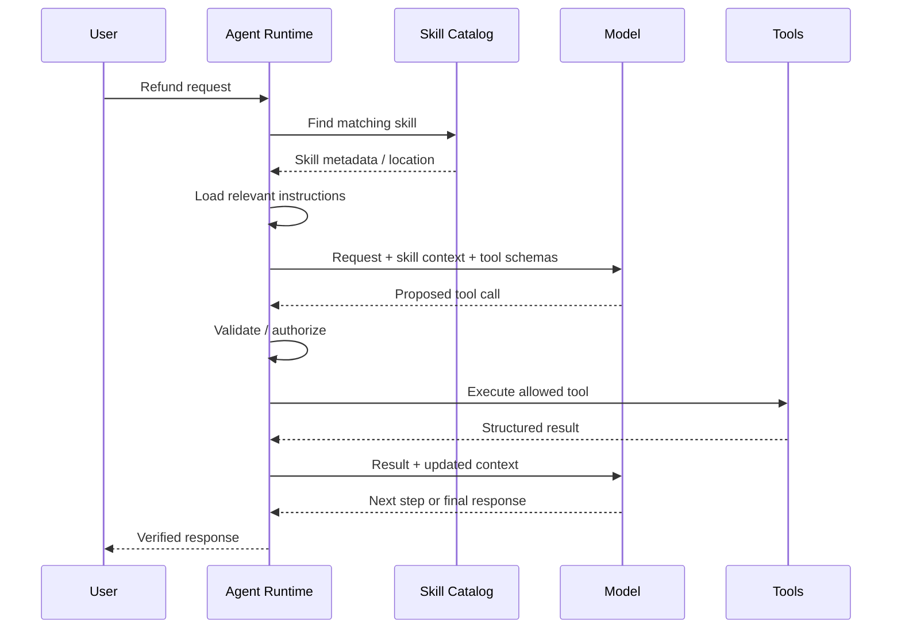

# 03. Agent Skills: Reusable Instructions ও Workflow

## 1. Agent-এর কাছে tool আছে, কিন্তু সে কি জানে কাজটি ভালোভাবে করতে?

ধরো, তুমি একটি support agent-কে তিনটি tool দিয়েছ: `get_order`, `search_refund_policy` এবং `request_refund`। Agent technically order দেখতে, policy খুঁজতে এবং refund request পাঠাতে পারে। কিন্তু capability থাকলেই যে সে সঠিক পদ্ধতিতে কাজ করবে, এমন নয়।

তার জানা দরকার:
- কোন ধরনের request-এ কোন tool ব্যবহার করবে?
- Order lookup-এর আগে customer identity কীভাবে verify করবে?
- কোন policy version প্রযোজ্য?
- Evidence কখন চাইতে হবে?
- কোন condition-এ refund action নিষিদ্ধ?
- Ambiguous case কখন human reviewer-এর কাছে পাঠাবে?
- Action-এর পরে কোন status verify করতে হবে?

এই procedure বারবার prompt-এ লিখে দিলে instruction copy/paste, drift ও maintenance-এর সমস্যা তৈরি হতে পারে। একই workflow একাধিক agent-এ ব্যবহার করতে হলে reusable instruction package দরকার হয়। Agent ecosystem-এ এই ধরনের package-কে **Skill** বলা হয়।

মূল পার্থক্যটি মনে রাখো:

**Tool capability দেয়; Skill বলে সেই capability কীভাবে ও কোন workflow-এ ব্যবহার করতে হবে।**

Skill নিজে model নয়, tool নয় এবং security enforcement mechanism-ও নয়। এটি reusable knowledge ও instruction package, যা agent-এর task execution guide করে।

## 2. Tool বনাম Skill: দুইটির কাজ আলাদা

| বিষয় | Tool | Skill |
|---|---|---|
| মূল ভূমিকা | Operation execute করার capability | কাজ করার পদ্ধতি ও workflow শেখানো |
| উদাহরণ | `search_refund_policy` | কোন policy version খুঁজবে ও কীভাবে evidence যাচাই করবে |
| Input/output | নির্দিষ্ট schema | Procedure, constraints, references |
| বাস্তব কাজ | API, DB, function বা অন্য action চালায় | Tool selection/sequence-কে guide করে |
| Security | Runtime/server authorization দরকার | Instruction নিজে permission দিতে পারে না |

ধরা যাক `search_refund_policy` tool policy document খুঁজে দেয়। কিন্তু কোন country, product category, delivery date বা policy version ব্যবহার করতে হবে, সেটি skill-এর workflow ব্যাখ্যা করতে পারে। Skill tool invoke করতে পারে, কিন্তু tool নিজে skill-এর পুরো procedure জানে না।

একটি সহজ analogy: Tool হলো রান্নাঘরের যন্ত্র; Skill হলো recipe। Recipe ছাড়া যন্ত্র ব্যবহার করা যায়, কিন্তু ধারাবাহিকভাবে ভালো ফল পেতে পদ্ধতি জানা দরকার। আবার recipe-তে লেখা থাকলেই যন্ত্র নিজে থেকে কাজ করে না।

## 3. Skill কখন কাজে আসে?

Skill বিশেষভাবে উপকারী যখন:

**Repeatable task:** একই ধরনের কাজ বারবার করতে হয় এবং প্রতিবার একই quality standard দরকার।

**Domain-specific workflow:** কাজের নিয়ম সাধারণ instruction-এর চেয়ে নির্দিষ্ট। যেমন incident triage, refund investigation বা deployment review।

**Multi-tool sequencing:** একাধিক tool কোন ক্রমে ব্যবহার করতে হবে তা task অনুযায়ী নির্ধারিত।

**Edge-case checklist:** সাধারণ flow ছাড়াও missing evidence, conflicting result বা service outage handle করতে হয়।

**Consistency:** একাধিক agent/team একই procedure অনুসরণ করবে।

**Context efficiency:** প্রয়োজন না হলে full instruction load না করে relevant skill load করা যায়।

তবে প্রতিটি prompt বা ছোট task-এর জন্য আলাদা Skill package বানানো প্রয়োজন নেই। Workflow repeatable, reusable বা যথেষ্ট জটিল হলেই package-এর maintenance cost ন্যায্য হয়।

## 4. একটি Skill package-এর structure

একটি Skill package-এ core instruction-এর পাশাপাশি optional reference, script ও asset থাকতে পারে।

```text
refund-investigation/
├── SKILL.md
├── references/
│   ├── refund-policy.md
│   └── evidence-checklist.md
├── scripts/
│   └── validate-request.py
└── assets/
    └── response-template.md
```

### SKILL.md

এখানে skill-এর পরিচয়, trigger/description, মূল workflow, constraints এবং expected outcome থাকে। Core instruction সংক্ষিপ্ত, স্পষ্ট ও actionable রাখা ভালো।

### references/

বিস্তারিত policy, checklist, domain terminology বা supporting documentation রাখা যায়। সব reference একসঙ্গে load করার দরকার নেই; প্রয়োজনীয় অংশ on-demand load হতে পারে।

### scripts/

Deterministic validation, transformation বা helper operation-এর code থাকতে পারে। তবে script execute করার অনুমতি skill-এর লেখা থেকে আসে না; runtime/platform-এর execution policy, sandbox ও permission প্রযোজ্য।

### assets/

Template, static file বা supporting resource রাখা যায়।

সব skill-এ এই চারটি অংশ থাকা বাধ্যতামূলক নয়। Simple skill-এ শুধু SKILL.md-ই যথেষ্ট হতে পারে।

## 5. Progressive Disclosure: প্রয়োজন অনুযায়ী instruction load

ধরা যাক, agent-এর কাছে ৫০টি skill আছে এবং প্রতিটির full instruction ৫,০০০ token। সব skill একসঙ্গে context-এ দিলে ২৫০,০০০ token instruction load হতে পারে, যদিও বর্তমান task-এ হয়তো একটি skill-ই দরকার।

Progressive disclosure-এ information ধাপে ধাপে load হয়:

1. **Discovery metadata:** ছোট name/description দেখে কোন skill প্রাসঙ্গিক হতে পারে তা বোঝা।
2. **Core instruction:** Task match করলে সেই skill-এর মূল instruction load করা।
3. **Supporting reference:** প্রয়োজন হলে নির্দিষ্ট reference, script বা asset load করা।



এতে context budget বাঁচে এবং irrelevant instruction কমে। কিন্তু metadata বা trigger দুর্বল হলে সঠিক skill discover নাও হতে পারে। তাই skill description-এ শুধু topic name নয়, কখন ব্যবহার করতে হবে এবং কখন ব্যবহার করা উচিত নয় সেটিও স্পষ্ট করা দরকার।

## 6. একটি illustrative SKILL.md

নিচের example generic; কোনো নির্দিষ্ট vendor বা framework-এর exact specification নয়।

```yaml
---
name: refund-investigation
description: >
  Investigate damaged-item refund requests.
  Use when a customer reports a damaged delivered item
  and asks for a refund.
---

# Workflow

1. Customer identity ও order reference যাচাই করো।
2. Order ID না থাকলে clarification চাও।
3. Order lookup করে status ও delivery date যাচাই করো।
4. Applicable policy version retrieve করো।
5. Policy অনুযায়ী required evidence নির্ধারণ করো।
6. Evidence missing হলে customer-এর কাছে চাও।
7. Eligibility trusted business service দিয়ে যাচাই করো।
8. Refund execute করার আগে permission ও approval policy মানো।
9. High-risk বা ambiguous case human review-এ পাঠাও।
10. Action result authoritative source থেকে verify করে report করো।

# Never

- অনুমান করে refund eligibility ঘোষণা করবে না।
- অন্য customer-এর order access করবে না।
- Approval/authorization ছাড়া refund initiate করবে না।
- Pending status-কে completed বলবে না।
```

এই skill agent-কে workflow শেখায়। কিন্তু “refund execute করবে না” instruction একা যথেষ্ট নয়। Backend permission না দিলে তবেই unauthorized refund বাস্তবে আটকানো যাবে।

## 7. Skill loading থেকে tool execution পর্যন্ত



এখানে runtime skill discover/load করতে পারে, model skill instruction context-এ পায়, তারপর model সেই instruction অনুযায়ী tool call propose করতে পারে। Runtime আবার call validate ও execute করে। Skill-এর instruction model-এর behavior guide করে; runtime ও backend-এর policy action enforce করে।

## 8. Skill কি deterministic behavior নিশ্চিত করে?

না। Skill মূলত instruction package। LLM সেটি interpret করে এবং কখনো ধাপ বাদ দিতে পারে, instruction ভুল বুঝতে পারে বা reference outdated হতে পারে। একাধিক skill conflict করতে পারে। তাই skill থাকলেই একই input-এ সবসময় একই sequence বা outcome পাওয়া যাবে, এমন নিশ্চয়তা নেই।

Determinism দরকার এমন অংশ code/service-এ রাখো:
- Exact calculation
- Permission check
- Business invariant
- Required state transition
- Idempotency
- Transaction execution
- Mandatory approval

Skill model-কে workflow guide করতে পারে, কিন্তু critical invariant runtime/backend enforce করবে।

### Skill adherence কীভাবে evaluate করবে?

Representative test case তৈরি করো। Expected tool sequence, required evidence, forbidden action, missing-information behavior, escalation condition ও final status correctness যাচাই করো। Skill version বদলালে regression test চালাও। শুধু model-কে “তুমি skill follow করেছ?” জিজ্ঞাসা করা যথেষ্ট evaluation নয়।

## 9. Skill maintenance: instruction-ও software artifact

Skill-এর instruction সময়ের সঙ্গে outdated হতে পারে। Refund policy বদলেছে, কিন্তু skill পুরনো reference ব্যবহার করছে। Tool schema বদলেছে, কিন্তু skill পুরনো parameter name বলছে। এমন হলে agent ভুল workflow অনুসরণ করবে।

তাই Skill package-এর সঙ্গে রাখা ভালো:
- Owner বা responsible team
- Version
- Last reviewed date
- Supported tool/schema version
- Source/reference version
- Change history
- Test/evaluation cases

Run reproducibility দরকার হলে কোন skill version বা immutable content hash ব্যবহার হয়েছিল, model version ও tool schema version-সহ log করা উচিত।

## 10. Skill injection ও supply-chain risk

Skill package-ও untrusted instruction বা code source হতে পারে। কেউ skill-এ এমন instruction ঢোকাতে পারে যা secret exfiltration, permission bypass বা unsafe tool call করতে বলে। Script থাকলে code execution risk-ও তৈরি হয়।

Mitigation:
- Trusted source/publisher ব্যবহার।
- Skill content review।
- Version pinning ও integrity check।
- Dependency review।
- Script sandboxing।
- Network ও filesystem permission সীমিত রাখা।
- Secret skill context বা model context-এ অকারণে না দেওয়া।
- Staged rollout ও regression evaluation।
- Runtime/backend authorization বজায় রাখা।

Skill-এর লেখা instruction কখনো server-side permission override করতে পারবে না।

## 11. Skill বনাম Memory বনাম RAG বনাম Fine-tuning

এগুলো আলাদা problem solve করে, যদিও একটি agent একই সঙ্গে সবগুলো ব্যবহার করতে পারে।

| Concept | কী | কোন প্রশ্নের উত্তর দেয় |
|---|---|---|
| Skill | Reusable instruction/workflow package | “কীভাবে কাজ করবে?” |
| Memory | Stored user/session/project/task information | “আগে কী জানা বা ঘটেছিল?” |
| RAG | External knowledge retrieve করে context-এ আনা | “এই বিষয়ে source-এ কী তথ্য আছে?” |
| Fine-tuning | Training দিয়ে model parameter update | “Model-এর learned behavior/pattern কীভাবে বদলাবে?” |
| Tool | Executable capability | “বাস্তবে কোন operation চালানো যাবে?” |

উদাহরণ: Refund skill বলে কীভাবে investigation করবে। Memory জানায় customer আগে কোন order নিয়ে যোগাযোগ করেছিলেন। RAG current policy document retrieve করে। Tool order lookup বা refund request চালায়। Fine-tuned model domain-specific language pattern ভালোভাবে handle করতে পারে। কোনো একটি অন্যগুলোর replacement নয়।

## 12. Interview: Skills নিয়ে গভীর প্রশ্ন

### Q1. Skill tool-এর replacement কেন নয়?

Tool operation execute করে; Skill operation ব্যবহারের procedure ও constraints শেখায়। `search_refund_policy` tool policy খুঁজে দেয়। Refund skill বলে কোন policy version খুঁজবে, evidence কীভাবে evaluate করবে, কোন condition-এ stop করবে এবং কখন human review দরকার। Skill tool invoke করতে পারে, কিন্তু নিজে external action execute করে না।

### Q2. সব skill কি context-এ থাকে?

না। Progressive disclosure-এ প্রথমে compact metadata/description discoverable থাকে। Task match করলে full instruction load হয়; প্রয়োজনে supporting reference বা asset on-demand load হয়। এতে context budget বাঁচে। তবে discovery metadata দুর্বল হলে matching skill পাওয়া নাও যেতে পারে।

### Q3. Malicious skill instruction কীভাবে risk তৈরি করে?

Skill model-কে unsafe action propose করতে বলতে পারে, sensitive data প্রকাশের নির্দেশ দিতে পারে বা policy bypass করতে বলতে পারে। Script থাকলে code execution risk-ও থাকে। Trusted source, review, version pinning, sandboxing, permission restriction ও backend authorization দরকার।

### Q4. Skill কি deterministic behavior নিশ্চিত করে?

না। Skill natural-language instruction, model সেটি interpret করে। Model ভুল বুঝতে বা step বাদ দিতে পারে। Exact validation, permission, calculation ও state transition deterministic code-এ enforce করো। Skill adherence representative evaluation দিয়ে মাপো।

### Q5. Progressive loading context window-কে কীভাবে সাহায্য করে?

সব skill-এর full content একসঙ্গে load না করে task-relevant skill load হয়। ফলে irrelevant instruction কমে, token budget বাঁচে এবং model-এর সামনে প্রয়োজনীয় workflow থাকে। তবে metadata ও retrieval quality ভালো না হলে ভুল skill load বা প্রয়োজনীয় skill miss হতে পারে।

### Q6. “Skill-কে prompt-এ লিখে দিলেই তো হয়, আলাদা package কেন?”

একটি ছোট task-এ prompt-এ instruction দেওয়া যথেষ্ট হতে পারে। কিন্তু একই workflow বারবার, একাধিক agent বা team-এ ব্যবহার হলে আলাদা package maintainability, versioning, ownership, reuse, review ও progressive loading দেয়। Skill package-এ reference ও helper script-ও রাখা যায়। তবে package overhead আছে; অপ্রয়োজনীয় skill architecture discovery ও maintenance জটিল করবে।

### Q7. Skill ভুল tool invoke করতে বললে কী হবে?

Runtime tool allowlist, schema, authorization ও business validation দিয়ে call reject করবে। Skill guidance, authority নয়। Skill-এর test/evaluation-এ forbidden tool call ও unsafe edge case অন্তর্ভুক্ত করতে হবে।

### Q8. Skill update করলে পুরনো run কীভাবে reproduce করবে?

Run metadata-তে skill identifier/version বা immutable content hash, model/version, tool schema version এবং relevant configuration সংরক্ষণ করো। এতে কোন instruction set দিয়ে decision হয়েছিল তা trace করা যায়। Reference document version-ও record করতে হবে, যদি সেটি decision-এ প্রভাব ফেলে।

## 13. Practice: Deployment Skill design

একটি deployment skill তৈরি করো। এর মধ্যে থাকবে:
- Trigger ও description
- Prerequisites
- Step-by-step workflow
- Required tools
- Validation/test steps
- Rollback condition
- Approval boundary
- Stop condition
- Final report format

তারপর প্রতিটি ধাপ classify করো: কোনটি instruction, কোনটি tool call, কোনটি deterministic script, কোনটি human approval। কোন permission runtime/backend enforce করবে তাও লিখো। Skill version বদলালে কোন regression test চালাবে তা নির্ধারণ করো।
