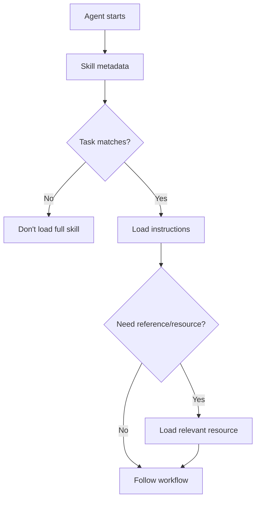
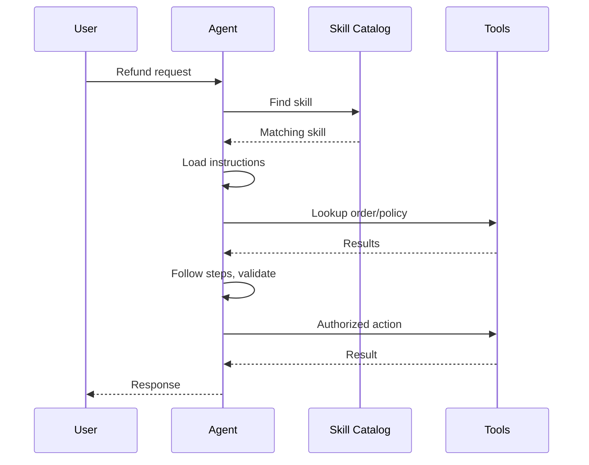

# 03. Agent Skills: Reusable Instructions ও Workflow

## Tool access থাকলেই expertise আসে না

Agent tools পেয়েছে, কিন্তু কোন tool কখন ব্যবহার করবে, কোন order-এ, কী edge case দেখবে, কীভাবে result verify করবে তা জানা নাও থাকতে পারে।

**Tool capability দেয়; Skill usage-এর knowledge/workflow দেয়।** Skill হলো reusable instruction package যা agent-কে নির্দিষ্ট task/domain-এ কাজ করার পদ্ধতি শেখায়। Skill নিজে model নয় এবং instruction alone security enforcement নয়। Package-এ optional reference, assets বা helper scripts থাকতে পারে।

## Tool বনাম Skill

| Tool | Skill |
|---|---|
| Executable capability | Instruction/workflow |
| “Search policy” | Policy search ও evidence evaluation কীভাবে করবে |
| Input/output contract | Steps, best practice, edge case |
| Action চালায় | Action-কে guide করে |

Analogy: Tool রান্নাঘরের যন্ত্র, Skill recipe।

## Skill কখন কাজে আসে?

- Repeatable tasks
- Domain-specific workflow
- Multi-tool sequencing
- Edge-case checklist
- Consistency
- Context-efficient instruction loading

## Skill package example

```text
refund-investigation/
├── SKILL.md
├── references/
│   ├── refund-policy.md
│   └── evidence-checklist.md
├── scripts/
│   └── validate-request.py
└── assets/
    └── response-template.md
```

Possible components:
- SKILL.md: metadata + core instructions
- references: deeper docs/policies
- scripts: deterministic helper code, platform permission সাপেক্ষে
- assets: templates/resources

সব skill-এ script থাকতে হবে এমন নয়।

## Progressive disclosure

সব skill-এর full instructions একসঙ্গে context-এ দিলে token budget নষ্ট হতে পারে। Progressive disclosure-এ:
1. Compact metadata/description দিয়ে skills discoverable।
2. Task relevant হলে full instructions load।
3. প্রয়োজন হলে reference/script/resource on-demand load।



এতে context-এ relevant content আসে; তবে metadata/trigger দুর্বল হলে skill discover নাও হতে পারে।

## Illustrative SKILL.md

এটি generic example, কোনো vendor-এর exact specification নয়।

    ---
    name: refund-investigation
    description: Investigate damaged-item refund requests.
    ---

    # Workflow
    1. Order ID না থাকলে চাইবে।
    2. Order lookup করবে।
    3. Applicable refund policy পড়বে।
    4. Evidence ও eligibility যাচাই করবে।
    5. Missing evidence থাকলে customer-কে চাইবে।
    6. অনুমতি ছাড়া refund করবে না।
    7. High-risk/ambiguous হলে human review।
    8. Action result যাচাই করে তারপর report করবে।

Skill-এর instruction কোনো security boundary নয়। “Refund করতে পারো” লেখা থাকলেও backend permission ছাড়া refund execute হওয়া উচিত নয়।

## Skill loading flow



## Benefits ও trade-offs

Benefits: reusable expertise, consistent workflow, efficient context, maintainability।

Trade-offs: outdated instructions, wrong trigger, conflicting skills, context overhead, unsafe instructions/resources।

Skills-এর version, owner, review ও evaluation দরকার।

## Skill vs Fine-tuning vs Memory

| | Skill | Fine-tuning | Memory |
|---|---|---|---|
| কী | Runtime instructions | Model parameters update | Stored facts/experience |
| Update | Instruction/package | Training | Store update |
| Use | Workflow guidance | Behavior/pattern শেখানো | Future recall |

## Interview drill

- Skill tool-এর replacement কেন নয়?
- সব skill কি context-এ থাকে?
- Malicious skill instruction কীভাবে risk তৈরি করে?
- Skill কি deterministic behavior নিশ্চিত করে?
- Progressive loading context window-কে কীভাবে সাহায্য করে?

**Practice:** Incident-triage skill-এর trigger, inputs, steps, tools, evidence rules, escalation, stop condition ও output format লিখে metadata/core/reference ভাগে সাজাও।