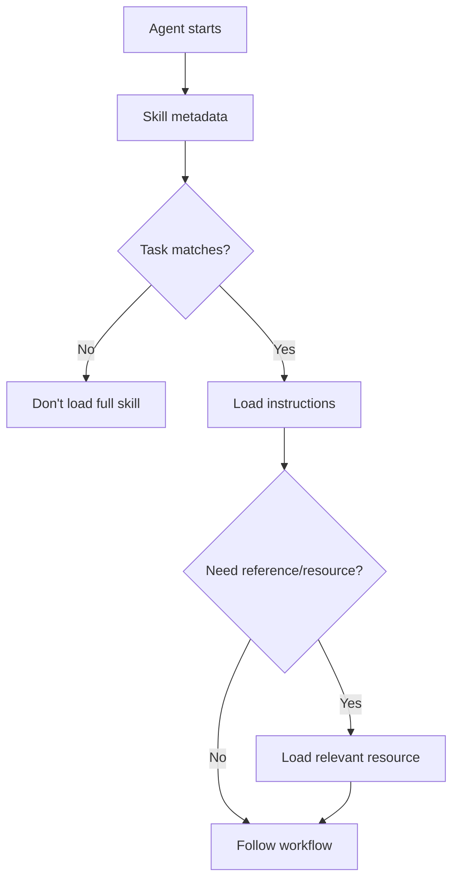
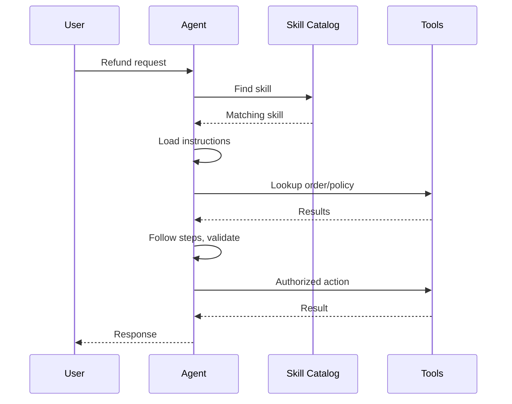

# 03. Agent Skills: Reusable Instructions ও Workflow

## Tool access থাকলেই expertise আসে না

Agent tools পেয়েছে, কিন্তু কোন tool কখন ব্যবহার করবে, কোন order-এ, কী edge case দেখবে, কীভাবে result verify করবে তা জানা নাও থাকতে পারে।

**Tool capability দেয়; Skill usage-এর knowledge/workflow দেয়।** Skill হলো reusable instruction package যা agent-কে নির্দিষ্ট task/domain-এ কাজ করার পদ্ধতি শেখায়। Skill নিজে model নয় এবং instruction alone security enforcement নয়। Package-এ optional reference, assets বা helper scripts থাকতে পারে।

## Tool বনাম Skill

| Tool | Skill |
|---|---|
| Executable capability | Instruction/workflow |
| “Search policy” | Policy search ও evidence evaluation কীভাবে করবে |
| Input/output contract | Steps, best practice, edge case |
| Action চালায় | Action-কে guide করে |

Analogy: Tool রান্নাঘরের যন্ত্র, Skill recipe।

## Skill কখন কাজে আসে?

- Repeatable tasks
- Domain-specific workflow
- Multi-tool sequencing
- Edge-case checklist
- Consistency
- Context-efficient instruction loading

## Skill package example

```text
refund-investigation/
├── SKILL.md
├── references/
│   ├── refund-policy.md
│   └── evidence-checklist.md
├── scripts/
│   └── validate-request.py
└── assets/
    └── response-template.md
```

Possible components:
- SKILL.md: metadata + core instructions
- references: deeper docs/policies
- scripts: deterministic helper code, platform permission সাপেক্ষে
- assets: templates/resources

সব skill-এ script থাকতে হবে এমন নয়।

## Progressive disclosure

সব skill-এর full instructions একসঙ্গে context-এ দিলে token budget নষ্ট হতে পারে। Progressive disclosure-এ:
1. Compact metadata/description দিয়ে skills discoverable।
2. Task relevant হলে full instructions load।
3. প্রয়োজন হলে reference/script/resource on-demand load।



এতে context-এ relevant content আসে; তবে metadata/trigger দুর্বল হলে skill discover নাও হতে পারে।

## Illustrative SKILL.md

এটি generic example, কোনো vendor-এর exact specification নয়।

    ---
    name: refund-investigation
    description: Investigate damaged-item refund requests.
    ---

    # Workflow
    1. Order ID না থাকলে চাইবে।
    2. Order lookup করবে।
    3. Applicable refund policy পড়বে।
    4. Evidence ও eligibility যাচাই করবে।
    5. Missing evidence থাকলে customer-কে চাইবে।
    6. অনুমতি ছাড়া refund করবে না।
    7. High-risk/ambiguous হলে human review।
    8. Action result যাচাই করে তারপর report করবে।

Skill-এর instruction কোনো security boundary নয়। “Refund করতে পারো” লেখা থাকলেও backend permission ছাড়া refund execute হওয়া উচিত নয়।

## Skill loading flow



## Benefits ও trade-offs

Benefits: reusable expertise, consistent workflow, efficient context, maintainability।

Trade-offs: outdated instructions, wrong trigger, conflicting skills, context overhead, unsafe instructions/resources।

Skills-এর version, owner, review ও evaluation দরকার।

## Skill vs Fine-tuning vs Memory

| | Skill | Fine-tuning | Memory |
|---|---|---|---|
| কী | Runtime instructions | Model parameters update | Stored facts/experience |
| Update | Instruction/package | Training | Store update |
| Use | Workflow guidance | Behavior/pattern শেখানো | Future recall |

## Interview drill

- Skill tool-এর replacement কেন নয়?
- সব skill কি context-এ থাকে?
- Malicious skill instruction কীভাবে risk তৈরি করে?
- Skill কি deterministic behavior নিশ্চিত করে?
- Progressive loading context window-কে কীভাবে সাহায্য করে?

**Practice:** Incident-triage skill-এর trigger, inputs, steps, tools, evidence rules, escalation, stop condition ও output format লিখে metadata/core/reference ভাগে সাজাও।

## গভীরে বোঝা: Skill runtime-এ কীভাবে কাজে লাগে?

Skill-কে “আরেকটি tool” ভাবলে ভুল হবে। Tool একটি operation execute করে; Skill agent-কে task সম্পন্ন করার পদ্ধতি শেখায়। উদাহরণস্বরূপ, `search_refund_policy` tool policy document খুঁজে দেয়। Refund-investigation skill বলে কোন order তথ্য আগে আনতে হবে, কোন policy version প্রযোজ্য, কী evidence দরকার, ambiguous হলে কখন থামতে হবে এবং কোন অবস্থায় human review চাইতে হবে। Skill tool invoke করতে পারে, কিন্তু tool নিজে Skill-এর পুরো workflow জানে না।

### Skill-এর structure ও ownership

একটি Skill package-এ core instruction, optional references, scripts ও assets থাকতে পারে। Core instruction সংক্ষিপ্ত ও actionable হওয়া ভালো। বড় policy/reference আলাদা রাখলে দরকারের সময় load করা যায়। Script থাকলে সেটি deterministic validation বা transformation করতে পারে, কিন্তু script execute করার অনুমতি platform/runtime-এর security policy থেকে আসতে হবে। Skill package-এর owner, version, review date ও supported environment রাখা উচিত।

### Progressive disclosure কেন কার্যকর?

ধরা যাক, agent-এর কাছে ৫০টি skill আছে, প্রতিটির ৫,০০০ token instruction। সব একসঙ্গে context-এ দিলে ২৫০,০০০ token খরচ হতে পারে, অথচ বর্তমান task-এ হয়তো একটি skill-ই দরকার। তাই প্রথমে ছোট metadata/description দেখে সম্ভাব্য skill নির্বাচন, তারপর matching skill-এর instruction load, এবং প্রয়োজন হলে নির্দিষ্ট reference load করা হয়। এতে context budget বাঁচে ও irrelevant instruction কমে। তবে skill discovery-র metadata ভুল বা অস্পষ্ট হলে সঠিক skill load নাও হতে পারে।

### Skill কি deterministic?

না। Skill instruction দেয়; LLM সেটি interpret করে। Model ভুল ধাপ বাদ দিতে পারে, instruction conflict হতে পারে, অথবা reference outdated হতে পারে। Determinism দরকার এমন validation, calculation, permission check ও state transition code/service-এ রাখতে হবে। Skill-এর adherence evaluation করতে representative test case, expected tool sequence, forbidden action, missing-evidence behavior ও escalation outcome যাচাই করো।

### Skill injection ও supply-chain risk

Skill package-ও untrusted code/instruction source হতে পারে। কেউ Skill-এ secret exfiltration বা permission bypass নির্দেশনা ঢোকাতে পারে। তাই source review, trusted publisher, version pinning, integrity check, dependency review, script sandboxing, network/file permission restriction এবং staged rollout দরকার। Skill-এর লেখা নির্দেশনা কখনো server-side authorization override করতে পারবে না।

### Skill, Memory, RAG ও Fine-tuning আলাদা কেন?

Skill হলো “কীভাবে কাজ করবে” এমন reusable procedure। Memory হলো নির্দিষ্ট user/session/project সম্পর্কে সংরক্ষিত তথ্য বা অতীত অভিজ্ঞতা। RAG হলো query অনুযায়ী external knowledge retrieve করে context-এ আনা। Fine-tuning model parameter-এ behavior/pattern শেখানোর training পদ্ধতি। একটি agent একই সঙ্গে skill ব্যবহার, memory recall ও RAG retrieval করতে পারে; এগুলো একে অন্যের বিকল্প নয়।

### Interview: “Skill-কে prompt-এ লিখে দিলেই তো হয়, আলাদা package কেন?”

একটি ছোট task-এ prompt-এ instruction দেওয়া যথেষ্ট হতে পারে। কিন্তু একই workflow বারবার, একাধিক agent বা team-এ ব্যবহার হলে আলাদা package maintainability, versioning, ownership, reuse, review ও progressive loading দেয়। Skill package-এ reference ও helper script-ও রাখা যায়। তবে package overhead আছে; অপ্রয়োজনীয় skill architecture তৈরি করলে discovery ও maintenance জটিল হবে।

**Follow-up: “Skill ভুল tool invoke করতে বললে?”** Runtime tool allowlist, schema, authorization ও business validation দিয়ে call reject করবে। Skill guidance, authority নয়। Skill-এর test/evaluation-এ forbidden tool call ও unsafe edge case অন্তর্ভুক্ত করতে হবে।

**Follow-up: “Skill update করলে পুরোনো run কীভাবে reproduce করবে?”** Run metadata-তে skill identifier/version বা immutable content hash, model/version, tool schema version এবং relevant config সংরক্ষণ করো। এতে কোন instruction set দিয়ে সিদ্ধান্ত হয়েছে তা trace করা যায়।

### Practice

একটি deployment skill তৈরি করো: trigger, prerequisites, steps, validation, rollback condition, approval boundary, stop condition ও final report নির্ধারণ করো। কোন ধাপ script হবে, কোনটি tool call, কোনটি model judgment এবং কোনটি human approval, আলাদা করে চিহ্নিত করো।

