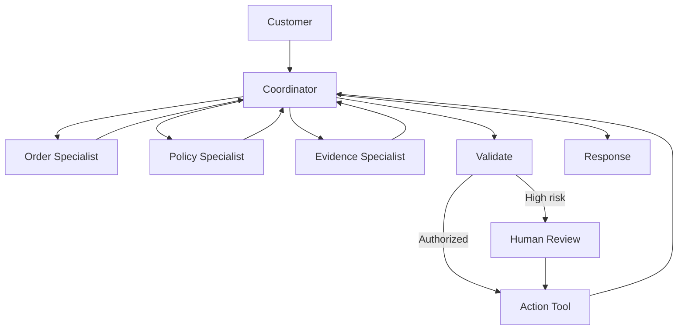
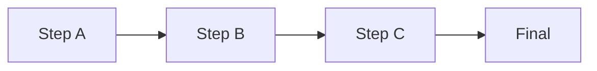
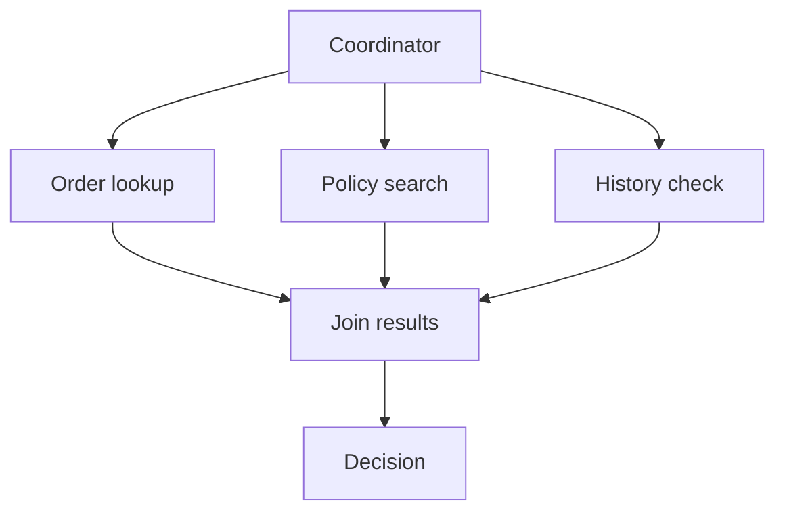
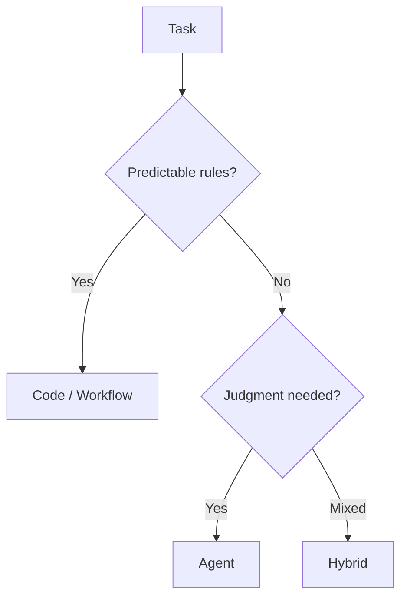

# 04. Multi-Agent System ও Orchestration

## Agent থেকে system

একটি agent-এর tools, instruction ও context বাড়লে decomposition, delegation, coordination ও ownership গুরুত্বপূর্ণ হয়। Multi-agent system একাধিক agent/role-কে একটি task-এর অংশ হিসেবে coordinate করে।

Multi-agent মানে শুধু multiple model calls নয়। Task boundary, interaction contract, context handoff, control ও termination strategy দরকার।

## Coordinator ও specialists: refund example

- Coordinator: request গ্রহণ, decomposition, coordination।
- Order specialist: order details।
- Policy specialist: policy/evidence।
- Resolution: findings মিলিয়ে decision/recommendation।
- Human reviewer: risky বা ambiguous case।

সব role আলাদা agent হওয়া বাধ্যতামূলক নয়। কিছু role code/service/tool দিয়েই বাস্তবায়ন করা যায়।

## Orchestration patterns

### Sequential
এক step-এর output পরের step-এর input। Predictable dependency-তে উপযোগী।

### Parallel
Independent subtasks একসঙ্গে চালানো যায়; latency কমাতে পারে। Partial failure, concurrency ও result merge handle করতে হবে।

### Supervisor
Supervisor tasks assign, results inspect, re-delegate বা finish করতে পারে। Dynamic task-এ useful, তবে bounded loop দরকার।

### Handoff
এক agent responsibility অন্য agent-এর কাছে transfer করে। Task, relevant context, constraints, allowed scope ও output contract দিতে হবে। Handoff control/ownership change; এটি tool call-এর সঙ্গে implement হতে পারে, কিন্তু conceptually আলাদা।

## Delegation contract

Agent-to-agent request-এ থাকা উচিত:
- Goal/task
- Relevant context/evidence
- Constraints
- Allowed scope/tools
- Expected output schema
- Deadline/timeout
- Failure/uncertainty reporting

Example output (illustrative):

    {
      "status": "completed",
      "summary": "Order is eligible for review",
      "evidence": ["order_status", "policy_clause"],
      "needs_human": false,
      "errors": []
    }

## Failure modes

- Context loss at handoff
- Conflicting agent conclusions
- Duplicate work
- Circular delegation
- Unbounded supervisor loop
- Partial failure/timeout
- Permission leakage
- Prompt injection propagation
- Latency/token cost explosion

## Reliability practices

- Clear task boundaries and ownership
- Typed input/output contracts
- Source of truth for shared state
- Timeout, max depth, retry budget
- Idempotency for side effects
- Validate agent outputs
- Parent/child trace IDs
- Least-privilege tool scopes
- Human escalation
- Evaluation against single-agent baseline

## Multi-agent vs deterministic workflow

সব subtask agent হওয়ার দরকার নেই। Stable, rule-based step code/workflow-এ রাখলে predictable; interpretation/judgment-heavy step LLM-এ রাখা যেতে পারে। Hybrid design অনেক ক্ষেত্রে উপযোগী।

## Interview drill

- Multi-agent কীভাবে orchestrate করবে?
- Parallel execution-এ কী failure?
- Handoff বনাম tool call?
- Agent result কীভাবে validate?
- Multi-agent benefit কী metric-এ single-agent baseline-এর চেয়ে প্রমাণ করবে?

**Practice:** একই refund workflow single-agent এবং coordinator + two specialists design করো। ২০টি test case-এ success, correctness, latency, cost, tool error ও human handoff তুলনা করো।

## গভীরে বোঝা: Multi-agent system-এর আসল মূল্য কোথায়?

একটি বড় prompt-কে কয়েকটি agent-এ ভাগ করলেই system উন্নত হয় না। Multi-agent architecture-এর মূল্য আসে যখন task সত্যিই আলাদা expertise, independent parallel work, isolation বা clear ownership থেকে লাভ পায়। অন্যথায় extra model calls, context handoff, coordination logic ও failure surface বাড়ে। তাই প্রথমে single-agent বা deterministic workflow baseline তৈরি করে তারপর multi-agent-এর measurable benefit প্রমাণ করা উচিত।

### Decomposition: কাজ কীভাবে ভাগ করবে?

ভালো decomposition-এ subtask-এর input, output, owner ও dependency পরিষ্কার। যেমন refund workflow-এ Order Agent শুধু order facts দেবে; Policy Agent applicable policy ও clause reference দেবে; Coordinator evidence মিলিয়ে সিদ্ধান্তের প্রস্তাব করবে। Policy Agent যেন নিজে refund execute করতে না পারে, কারণ তার কাজ policy interpretation। Responsibility ছোট ও সীমিত হলে privilege এবং ভুলের প্রভাব কমে।

খারাপ decomposition: “এক agent সব research করবে, আরেক agent সব validate করবে” কিন্তু validate বলতে কী, expected output কী, conflict হলে কে সিদ্ধান্ত নেবে কিছুই নির্দিষ্ট নয়। এমন system-এ agent-রা একই কাজ করে, contradictory result দেয় এবং coordinator অস্পষ্ট output জোড়া লাগায়।

### Orchestration pattern বেছে নেওয়া

- **Sequential:** B-এর আগে A লাগবেই। উদাহরণ: order identity যাচাই → eligibility check → refund request। Dependency পরিষ্কার, কিন্তু latency যোগ হয়।
- **Parallel:** subtask স্বাধীন। যেমন order facts ও policy document একই সময়ে পড়া। Join point-এ timeout/partial result/conflict handle করতে হবে।
- **Supervisor:** একটি coordinator dynamic ভাবে কাজ assign ও result inspect করে। Complex task-এ flexible, কিন্তু loop, cost ও termination guard দরকার।
- **Handoff:** current owner control অন্য agent-কে দেয়। Handoff-এর সঙ্গে context, goal, constraints, completed work ও remaining task দিতে হবে।

সব workflow-এ একই pattern দরকার হয় না; hybrid orchestration সাধারণ।

### Context handoff: কী পাঠানো উচিত?

পুরো conversation transcript child agent-কে পাঠালে context cost ও irrelevant instruction বাড়ে। আবার শুধু “এটা করো” পাঠালে গুরুত্বপূর্ণ constraint হারায়। Structured handoff-এ task, minimum relevant facts, evidence/source, user/tenant scope, constraints, allowed tools, expected schema, deadline, confidence/uncertainty এবং escalation condition রাখো। Child agent-কে parent-এর private reasoning বা অপ্রয়োজনীয় sensitive data পাঠানোর দরকার নেই।

### Shared state ও consistency

দুই agent একই order state আলাদা context-এ ধরে রাখলে stale information থেকে conflicting action হতে পারে। Shared state-এর authoritative source নির্দিষ্ট করো; version/updated_at রাখো; write operation-এ optimistic concurrency বা transaction boundary বিবেচনা করো। Agent message-কে authoritative database state ধরে নিও না। Side effect-এর আগে current state পুনরায় যাচাই করো।

### Partial failure, retry ও cancellation

Parallel flow-এ একটি specialist timeout করলেও অন্যগুলো result দিতে পারে। System policy অনুযায়ী partial result গ্রহণ, retry, fallback বা human escalation বেছে নিতে হবে। Retry bounded ও idempotency-aware হওয়া দরকার। Parent task cancel হলে child task-গুলো cancel/stop হবে কি না নির্ধারণ করো; নইলে abandoned কাজ খরচ ও side effect তৈরি করতে পারে। Deadline, max depth, max agent calls ও token/cost budget নির্দিষ্ট করো।

### Multi-agent-এর ফল কীভাবে মাপবে?

একই representative test set-এ single-agent baseline ও multi-agent version তুলনা করো। Metric: task success, factual/decision correctness, policy violation, tool-call accuracy, human escalation quality, p50/p95 latency, token/API cost, timeout/partial failure rate। শুধু “উত্তর ভালো লাগছে” যথেষ্ট নয়। Multi-agent যদি সামান্য accuracy বাড়িয়ে latency ও cost বহুগুণ বাড়ায়, সেটি product requirement অনুযায়ী গ্রহণযোগ্য কি না বিচার করতে হবে।

### Interview: “কখন multi-agent ব্যবহার করবে না?”

যখন workflow ছোট, sequential ও predictable; একটি agent বা সাধারণ code pipeline সহজে কাজটি করতে পারে; subtask-গুলোর dependency বেশি; shared state coordination কঠিন; অথবা latency/cost budget tight। Multi-agent-এর coordination overhead benefit-এর চেয়ে বেশি হলে ব্যবহার করব না। আগে baseline, পরে evaluation দিয়ে প্রয়োজন প্রমাণ করব।

**Follow-up: “দুই agent পরস্পরবিরোধী উত্তর দিলে?”** Source/evidence ও freshness যাচাই, output schema-তে confidence নয় বরং evidence provenance চাওয়া, conflict policy প্রয়োগ, authoritative system lookup এবং high-impact ambiguity-তে human review। Coordinator শুধু majority vote করে সিদ্ধান্ত নেবে না, কারণ দুই agent একই ভুল source ব্যবহার করতে পারে।

**Follow-up: “Parallel agent কি সবসময় দ্রুত?”** না। Parallelism wall-clock time কমাতে পারে, কিন্তু startup/scheduling overhead, rate limit, downstream contention এবং slowest branch-এর অপেক্ষা যোগ হয়। p95 latency ও cost দিয়ে মাপতে হবে।

### Practice: ২-agent refund design

একটি Order Specialist এবং Policy Specialist parallel চালাও। তাদের output schema, evidence reference, timeout, partial failure behavior এবং conflict resolution লিখো। Coordinator কোন তথ্য authoritative service থেকে পুনরায় যাচাই করবে তা দেখাও। শেষে একই ২০টি test case single-agent baseline-এর সঙ্গে তুলনা করো।

