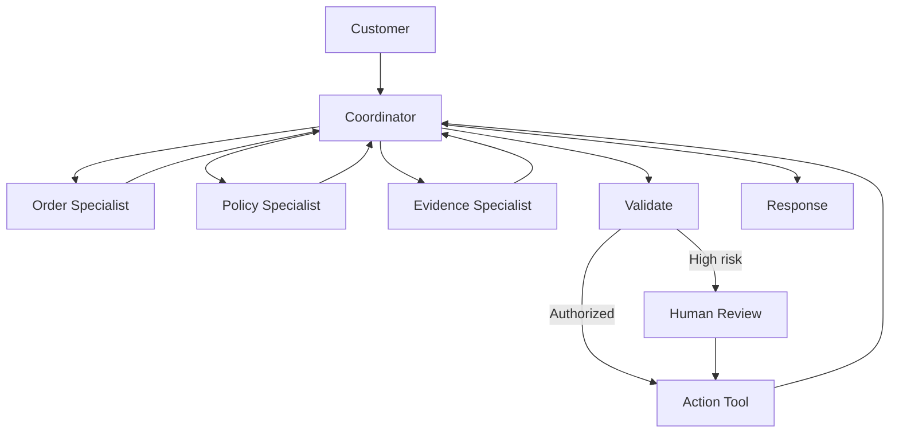
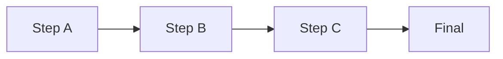
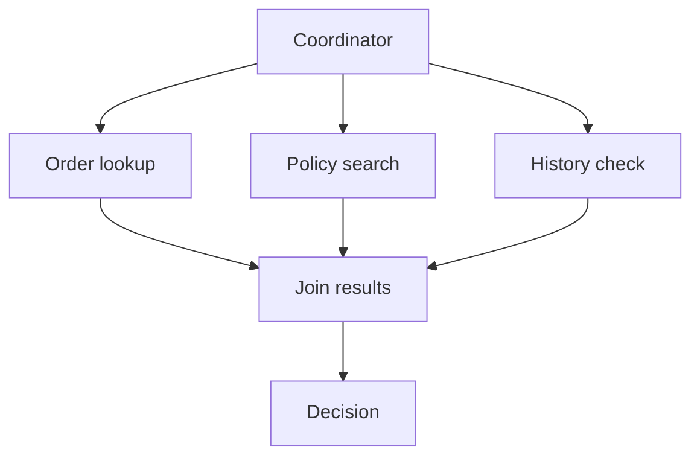
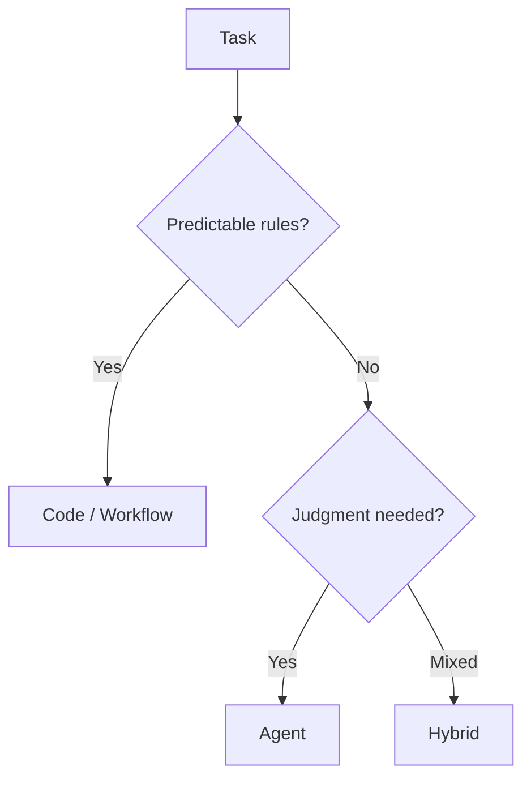

# 04. Multi-Agent System ও Orchestration

## Agent থেকে system

একটি agent-এর tools, instruction ও context বাড়লে decomposition, delegation, coordination ও ownership গুরুত্বপূর্ণ হয়। Multi-agent system একাধিক agent/role-কে একটি task-এর অংশ হিসেবে coordinate করে।

Multi-agent মানে শুধু multiple model calls নয়। Task boundary, interaction contract, context handoff, control ও termination strategy দরকার।

## Coordinator ও specialists: refund example

- Coordinator: request গ্রহণ, decomposition, coordination।
- Order specialist: order details।
- Policy specialist: policy/evidence।
- Resolution: findings মিলিয়ে decision/recommendation।
- Human reviewer: risky বা ambiguous case।

সব role আলাদা agent হওয়া বাধ্যতামূলক নয়। কিছু role code/service/tool দিয়েই বাস্তবায়ন করা যায়।

## Orchestration patterns

### Sequential
এক step-এর output পরের step-এর input। Predictable dependency-তে উপযোগী।

### Parallel
Independent subtasks একসঙ্গে চালানো যায়; latency কমাতে পারে। Partial failure, concurrency ও result merge handle করতে হবে।

### Supervisor
Supervisor tasks assign, results inspect, re-delegate বা finish করতে পারে। Dynamic task-এ useful, তবে bounded loop দরকার।

### Handoff
এক agent responsibility অন্য agent-এর কাছে transfer করে। Task, relevant context, constraints, allowed scope ও output contract দিতে হবে। Handoff control/ownership change; এটি tool call-এর সঙ্গে implement হতে পারে, কিন্তু conceptually আলাদা।

## Delegation contract

Agent-to-agent request-এ থাকা উচিত:
- Goal/task
- Relevant context/evidence
- Constraints
- Allowed scope/tools
- Expected output schema
- Deadline/timeout
- Failure/uncertainty reporting

Example output (illustrative):

    {
      "status": "completed",
      "summary": "Order is eligible for review",
      "evidence": ["order_status", "policy_clause"],
      "needs_human": false,
      "errors": []
    }

## Failure modes

- Context loss at handoff
- Conflicting agent conclusions
- Duplicate work
- Circular delegation
- Unbounded supervisor loop
- Partial failure/timeout
- Permission leakage
- Prompt injection propagation
- Latency/token cost explosion

## Reliability practices

- Clear task boundaries and ownership
- Typed input/output contracts
- Source of truth for shared state
- Timeout, max depth, retry budget
- Idempotency for side effects
- Validate agent outputs
- Parent/child trace IDs
- Least-privilege tool scopes
- Human escalation
- Evaluation against single-agent baseline

## Multi-agent vs deterministic workflow

সব subtask agent হওয়ার দরকার নেই। Stable, rule-based step code/workflow-এ রাখলে predictable; interpretation/judgment-heavy step LLM-এ রাখা যেতে পারে। Hybrid design অনেক ক্ষেত্রে উপযোগী।

## Interview drill

- Multi-agent কীভাবে orchestrate করবে?
- Parallel execution-এ কী failure?
- Handoff বনাম tool call?
- Agent result কীভাবে validate?
- Multi-agent benefit কী metric-এ single-agent baseline-এর চেয়ে প্রমাণ করবে?

**Practice:** একই refund workflow single-agent এবং coordinator + two specialists design করো। ২০টি test case-এ success, correctness, latency, cost, tool error ও human handoff তুলনা করো।