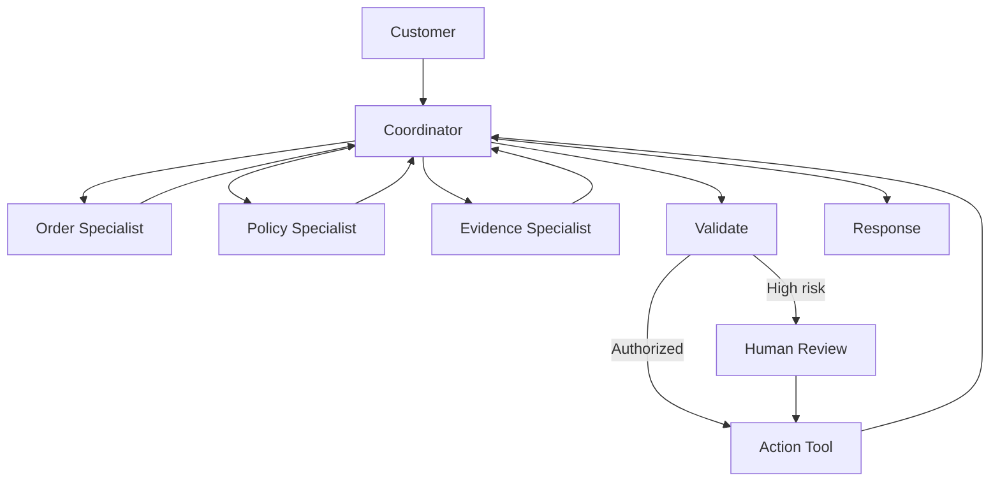
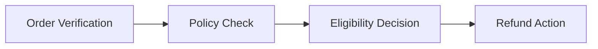
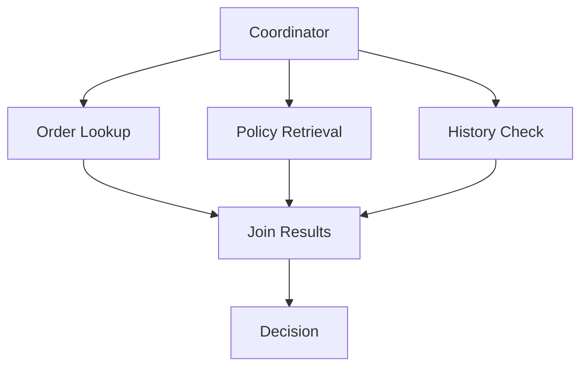
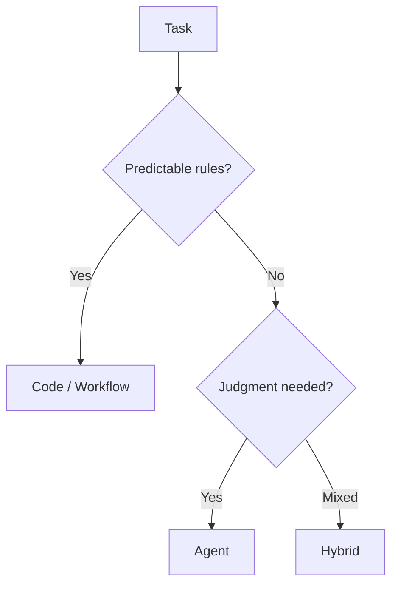

# 04. Multi-Agent System ও Orchestration

## 1. একাধিক Agent থাকলেই কি system তৈরি হয়ে যায়?

একটি agent যখন order lookup, policy search ও refund request চালায়, তখন তার কাজের পরিধি সীমিত হতে পারে। কিন্তু system বড় হলে task-কে ভাগ করতে হয়, আলাদা role-কে দায়িত্ব দিতে হয়, তাদের output সংগ্রহ করতে হয় এবং conflicting result resolve করতে হয়।

ধরা যাক একটি refund request-এর জন্য order details, applicable policy এবং damage evidence যাচাই করা দরকার। এই কাজগুলোর কিছু independent, কিছু dependent। Order details না পেলে নির্দিষ্ট order-এর eligibility যাচাই করা যাবে না। আবার policy document search এবং order lookup একই সময়ে করা সম্ভব হতে পারে, যদি policy query করার জন্য প্রয়োজনীয় product/country information আগে থেকেই জানা থাকে।

এখানে **Multi-Agent Orchestration** হলো একাধিক agent বা agent-like role-এর কাজ ভাগ করা, execution coordinate করা, context ও result handoff করা এবং overall task complete বা stop করানোর ব্যবস্থা।

Multi-agent মানে শুধু multiple model calls নয়। একটি agent একাধিকবার model call করতে পারে, তবুও সেটি single-agent system হতে পারে। Multi-agent architecture-এর জন্য আলাদা responsibility, interaction contract, context handoff, control ও termination strategy দরকার।

## 2. Coordinator ও Specialists: Refund example

একটি illustrative design-এ role-গুলো এমন হতে পারে:

- **Coordinator:** user request গ্রহণ, task decomposition, assignment, result collection ও workflow control।
- **Order specialist:** order details retrieve ও verify।
- **Policy specialist:** applicable policy version ও relevant clause খুঁজে বের করা।
- **Evidence specialist:** supplied photo/document-এর relevant evidence summarize করা।
- **Resolution role:** findings মিলিয়ে next step প্রস্তাব করা।
- **Human reviewer:** high-risk বা ambiguous case approve/reject করা।



এই diagram একটি possible decomposition, universal template নয়। Order lookup একটি deterministic API হতে পারে, policy retrieval একটি search service হতে পারে, evidence analysis একটি classifier হতে পারে। প্রতিটি role-কে আলাদা LLM agent বানাতে হবে এমন নয়।

Coordinator-এর কাজ হলো workflow control: কে কোন subtask করবে, dependency কী, কখন result join হবে, timeout হলে কী হবে এবং কখন stop করতে হবে। Coordinator-কে order, policy বা payment-এর business owner বানানো উচিত নয়। সংশ্লিষ্ট domain-এর authoritative data ও operation সংশ্লিষ্ট service-এর কাছেই থাকবে।

## 3. Decomposition: কাজ কীভাবে ভাগ করবে?

Multi-agent design-এর সবচেয়ে গুরুত্বপূর্ণ সিদ্ধান্ত হলো task boundary। শুধু বড় task-কে সমান সংখ্যক ছোট prompt-এ ভাগ করলে ভালো decomposition হয় না। প্রতিটি subtask-এর input, output, owner, dependency এবং completion condition স্পষ্ট হতে হবে।

### ভালো decomposition

Refund workflow-এ:

- Order Specialist শুধু verified order facts দেবে।
- Policy Specialist applicable policy version ও clause reference দেবে।
- Evidence Specialist photo থেকে observable evidence summarize করবে, কিন্তু order ownership বা refund eligibility decide করবে না।
- Coordinator evidence ও result একত্র করবে এবং missing/conflicting information শনাক্ত করবে।
- Refund service নিজের business invariant ও permission যাচাই করে action execute করবে।

এখানে প্রতিটি role-এর সীমা আছে। Policy Specialist নিজে refund execute করতে পারবে না, কারণ তার responsibility policy retrieval/interpretation। এতে privilege ও ভুলের impact সীমিত হয়।

### খারাপ decomposition

ধরা যাক task ভাগ করা হলো: “এক agent research করবে, আরেক agent validate করবে।” কিন্তু validate বলতে কী, কোন source authoritative, output schema কী, conflict হলে কে final decision নেবে, কিছুই বলা হলো না। তখন agent-রা একই কাজ করে, contradictory result দেয় এবং coordinator অস্পষ্ট output জোড়া লাগাতে বাধ্য হয়।

ভালো decomposition-এ প্রতিটি subtask-এর contract এমন হওয়া উচিত, যাতে অন্য component বুঝতে পারে কাজটি complete হয়েছে কি না এবং result ব্যবহারযোগ্য কি না।

## 4. Orchestration pattern: Agent-রা কীভাবে কাজ ভাগ করে?

একটি system-এ একাধিক pattern একসঙ্গে থাকতে পারে। Pattern বেছে নাও dependency ও task behavior দেখে।

### 4.1 Sequential orchestration

এক step-এর output পরের step-এর input। যখন dependency বাধ্যতামূলক, তখন sequential flow উপযোগী।



যেমন order identity যাচাইয়ের আগে refund request পাঠানো যাবে না। Sequential flow সহজে trace করা যায়, কিন্তু প্রতিটি step-এর latency যোগ হয়।

### 4.2 Parallel orchestration

যখন subtask-গুলো একে অপরের output-এর ওপর নির্ভরশীল নয়, তখন একই সময়ে চালানো যায়।



উদাহরণ: Customer-এর country ও product category জানা থাকলে order details, relevant policy document এবং customer history parallel retrieve করা যেতে পারে।

Parallelism wall-clock latency কমাতে পারে, কিন্তু free নয়। Scheduling overhead, downstream rate limit, resource contention এবং join point-এ slowest required branch-এর জন্য অপেক্ষা করতে হয়। একটি branch fail করলে partial result নিয়ে proceed করবে, retry করবে, নাকি human review করবে, তা আগে নির্ধারণ করো।

### 4.3 Supervisor pattern

Supervisor একটি high-level controller হিসেবে task assign করে, result inspect করে, প্রয়োজন হলে re-delegate করে বা কাজ শেষ করে। Dynamic task-এ এটি উপকারী হতে পারে।

কিন্তু supervisor যদি বারবার “আরও research করো” বা “আরেকবার validate করো” বলে, loop চলতেই পারে। তাই max delegation depth, max agent calls, deadline, token/cost budget ও termination criteria দরকার।

### 4.4 Handoff pattern

Handoff-এ একটি agent task/control অন্য agent-এর কাছে transfer করে। এটি শুধু message পাঠানো নয়। Handoff-এর পরে কে task-এর owner, sender আবার control পাবে কি না, receiver কী output দেবে এবং timeout হলে কী হবে, তা নির্দিষ্ট করতে হয়।

Handoff একটি tool/message mechanism দিয়ে implement হতে পারে, কিন্তু conceptually এটি responsibility/control transfer।

## 5. Delegation contract: Agent-কে কী পাঠাবে?

Parent agent যদি child agent-কে শুধু বলে “এই order check করো”, child-এর কাছে হয়তো order ID নেই, customer scope নেই, policy version নেই, অথবা expected output কী তা পরিষ্কার নয়।

একটি delegation contract-এ সাধারণত থাকবে:

- **Goal/task:** ঠিক কী deliver করতে হবে?
- **Relevant context:** প্রয়োজনীয় facts, identifiers ও previous results।
- **Evidence/provenance:** তথ্য কোথা থেকে এসেছে?
- **Constraints:** কোন policy, time range বা business condition মানতে হবে?
- **Allowed scope/tools:** কোন data ও operation access করা যাবে?
- **Expected output schema:** result কী format-এ ফেরত আসবে?
- **Deadline/timeout:** কতক্ষণ অপেক্ষা করবে?
- **Failure/uncertainty reporting:** কী না জানলে বা fail করলে কীভাবে জানাবে?
- **Completion condition:** কোন evidence পেলে task complete?

Illustrative output:

```json
{
  "status": "completed",
  "summary": "Order is eligible for policy review",
  "facts": {
    "order_status": "delivered",
    "delivery_date": "2026-11-20"
  },
  "evidence": [
    {
      "source": "order-service",
      "record_id": "O-42"
    }
  ],
  "uncertainties": [],
  "needs_human": false,
  "errors": []
}
```

এটি শুধু উদাহরণ। Real contract-এ schema version, tenant scope, trace ID, timestamps এবং error taxonomy-ও থাকতে পারে।

## 6. Context handoff: বেশি পাঠালেও সমস্যা, কম পাঠালেও সমস্যা

Parent agent-এর পুরো conversation transcript child agent-কে পাঠালে context cost ও irrelevant instruction বাড়ে। আবার শুধু task name পাঠালে গুরুত্বপূর্ণ constraint হারিয়ে যায়।

তাই handoff-এ **minimum sufficient context** পাঠাও:
- কাজের goal;
- relevant facts ও exact identifiers;
- evidence/source reference;
- applicable constraints;
- completed ও pending steps;
- allowed tools/scope;
- expected output format;
- uncertainty ও deadline।

Sensitive বা অপ্রয়োজনীয় personal data পাঠানোর দরকার নেই। Child agent-এর নিজস্ব permission scope থাকতে হবে। Parent-এর broad credential বা hidden instruction কপি করে দেওয়াই context handoff নয়।

## 7. Shared state ও ownership: একই data-র দুই owner হলে কী হয়?

ধরো Order Specialist এবং Coordinator দুজনেই নিজেদের context-এ order status ধরে রেখেছে। Order service-এ status update হয়ে গেল, কিন্তু Coordinator-এর cached state পুরনো। Coordinator যদি stale status ধরে refund initiate করে, system ভুল সিদ্ধান্ত নিতে পারে।

সমাধানের জন্য:
- কোন service/state authoritative তা নির্দিষ্ট করো।
- Shared state-এর owner নির্ধারণ করো।
- Version বা updated timestamp রাখো।
- Write operation-এ optimistic concurrency/transaction boundary বিবেচনা করো।
- Side-effecting action-এর আগে current state পুনরায় verify করো।
- Agent message-কে authoritative database state ধরে নিও না।

একাধিক agent একই record update করলে race condition, lost update বা conflicting state তৈরি হতে পারে। তাই state ownership agent-এর নাম দিয়ে নয়, domain/service boundary দিয়ে নির্ধারণ করাই ভালো।

## 8. Failure handling: একটি specialist ব্যর্থ হলে কী হবে?

Parallel flow-এ Order Specialist result দিল, কিন্তু Policy Specialist timeout করল। Coordinator কী করবে?

সম্ভাব্য option:
- Policy service-এ bounded retry।
- Cached policy ব্যবহার, যদি freshness/version নিশ্চিত হয়।
- Partial result দিয়ে safe response, যদি business policy অনুমতি দেয়।
- Refund action বন্ধ রেখে customer-কে জানানো।
- Human review-এ escalate।

কোন option সঠিক তা risk ও business requirement নির্ধারণ করবে। “একটি agent fail করেছে, তাই আবার call করো” যথেষ্ট recovery strategy নয়।

### Retry ও idempotency

Read-only lookup retry করা সাধারণত তুলনামূলক নিরাপদ। Side-effecting action-এর retry idempotency-aware হতে হবে। একই refund action দুইবার execute হওয়া ঠেকাতে idempotency key এবং status reconciliation দরকার।

### Cancellation

Parent task cancel হলে child agent-দের কাজও cancel হবে কি না নির্ধারণ করো। নইলে abandoned task background-এ চলতে থেকে cost, load বা side effect তৈরি করতে পারে। Cancellation cooperative হতে পারে; already committed transaction reverse করতে আলাদা compensation লাগতে পারে।

### Bounded execution

প্রতিটি workflow-এ deadline, max agent calls, max delegation depth, retry budget এবং token/cost budget থাকা দরকার। Runtime এগুলো enforce করবে।

## 9. Multi-agent security: Permission boundary যেন handoff-এ হারিয়ে না যায়

একটি agent অন্য agent-কে task দিলেই receiver parent-এর সব permission পেয়ে যায় না। প্রত্যেক tool call-এ caller identity, task scope ও resource-level authorization enforce করতে হবে।

উদাহরণ:
- Order Specialist: নির্দিষ্ট customer-এর order read-only access।
- Policy Specialist: versioned policy read access।
- Evidence Specialist: supplied evidence object read access।
- Refund Executor: narrow refund permission, amount limit ও approval requirement।

Agent-to-agent message-ও untrusted input হতে পারে। Parent agent ভুল বা malicious identifier পাঠাতে পারে; receiver-কে input validate করতে হবে। Prompt-এ “শুধু এই order দেখবে” লেখা backend authorization-এর বিকল্প নয়।

## 10. Multi-agent বনাম deterministic workflow: সব step agent হওয়া দরকার নেই

Stable, rule-based step code বা workflow engine-এ রাখলে behavior predictable ও testable হয়। Interpretation/judgment-heavy step-এ LLM agent কাজে লাগতে পারে।



Refund amount calculation, permission check, state transition, idempotency ও transaction execution deterministic service-এ রাখা উচিত। User-এর অস্পষ্ট complaint বোঝা বা evidence summarize করা agent-এর কাজ হতে পারে। Hybrid architecture অনেক সময় সবচেয়ে বাস্তবসম্মত।

## 11. Multi-agent-এর ফল কীভাবে মাপবে?

একই representative test set-এ single-agent baseline এবং multi-agent version তুলনা করো। Metric হতে পারে:

- Task success rate
- Factual/decision correctness
- Policy violation rate
- Tool-call accuracy
- Human escalation quality
- p50/p95 end-to-end latency
- Token ও API cost per successful task
- Timeout/partial failure rate
- Duplicate side-effect rate
- Debugging ও maintenance effort

শুধু “উত্তর ভালো লাগছে” যথেষ্ট নয়। Multi-agent যদি সামান্য accuracy বাড়িয়ে latency ও cost বহুগুণ বাড়ায়, product requirement অনুযায়ী সেটি গ্রহণযোগ্য কি না বিচার করতে হবে।

## 12. Interview: Multi-Agent Orchestration

### Q1. Multi-agent system কীভাবে orchestrate করবে?

প্রথমে task decomposition ও agent boundary নির্ধারণ করব। তারপর dependency অনুযায়ী sequential/parallel/supervisor/handoff pattern বেছে নেব। প্রতিটি subtask-এর typed input/output contract, state owner, timeout, retry budget ও permission scope থাকবে। Coordinator task assignment, result collection, conflict handling ও termination পরিচালনা করবে। Side-effecting action authoritative service-এর মাধ্যমে execute হবে।

### Q2. Parallel execution-এ কী failure হতে পারে?

Partial failure, timeout, rate limit, resource contention, stale data, duplicate action এবং join conflict। সব task parallel করা যাবে না; dependency graph দরকার। Join point-এ required result missing হলে system কী করবে, সেটি নির্দিষ্ট করতে হবে। Side effect idempotency ও explicit ownership ছাড়া parallel করা উচিত নয়।

### Q3. Handoff ও Tool call-এর পার্থক্য কী?

Tool call একটি capability invoke করে। Handoff হলো task/control অন্য agent বা role-এর কাছে transfer করা। Handoff implement করতে message বা tool mechanism লাগতে পারে, কিন্তু conceptually ownership, context ও expected output transfer হয়। একটি tool call সবসময় agent responsibility transfer করে না।

### Q4. Agent result কীভাবে validate করবে?

Output schema, required fields, source/provenance, timestamp, scope ও business invariant validate করব। High-impact decision-এর জন্য authoritative service থেকে fact re-check করব। Confidence score একা যথেষ্ট নয়। Conflicting বা incomplete result হলে action pause করে clarification বা human review নেব।

### Q5. Multi-agent benefit কীভাবে single-agent baseline-এর চেয়ে প্রমাণ করবে?

একই task distribution ও test set-এ task success, correctness, policy violation, tool accuracy, p50/p95 latency, cost, partial failure ও human escalation তুলনা করব। Maintenance ও observability overhead-ও বিবেচনা করব। Measurable benefit না থাকলে single-agent বা modular deterministic workflow রাখব।

### Q6. কখন multi-agent ব্যবহার করবে না?

Workflow ছোট, sequential ও predictable হলে; subtask dependency বেশি হলে; shared state coordination কঠিন হলে; latency/cost budget tight হলে; অথবা single agent ও modular tools দিয়ে কাজ ভালোভাবে হলে multi-agent ব্যবহার করব না। Coordination overhead benefit-এর চেয়ে বেশি হলে এটি unnecessary complexity।

### Q7. দুই agent পরস্পরবিরোধী result দিলে কী করবে?

প্রথমে source, evidence, freshness ও scope যাচাই করব। Authoritative domain service বা official policy source দিয়ে conflict resolve করব। Majority vote যথেষ্ট নয়, কারণ দুই agent একই ভুল source ব্যবহার করতে পারে। High-impact ambiguity unresolved থাকলে human review-এ পাঠাব।

### Q8. Parallel agent কি সবসময় দ্রুত?

না। Parallelism wall-clock time কমাতে পারে, কিন্তু scheduling overhead, rate limit, downstream contention এবং slowest required branch-এর অপেক্ষা যোগ হয়। p50/p95 latency ও cost per successful task দিয়ে মাপতে হবে।

## 13. Practice: Two-specialist refund workflow

একটি Coordinator, Order Specialist এবং Policy Specialist দিয়ে refund investigation design করো। Order lookup ও policy retrieval parallel চলতে পারে কি না, কোন input আগে জানা দরকার তা নির্ধারণ করো।

প্রতিটি specialist-এর জন্য লিখবে:
- Responsibility ও non-responsibility
- Input/output schema
- Evidence/source reference
- Permission scope
- Timeout ও retry
- Failure/uncertainty behavior
- State ownership

Coordinator-এর জন্য লিখবে:
- Dependency graph
- Join condition
- Conflict resolution
- Partial failure policy
- Human escalation
- Max calls/depth/deadline

তারপর একই ২০টি test case single-agent baseline-এর সঙ্গে তুলনা করো। Success, correctness, policy violation, latency, cost ও failure recovery মাপো। শেষে ব্যাখ্যা করো, কোন measurable result পেলে multi-agent design production-এ গ্রহণ করবে।
