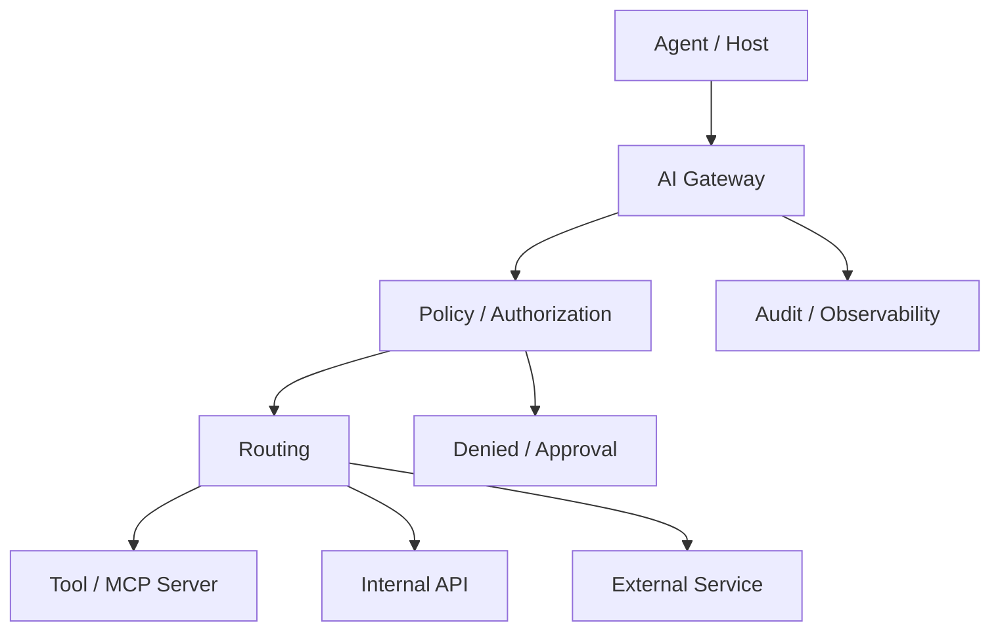
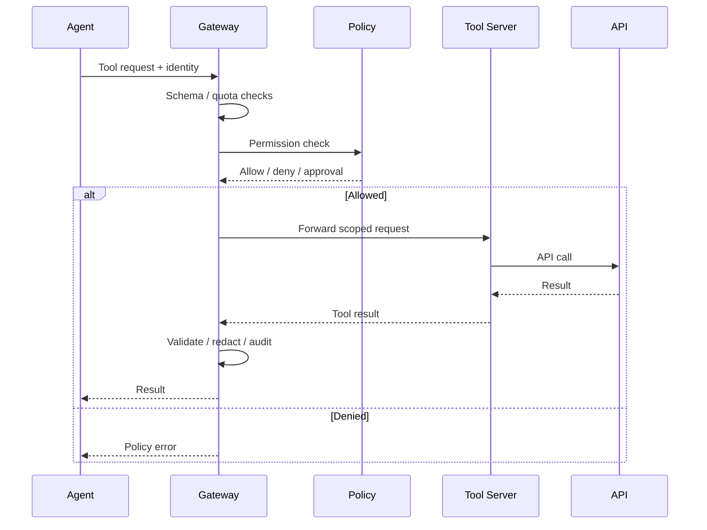

# 05. AI Gateway: Agent-এর Tool Access-এর মধ্যবর্তী Layer

## Gateway কেন?

একাধিক agent/tool/service থাকলে প্রত্যেক agent-এ credential, policy, rate limit, routing ও logging আলাদাভাবে implement করলে inconsistency এবং security risk বাড়ে।

AI Gateway হলো agent ও tools/services-এর মধ্যে একটি intermediary layer, যা access control, routing, credential management, policy, quota ও observability centralize করতে পারে। সব architecture-এ gateway আবশ্যক নয়।

## Architecture

## Common responsibilities

- **Tool catalog/discovery:** tools metadata, filtering, availability।
- **Authentication/credentials:** token/credential handling; secret exposure কমানো।
- **Authorization:** identity, role, scope, resource ও action check।
- **Policy enforcement:** approval, amount/risk limits, environment restrictions।
- **Routing:** request সঠিক server/service-এ পাঠানো।
- **Rate limit/quota:** user/agent/tool অনুযায়ী request ও concurrency limits।
- **Validation:** input/output schema, response limits।
- **Observability:** trace, latency, status, error, policy decision, cost।
- **Governance:** allowlist, review, policy updates, access audit।

সব responsibility একটি gateway-তেই থাকবে এমন নয়; design অনুযায়ী distributed হতে পারে।

## Request flow

## Centralized policy কেন?

Refund example: Agent 5000 টাকা refund request করল, অথচ order-এর refundable amount 500। Prompt instruction model-কে guide করে; Gateway/business service trusted server-side validation দিয়ে request reject করতে পারে।

Checks:
- User/tenant identity
- Agent identity
- Tool/action permission
- Resource ownership
- Amount limit
- Approval status
- Rate limit
- Risk/environment

## Gateway বনাম MCP server

| MCP Server | AI Gateway |
|---|---|
| Capability expose/implement করে | Access/routing/control intermediary |
| Tools/resources/prompts serve করে | Policy, auth, quota, credential, audit |
| Domain integration endpoint | একাধিক tools/server-এর সামনে layer হতে পারে |

Gateway MCP server-এর সামনে বসতে পারে, MCP-compatible request route করতে পারে, বা direct API manage করতে পারে। MCP এবং Gateway এক জিনিস নয়।

## Gateway ছাড়াও security সম্ভব

Application, tool server ও downstream service authorization implement করতে পারে। Gateway consistent central control দিতে পারে, কিন্তু gateway itself failure/misconfiguration-এর source।

Defense in depth: gateway check-এর পাশাপাশি downstream business API resource-level permission enforce করবে, যাতে gateway bypass হলেও unauthorized action reject হয়।

## Reliability ও failure

- Gateway outage: tool access unavailable।
- Policy service outage: fail-open/fail-closed behavior risk অনুযায়ী।
- Timeout: bounded timeout, circuit breaker।
- Retry: idempotency-aware।
- Credential compromise: scope/rotation/audit।
- Log leak: sensitive input/output redact।
- Huge output: filter/response cap।
- Tool abuse: rate limit/anomaly detection।

High-impact operation-এ policy failure হলে fail-closed সাধারণত safer; low-risk read-only operation-এর behavior requirements অনুযায়ী।

## Interview drill

- Gateway কেন?
- Gateway authorization-এর পাশাপাশি downstream auth কেন?
- Gateway ও MCP server-এর difference?
- Gateway outage হলে কী করবে?
- Logging-এ কী রাখবে, কী redact করবে?

**Practice:** Refund gateway policy লিখো: read/write scopes, refund limit, approval threshold, credential scope, rate limit, audit fields ও outage behavior।