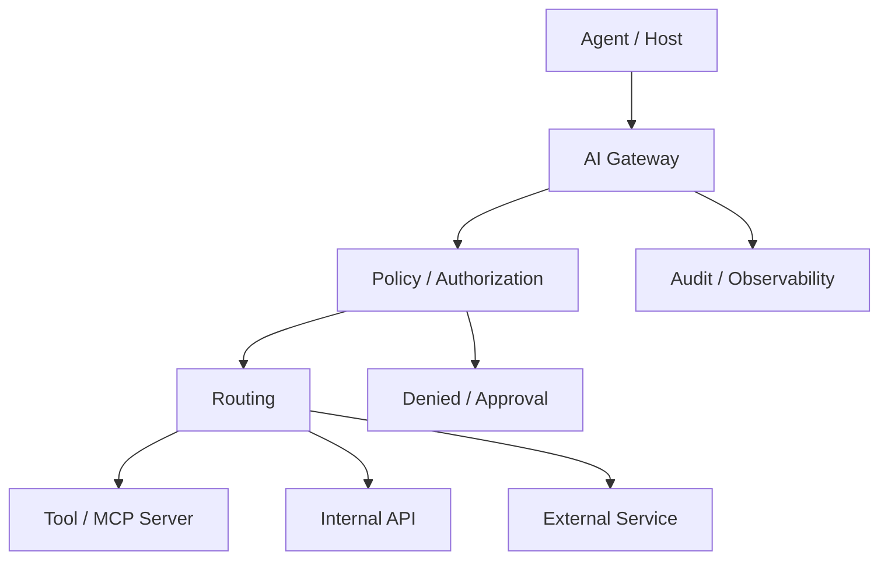
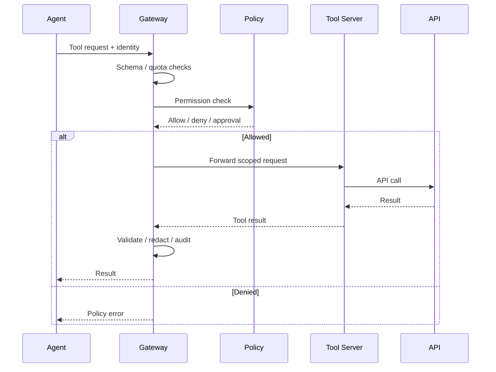

# 05. AI Gateway: Agent-এর Tool Access-এর মধ্যবর্তী Layer

## Gateway কেন?

একাধিক agent/tool/service থাকলে প্রত্যেক agent-এ credential, policy, rate limit, routing ও logging আলাদাভাবে implement করলে inconsistency এবং security risk বাড়ে।

AI Gateway হলো agent ও tools/services-এর মধ্যে একটি intermediary layer, যা access control, routing, credential management, policy, quota ও observability centralize করতে পারে। সব architecture-এ gateway আবশ্যক নয়।

## Architecture

## Common responsibilities

- **Tool catalog/discovery:** tools metadata, filtering, availability।
- **Authentication/credentials:** token/credential handling; secret exposure কমানো।
- **Authorization:** identity, role, scope, resource ও action check।
- **Policy enforcement:** approval, amount/risk limits, environment restrictions।
- **Routing:** request সঠিক server/service-এ পাঠানো।
- **Rate limit/quota:** user/agent/tool অনুযায়ী request ও concurrency limits।
- **Validation:** input/output schema, response limits।
- **Observability:** trace, latency, status, error, policy decision, cost।
- **Governance:** allowlist, review, policy updates, access audit।

সব responsibility একটি gateway-তেই থাকবে এমন নয়; design অনুযায়ী distributed হতে পারে।

## Request flow

## Centralized policy কেন?

Refund example: Agent 5000 টাকা refund request করল, অথচ order-এর refundable amount 500। Prompt instruction model-কে guide করে; Gateway/business service trusted server-side validation দিয়ে request reject করতে পারে।

Checks:
- User/tenant identity
- Agent identity
- Tool/action permission
- Resource ownership
- Amount limit
- Approval status
- Rate limit
- Risk/environment

## Gateway বনাম MCP server

| MCP Server | AI Gateway |
|---|---|
| Capability expose/implement করে | Access/routing/control intermediary |
| Tools/resources/prompts serve করে | Policy, auth, quota, credential, audit |
| Domain integration endpoint | একাধিক tools/server-এর সামনে layer হতে পারে |

Gateway MCP server-এর সামনে বসতে পারে, MCP-compatible request route করতে পারে, বা direct API manage করতে পারে। MCP এবং Gateway এক জিনিস নয়।

## Gateway ছাড়াও security সম্ভব

Application, tool server ও downstream service authorization implement করতে পারে। Gateway consistent central control দিতে পারে, কিন্তু gateway itself failure/misconfiguration-এর source।

Defense in depth: gateway check-এর পাশাপাশি downstream business API resource-level permission enforce করবে, যাতে gateway bypass হলেও unauthorized action reject হয়।

## Reliability ও failure

- Gateway outage: tool access unavailable।
- Policy service outage: fail-open/fail-closed behavior risk অনুযায়ী।
- Timeout: bounded timeout, circuit breaker।
- Retry: idempotency-aware।
- Credential compromise: scope/rotation/audit।
- Log leak: sensitive input/output redact।
- Huge output: filter/response cap।
- Tool abuse: rate limit/anomaly detection।

High-impact operation-এ policy failure হলে fail-closed সাধারণত safer; low-risk read-only operation-এর behavior requirements অনুযায়ী।

## Interview drill

- Gateway কেন?
- Gateway authorization-এর পাশাপাশি downstream auth কেন?
- Gateway ও MCP server-এর difference?
- Gateway outage হলে কী করবে?
- Logging-এ কী রাখবে, কী redact করবে?

**Practice:** Refund gateway policy লিখো: read/write scopes, refund limit, approval threshold, credential scope, rate limit, audit fields ও outage behavior।

## গভীরে বোঝা: Gateway কি security-এর একমাত্র দরজা?

AI Gateway হলো central enforcement ও mediation point, কিন্তু সেটিকে একমাত্র security boundary ধরে নিলে বিপদ। কোনো internal service ভুল configuration, network path বা compromised credential-এর কারণে gateway bypass করতে পারলে downstream service-কে নিজস্ব authorization enforce করতেই হবে। Gateway consistency, routing, credential isolation, quota ও audit সহজ করে; business ownership এবং resource permission-এর শেষ সিদ্ধান্ত authoritative service-এর কাছে থাকা উচিত।

### Authentication বনাম Authorization

Authentication: request কে করছে? Authorization: ওই identity এই resource-এ এই action করতে পারবে কি? Agent identity, end-user identity, tenant ও delegated scope আলাদা হতে পারে। শুধু gateway API key বৈধ হলেই user-এর order refund করার অনুমতি প্রমাণ হয় না। Request context-এ authenticated principal ও delegated scope নিরাপদভাবে carry করতে হবে; client-supplied user_id-কে সত্য ধরে নেওয়া যাবে না।

### Policy decision কোথায় হবে?

Policy decision-এ subject (কে), action (কী), resource (কোনটি), context (কখন/কোন tenant/কোন risk) বিবেচনা করা যায়। Gateway coarse-grained allow/deny, tool allowlist, rate limit ও approval gate দিতে পারে। Domain service আবার resource ownership, balance, state transition ও business invariant যাচাই করবে। Refund amount limit শুধু gateway config-এ থাকলে অন্য পথ দিয়ে API call করে সেটি bypass হতে পারে।

### Credential management

Agent-কে raw database password বা broad cloud credential দেওয়া উচিত নয়। Gateway বা tool server scoped credential ব্যবহার করতে পারে; secret vault থেকে runtime-এ আনবে, rotate করবে, audit করবে এবং logs/model context থেকে দূরে রাখবে। Per-user delegation দরকার হলে credential propagation/identity mapping স্পষ্ট করতে হবে। Shared service credential ব্যবহার করলে tenant isolation কীভাবে enforce হয়, সেটিও design করতে হবে।

### Fail-open বনাম fail-closed

Policy service unavailable হলে fail-open মানে check না করেও request allow; availability বাড়তে পারে, কিন্তু unauthorized action-এর ঝুঁকি তৈরি হয়। Fail-closed মানে policy decision না পেলে deny; sensitive write/refund/deploy operation-এ সাধারণত নিরাপদ। Read-only low-risk operation-এর জন্য cached policy বা সীমিত degraded mode সম্ভব হতে পারে, তবে expiry ও scope স্পষ্ট হওয়া চাই। এক policy সব action-এ প্রয়োগ করা উচিত নয়।

### Rate limit, quota ও fairness

Rate limit burst বা request frequency নিয়ন্ত্রণ করে; quota নির্দিষ্ট সময়ে মোট ব্যবহার সীমিত করে। Key হতে পারে user, tenant, agent, tool বা downstream service। শুধু IP-based limit multi-tenant agent platform-এ যথেষ্ট নয়। Concurrency limit, queue, backpressure এবং priority policy-ও লাগতে পারে। Retry storm ঠেকাতে exponential backoff ও jitter ব্যবহার করা যায়; কিন্তু side-effecting request-এ idempotency জরুরি।

### Observability: কী log করবে?

Trace ID, actor/tenant, tool name/version, policy decision, duration, status/error category, retry count, token/cost metadata ও downstream request ID রাখা উপকারী। কিন্তু access token, password, full payment data, unnecessary PII বা raw sensitive prompt log করা উচিত নয়। Structured logs, redaction, retention limit ও access control দরকার। Audit log tamper-resistant হওয়া উচিত।

### Gateway-এর single point of failure

Gateway outage হলে বহু tool একসঙ্গে unavailable হতে পারে। High availability, horizontal scaling, health check, circuit breaker, bounded queue, graceful degradation ও clear timeout policy দরকার। তবে failover যেন policy bypass না করে। Gateway policy version rollout-এ canary ও rollback রাখা ভালো।

### Interview: “Gateway আর downstream authorization দুটোই কেন?”

Gateway centralized, consistent policy enforcement, credential isolation, routing, quota ও audit দেয়। কিন্তু gateway bypass, misconfiguration বা internal call path থাকতে পারে। তাই downstream business service-কে resource ownership, business invariant ও action permission পুনরায় enforce করতে হবে। এটি defense in depth। Gateway coarse access gate, service authoritative domain guard।

**Follow-up: “Gateway fail করলে refund request কী করবে?”** Sensitive write operation-এ policy decision ছাড়া fail-closed করে request reject/pending রাখব, retry সীমিত করব এবং idempotency key দিয়ে outcome reconcile করব। Gateway failover থাকবে, কিন্তু failover path-এ একই policy বজায় থাকবে।

**Follow-up: “সব logging gateway-তে রাখবে?”** Gateway access ও routing event জানে, কিন্তু downstream service-এর final business outcome নাও জানে। Correlation/trace ID দিয়ে gateway, tool server ও business service-এর event যুক্ত করব; প্রতিটি layer নিজের authoritative event log করবে।

### Practice

একটি production AI Gateway-এর threat model লেখো: credential theft, tenant confusion, prompt injection, policy outage, log leakage, rate-limit abuse ও gateway bypass। প্রতিটির preventive control, detection signal এবং recovery plan দাও।

