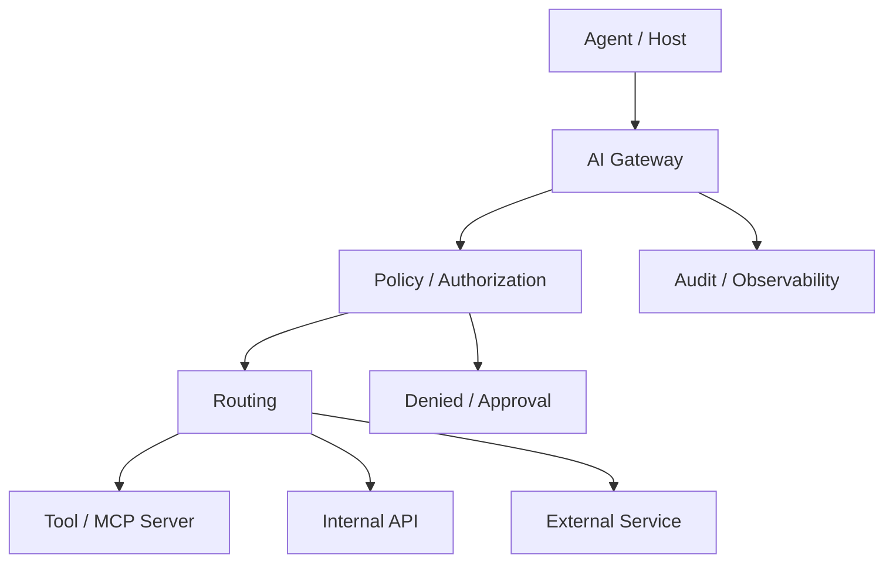
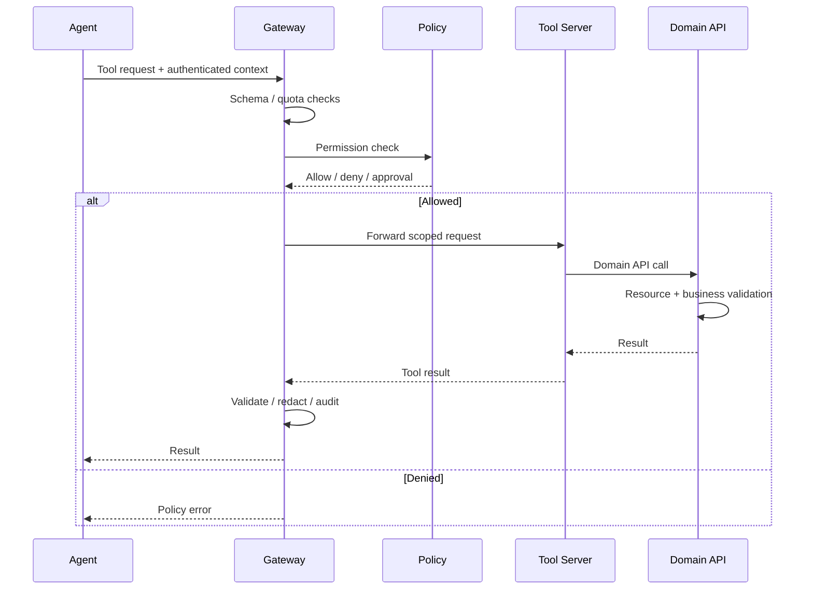

# 05. AI Gateway: Agent ও Tools-এর মাঝখানের Control Layer

## 1. একাধিক Agent ও Tool হলে security ও governance কোথায় রাখবে?

ধরো, একটি organization-এ ২০টি agent আছে। কেউ GitHub issue তৈরি করে, কেউ database query করে, কেউ customer support সামলায়, আবার কেউ refund বা deployment-এর মতো sensitive operation চালায়। প্রত্যেক agent যদি নিজের মতো credential, rate limit, policy check ও audit logging implement করে, তাহলে কয়েকটি সমস্যা তৈরি হয়:

- একই permission rule বিভিন্ন জায়গায় ভিন্নভাবে enforce হতে পারে।
- কোনো agent-এর credential প্রয়োজনের চেয়ে বেশি powerful হতে পারে।
- কোন tool কোন user বা tenant ব্যবহার করেছে, তা trace করা কঠিন হয়।
- Rate limit ও quota consistent থাকে না।
- Policy change করতে বহু application update করতে হয়।
- Sensitive input/output log হয়ে যাওয়ার ঝুঁকি বাড়ে।

এই ধরনের cross-cutting concern এক জায়গায় mediate ও centralize করার জন্য **AI Gateway** ব্যবহার করা যেতে পারে। Gateway agent/application এবং tools, MCP servers বা external services-এর মাঝখানে একটি intermediary layer হিসেবে কাজ করে।

তবে Gateway সব architecture-এ বাধ্যতামূলক নয়। ছোট application-এ application runtime ও domain service-এর মধ্যেই এসব responsibility যথেষ্টভাবে implement করা যায়। Gateway-এর প্রয়োজন নির্ভর করে integration সংখ্যা, governance, isolation ও operational requirement-এর ওপর।

## 2. AI Gateway কী এবং কী নয়?

AI Gateway হলো একটি control/mediation layer, যা agent বা AI application-এর request গ্রহণ করে policy অনুযায়ী validate, authorize, route ও monitor করতে পারে। এটি credential handling, quota, rate limit, audit এবং response filtering-এর মতো cross-cutting capability দিতে পারে।

Gateway-কে Agent Runtime-এর সঙ্গে গুলিয়ে ফেলবে না:
- **Agent Runtime:** model invocation, agent loop, state, tool-call dispatch, workflow ও stop condition পরিচালনা করে।
- **AI Gateway:** request-এর access, policy, routing, quota, credential ও observability mediate করে।
- **Tool/MCP Server:** capability implement বা expose করে।
- **Domain Service:** নিজের business state ও invariant-এর authoritative owner।

Gateway সাধারণত পুরো agent workflow-এর planner নয়। এটি agent-এর হয়ে সব business decision নেয় না।

## 3. একটি সম্ভাব্য Gateway architecture

এখানে Gateway request receive করে। Policy layer দেখে request allow, deny বা approval প্রয়োজন কি না। Routing layer অনুমোদিত request সঠিক tool/server/service-এ পাঠায়। Gateway ও downstream layer outcome log করতে পারে।

সব responsibility একটি deployable gateway service-এ থাকতে হবে এমন নয়। Policy engine, secret manager, rate limiter ও observability platform আলাদা component হতে পারে। Gateway হলো তাদের সামনে একটি coherent control point।

## 4. Gateway-এর common responsibility

### 4.1 Tool catalog ও capability filtering

কোন agent বা user কোন tool দেখতে/ব্যবহার করতে পারবে, তা filter করা যায়। এতে অপ্রাসঙ্গিক বা নিষিদ্ধ tool model-এর সামনে না-ও আসতে পারে। তবে model-এর সামনে tool লুকানো security boundary নয়; runtime/server-side authorization দরকার।

### 4.2 Authentication ও credential management

Request কোন user, tenant, agent বা service থেকে এসেছে তা authenticate করতে সাহায্য করে। Raw database password বা broad cloud credential agent context-এ না দিয়ে gateway/tool server scoped credential ব্যবহার করতে পারে।

### 4.3 Authorization ও policy enforcement

Identity, role, scope, resource, action ও context দেখে request allow/deny/approval করতে পারে। তবে domain-specific invariant-এর authoritative check সংশ্লিষ্ট business service-এও থাকতে হবে।

### 4.4 Routing

Request সঠিক MCP server, tool server, internal API বা external provider-এ পাঠায়। Routing-এর সঙ্গে health, version ও environment policy জড়িত থাকতে পারে।

### 4.5 Rate limit, quota ও concurrency control

User, tenant, agent, tool বা downstream service অনুযায়ী request frequency, total usage ও concurrent operation সীমিত করতে পারে।

### 4.6 Input/output validation

Schema, payload size, response size ও allowed operation যাচাই করা যায়। Sensitive field redact করা বা oversized response trim করা যায়। কিন্তু trim করতে গিয়ে critical evidence বাদ পড়ছে কি না তা দেখতে হবে।

### 4.7 Observability ও audit

Trace ID, actor, tenant, tool name, policy decision, latency, status, retry count এবং cost metadata সংগ্রহ করা যায়। Sensitive data log না করে auditability বজায় রাখতে হবে।

### 4.8 Governance

Tool allowlist, environment restriction, approval threshold, credential rotation, policy versioning এবং access review-এর মতো governance process support করতে পারে।

সব architecture-এ সব responsibility Gateway-এর হবে এমন নয়। Domain service, runtime, identity provider ও observability platform-এর মধ্যেও responsibility ভাগ হতে পারে।

## 5. Request flow: Gateway কীভাবে সিদ্ধান্ত নেয়?

একটি request-এ সাধারণত:
1. Agent/runtime authenticated identity ও request পাঠায়।
2. Gateway payload/schema, quota ও request size check করে।
3. Policy engine action অনুমোদিত কি না যাচাই করে।
4. Approval লাগলে request pending/approval flow-তে যায়।
5. Allowed হলে gateway scoped request সঠিক server-এ route করে।
6. Tool server downstream domain API invoke করে।
7. Domain API resource ownership ও business invariant যাচাই করে।
8. Result gateway-তে ফিরে আসে; প্রয়োজন হলে redact/validate হয়।
9. Gateway trace/audit event লেখে এবং result agent-কে ফেরত দেয়।

এই flow illustrative। বাস্তব system-এ authentication, authorization ও policy evaluation-এর সুনির্দিষ্ট ক্রম identity architecture অনুযায়ী বদলাতে পারে।

## 6. Authentication বনাম Authorization: Gateway-তে সবচেয়ে জরুরি পার্থক্য

**Authentication:** Request কে করছে?  
**Authorization:** ওই identity এই resource-এ এই action করতে পারবে কি?

Agent system-এ identity একাধিক স্তরের হতে পারে:
- End-user identity
- Agent/application identity
- Tenant/organization identity
- Gateway service identity
- Downstream service identity

ধরা যাক Gateway-এর কাছে এমন service credential আছে যা সব customer-এর order পড়তে পারে। User নিজের order দেখতে চাইলো, কিন্তু model অন্য customer-এর order ID পাঠাল। Gateway শুধু নিজের service credential বৈধ কি না দেখে request পাঠালে user-এর permission প্রমাণ হয় না।

তাই authenticated principal এবং delegated scope নিরাপদভাবে carry করতে হবে। Client-supplied `user_id`-কে verified identity ধরে নেওয়া যাবে না। Gateway coarse-grained permission দিতে পারে, কিন্তু resource-level authorization domain service-এ enforce করতে হবে।

## 7. Centralized policy বনাম Domain ownership

ধরা যাক agent ৫,০০০ টাকা refund request করল, কিন্তু order-এর refundable balance মাত্র ৫০০ টাকা।

Gateway policy-তে amount threshold বা refund tool allowlist থাকতে পারে। কিন্তু refundable balance, order state, currency, already-refunded status এবং transaction consistency জানে refund domain service। তাই business invariant-এর শেষ কথা domain service-এর হওয়া উচিত।

একটি ভালো division:

- **Gateway:** এই agent কি refund tool ব্যবহার করতে পারে? Tenant quota ঠিক আছে? Approval দরকার?
- **Refund service:** এই order-এর refundable balance কত? এই transaction duplicate কি? Current state-এ refund valid কি?
- **Runtime:** model-এর proposed tool call loop-এর মধ্যে পাঠানো হবে কি? Max call budget অতিক্রম হয়েছে কি?
- **Human reviewer:** policy অনুযায়ী approval-এর দায়িত্ব তার কি না?

Gateway central consistency দেয়, কিন্তু domain ownership সরিয়ে নেয় না।

## 8. Gateway বনাম MCP Server

| MCP Server | AI Gateway |
|---|---|
| Tools/resources/prompts expose করে | Access/routing/control intermediary |
| Capability request handle করে | Policy, auth, quota, credential ও audit mediate করে |
| Domain integration implement/wrap করতে পারে | একাধিক tool/server-এর সামনে layer হতে পারে |
| MCP protocol lifecycle মেনে চলে | Gateway protocol-specific বা protocol-agnostic হতে পারে |

Gateway MCP server-এর সামনে বসতে পারে, MCP-compatible request route করতে পারে, অথবা direct API manage করতে পারে। MCP এবং Gateway এক জিনিস নয়। MCP capability interaction standardize করে; Gateway access ও governance control করতে পারে।

## 9. Gateway ছাড়াও কি security সম্ভব?

হ্যাঁ। Application, tool server ও downstream service authorization implement করতে পারে। Gateway consistent central control, credential isolation, routing, quota ও audit সহজ করে। কিন্তু Gateway নিজেও failure বা misconfiguration-এর source হতে পারে।

তাই defense in depth দরকার:
- Gateway coarse-grained policy enforce করবে।
- Tool server input ও scope validate করবে।
- Domain API resource-level authorization ও business invariant enforce করবে।
- Audit event correlation ID দিয়ে যুক্ত হবে।

Gateway bypass হলেও domain service যেন unauthorized action reject করে।

## 10. Fail-open বনাম Fail-closed: Policy service down হলে কী হবে?

ধরা যাক Gateway-এর policy service unavailable। Request allow করবে, নাকি deny?

**Fail-open:** Policy check করা যাচ্ছে না, তবুও request allow। Availability বাড়তে পারে, কিন্তু unauthorized action-এর ঝুঁকি তৈরি হয়।

**Fail-closed:** Policy decision পাওয়া যাচ্ছে না, তাই request deny বা pending। Availability কমতে পারে, কিন্তু sensitive action-এর ক্ষেত্রে নিরাপত্তা বজায় থাকে।

একটি policy সব action-এ প্রযোজ্য হওয়া উচিত নয়:
- Refund/payment/deploy/delete-এর মতো high-impact write operation-এ সাধারণত fail-closed safer।
- Low-risk read-only operation-এ requirements অনুযায়ী short-lived cached policy বা সীমিত degraded mode সম্ভব।
- Cached policy ব্যবহার করলে expiry, scope ও version যাচাই করতে হবে।

Fail-open/fail-closed সিদ্ধান্ত explicit risk analysis ও business requirement থেকে আসা উচিত, convenience থেকে নয়।

## 11. Reliability: Gateway নিজেই failure point হতে পারে

Gateway outage হলে একসঙ্গে অনেক agent-এর tool access বন্ধ হতে পারে। তাই:
- High availability ও horizontal scaling।
- Health check ও circuit breaker।
- Bounded queue ও backpressure।
- Clear timeout budget।
- Retry with exponential backoff/jitter, যেখানে safe।
- Idempotency-aware side-effect handling।
- Graceful degradation।
- Policy-preserving failover।
- Canary rollout ও rollback।

Failover path যেন policy bypass না করে। Sensitive action-এর ক্ষেত্রে Gateway unavailable হলে অন্য route দিয়ে একই action চালানো যাবে কি না, তা explicitভাবে নির্ধারণ করতে হবে।

## 12. Rate limit, quota ও fairness

Rate limit সাধারণত নির্দিষ্ট সময়ে request frequency বা burst নিয়ন্ত্রণ করে। Quota নির্দিষ্ট সময়ের মোট usage সীমিত করে। Key হতে পারে user, tenant, agent, tool বা downstream service।

Multi-tenant system-এ শুধু IP-based rate limit যথেষ্ট নয়। Tenant-level quota, per-tool concurrency limit, queue, backpressure ও priority policy লাগতে পারে। Retry storm ঠেকাতে exponential backoff ও jitter সহায়ক, কিন্তু side-effecting request-এ idempotency ছাড়া retry নিরাপদ নয়।

## 13. Observability: কী log করবে, কী করবে না?

Gateway-এ useful telemetry:
- Trace/correlation ID
- Actor ও tenant identifier (প্রয়োজনীয় ও নিরাপদ scope-এ)
- Agent/tool name ও version
- Policy decision ও reason code
- Request duration ও downstream latency
- Status/error category
- Retry count
- Token/cost metadata যেখানে প্রযোজ্য
- Downstream request/transaction ID

যা অকারণে log করবে না:
- Password, API key, access token
- Full payment credentials
- Unnecessary personal data
- Raw sensitive prompt/document
- Secret-bearing tool arguments

Structured logging, redaction, retention limit, access control ও tamper-resistant audit দরকার। Gateway access event জানে, কিন্তু downstream business operation শেষ পর্যন্ত commit হয়েছে কি না সবসময় জানে না। তাই correlation ID দিয়ে gateway, tool server ও domain service-এর authoritative event যুক্ত করতে হবে।

## 14. Interview: AI Gateway নিয়ে গভীর প্রশ্ন

### Q1. AI Gateway কেন দরকার?

একাধিক agent ও tool থাকলে credential, policy, routing, quota ও logging আলাদা আলাদা implement করলে inconsistency তৈরি হয়। Gateway এসব cross-cutting concern centralize করতে পারে। এতে access governance, observability ও credential isolation সহজ হয়। তবে ছোট application-এ Gateway বাধ্যতামূলক নয়; application ও domain service-এ একই responsibility যথেষ্টভাবে থাকলে আলাদা gateway overhead অপ্রয়োজনীয় হতে পারে।

### Q2. Gateway authorization-এর পাশাপাশি downstream authorization কেন দরকার?

Gateway centralized, consistent policy enforcement, routing, quota ও audit দেয়। কিন্তু gateway bypass, misconfiguration বা internal call path থাকতে পারে। তাই downstream business service-কে resource ownership, business invariant ও action permission পুনরায় enforce করতে হবে। এটি defense in depth। Gateway coarse access gate; service authoritative domain guard।

### Q3. Gateway ও MCP server-এর difference কী?

MCP server capability expose/implement করে। AI Gateway access, routing, credential, quota, policy ও audit mediate করে। Gateway MCP server-এর সামনে থাকতে পারে, কিন্তু MCP protocol-এর replacement নয়। MCP interoperability; Gateway governance/control layer।

### Q4. Gateway outage হলে কী করবে?

High-impact write operation-এ policy decision ছাড়া fail-closed করে request deny বা pending রাখব। High availability, health check ও policy-preserving failover রাখব। Retry bounded হবে এবং side effect idempotency-aware হবে। Outcome unknown হলে status reconciliation করব। Low-risk read operation-এর degraded behavior আলাদাভাবে define করা যায়।

### Q5. Logging-এ কী রাখবে, কী redact করবে?

Trace ID, actor/tenant, tool/version, policy decision, latency, status/error category, retry count ও downstream request ID রাখব। Password, token, full payment data, unnecessary PII ও raw sensitive content redact বা বাদ দেব। Retention, access control ও audit integrity নিশ্চিত করব।

### Q6. Gateway কি সব business rule enforce করবে?

না। Gateway coarse-grained policy, tool allowlist, tenant quota, approval gate ও routing করতে পারে। কিন্তু refundable balance, order state, inventory availability বা transaction invariant সংশ্লিষ্ট domain service-এর দায়িত্ব। Gateway-কে domain service-এর authoritative owner বানালে coupling ও bypass risk তৈরি হয়।

### Q7. Authentication ও Authorization-এর পার্থক্য কী?

Authentication request-এর identity যাচাই করে। Authorization ওই identity নির্দিষ্ট resource-এ নির্দিষ্ট action করতে পারবে কি না যাচাই করে। Agent identity ও end-user identity আলাদা হতে পারে। Gateway-এর service credential বৈধ হওয়া user permission-এর প্রমাণ নয়; delegated identity/scope এবং resource ownership check দরকার।

### Q8. Gateway fail করলে fail-open নাকি fail-closed?

Risk অনুযায়ী। Refund, payment, deployment বা delete-এর মতো sensitive write action-এ policy service unavailable হলে সাধারণত fail-closed। Low-risk read-only action-এ short-lived cached policy দিয়ে সীমিত degraded mode সম্ভব হতে পারে, যদি scope ও expiry নিশ্চিত থাকে। Decision explicit risk policy-তে লিখতে হবে।

## 15. Practice: Production AI Gateway-এর threat model

একটি threat model লেখো। অন্তত এই threat অন্তর্ভুক্ত করো:

1. Credential theft।
2. Tenant identity confusion।
3. Prompt injection থেকে unsafe tool proposal।
4. Policy service outage।
5. Sensitive log leakage।
6. Rate-limit abuse ও retry storm।
7. Gateway bypass করে direct domain API call।
8. Compromised MCP/tool server।

প্রতিটির জন্য লিখবে:
- Preventive control
- Detection signal
- Blast radius
- Recovery/incident response
- কোন component control-এর owner

শেষে একটি refund request sequence diagram আঁকো যেখানে Gateway policy check এবং refund service-এর final business validation দুটোই দেখা যায়।
