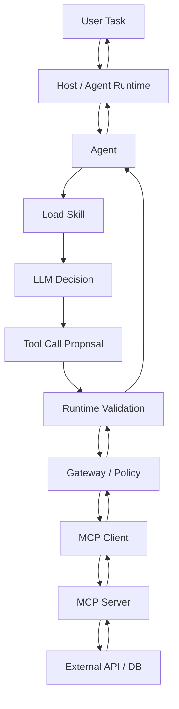
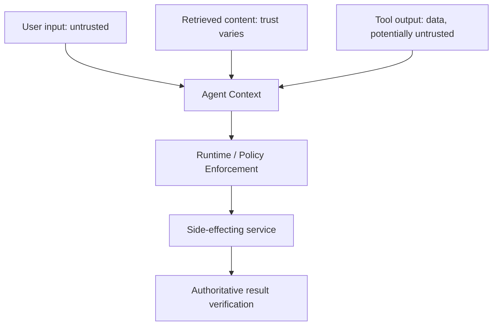

# 06. Tool, Skill, Agent, MCP ও Gateway: এক System-এ

## ধারণাগুলো আলাদা

- **Agent:** goal নিয়ে reasoning/decision/coordination।
- **Tool:** নির্দিষ্ট action/capability।
- **Skill:** reusable instructions/workflow।
- **MCP:** capability discover/invoke করার protocol।
- **Multi-agent:** responsibility একাধিক agent-এ ভাগ।
- **Gateway:** tools/services access-এর policy, auth, routing ও observability layer (যদি architecture-এ থাকে)।

## একসঙ্গে flow

Diagramটি conceptual; gateway/client/server placement implementation অনুযায়ী ভিন্ন হতে পারে।

## Refund task walkthrough

Request: “আমার order-এর item damaged, refund চাই।”

1. Host request গ্রহণ করে।
2. Agent refund skill load করে।
3. Skill workflow অনুযায়ী order lookup tool বেছে নেয়।
4. Model structured tool call propose করে।
5. Runtime schema validate করে।
6. Gateway identity/scope/policy check করে।
7. Tool/MCP server order data retrieve করে।
8. Result context-এ আসে।
9. Agent policy retrieval করে eligibility/evidence যাচাই করে।
10. Missing evidence হলে customer-কে প্রশ্ন করে; ambiguity/high risk হলে human review।
11. Refund action অনুমোদিত হলে policy gate আবার check করে।
12. Tool result verify করে।
13. Agent status জানায়; success claim authoritative result ছাড়া নয়।

## Trust boundaries

User input, retrieved documents ও tool output-এ instruction-like text থাকতে পারে। এগুলো trusted system instruction নয়। Prompt injection tool permission বাড়াতে পারবে না।

## Responsibility matrix

| Responsibility | Owner / enforcement |
|---|---|
| Request understanding | Agent/model + app |
| Workflow guidance | Skill |
| Tool selection | Model, runtime constraints |
| Schema validation | Runtime/tool boundary |
| Authorization | Gateway/tool server/business service |
| Operation | Tool implementation/downstream |
| Result verification | Runtime/agent + authoritative system |
| Audit | Runtime/gateway/tool/service |
| User response | Agent/host |

## Design principles

- Least privilege
- Clear tool contracts
- Skill is guidance, not enforcement
- Server-side authorization
- Relevant context
- Explicit state & stop conditions
- Bounded retries/turns
- Side effects-এর জন্য idempotency
- Traceable tool calls
- High-risk action-এ human review
- Production আগে evaluation

## Architecture review checklist

1. Agent কোন tool দেখতে পাচ্ছে, কেন?
2. ভুল tool select হলে runtime কী করবে?
3. Invalid args কীভাবে reject হবে?
4. Permission denied হলে recover path?
5. Timeout-এর পর action সফল হয়েছে কি না কীভাবে reconcile?
6. Skill outdated হলে detect/review?
7. Retrieved content-এ prompt injection?
8. Agent loop bounded?
9. Authoritative action result কোথায়?
10. Sensitive data logs-এ কীভাবে redact?