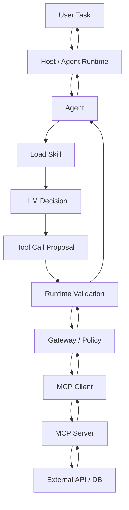
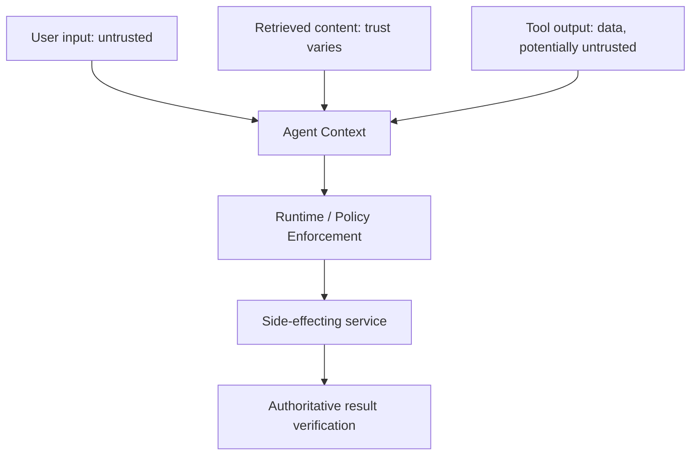

# 06. Tool, Skill, Agent, MCP ও Gateway: এক System-এ

## ধারণাগুলো আলাদা

- **Agent:** goal নিয়ে reasoning/decision/coordination।
- **Tool:** নির্দিষ্ট action/capability।
- **Skill:** reusable instructions/workflow।
- **MCP:** capability discover/invoke করার protocol।
- **Multi-agent:** responsibility একাধিক agent-এ ভাগ।
- **Gateway:** tools/services access-এর policy, auth, routing ও observability layer (যদি architecture-এ থাকে)।

## একসঙ্গে flow

Diagramটি conceptual; gateway/client/server placement implementation অনুযায়ী ভিন্ন হতে পারে।

## Refund task walkthrough

Request: “আমার order-এর item damaged, refund চাই।”

1. Host request গ্রহণ করে।
2. Agent refund skill load করে।
3. Skill workflow অনুযায়ী order lookup tool বেছে নেয়।
4. Model structured tool call propose করে।
5. Runtime schema validate করে।
6. Gateway identity/scope/policy check করে।
7. Tool/MCP server order data retrieve করে।
8. Result context-এ আসে।
9. Agent policy retrieval করে eligibility/evidence যাচাই করে।
10. Missing evidence হলে customer-কে প্রশ্ন করে; ambiguity/high risk হলে human review।
11. Refund action অনুমোদিত হলে policy gate আবার check করে।
12. Tool result verify করে।
13. Agent status জানায়; success claim authoritative result ছাড়া নয়।

## Trust boundaries

User input, retrieved documents ও tool output-এ instruction-like text থাকতে পারে। এগুলো trusted system instruction নয়। Prompt injection tool permission বাড়াতে পারবে না।

## Responsibility matrix

| Responsibility | Owner / enforcement |
|---|---|
| Request understanding | Agent/model + app |
| Workflow guidance | Skill |
| Tool selection | Model, runtime constraints |
| Schema validation | Runtime/tool boundary |
| Authorization | Gateway/tool server/business service |
| Operation | Tool implementation/downstream |
| Result verification | Runtime/agent + authoritative system |
| Audit | Runtime/gateway/tool/service |
| User response | Agent/host |

## Design principles

- Least privilege
- Clear tool contracts
- Skill is guidance, not enforcement
- Server-side authorization
- Relevant context
- Explicit state & stop conditions
- Bounded retries/turns
- Side effects-এর জন্য idempotency
- Traceable tool calls
- High-risk action-এ human review
- Production আগে evaluation

## Architecture review checklist

1. Agent কোন tool দেখতে পাচ্ছে, কেন?
2. ভুল tool select হলে runtime কী করবে?
3. Invalid args কীভাবে reject হবে?
4. Permission denied হলে recover path?
5. Timeout-এর পর action সফল হয়েছে কি না কীভাবে reconcile?
6. Skill outdated হলে detect/review?
7. Retrieved content-এ prompt injection?
8. Agent loop bounded?
9. Authoritative action result কোথায়?
10. Sensitive data logs-এ কীভাবে redact?

## End-to-end architecture: component ownership পরিষ্কার করো

একটি production system-এ diagram আঁকার চেয়ে গুরুত্বপূর্ণ হলো প্রতিটি decision ও state-এর owner নির্ধারণ। Agent request বোঝে ও next step প্রস্তাব করে। Skill workflow guide করে। Runtime loop, tool allowlist, schema validation ও turn budget নিয়ন্ত্রণ করে। MCP client/server capability communication standardize করে। Gateway access mediation ও centralized policy দিতে পারে। Domain service business invariant ও resource authorization enforce করে। Database authoritative state রাখে। Human reviewer high-risk exception সামলায়। একই responsibility একাধিক layer-এ থাকলেও authoritative owner স্পষ্ট হওয়া দরকার।

### একটি নিরাপদ refund flow

1. Host user authenticate করে এবং tenant context স্থাপন করে।
2. Agent refund-investigation skill load করে; skill instruction হিসেবে বিবেচিত হয়, permission হিসেবে নয়।
3. Model order lookup tool call প্রস্তাব করে।
4. Runtime tool allowlist ও schema যাচাই করে।
5. Gateway identity, scope, quota ও policy যাচাই করে।
6. Tool server downstream order service call করে। Order service নিজে resource ownership যাচাই করে।
7. Agent policy ও evidence পড়ে; retrieved content untrusted data হিসেবে বিবেচিত হয়।
8. Refund action-এর আগে current order state ও refundable balance authoritative service থেকে পুনরায় যাচাই হয়।
9. Amount/ risk threshold অনুযায়ী human approval নেওয়া হয়। Approval request user, order, amount ও operation-এর সঙ্গে bind করতে হবে; generic “approved” flag যথেষ্ট নয়।
10. Refund service idempotency key সহ transaction execute করে এবং refund ID/status দেয়।
11. Runtime authoritative result যাচাই করে; শুধু tool call পাঠানোকে success ধরে না।
12. Correlation ID-সহ audit event হয়; sensitive value redact হয়।

### Trust boundary ও prompt injection

User prompt, retrieved document, MCP resource, tool output ও child-agent response সবই untrusted বা partially trusted input হতে পারে। এগুলোর মধ্যে instruction-like text থাকলেও system policy override করতে পারে না। Trusted instruction, user request ও retrieved data আলাদা রাখতে হবে। Prompt-level instruction helpful, কিন্তু actual defense হলো least privilege, server-side authorization, output validation, network/data boundary এবং sensitive action approval।

### Threat model table

| Threat | সম্ভাব্য প্রভাব | প্রতিরোধ/সনাক্তকরণ |
|---|---|---|
| Prompt injection in document | Secret leak বা unsafe tool call | Untrusted-data boundary, tool scope, output policy |
| Malicious MCP server | Data exfiltration/unauthorized action | Server review, scoped credential, egress control |
| Cross-tenant IDOR | অন্য tenant-এর data access | Service-side tenant/resource authorization |
| Duplicate tool retry | Double refund/deploy | Idempotency, transaction status reconciliation |
| Agent loop | Cost/latency exhaustion | Max turns/depth, budget, deadline |
| Gateway outage | Tool access failure | HA, fail-closed sensitive writes, controlled fallback |
| Log leakage | PII/secret exposure | Redaction, retention, RBAC, audit |
| Skill supply-chain compromise | Unsafe workflow/script | Trusted source, pinning, review, sandbox |

### State, approval ও audit

Approval-কে শুধু conversation-এর “yes” text হিসেবে ধরে নিও না। Approval record-এ approver identity, exact action, resource, amount/payload hash, timestamp, expiry এবং policy version থাকা উচিত। Action execute করার আগে state বদলে গেছে কি না revalidate করতে হবে। Audit-এ request ID, actor, tool, policy decision, approval reference, idempotency key, authoritative result ID ও timestamp রাখা যায়; secrets/অপ্রয়োজনীয় PII নয়।

### Interview: “এই architecture-এ LLM-কে trust করবে কতটা?”

LLM-কে intent interpretation, classification, synthesis ও ambiguous text reasoning-এর জন্য ব্যবহার করব। কিন্তু authentication, authorization, financial calculation, transaction state, idempotency, quota এবং irreversible action-এর enforcement deterministic trusted service-এ রাখব। Model output proposal; domain service final authority। High-risk ambiguity হলে human review। এতে model ভুল করলেও blast radius সীমিত থাকে।

**Follow-up: “Prompt injection পুরোপুরি ঠেকানো যায়?”** কোনো single prompt trick দিয়ে সম্পূর্ণ guarantee দেওয়া যায় না। Defense-in-depth দরকার: retrieved content-কে data হিসেবে treat, least-privilege tools, secrets context-এ না দেওয়া, server-side authorization, outbound action validation, human approval ও adversarial evaluation। লক্ষ্য হলো injection ঘটলেও তা যেন unauthorized action বা data exfiltration ঘটাতে না পারে।

**Follow-up: “Agent বলল refund complete, কিন্তু service response timeout?”** Success claim করব না। Idempotency key বা operation ID দিয়ে authoritative refund service-এ status reconcile করব। Outcome unknown থাকলে pending/unknown জানাব, blind retry করব না।

### Architecture review checklist

- [ ] Identity: user, tenant ও agent identity আলাদা করে যাচাই হয়?
- [ ] Tool: allowlist, schema ও business validation কোথায়?
- [ ] Authorization: resource owner ও action permission domain service-এ enforce হয়?
- [ ] Side effect: idempotency, transaction state ও reconciliation আছে?
- [ ] Approval: exact action/payload-এর সঙ্গে bind করা?
- [ ] MCP: server trust, transport auth ও capability scope নির্দিষ্ট?
- [ ] Skill: version, source review ও evaluation আছে?
- [ ] Multi-agent: task contract, context minimization ও bounded delegation আছে?
- [ ] Gateway: failover policy bypass করতে পারে না?
- [ ] Security: prompt injection, tenant isolation ও secret handling পরীক্ষা করা?
- [ ] Observability: trace/audit আছে, sensitive data redacted?
- [ ] Evaluation: success, policy violation, latency ও cost মাপা হয়?

