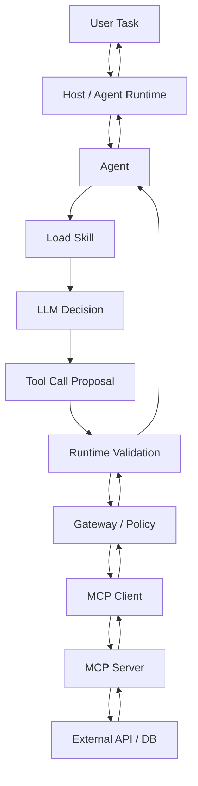
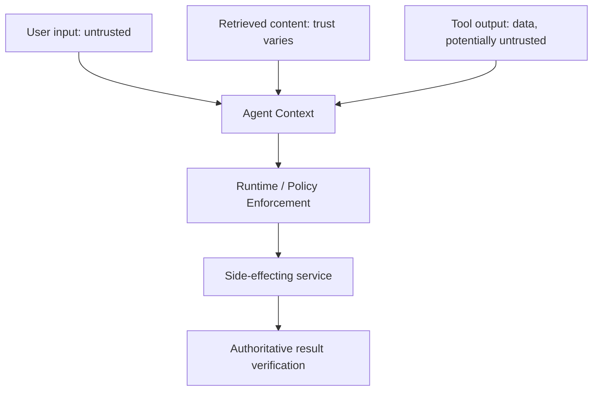

# 06. Tool, Skill, Agent, MCP ও Gateway: এক System-এ কীভাবে একসঙ্গে কাজ করে?

## 1. অনেকগুলো concept শিখলাম, কিন্তু production architecture-এ এরা কোথায় বসে?

এখন পর্যন্ত আমরা আলাদা করে দেখেছি Agent, Tool Calling, MCP, Skill, Multi-Agent Orchestration এবং AI Gateway। আলাদা chapter-এ পড়লে এগুলো বিচ্ছিন্ন মনে হতে পারে। কিন্তু বাস্তবে একটি AI application-এ এগুলো একই workflow-এর ভিন্ন responsibility সামলায়।

একটি damaged-item refund request কল্পনা করো। User বললেন, “আমার order-এর item damaged, refund চাই।” এই request-এ:

- **Host/Agent Runtime** user interaction, model call, state ও execution loop পরিচালনা করে।
- **Agent** goal বুঝে next step-এর proposal দেয়।
- **Skill** refund investigation-এর reusable workflow ও constraints জানায়।
- **Tool** order lookup, policy search বা refund request-এর মতো operation expose করে।
- **MCP** compatible host/client ও server-এর মধ্যে capability discovery/invocation-এর protocol দিতে পারে।
- **AI Gateway** architecture-এ থাকলে access, policy, routing, credential, quota ও audit mediate করতে পারে।
- **Domain Service** order/payment/refund-এর authoritative state ও business invariant enforce করে।
- **Human Reviewer** high-risk বা ambiguous action approve করতে পারে।

প্রতিটি component-এর কাজ আলাদা। এগুলোকে এক generic “AI agent” box-এ ঢুকিয়ে দিলে security ও ownership boundary অস্পষ্ট হয়।

## 2. Concept map: কোনটি কী দায়িত্ব নেয়?

| Concept | মূল দায়িত্ব | যে প্রশ্নের উত্তর দেয় |
|---|---|---|
| Agent | Goal-oriented decision ও task behavior | “এখন কী করা উচিত?” |
| Runtime/Host | Model loop, state, tool dispatch, stop/budget | “এই কাজ কীভাবে execute ও control হবে?” |
| Tool | Executable capability | “কোন operation চালানো যাবে?” |
| Skill | Reusable instructions/workflow | “কাজটি কী পদ্ধতিতে করা উচিত?” |
| MCP | Capability discovery/invocation protocol | “Host ও server কীভাবে কথা বলবে?” |
| Multi-agent orchestration | Multiple role/task coordination | “কাজ কার কাছে যাবে, result কীভাবে join হবে?” |
| AI Gateway | Access, policy, routing, quota, audit mediation | “এই request কোথায় ও কোন শর্তে যেতে পারবে?” |
| Domain Service | Business state ও invariant-এর authority | “এই business operation সত্যিই বৈধ কি?” |

একটি গুরুত্বপূর্ণ nuance: Gateway, MCP এবং runtime সব architecture-এ একই জায়গায় বা একই product হিসেবে থাকবে না। MCP server-এর সামনে Gateway থাকতে পারে; আবার direct tool integration-এ MCP লাগতেই নাও পারে। Architecture design-এ নাম নয়, responsibility ও trust boundary নির্ধারণ জরুরি।

## 3. একসঙ্গে flow: High-level architecture

Diagramটি একটি conceptual arrangement। বাস্তবে Gateway MCP Client-এর আগে বা পরে থাকতে পারে, policy check একাধিক layer-এ হতে পারে, আর direct API integration-এ MCP Client/Server থাকবে না। Diagram-এর উদ্দেশ্য exact product topology দেখানো নয়; বরং request কোন responsibility পার হয়ে যায় তা বোঝানো।

## 4. Refund task walkthrough: একটি request-এর জীবনচক্র

User বললেন: “আমার order-এর item damaged, refund চাই।”

### ধাপ ১: Host request গ্রহণ করে

Host user authentication ও tenant context স্থাপন করে। User-এর message agent runtime-এ যায়। এখানে user identity শুধু prompt text থেকে বিশ্বাস করা হবে না; trusted authentication context দরকার।

### ধাপ ২: Agent relevant Skill load করে

Runtime skill catalog থেকে refund investigation-এর matching skill খুঁজে load করতে পারে। Skill বলে order কীভাবে verify করতে হবে, কোন evidence লাগতে পারে, ambiguity হলে কী করতে হবে এবং action-এর আগে কী যাচাই জরুরি।

Skill-এর instruction permission দেয় না। “Refund execute করো” লেখা থাকলেও runtime/backend authorization ছাড়া refund চলবে না।

### ধাপ ৩: Model tool call propose করে

Skill ও available tool schema context-এ পেয়ে model `get_order` call propose করতে পারে। Model arguments তৈরি করলেও call এখনো execute হয়নি।

### ধাপ ৪: Runtime validation ও policy check

Runtime tool allowlist, schema, max-call budget ও workflow state যাচাই করে। Gateway থাকলে identity, scope, quota ও coarse policy check করতে পারে। প্রয়োজন হলে approval workflow শুরু হবে।

### ধাপ ৫: Tool/MCP Server domain service-এর সঙ্গে কাজ করে

MCP Client server-এ request পাঠাতে পারে। MCP Server handler internal order API call করে। Order service নিজেই resource ownership ও current state যাচাই করবে। Result structured ভাবে ফেরত আসবে।

### ধাপ ৬: Agent policy ও evidence যাচাই করে

Agent current policy retrieve করতে পারে। Retrieved content data, trusted system instruction নয়। Applicable policy version, product/country scope ও effective date যাচাই করতে হবে। Evidence missing হলে customer-কে clarification/photo চাইতে পারে।

### ধাপ ৭: High-impact action-এর আগে final validation

Refund action-এর আগে current order state, refundable balance, amount, currency, duplicate request এবং caller permission authoritative refund service-এ আবার যাচাই হবে। Amount/risk threshold অনুযায়ী human approval দরকার হতে পারে। Approval record exact resource, amount ও action-এর সঙ্গে bind করা উচিত।

### ধাপ ৮: Refund execution ও result verification

Refund service idempotency key সহ operation execute করে এবং refund ID/status ফেরত দেয়। Runtime result verify করে। `pending` status-কে `completed` বলা যাবে না। Outcome unknown হলে transaction status reconcile করতে হবে।

### ধাপ ৯: Audit ও communication

Gateway, runtime, tool server ও domain service trace/correlation ID দিয়ে event যুক্ত করে। Sensitive data redact করতে হবে। Agent authoritative status অনুযায়ী customer-কে response দেয়।

## 5. Trust boundaries: কোন input-কে কতটা বিশ্বাস করবে?

একটি agentic system-এ অনেক উৎস থেকে text ও data আসে:
- User input
- Retrieved document/resource
- Tool output
- MCP server response
- Child-agent result
- Memory record

এসবের মধ্যে instruction-এর মতো text থাকতে পারে। কিন্তু এগুলো trusted system/developer instruction নয়। External content model-কে নির্দেশ দিতে পারে, কিন্তু tool permission বা policy override করতে পারবে না।

Prompt injection-এর বিরুদ্ধে শুধু prompt-এ “ignore malicious instruction” লিখে নিরাপত্তা নিশ্চিত করা যায় না। আসল defense হলো least-privilege tools, server-side authorization, sensitive data boundary, output validation এবং high-risk action approval।

## 6. Responsibility matrix: কে কোন কাজের owner?

| Responsibility | Primary owner / enforcement |
|---|---|
| User authentication | Identity provider / Host |
| Request understanding | Agent/model + application |
| Workflow guidance | Skill |
| Model invocation ও loop | Agent Runtime |
| Tool selection proposal | Model |
| Tool allowlist ও schema validation | Runtime/tool boundary |
| Protocol communication | MCP Client/Server (যদি ব্যবহৃত হয়) |
| Coarse access/routing/quota | Gateway (যদি থাকে) |
| Resource authorization | Domain service / trusted backend |
| Business invariant ও transaction | Domain service |
| External operation | Tool implementation / downstream service |
| Result verification | Runtime + authoritative system |
| Audit | Runtime/Gateway/Tool/Domain service |
| User-facing response | Agent/Host |

একটি responsibility একাধিক layer-এ check হতে পারে, কিন্তু authoritative owner স্পষ্ট থাকা উচিত। উদাহরণ: Gateway coarse refund permission যাচাই করতে পারে; refund service refundable balance ও order state-এর final authority।

## 7. Production design principles

### Least privilege

Agent বা tool server-কে প্রয়োজনের বেশি access দিও না। Read-only workflow-এ write tool expose করার দরকার নেই।

### Clear contracts

Tool, MCP capability ও agent handoff-এর input/output schema নির্দিষ্ট করো। Ambiguous text contract production debugging কঠিন করে।

### Skill is guidance, not enforcement

Skill workflow শেখায়। Permission, amount limit ও business invariant trusted runtime/service-এ enforce হবে।

### Relevant context

সব conversation, document বা skill একসঙ্গে context-এ দিও না। Task-relevant evidence, source ও current state বেছে নাও।

### Explicit state ও stop condition

Workflow state persist করো। Max turns, deadline, retry budget, delegation depth ও cost limit enforce করো।

### Side effect-এর জন্য idempotency

Refund/payment/deploy-এর মতো operation retry হলে duplicate effect ঠেকাও। Unknown outcome reconcile করো।

### Traceable execution

একটি request-এর model call, tool call, MCP request, gateway decision ও downstream transaction trace ID দিয়ে যুক্ত করো।

### High-risk action-এ human review

Ambiguous বা high-impact operation-এ explicit approval flow রাখো। Approval exact action/resource/payload-এর সঙ্গে bind করো।

### Evaluation before production

Task success, correctness, policy violation, false-success, latency, cost ও recovery metric দিয়ে system evaluate করো।

## 8. Threat model: কোন attack বা failure কী ক্ষতি করতে পারে?

| Threat | সম্ভাব্য প্রভাব | প্রতিরোধ/সনাক্তকরণ |
|---|---|---|
| Prompt injection in document | Secret leak বা unsafe tool call | Untrusted-data boundary, tool scope, output policy |
| Malicious MCP server | Data exfiltration/unauthorized action | Server review, scoped credential, egress control |
| Cross-tenant IDOR | অন্য tenant-এর data access | Service-side tenant/resource authorization |
| Duplicate tool retry | Double refund/deploy | Idempotency, transaction status reconciliation |
| Agent loop | Cost/latency exhaustion | Max turns/depth, budget, deadline |
| Gateway outage | Tool access failure | HA, sensitive write fail-closed, controlled fallback |
| Log leakage | PII/secret exposure | Redaction, retention, RBAC, audit |
| Skill supply-chain compromise | Unsafe workflow/script | Trusted source, pinning, review, sandbox |
| Child-agent context poisoning | ভুল decision বা data leak | Handoff validation, provenance, least privilege |
| Stale policy | Wrong eligibility decision | Version/effective-date validation |

Threat model-এ শুধু preventive control নয়, detection signal, blast radius ও recovery plan-ও লিখতে হবে।

## 9. Approval, State ও Audit: “Yes” বললেই কি approval?

না। High-impact action-এর approval record-কে exact action-এর সঙ্গে bind করতে হবে। Conversation-এ user “yes” বলেছে, কিন্তু সে কোন amount, কোন order বা কোন operation approve করেছে তা অস্পষ্ট হতে পারে।

একটি approval record-এ থাকতে পারে:
- Approver identity
- Exact action ও resource
- Amount/currency বা payload hash
- Timestamp ও expiry
- Policy version
- Request/correlation ID
- Approval status

Action execute করার আগে current state পুনরায় validate করতে হবে। Approval দেওয়ার পর order state বা refundable balance বদলে যেতে পারে।

Audit-এ request ID, actor, tool, policy decision, approval reference, idempotency key, authoritative result ID ও timestamp রাখা যায়। Secret ও অপ্রয়োজনীয় personal data log করা যাবে না।

## 10. Interview: Integrated architecture ও security

### Q1. এই architecture-এ LLM-কে কতটা trust করবে?

LLM-কে intent interpretation, classification, synthesis ও ambiguous text reasoning-এর জন্য ব্যবহার করব। কিন্তু authentication, authorization, financial calculation, transaction state, idempotency, quota এবং irreversible action-এর enforcement deterministic trusted service-এ রাখব। Model output proposal; domain service final authority। High-risk ambiguity হলে human review। এতে model ভুল করলেও blast radius সীমিত থাকে।

### Q2. Prompt injection পুরোপুরি ঠেকানো যায়?

কোনো single prompt trick দিয়ে সম্পূর্ণ guarantee দেওয়া যায় না। Defense-in-depth দরকার: retrieved content-কে data হিসেবে treat, least-privilege tools, secrets context-এ না দেওয়া, server-side authorization, outbound action validation, human approval ও adversarial evaluation। লক্ষ্য হলো injection ঘটলেও তা যেন unauthorized action বা data exfiltration ঘটাতে না পারে।

### Q3. Agent বলল refund complete, কিন্তু service response timeout?

Success claim করব না। Idempotency key বা operation ID দিয়ে authoritative refund service-এ status reconcile করব। Outcome unknown থাকলে pending/unknown জানাব, blind retry করব না।

### Q4. Gateway এবং Domain Service দুটোই authorization করলে duplication নয়?

দুই layer-এর check-এর উদ্দেশ্য এক নয়। Gateway centralized coarse policy, tool access, quota ও routing enforce করতে পারে। Domain service resource ownership, current business state ও invariant-এর authoritative owner। একই policy copy না করে responsibility ভাগ করতে হবে। Gateway bypass হলেও domain service যেন unauthorized action reject করে।

### Q5. সব role-কে আলাদা agent বানাবে?

না। কিছু role deterministic function/service/tool হতে পারে। LLM agent কেবল যেখানে language understanding, contextual judgment বা dynamic task decomposition দরকার সেখানে ব্যবহার করব। অতিরিক্ত agent call cost, latency ও coordination complexity বাড়ায়।

### Q6. Approval pending অবস্থায় process restart হলে কী হবে?

Workflow state durable storage-এ persist করব। Approval record exact request/resource/amount-এর সঙ্গে bind থাকবে। Restart-এর পরে runtime state load করে approval status check করবে; নতুন করে side effect চালাবে না। Approval expire বা state বদলে গেলে পুনরায় validation/approval লাগবে।

## 11. Architecture review checklist

- [ ] Identity: user, tenant ও agent identity আলাদা করে যাচাই হয়?
- [ ] Tool: allowlist, schema ও business validation কোথায়?
- [ ] Authorization: resource owner ও action permission domain service-এ enforce হয়?
- [ ] Side effect: idempotency, transaction state ও reconciliation আছে?
- [ ] Approval: exact action/payload-এর সঙ্গে bind করা?
- [ ] MCP: server trust, transport auth ও capability scope নির্দিষ্ট?
- [ ] Skill: version, source review ও evaluation আছে?
- [ ] Multi-agent: task contract, context minimization ও bounded delegation আছে?
- [ ] Gateway: failover policy bypass করতে পারে না?
- [ ] Security: prompt injection, tenant isolation ও secret handling পরীক্ষা করা?
- [ ] Observability: trace/audit আছে, sensitive data redacted?
- [ ] Evaluation: success, policy violation, latency ও cost মাপা হয়?

## 12. Practice: Production Refund Agent Architecture

একটি end-to-end refund agent architecture design করো। Diagram-এ Host/Runtime, Agent, Skill, Tool, optional MCP Server, optional Gateway, Order Service, Refund Service, Memory/State Store এবং Human Approval দেখাও।

তারপর প্রতিটি component-এর জন্য লিখবে:
1. Responsibility ও non-responsibility।
2. Owned state ও authoritative data।
3. Input/output contract।
4. Permission ও trust boundary।
5. Failure mode ও recovery।
6. Observability/audit event।
7. Test strategy।

শেষে threat model থেকে অন্তত পাঁচটি attack scenario simulate করো। প্রতিটির ক্ষেত্রে দেখাও, model ভুল করলেও কোন trusted layer action আটকাবে বা কীভাবে recover করবে।
