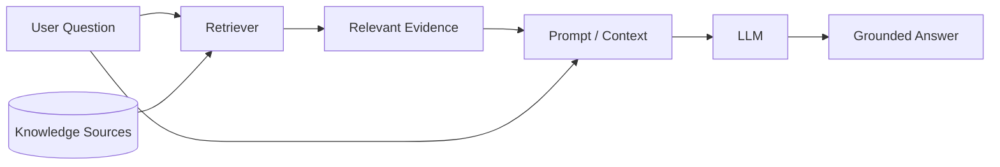
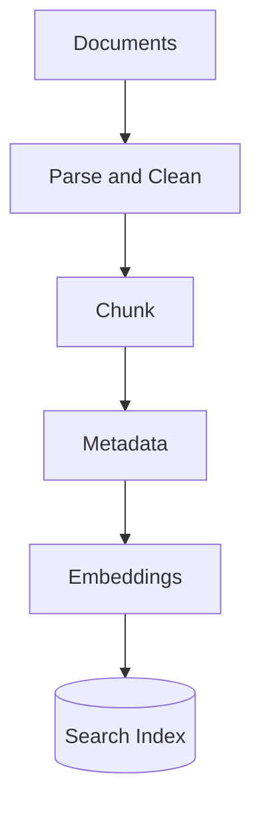
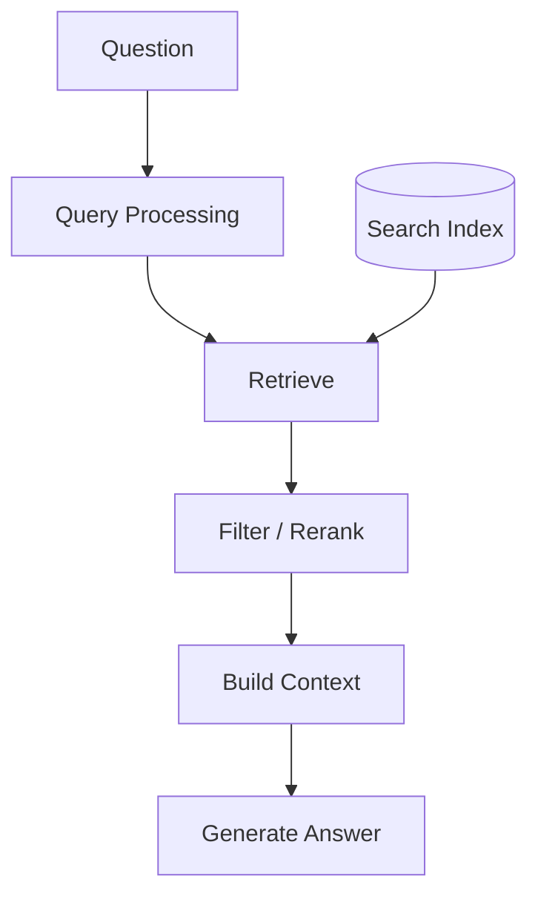

# 01. Why an Agent Needs Grounded Knowledge

## 1. LLM সুন্দর উত্তর দিতে পারে, কিন্তু সেটি কি তোমার system-এর সত্য?

ধরো, একটি company-র customer support agent-কে জিজ্ঞাসা করা হলো: “আমার damaged product-এর refund কি পাওয়া যাবে?” LLM হয়তো সাধারণ e-commerce practice থেকে বলতে পারে, “সাধারণত delivery-এর ৭ দিনের মধ্যে refund পাওয়া যায়।” উত্তরটি স্বাভাবিক ও আত্মবিশ্বাসী শোনায়। কিন্তু তোমার company-র policy হয়তো ১৪ দিন, অথবা product category অনুযায়ী আলাদা। আবার customer-এর order-টি ৩০ দিন আগেরও হতে পারে।

এখানে model-এর ভাষাগত দক্ষতা সমস্যা নয়। সমস্যা হলো, model-এর কাছে এই নির্দিষ্ট প্রশ্নের authoritative evidence নেই।

LLM training-এর সময় বিপুল text থেকে language pattern, concept ও relationship শেখে। সে training data থেকে general knowledge ব্যবহার করতে পারে। কিন্তু production application-এ এমন অনেক প্রশ্ন আসে যার উত্তর training data থেকে পাওয়া সম্ভব নয়:

- আমাদের company-র সর্বশেষ refund policy কী?
- গতকাল কোন customer-এর subscription renew হয়েছে?
- Internal Engineering Handbook-এ deployment freeze সম্পর্কে কী বলা আছে?
- এই quarter-এ কোন product-এর দাম পরিবর্তন হয়েছে?
- এই user-এর current leave balance কত?

কিছু তথ্য private, কিছু দ্রুত পরিবর্তিত হয়, কিছু user-specific, আবার কিছু exact current state। Model training-এ তথ্যটি থাকলেও সেটি পুরোনো বা অসম্পূর্ণ হতে পারে। তাই LLM-এর fluency-কে factual authority ভাবা বিপজ্জনক। সুন্দরভাবে বলা উত্তরও ভুল হতে পারে।

এই gap থেকেই **Grounded Knowledge**-এর প্রয়োজন তৈরি হয়। Agent-কে শুধু উত্তর তৈরি করতে বললেই হবে না; উত্তর দেওয়ার আগে কোন source থেকে evidence আনতে হবে, সেই evidence কতটা authoritative ও current, এবং claim-এর সঙ্গে source-এর সম্পর্ক কী, তা নিশ্চিত করতে হবে।

## 2. Parametric Knowledge বনাম External Knowledge

LLM-এর training থেকে শেখা জ্ঞানকে সাধারণত **parametric knowledge** বলা হয়, কারণ তা model-এর parameters-এর মধ্যে encode থাকে। Model আলাদা database query করে প্রতিটি উত্তর তৈরি করে না; তার learned parameters থেকে response generate করে।

অন্যদিকে **external knowledge** থাকে model-এর বাইরে: document, database, API, search index, ticket, source code, wiki বা Knowledge Graph-এ। Application প্রয়োজন অনুযায়ী সেখান থেকে তথ্য retrieve করে model context-এ দিতে পারে।

| বিষয় | Parametric knowledge | External knowledge |
|---|---|---|
| কোথায় থাকে | Model parameters | Document, DB, API, index, graph |
| Update | Model update/fine-tuning | Source update ও index/data refresh |
| Private company data | সাধারণত সরাসরি উপযুক্ত নয় | Access control মেনে দেওয়া যায় |
| Provenance | নির্দিষ্ট source দেখানো কঠিন | Source reference রাখা যায় |
| Exact current state | নিশ্চয়তা নেই | Authoritative API/DB থেকে পাওয়া যায় |
| প্রধান ঝুঁকি | Stale/ভুল learned association | Retrieval miss, stale index, source error |

External knowledge শুধু PDF নয়। Policy, product catalogue, database record, support ticket, source code, wiki, API response বা Knowledge Graph-ও হতে পারে।

একটি গুরুত্বপূর্ণ nuance: সব external knowledge-ই RAG দিয়ে আনতে হবে না। Exact account balance বা payment status-এর জন্য structured API query বেশি উপযুক্ত। RAG বিশেষভাবে উপকারী যখন knowledge unstructured বা semi-structured document-এ ছড়িয়ে থাকে এবং natural-language query দিয়ে relevant passage খুঁজতে হয়।

## 3. Grounding কী? উত্তরকে Evidence-এর সঙ্গে যুক্ত করা

**Grounding** হলো model-এর উত্তর বা সিদ্ধান্তকে নির্দিষ্ট, যাচাইযোগ্য evidence-এর সঙ্গে যুক্ত করা।

Ungrounded flow-তে model নিজের learned knowledge ও prompt থেকে উত্তর বানায়। সেটি সাধারণ industry practice-এর মতো শোনালেও তোমার company policy-র সঙ্গে না-ও মিলতে পারে।

Grounded flow-তে:
1. User-এর প্রশ্ন ও প্রয়োজনীয় scope বোঝা হয়।
2. Approved source থেকে প্রাসঙ্গিক তথ্য retrieve করা হয়।
3. Evidence-এর source, version, timestamp ও access scope যাচাই করা হয়।
4. Relevant evidence model context-এ দেওয়া হয়।
5. Model evidence-এর ভিত্তিতে উত্তর তৈরি করে।
6. প্রয়োজন হলে claim-এর পাশে source reference দেখানো হয়।
7. Evidence যথেষ্ট না হলে অনুমান না করে clarification বা abstention করা হয়।

Model-এর কাজ evidence থেকে উত্তর তৈরি করা; evidence না থাকলে policy উদ্ভাবন করা নয়।

### Grounding-এর একটি ছোট example

User: “আমার damaged item-এর refund হবে?”

Ungrounded answer: “হ্যাঁ, damaged item হলে refund পাওয়া যায়।”

Grounded answer-এর আগে system:
- User identity ও order ownership যাচাই করবে।
- Order service থেকে delivery date ও item details নেবে।
- Current policy version retrieve করবে।
- Required evidence আছে কি না দেখবে।
- Eligibility business service দিয়ে validate করবে।

এরপর agent বলতে পারবে refund eligible, ineligible, evidence pending, অথবা আরও তথ্য প্রয়োজন। উত্তরটি শুধু model-এর অনুমানের ওপর নির্ভর করছে না।

## 4. RAG কী এবং কেন দরকার?

RAG-এর পূর্ণরূপ **Retrieval-Augmented Generation**।

- **Retrieval:** External source থেকে relevant information খুঁজে আনা।
- **Augmented:** পাওয়া information model-এর current context-এ যোগ করা।
- **Generation:** Model সেই context ব্যবহার করে উত্তর তৈরি করা।

ধরা যাক company-র ৫০০টি policy document আছে। User একটি নির্দিষ্ট refund exception সম্পর্কে জিজ্ঞাসা করলেন। প্রতিটি document model-কে পাঠানো ব্যয়বহুল ও অপ্রয়োজনীয়। RAG query অনুযায়ী relevant document/chunk retrieve করে context-এ দেয়। Model সেই evidence দেখে উত্তর তৈরি করে।

RAG model-এর weights পরিবর্তন করে না। প্রতিটি query-তে external information retrieve করে current inference context-এ যোগ করে। Source পরিবর্তিত হলে source/index refresh করা যায়, model retrain করা বাধ্যতামূলক নয়।

## 5. RAG বনাম Fine-tuning: কোন সমস্যা কোন পদ্ধতি সমাধান করে?

দুটি পদ্ধতি প্রায়ই গুলিয়ে ফেলা হয়, কারণ দুটোই model-এর output উন্নত করতে পারে। কিন্তু তারা আলাদা জায়গায় কাজ করে।

**RAG** inference time-এ external evidence এনে context-এ যোগ করে। এটি private, changing, source-backed factual knowledge-এর জন্য কার্যকর।

**Fine-tuning** training process-এর মাধ্যমে model parameters পরিবর্তন করে। এটি response pattern, task behavior বা domain-specific style উন্নত করতে সাহায্য করতে পারে। কিন্তু প্রতিদিন বদলানো policy বা user-specific balance-কে weights-এ রাখার জন্য এটি সাধারণত উপযুক্ত নয়।

| প্রয়োজন | সম্ভাব্য পছন্দ |
|---|---|
| পরিবর্তনশীল company policy | RAG / authoritative policy lookup |
| Private documents থেকে উত্তর | ACL-সহ RAG |
| Source citation দরকার | RAG + provenance/citation validation |
| নির্দিষ্ট response style | Prompt বা fine-tuning |
| Domain-specific task behavior | Fine-tuning বিবেচনা |
| নতুন factual data নিয়মিত যোগ | সাধারণত external retrieval |
| Exact current account state | Authoritative API/database |
| Tool permission enforce | Runtime/server-side authorization |

একই system-এ RAG ও fine-tuning একসঙ্গে থাকতে পারে। Fine-tuned model domain language ভালো বুঝতে পারে, আর RAG current evidence সরবরাহ করে।

## 6. RAG-এর দুইটি lifecycle: Indexing time ও Query time

RAG-কে শুধু “question এলো, vector search করলাম” হিসেবে দেখলে অর্ধেক architecture বাদ পড়ে যায়। RAG-এর দুইটি আলাদা lifecycle আছে।

### 6.1 Indexing / Ingestion time

Source document-কে search-ready representation-এ রূপান্তর করা হয়।

এখানে source collect, parse, clean, chunk, metadata attach, embedding generate এবং index update হতে পারে। Parsing বা chunking ভুল হলে query time-এ সঠিক evidence খুঁজে পাওয়া কঠিন হবে।

### 6.2 Query time

User question এলে query processing, retrieval, filtering, reranking ও context assembly হয়।

Indexing ভালো হলেই retrieval নিশ্চিত নয়। Query অস্পষ্ট হতে পারে, metadata filter ভুল হতে পারে, index stale হতে পারে বা ranking relevant exception-কে নিচে পাঠাতে পারে। দুই lifecycle-এর quality আলাদা করে evaluate করতে হয়।

## 7. কখন RAG দরকার নেই?

সব knowledge problem-এর সমাধান RAG নয়।

- **General language/conceptual question:** Model-এর built-in knowledge যথেষ্ট হতে পারে।
- **Exact current state:** Account balance, payment status বা inventory quantity-এর জন্য authoritative API/database query ভালো।
- **Calculation:** Money, tax বা eligibility calculation deterministic code-এ করা উচিত।
- **Action:** Refund বা ticket create করতে tool calling দরকার।
- **Small stable context:** কয়েকটি ছোট instruction সরাসরি prompt-এ দেওয়া সহজ।
- **Exact structured lookup:** নির্দিষ্ট ID দিয়ে database query vector similarity-এর চেয়ে নির্ভরযোগ্য।

RAG unstructured knowledge retrieval-এ সাহায্য করে; transaction, authorization বা deterministic calculation-এর বিকল্প নয়।

## 8. RAG failure: Retrieval থাকলেই Grounding নিশ্চিত নয়

RAG hallucination কমাতে সাহায্য করতে পারে, কিন্তু ভুল evidence retrieve হলে grounded answer-ও ভুল হতে পারে।

| Failure | কেন হয় | কী করা যায় |
|---|---|---|
| Hallucination | Evidence নেই/অপর্যাপ্ত, তবু model উত্তর দেয় | Evidence sufficiency check, abstain |
| Stale answer | Source/index পুরোনো | Freshness metadata, refresh, version check |
| Wrong document | Retrieval ভুল candidate আনে | Better chunking, hybrid search, rerank |
| Access leak | অন্য user-এর document retrieve | Retrieval-এর আগেই ACL/tenant filter |
| Unsupported citation | Source claim support করে না | Claim-source validation |
| Conflicting policy | একাধিক version আছে | Authority, scope ও effective date resolve |
| Missing exception | Chunking-এ exception বিচ্ছিন্ন | Structure-aware chunking, neighboring context |
| Query mismatch | User wording source vocabulary থেকে আলাদা | Query rewriting, hybrid retrieval |

একটি গুরুত্বপূর্ণ বিষয়: ACL filter শুধু final answer-এর সময় নয়, retrieval-এর আগেই enforce করা দরকার। অন্য tenant-এর document retrieve করে পরে prompt-এ না দিতে চাইলেও sensitive data ইতিমধ্যে system boundary পেরিয়ে যেতে পারে।

## 9. Grounded answer-এর quality কীভাবে যাচাই করবে?

শুধু model-এর উত্তর source citation দিয়েছে কি না দেখলেই হবে না। Citation থাকতে পারে, কিন্তু সেটি claim support নাও করতে পারে।

একটি evaluation-এ প্রশ্ন করতে পারো:
- Relevant evidence retrieve হয়েছে?
- Evidence authoritative ও current?
- User/tenant access scope ঠিক ছিল?
- Answer-এর প্রতিটি important claim evidence দ্বারা supported?
- Evidence অনুপস্থিত হলে model abstain করেছে?
- Conflicting source থাকলে uncertainty জানিয়েছে?
- Answer-এ source reference সঠিক?
- Tool/API data ও document evidence-এর conflict handle হয়েছে?

RAG quality-এর জন্য retrieval metric এবং answer metric আলাদা। Retrieval ভালো কিন্তু answer ভুল হতে পারে; answer fluent কিন্তু retrieval irrelevant হতে পারে।

## 10. Interview: Grounding ও RAG নিয়ে গভীর প্রশ্ন

### Q1. RAG কী এবং কেন দরকার?

RAG inference-time-এ external source থেকে evidence retrieve করে model context-এ যোগ করে। Private, changing বা domain-specific knowledge এবং source-backed answer-এর জন্য উপযোগী। এটি model weights update না করেই current source ব্যবহার করতে দেয়। তবে source freshness, ACL, retrieval quality ও citation validation দরকার।

### Q2. RAG কি hallucination পুরোপুরি বন্ধ করে?

না। Retriever ভুল evidence আনতে পারে, source ভুল বা stale হতে পারে, evidence অসম্পূর্ণ হতে পারে, আর model সঠিক evidence ভুল বুঝতে পারে। তাই retrieval evaluation, evidence sufficiency check, grounded instruction, claim-source validation ও abstention দরকার। RAG hallucination risk কমাতে পারে, guarantee করে না।

### Q3. RAG আর Fine-tuning-এর পার্থক্য কী?

RAG runtime-এ external evidence context-এ যোগ করে; fine-tuning training-এর মাধ্যমে model parameters পরিবর্তন করে। Changing factual knowledge, private documents ও citation-এর জন্য RAG বেশি উপযোগী। Consistent task behavior বা response style শেখাতে fine-tuning বিবেচনা করা যায়। দুইটি একসঙ্গে ব্যবহার করা সম্ভব।

### Q4. RAG কি database query-এর বিকল্প?

সবসময় নয়। Exact current state, account balance, order status বা transaction-এর জন্য structured API/SQL query authoritative ও নির্ভুল। RAG unstructured document থেকে semantic evidence retrieve করতে কার্যকর। Hybrid system-এ document RAG এবং structured API lookup একসঙ্গে থাকতে পারে।

### Q5. Grounding-এর জন্য citation থাকলেই কি যথেষ্ট?

না। Citation সঠিক source-এ point করলেও source claim support নাও করতে পারে। Claim-source alignment, source authority, version, freshness ও access scope যাচাই করতে হবে। গুরুত্বপূর্ণ decision-এর জন্য structured evidence ও deterministic validation দরকার হতে পারে।

### Q6. Retrieval-এর আগে ACL enforce করা কেন জরুরি?

কারণ অন্য tenant/user-এর document retrieve করাই data boundary violation হতে পারে, যদিও final response-এ তা না দেখানো হয়। Retrieval query-তে authenticated principal, tenant ও document permission filter করতে হবে। Permission change হলে index metadata বা authorization service-এর সঙ্গে sync রাখতে হবে।

### Q7. কখন RAG ব্যবহার করবে না?

General knowledge, exact structured lookup, current transactional state, deterministic calculation বা action execution-এর জন্য RAG primary mechanism হওয়া উচিত নয়। সেখানে model knowledge, API/database, code বা tool যথাযথ। RAG কেবল তখনই যোগ করব যখন unstructured external evidence retrieval-এর বাস্তব প্রয়োজন আছে।

## 11. Practice: HR Assistant-এর Knowledge Architecture

একটি HR assistant-এর কাছে আছে:
- Employee handbook
- Leave policy
- Employee-specific leave balance
- Leave request history
- Company holiday calendar

প্রতিটি তথ্যের জন্য নির্ধারণ করো:
1. RAG, structured API/DB, event store, নাকি direct prompt?
2. Source of truth কোনটি?
3. User/tenant access কীভাবে enforce হবে?
4. তথ্য কত দ্রুত stale হতে পারে?
5. Policy version/effective date কীভাবে যাচাই হবে?
6. Evidence না পেলে agent কী করবে?
7. Answer-এর claim ও source কীভাবে validate করবে?

শেষে architecture diagram আঁকো। মূল শিক্ষা: **Model-এর উত্তর যত গুরুত্বপূর্ণ, উত্তর তৈরির আগে তাকে কোন evidence দেওয়া হলো এবং সেই evidence কেন বিশ্বাসযোগ্য, সেটিও তত গুরুত্বপূর্ণ।**
