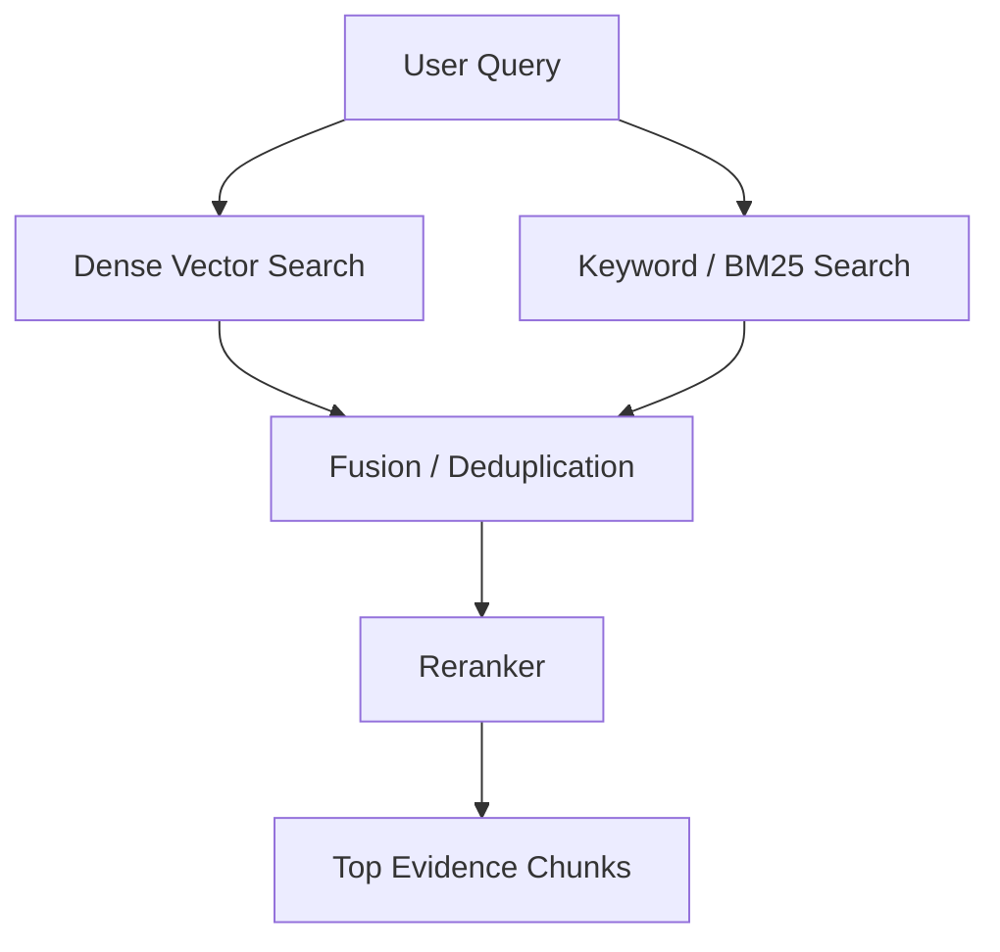
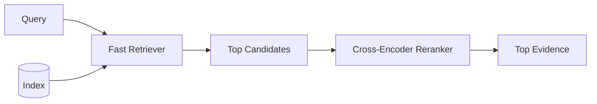

# 03. Retrieval Quality: Finding the Right Evidence

## 1. RAG system-এর সবচেয়ে গুরুত্বপূর্ণ প্রশ্ন: সঠিক evidence কি খুঁজে পেয়েছি?

ধরো, একটি company-র refund policy-তে লেখা আছে: “Standard product refund request purchase-এর ৩০ দিনের মধ্যে করতে হবে।” কিন্তু damaged item-এর জন্য আলাদা exception আছে: “Delivery-এর ৭ দিনের মধ্যে damage report করতে হবে।” User জিজ্ঞাসা করলেন, “আমার product delivery-এর ১০ দিন পর damaged বলে report করলে refund পাব?”

RAG system যদি শুধু general ৩০ দিনের clause retrieve করে, তাহলে model ভুল উত্তর দিতে পারে। আবার যদি ২০টি document retrieve করে, তার মধ্যে ১৮টি অপ্রাসঙ্গিক হয়, তাহলে গুরুত্বপূর্ণ exception noise-এর মধ্যে হারিয়ে যেতে পারে।

এই উদাহরণ দেখায়, RAG-এর answer quality শুধু LLM-এর ওপর নির্ভর করে না। Retriever কোন evidence আনছে, কোন order-এ আনছে, কতটা relevant evidence context-এ যাচ্ছে এবং access scope ঠিক আছে কি না, সবই গুরুত্বপূর্ণ।

**Retrieval quality** হলো query-এর জন্য প্রয়োজনীয় evidence সঠিকভাবে খুঁজে, rank করে এবং authorized scope-এর মধ্যে সরবরাহ করার ক্ষমতা।

## 2. Precision ও Recall: Retrieval quality-এর দুইটি মৌলিক দিক

ধরো, একটি প্রশ্নের উত্তর দিতে corpus-এ মোট ৪টি relevant chunk আছে। Retriever ৩টি relevant chunk পেয়েছে, কিন্তু মোট ৫টি chunk এনেছে। তাহলে:

```text
Precision = Relevant Retrieved / Total Retrieved
          = 3 / 5
          = 0.60

Recall    = Relevant Retrieved / Total Relevant
          = 3 / 4
          = 0.75
```

**Precision** বলে retrieve করা item-এর কত অংশ relevant। Precision কম হলে model-এর context-এ noise বেশি যায়।

**Recall** বলে corpus-এর relevant item-এর কত অংশ retrieve হয়েছে। Recall কম হলে প্রয়োজনীয় evidence বাদ পড়তে পারে।

দুইটি metric-এর trade-off আছে। High recall পেতে বেশি candidate আনলে noise বাড়তে পারে। High precision পেতে খুব কম candidate নিলে critical exception বাদ পড়তে পারে। তাই শুধু একটি metric maximize করলেই হবে না; final answer quality ও task risk-ও দেখতে হবে।

## 3. Dense retrieval: অর্থের মিল খোঁজা

Dense retrieval-এ query ও document chunk embedding model দিয়ে vector-এ রূপান্তর করা হয়। এরপর cosine similarity, dot product বা অন্য distance metric দিয়ে কাছাকাছি vector খোঁজা হয়।

উদাহরণ:
- Query: “How do I get my money back?”
- Document: “Refund requests must be submitted within 30 days.”

শব্দ এক নয়, কিন্তু অর্থ কাছাকাছি। Dense retrieval এই semantic similarity ধরতে পারে।

### Dense retrieval কোথায় ভালো?

- User natural language-এ প্রশ্ন করে।
- Query ও document-এ synonym/paraphrase আছে।
- একই concept ভিন্ন শব্দে প্রকাশ করা হয়েছে।
- Exact keyword match না থাকলেও অর্থগত সম্পর্ক গুরুত্বপূর্ণ।

### Dense retrieval-এর সীমাবদ্ধতা

- Exact ID, product code, error code বা clause number miss হতে পারে।
- শব্দে কাছাকাছি কিন্তু অর্থে আলাদা passage ভুলভাবে উপরে আসতে পারে।
- Embedding model-এর language/domain performance ভিন্ন।
- খুব ছোট chunk-এ context কম থাকলে semantic representation দুর্বল হতে পারে।

উদাহরণ: User বললেন `ERR_AUTH_4037` error-এর documentation খুঁজতে। Vector search conceptually related authentication document আনতে পারে, কিন্তু exact error code-যুক্ত page বাদ পড়তে পারে।

## 4. Keyword / Sparse retrieval: শব্দ ও identifier-এর মিল

BM25-এর মতো lexical retrieval term frequency, inverse document frequency এবং document length বিবেচনা করে। Exact term, identifier, acronym, code বা rare phrase-এর জন্য এটি কার্যকর।

উদাহরণ:
- `ERR_AUTH_4037`
- `SKU-AX19`
- `policy clause R-17`
- `Kubernetes PodDisruptionBudget`

যেখানে exact token গুরুত্বপূর্ণ, keyword search সাধারণত শক্তিশালী। কিন্তু user যদি “How can I get my money back?” বলেন আর document-এ “refund eligibility” লেখা থাকে, lexical match দুর্বল হতে পারে।

Dense এবং sparse retrieval তাই পরস্পরের বিকল্প নয়; তাদের strength আলাদা।

## 5. Hybrid retrieval: Semantic ও lexical search একসঙ্গে

Hybrid retrieval-এ dense vector search এবং keyword/BM25 search একসঙ্গে চালিয়ে result combine করা হয়।



Dense search semantic candidate আনে; BM25 exact term ও identifier match করে। দুই result list combine করলে এক পদ্ধতির blind spot অন্যটি কিছুটা cover করতে পারে।

### Score fusion বনাম rank fusion

দুই retriever-এর raw score একই scale-এ নাও হতে পারে। Dense similarity score ও BM25 score সরাসরি যোগ করলে একটি পদ্ধতি অযথা বেশি weight পেতে পারে।

একটি পদ্ধতি হলো score normalization করে weighted combination। আরেকটি হলো rank-based fusion, যেমন **Reciprocal Rank Fusion (RRF)**:

```text
RRF_score(document) = Σ 1 / (k + rank_in_list)
```

এখানে document যে list-এ যত উপরে rank পায়, তার contribution তত বেশি। `k` একটি smoothing constant। RRF raw score scale-এর ওপর কম নির্ভর করে, তবে fusion strategy-ও evaluation দিয়ে বেছে নিতে হবে।

## 6. Reranking: প্রথম search-এর পরে আরও ভালো ranking

প্রথম retriever সাধারণত দ্রুত অনেক candidate আনে। কিন্তু top candidate-গুলো সবসময় final context-এর জন্য best নয়। Reranker query ও candidate একসঙ্গে দেখে relevance ranking উন্নত করতে পারে।

### Bi-encoder

Query ও document আলাদাভাবে encode হয়। তাদের vector similarity দিয়ে search করা দ্রুত, তাই large corpus থেকে candidate retrieval-এ উপযোগী।

### Cross-encoder

Query ও document pair একসঙ্গে model-এ দেওয়া হয়। Model pair-এর relevance score দেয়। সাধারণত nuanced relevance বিচার করতে ভালো হতে পারে, কিন্তু প্রতিটি candidate-এর জন্য compute লাগে। তাই পুরো corpus-এ cross-encoder চালানো ব্যয়বহুল; আগে retriever দিয়ে candidate কমানো হয়।



একটি গুরুত্বপূর্ণ সীমাবদ্ধতা: Retriever relevant chunk একেবারেই না আনলে reranker সেটি উদ্ধার করতে পারবে না। Reranker candidate pool-এর মধ্যে ranking ঠিক করে; corpus-wide retrieval miss নিজে থেকে solve করে না।

## 7. Query rewriting ও decomposition

User query অনেক সময় conversational বা অস্পষ্ট হয়।

আগের conversation:
“আমার order-টা delivered হয়েছে।”

পরের প্রশ্ন:
“ওটা কত দিনের মধ্যে ফেরত দিতে পারি?”

এই “ওটা” কী বোঝাচ্ছে, query processing-এ conversation context থেকে resolve করতে হবে। Search-এর জন্য standalone query তৈরি করা যায়: “Applicable return window for the delivered order and product category.”

Complex question একাধিক subquery-তে ভাগ হতে পারে। যেমন “গত বছরের তুলনায় এ বছরের refund rate কেন বেড়েছে?” প্রশ্নে:
- গত বছরের refund rate
- এ বছরের refund rate
- Policy change
- Incident/support report
- Product category breakdown

আলাদা retrieve করে পরে evidence join করতে হতে পারে।

তবে rewriting-এ user intent বদলে যাওয়ার ঝুঁকি আছে। Original query ও rewritten query trace করো; প্রয়োজন হলে original এবং rewritten দুটো দিয়েই search করো। Query rewrite যেন scope, time range বা negation হারিয়ে না ফেলে।

## 8. Metadata filtering: Search-এর আগেই scope ঠিক করো

Retrieval candidate-কে document metadata দিয়ে filter করা যায়:
- `tenant_id`
- `allowed_groups`
- `document_type`
- `language`
- `effective_date`
- `version/status`
- `product`
- `region`

উদাহরণ: Finance team-এর current policy খুঁজতে হলে tenant, user group, document type এবং active version filter করা যেতে পারে।

**Security filter retrieval-এর আগেই trusted identity দিয়ে enforce করতে হবে।** User-এর দেওয়া tenant ID বা group name বিশ্বাস করা যাবে না। Unauthorized result পরে বাদ দিলেও তা intermediate logs, reranker বা model context-এ leak হতে পারে।

Metadata filter correctness-ও জরুরি। ভুল effective date বা stale ACL থাকলে relevant document-ই বাদ পড়ে যেতে পারে। তাই metadata ingestion ও permission sync evaluate করতে হবে।

## 9. Chunk size, overlap ও top-k: কোনো magic number নেই

Retrieval-এর quality অনেকাংশে chunk design ও candidate count-এর ওপর নির্ভর করে।

| Setting | খুব কম হলে | খুব বেশি হলে |
|---|---|---|
| Chunk size | Context ভেঙে যায়, clause বিচ্ছিন্ন | Topic মিশে যায়, noise বাড়ে |
| Overlap | Boundary context হারায় | Duplicate ও storage/embedding cost |
| Top-k | Relevant evidence বাদ | Irrelevant context ও latency |
| Candidate pool | Recall কম | Rerank cost/latency |
| Context budget | Evidence কম | Model distraction ও token cost |

Chunk size, overlap ও top-k corpus এবং query distribution দিয়ে experiment করে ঠিক করতে হবে। Policy corpus, source code এবং support ticket-এর জন্য একই configuration ভালো নাও হতে পারে।

## 10. Context selection: Retriever যা আনে, সব পাঠাবে না

Retriever-এর কাজ candidate আনা। Context builder-এর কাজ model-এর জন্য সবচেয়ে উপযোগী evidence নির্বাচন করা।

একটি context builder করতে পারে:
1. Duplicate/near-duplicate chunk বাদ।
2. একই document-এর redundant passage কমানো।
3. সব sub-question cover হয়েছে কি না যাচাই।
4. Contradictory version শনাক্ত।
5. Source authority ও freshness বিবেচনা।
6. Token budget অনুযায়ী evidence নির্বাচন।
7. Citation metadata preserve।
8. Exception-এর সঙ্গে parent heading বা neighboring context রাখা।

Long context মানেই unlimited attention নয়। Evidence-এর ordering ও placement-ও answer quality-তে প্রভাব ফেলতে পারে। তাই context selection-কে retrieval-এর পরে আলাদা stage হিসেবে evaluate করো।

## 11. Retrieval evaluation: কোন metric কী বলে?

| Metric | কী বোঝায় | কখন কাজে লাগে |
|---|---|---|
| Recall@k | Top-k-তে relevant evidence কতটা | প্রয়োজনীয় evidence বাদ যাচ্ছে কি না |
| Precision@k | Top-k-এর কতটা relevant | Context noise কত |
| MRR | প্রথম relevant result কত উপরে | প্রথম useful result দ্রুত আসে কি না |
| nDCG@k | Relevance grade ও ranking position | graded relevance ranking quality |
| Context precision | Generation context-এ relevant evidence-এর অনুপাত | Model-কে কতটা noise দেওয়া হচ্ছে |
| Context recall | প্রয়োজনীয় evidence context-এ এসেছে কি না | Answer-এর জন্য সব evidence এসেছে কি না |

Evaluation set-এ থাকা উচিত:
- বাস্তব user query
- Expected relevant document/chunk
- Answerable/unanswerable status
- Tenant/user permission scope
- Current ও stale version-এর উদাহরণ
- Exact identifier ও paraphrase query
- Exception/negation case

শুধু retrieval metric যথেষ্ট নয়। Final answer correctness, citation correctness, abstention quality, latency ও cost-ও মাপতে হবে।

## 12. Practical experiment: কোন retrieval pipeline ভালো?

একই evaluation set-এ চারটি configuration compare করো:

1. Dense retrieval top-5
2. Dense top-20 + rerank top-5
3. BM25 top-20
4. Hybrid top-20 + rerank top-5

Measure:
- Recall@k
- Precision@k / nDCG
- Answer correctness
- Citation correctness
- Missed-exception rate
- p95 latency
- Cost per query

ACL কখনো off করে production data-তে quality experiment করবে না। Permission filter সব configuration-এ একইভাবে enforce হবে।

## 13. Failure analysis: Symptom দেখে কোথায় খুঁজবে?

| Symptom | সম্ভাব্য কারণ | তদন্ত |
|---|---|---|
| Relevant doc নেই | Ingestion/index gap | Source coverage, parser, sync |
| Similar but wrong result | Dense ambiguity | BM25/hybrid, metadata |
| Correct doc, wrong passage | Chunking | Structure-aware chunk |
| Top result ভালো, answer খারাপ | Context/prompt/generation | Evidence ordering, claim validation |
| Old policy answer | Version/freshness | Effective date, active status |
| Unauthorized content | ACL bug | Identity propagation, pre-filter |
| Exact ID miss | Sparse retrieval absent | BM25/identifier index |
| Exception miss | Recall/chunk boundary | Query set, neighboring context |

Final answer ভুল হলে শুধু prompt বদলানোর আগে retrieval trace দেখে নাও। ভুল source এসেছে, নাকি সঠিক source এসে context থেকে বাদ গেছে, নাকি model সেটি ভুল বুঝেছে, আলাদা করতে হবে।

## 14. Interview: Retrieval Quality

### Q1. Dense বনাম sparse retrieval-এর পার্থক্য কী?

Dense retrieval embedding similarity দিয়ে semantic match খুঁজে; sparse/keyword retrieval exact term, rare phrase, ID ও code match-এ শক্তিশালী। Natural-language paraphrase-এ dense উপকারী, identifier-heavy corpus-এ sparse ভালো। Hybrid retrieval দুই ধরনের signal combine করতে পারে।

### Q2. Reranker কেন দরকার?

প্রথম retriever দ্রুত broad candidate set আনে। Reranker query ও candidate একসঙ্গে evaluate করে final relevance ranking উন্নত করতে পারে। তবে candidate set-এ relevant evidence না থাকলে reranker সেটি খুঁজে আনতে পারবে না। তাই retrieval recall ও reranker quality আলাদা মাপতে হবে।

### Q3. Top-k কীভাবে বাছবে?

Recall@k, precision/nDCG, final answer correctness, latency ও cost একসঙ্গে মেপে। বেশি k evidence recall বাড়াতে পারে, কিন্তু noise ও token cost-ও বাড়ায়। Corpus/query distribution অনুযায়ী best trade-off বেছে নিতে হবে।

### Q4. Metadata filter কি security boundary?

শুধু তখনই যখন trusted identity থেকে server-side enforce হয় এবং সব retrieval path একই policy মানে। Client-provided filter বিশ্বাস করা যাবে না। Retrieval-এর আগে ACL filter দরকার; final response-এর আগে আবার authorization/source check করা যেতে পারে।

### Q5. Retrieval ভালো হলেও hallucination কেন হতে পারে?

Model evidence ভুল বুঝতে পারে, context-এ conflicting source থাকতে পারে, answer unsupported claim যোগ করতে পারে বা citation mismatch হতে পারে। তাই retrieval ও generation আলাদা evaluate করতে হবে। Claim-source validation ও insufficient evidence-এ abstention দরকার।

### Q6. Dense search exact clause ID miss করলে কী করবে?

BM25/keyword retrieval বা exact identifier index যোগ করব। Hybrid result rank fusion দিয়ে combine করব। Query rewriting-এ identifier যেন পরিবর্তিত না হয় তা নিশ্চিত করব। Exact ID lookup-কে semantic similarity-এর ওপর ছেড়ে দেওয়া উচিত নয়।

## 15. Practice: Policy corpus retrieval design

একটি policy corpus-এ exact clause ID এবং natural-language question দুটোই আছে।

1. Dense-only search কেন clause ID miss করতে পারে?
2. BM25 ও vector result কীভাবে fuse করবে?
3. Reranker কোথায় বসবে এবং তার সীমা কী?
4. Draft ও active version থাকলে active version কীভাবে নিশ্চিত করবে?
5. ACL filter কোন identity থেকে তৈরি হবে?
6. Query answerable না হলে system কী করবে?
7. Missed exception কীভাবে evaluate করবে?

শেষে চারটি retrieval configuration-এর experiment plan লেখো। Metric, latency budget ও cost threshold নির্ধারণ করো।
