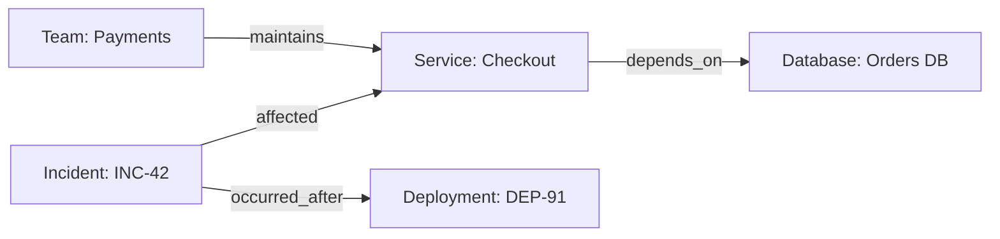
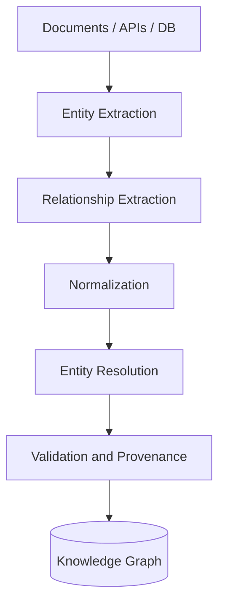

# 04. Knowledge Graph: Knowledge as Relationships

## 1. কিছু প্রশ্নের উত্তর paragraph খুঁজে পেলেই পাওয়া যায় না

ধরো, একটি software company-তে production incident ঘটেছে। Incident response team জানতে চায়:

- কোন team এই service maintain করে?
- Service-টি কোন database-এর ওপর নির্ভরশীল?
- Incident কোন deployment-এর পরে শুরু হয়েছে?
- ঐ deployment কোন engineer approve করেছিলেন?
- একই database-এর ওপর নির্ভরশীল আর কোন service ঝুঁকিতে আছে?

এই প্রশ্নগুলোর উত্তর হয়তো আলাদা আলাদা document, ticket, deployment record ও architecture page-এ ছড়িয়ে আছে। সাধারণ document retrieval relevant paragraph খুঁজে দিতে পারে, কিন্তু paragraph-গুলোর মধ্যে entity ও relationship ধরে বহু ধাপের প্রশ্নের উত্তর তৈরি করা কঠিন হতে পারে।

এ ধরনের problem-এ **Knowledge Graph** কাজে আসে। এটি knowledge-কে শুধু document বা row হিসেবে নয়, বরং entity এবং তাদের relationship-এর network হিসেবে represent করে।

## 2. Graph-এর মৌলিক ধারণা: Node, Edge, Property

Knowledge Graph-এর তিনটি মৌলিক building block:

**Node / Entity:** যে বাস্তব বা conceptual object নিয়ে তথ্য রাখা হচ্ছে। যেমন Team, Service, Database, Incident, Person, Deployment বা Policy।

**Edge / Relationship:** দুইটি entity-র মধ্যে সম্পর্ক। যেমন `MAINTAINS`, `DEPENDS_ON`, `AFFECTED`, `APPROVED_BY`, `APPLIES_TO`।

**Property:** Node বা edge-এর attribute। যেমন name, environment, status, created_at, valid_from, confidence বা source reference।



এই graph-এ শুধু “Checkout Service” নামে একটি node নেই; কোন team সেটি maintain করে, কোন database-এর ওপর নির্ভর করে এবং কোন incident সেটিকে affect করেছে, তাও প্রকাশিত হয়েছে।

## 3. Triple representation: একটি fact কীভাবে লেখা হয়?

Knowledge Graph-এ একটি সাধারণ fact-কে subject-predicate-object triple হিসেবে প্রকাশ করা যায়:

```text
(Payments Team, MAINTAINS, Checkout Service)
(Checkout Service, DEPENDS_ON, Orders DB)
(INC-42, AFFECTED, Checkout Service)
```

এখানে:
- Subject হলো যে entity থেকে relation শুরু।
- Predicate হলো relationship-এর নাম।
- Object হলো যে entity-র সঙ্গে relation তৈরি।

Relationship-এর direction গুরুত্বপূর্ণ। `Team MAINTAINS Service` এবং `Service MAINTAINED_BY Team` একই semantic relation উল্টো direction-এ প্রকাশ করতে পারে, কিন্তু schema-তে convention consistent হওয়া দরকার।

একটি বাস্তব graph-এ property, timestamp, source, confidence ও validity metadata-ও থাকতে পারে। একই relationship সময়ের সঙ্গে বদলাতে পারে, তাই শুধু static edge যথেষ্ট নাও হতে পারে।

## 4. Knowledge Graph বনাম Relational Database

Relational database-এ data table, row, column ও foreign key দিয়ে represent করা হয়। Graph database-এ node ও edge first-class structure। দুই পদ্ধতিই relationship represent করতে পারে, কিন্তু query pattern আলাদা।

| বিষয় | Relational DB | Graph DB |
|---|---|---|
| Data model | Table, row, foreign key | Node, edge, property |
| Relationship query | JOIN | Traversal / pattern match |
| Strength | Structured record, transaction, aggregation | Relationship-heavy ও multi-hop traversal |
| Schema | Table/column constraints | Node/edge type, ontology/schema |
| Trade-off | Deep/variable join complex হতে পারে | Governance, traversal planning ও graph maintenance দরকার |

Graph database সবসময় SQL database-এর বিকল্প নয়। Customer, payment ও order-এর transactional record relational DB-তে থাকতে পারে, আর service dependency বা entity relationship graph-এ রাখা যেতে পারে। কোনটি বেছে নেবে তা query pattern, consistency requirement, write workload ও operational complexity দেখে।

## 5. Knowledge Graph তৈরির pipeline

Graph তৈরি করা মানে শুধু document থেকে নাম বের করে node বানানো নয়। Entity identity, relation correctness, schema, provenance ও time validity সামলাতে হয়।



### 5.1 Entity extraction

Source থেকে entity mention বের করা। যেমন “Payments team”, “Checkout service”, “Orders database”, “INC-42”।

পদ্ধতি হতে পারে:
- Rule বা regular expression
- Structured source parser
- Named Entity Recognition (NER)
- LLM-assisted extraction
- Existing master data lookup

LLM unstructured document থেকে entity candidate বের করতে সাহায্য করতে পারে, কিন্তু extraction result সরাসরি authoritative ধরে নেওয়া যাবে না।

### 5.2 Relationship extraction

Entity-গুলোর মধ্যে relation বের করা। যেমন “Payments team owns Checkout service” থেকে `MAINTAINS` বা `OWNS` relation তৈরি।

Relation extraction-এ ভুল হলে graph দেখতে plausible হলেও query ভুল result দিতে পারে। তাই allowed relation schema, source evidence এবং validation দরকার।

### 5.3 Normalization

একই entity বিভিন্ন নামে উল্লেখ হতে পারে:
- “Checkout”
- “checkout-service”
- “Checkout API”

Normalization canonical identifier ও alias mapping তৈরি করে। কিন্তু একই নাম মানেই একই entity নয়। “Payments” নামে team এবং product থাকতে পারে।

### 5.4 Entity resolution

দুইটি record একই real-world entity বোঝায় কি না তা নির্ধারণ। একই নামের দুই employee এক ব্যক্তি নয়; আবার “Checkout API” ও “checkout-service” একই service হতে পারে।

Entity resolution-এ কাজে লাগে:
- Stable ID
- Domain/type constraint
- Alias ও name similarity
- Source system
- Organization/project scope
- Temporal information
- Confidence threshold
- Human review

False merge হলে দুই entity এক হয়ে যায়; false split হলে একই entity একাধিক node-এ ভাগ হয়। দুই ধরনের ভুলই graph query নষ্ট করতে পারে।

### 5.5 Validation ও provenance

প্রতিটি fact-এর সঙ্গে source reference থাকা উচিত:
- Source document/record ID
- Page/section বা API record
- Extraction time
- Source version
- Confidence বা validation status
- Valid time/observed time
- Extractor/model version, যেখানে প্রাসঙ্গিক

Provenance ছাড়া ভুল edge কোথা থেকে এসেছে তা খুঁজে পাওয়া কঠিন। High-impact graph fact-এর জন্য source-of-truth system থেকে verification বা human review দরকার হতে পারে।

## 6. Schema / Ontology: Graph-এ কী কী relation allowed?

Ontology বা graph schema বলে:
- কোন ধরনের node থাকতে পারে;
- কোন relationship allowed;
- relation-এর source ও target type কী;
- কোন property required;
- relation directional কি না;
- temporal validity কীভাবে represent হবে।

উদাহরণ:

```text
Node types:
  Team, Service, Database, Incident, Deployment

Allowed relationships:
  Team -[MAINTAINS]-> Service
  Service -[DEPENDS_ON]-> Database
  Incident -[AFFECTED]-> Service
  Incident -[OCCURRED_AFTER]-> Deployment
  Deployment -[APPROVED_BY]-> Person
```

Schema খুব rigid হলে নতুন concept যোগ করা কঠিন। আবার খুব loose হলে inconsistent relation name, invalid edge ও duplicate entity তৈরি হতে পারে। Versioned schema, validation rule ও migration plan দরকার।

## 7. Graph query ও traversal: Multi-hop প্রশ্নের উত্তর

প্রশ্ন: “Payments team-এর maintained service কোন database-এর ওপর নির্ভরশীল?”

এটি একটিমাত্র fact নয়। Graph-এ path traverse করতে হবে:

1. Payments Team node খুঁজো।
2. `MAINTAINS` edge ধরে Service node-এ যাও।
3. `DEPENDS_ON` edge ধরে Database node-এ যাও।
4. Path, properties ও source evidence ফেরত দাও।

```text
(Payments)-[:MAINTAINS]->(Service)-[:DEPENDS_ON]->(Database)
```

এটি conceptual pattern, নির্দিষ্ট graph query language নয়।

Graph traversal-এর সময় depth, allowed relationship type, tenant/project scope এবং result limit নির্দিষ্ট করতে হয়। Unbounded traversal huge বা irrelevant subgraph ফেরত দিতে পারে। Query-তে source ও confidence metadata preserve করা উচিত।

## 8. Knowledge Graph এবং RAG একসঙ্গে

Document RAG relevant text chunk retrieve করে। Knowledge Graph structured entity ও relationship query করে। দুটির evidence type আলাদা, তাই hybrid system-এ একসঙ্গে ব্যবহার করা যায়।

ধরা যাক প্রশ্ন: “Checkout Service down হলে কোন team-কে notify করব এবং কোন database potentially affected?”

1. Graph থেকে Checkout Service-এর `MAINTAINS` ও `DEPENDS_ON` relation traverse।
2. Graph result-এর source reference থেকে architecture document বা incident runbook retrieve।
3. RAG থেকে relevant runbook passage ও escalation instruction আনো।
4. Current service/database status authoritative monitoring API থেকে verify করো।
5. Evidence একত্র করে answer তৈরি করো।

Graph relation path দেয়; document RAG supporting explanation দেয়; live API current state দেয়। Graph fact-ও source-backed, versioned ও access-controlled হতে হবে। Graph-এ relation আছে বলেই service বর্তমানে healthy বা database এখনো dependency, এমন নিশ্চয়তা নেই।

## 9. কখন Knowledge Graph ব্যবহার করবে?

উপযোগী হতে পারে যখন:
- Entity relationship query-র কেন্দ্রীয় বিষয়।
- Multi-hop traversal দরকার।
- Impact analysis বা dependency analysis করতে হয়।
- তথ্য বহু source-এ ছড়িয়ে আছে।
- Entity identity, lineage বা ownership track করতে হয়।
- একই relation বিভিন্ন application-এ reuse হয়।

কম উপযোগী হতে পারে যখন:
- সাধারণ FAQ-তে document retrieval যথেষ্ট।
- Relationship কম এবং SQL query সহজ।
- Graph maintenance cost benefit-এর চেয়ে বেশি।
- Entity/relationship extraction quality দুর্বল এবং validation process নেই।
- প্রশ্নগুলো mostly exact transactional lookup।

Graph ব্যবহার করার আগে representative query set দিয়ে পরীক্ষা করো। শুধু “data interconnected” বললেই graph database প্রয়োজন প্রমাণ হয় না।

## 10. Failure modes: Graph ভুল হলে query-ও ভুল

| Failure | প্রভাব | প্রতিকার |
|---|---|---|
| Entity duplication | একই entity আলাদা node | Entity resolution, canonical ID |
| False edge | ভুল relationship | Schema, evidence, review |
| Stale edge | পুরনো ownership/dependency | Validity interval, sync, expiration |
| Missing provenance | Fact যাচাই অসম্ভব | Source reference mandatory |
| Broad traversal | Huge/irrelevant result | Depth ও relation constraints |
| Access leak | Restricted relation প্রকাশ | Node/edge authorization |
| Ontology drift | Inconsistent graph | Versioned schema, migration |
| Temporal confusion | পুরনো relation current হিসেবে ব্যবহার | Valid time ও observed time |
| Extraction hallucination | Source-এ নেই এমন relation | Evidence-backed extraction, validation |

Graph quality evaluate করতে entity resolution accuracy, relation precision/recall, provenance coverage, freshness এবং downstream query correctness মাপা যায়।

## 11. Interview: Knowledge Graph নিয়ে গভীর প্রশ্ন

### Q1. Knowledge Graph কী?

Knowledge Graph হলো entity ও তাদের relationship-কে node-edge-property structure-এ represent করা knowledge model। এটি relationship-centric query, multi-hop traversal, dependency analysis ও entity linkage-এর জন্য কার্যকর। প্রতিটি fact-এর source/provenance ও validity metadata থাকলে graph result audit করা সহজ হয়।

### Q2. Graph DB কেন relational DB-এর চেয়ে ভালো?

সব ক্ষেত্রে ভালো নয়। Deep বা variable relationship traversal-এ graph model natural হতে পারে। Transactional tabular workload, aggregation ও strong relational constraints-এর জন্য relational DB ভালো fit হতে পারে। Workload, query pattern, consistency, scale ও operational cost দেখে নির্বাচন করতে হবে।

### Q3. Entity resolution কেন কঠিন?

একই নামের আলাদা entity থাকতে পারে; একই entity-র alias থাকতে পারে। Name similarity একা যথেষ্ট নয়। Stable ID, type/domain constraint, source system, scope, temporal information ও confidence দরকার। Ambiguous match human review-এ পাঠানো যেতে পারে।

### Q4. Graph fact বিশ্বাস করবে কীভাবে?

Provenance, source version, extraction confidence, valid time, schema validation ও source-of-truth policy দরকার। LLM-extracted relation authoritative নয়। High-impact relation official source বা owning service থেকে verify করা উচিত।

### Q5. Graph-এ relationship পরিবর্তন হলে কী করবে?

Relation-এর valid time বা effective interval রাখো, source update event ingest করো, old edge close/invalidate করো এবং new edge version করো। Historical query ও current-state query আলাদা হতে পারে। Cache/index downstream হলে refresh/invalidation দরকার।

### Q6. Knowledge Graph কি RAG-এর replacement?

না। Graph structured relationship query-তে শক্তিশালী; RAG unstructured document passage retrieve করতে পারে। Hybrid system-এ graph path ও document evidence একসঙ্গে দেওয়া যায়। Exact current state-এর জন্য আবার domain API দরকার হতে পারে।

## 12. Practice: Software Company Architecture Graph

একটি software company-র architecture graph বানাও। Node types:
- Team
- Service
- Database
- API
- Incident
- Deployment
- Person

কমপক্ষে এই relationship define করো:
- Team maintains Service
- Service depends_on Database
- Service exposes API
- Incident affected Service
- Incident occurred_after Deployment
- Deployment approved_by Person

তারপর প্রশ্নগুলোর উত্তর graph traversal দিয়ে বের করার query plan লেখো:

1. Service down হলে কোন team notify হবে?
2. কোন database potentially affected?
3. Incident কোন deployment-এর পরে শুরু?
4. Deployment কে approve করেছিলেন?
5. Service ownership বদলালে historical ownership কীভাবে represent হবে?

প্রতিটি node/edge-এর source, timestamp, validity ও confidence metadata দাও। শেষে একটি ভুল edge ও stale edge scenario তৈরি করে দেখাও, query result কীভাবে ভুল হবে এবং validation কীভাবে তা ধরবে।
