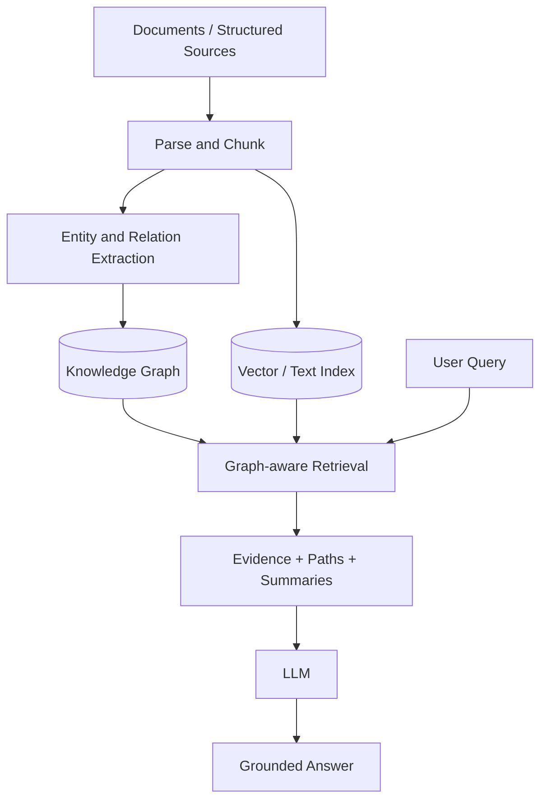
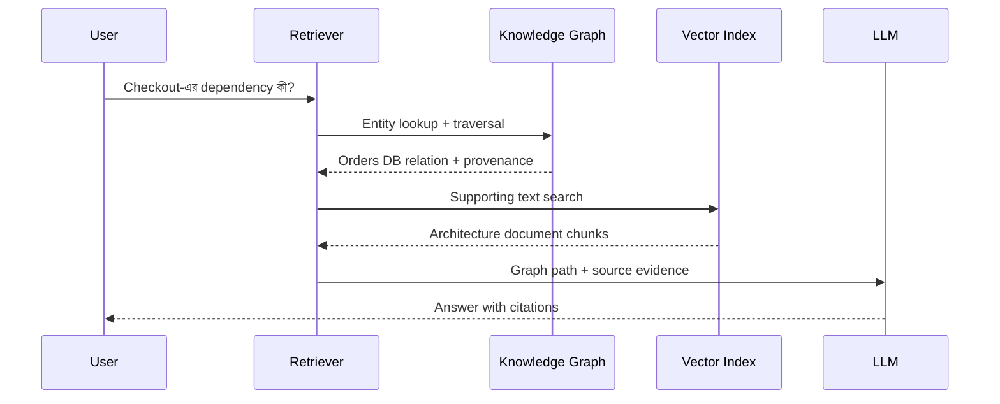

# 05. GraphRAG: Combining Graphs and Retrieval

## 1. Document search অনেক সময় উত্তর দেয়, কিন্তু relationship-এর পুরো ছবি দেয় না

ধরো, engineering leadership জানতে চায়: “গত দুই quarter-এ Checkout Service-এর reliability কমার প্রধান কারণ কী এবং কোন team-গুলো জড়িত?”

এই প্রশ্নের উত্তর দিতে শুধু একটি paragraph যথেষ্ট নয়। দরকার হতে পারে:
- Incident report ও timeline
- Deployment history
- Service ownership
- Service dependency
- Database ও API relationship
- Team responsibility
- Quarter-wise incident trend

সাধারণ vector RAG relevant document chunk খুঁজে দিতে পারে। কিন্তু একাধিক document-এর মধ্যে ছড়িয়ে থাকা entity ও relationship জোড়া লাগানো কঠিন হতে পারে। Knowledge Graph এই entity ও relation-গুলো structured ভাবে represent করে। **GraphRAG** graph-based structure এবং document retrieval একত্রে ব্যবহার করে LLM-কে relationship-aware evidence দিতে পারে।

একটি গুরুত্বপূর্ণ caveat: GraphRAG-এর একটিমাত্র universal implementation নেই। বিভিন্ন system graph construction, community detection, retrieval, summary ও query planning ভিন্নভাবে করতে পারে। তাই GraphRAG-কে একটি approach family হিসেবে বোঝা ভালো, একটিমাত্র fixed algorithm হিসেবে নয়।

## 2. GraphRAG-এর mental model

GraphRAG system-এ সাধারণত document/text index এবং graph representation দুটোই থাকে। Query অনুযায়ী graph traversal, semantic search, keyword search, precomputed summary বা এদের combination ব্যবহার হতে পারে।



Graph এবং text index দুটোই evidence source। Graph relationship/path দেখায়; text index original paragraph, explanation ও supporting detail দিতে পারে। LLM এই evidence থেকে উত্তর তৈরি করে। Graph fact-এর provenance না থাকলে model-এর কাছে path থাকলেও সেটি যাচাই করা কঠিন হবে।

## 3. GraphRAG indexing pipeline: Graph কীভাবে তৈরি হয়?

GraphRAG-এর query-time behavior অনেকাংশে নির্ভর করে indexing-time graph construction-এর ওপর। ভুল entity বা relation তৈরি হলে query-time traversal সেই ভুলকে আরও ছড়িয়ে দিতে পারে।

একটি সম্ভাব্য indexing pipeline:

1. Documents ও structured sources ingest এবং normalize।
2. Text chunk তৈরি।
3. Entity mention extract।
4. Entity mention resolve করে canonical entity নির্ধারণ।
5. Relationship extract।
6. Schema অনুযায়ী graph build।
7. প্রয়োজন হলে graph community/cluster তৈরি।
8. Community বা graph-derived summary তৈরি।
9. Original chunk ও graph fact-এর provenance সংরক্ষণ।
10. Graph ও text index versioned ভাবে publish।

প্রতিটি stage-এর validation দরকার। যেমন relation extraction model যদি “Service A depends on Database B” উল্টো করে দেয়, তাহলে downstream dependency analysis ভুল হবে। Community summary যদি পুরনো source-এর ওপর তৈরি হয়, global question-এর উত্তরও stale হতে পারে।

## 4. Local / Entity-centric retrieval: নির্দিষ্ট entity ঘিরে evidence খোঁজা

Local retrieval pattern-এ প্রশ্ন সাধারণত একটি বা কয়েকটি নির্দিষ্ট entity নিয়ে হয়।

উদাহরণ: “Checkout Service কোন database-এর ওপর নির্ভরশীল?”

সম্ভাব্য flow:
1. Query থেকে “Checkout Service” entity resolve।
2. Graph-এ entity node খোঁজা।
3. `DEPENDS_ON` relation traverse।
4. সংশ্লিষ্ট database node ও edge provenance সংগ্রহ।
5. Graph fact সমর্থনকারী architecture document chunk retrieve।
6. Current status প্রয়োজন হলে monitoring/API থেকে verify।
7. Graph path ও source evidence LLM context-এ দেওয়া।



Graph result relationship দেখায়; document result textual evidence দেয়। দুটো মিললে traceability বাড়তে পারে। কিন্তু graph relation যদি stale হয়, document evidence দিয়ে version conflict শনাক্ত করতে হবে।

## 5. Global / Corpus-level retrieval: পুরো corpus-এর pattern বোঝা

কিছু প্রশ্ন একটি নির্দিষ্ট entity নিয়ে নয়, বরং অনেক document ও relationship জুড়ে থাকা pattern নিয়ে।

উদাহরণ:
- “সব incident মিলিয়ে recurring reliability issue কী?”
- “কোন dependency group সবচেয়ে বেশি incident-এ জড়িত?”
- “গত ছয় মাসে কোন team-গুলোর service ownership overlap বেড়েছে?”

প্রতিটি incident document আলাদা করে retrieve করলেই global pattern নির্ভরযোগ্যভাবে পাওয়া নাও যেতে পারে। কিছু GraphRAG architecture-এ community detection বা graph clustering দিয়ে related entity-র group তৈরি করা হয়। তারপর community-level summary তৈরি করে corpus-level query-তে candidate evidence হিসেবে ব্যবহার করা যায়।

তবে summary-কে final truth ধরে নেওয়া যাবে না। গুরুত্বপূর্ণ claim-এর জন্য original incident report, deployment record বা authoritative metric-এ ফিরে গিয়ে verify করতে হবে। Summary ভুল বা stale হলে global answer-ও ভুল হবে।

Local/global terminology কিছু GraphRAG architecture-এ ব্যবহৃত হয়; সব implementation-এ একই algorithm বা exact pipeline থাকবে না।

## 6. GraphRAG বনাম Vector RAG

| বিষয় | Vector RAG | GraphRAG |
|---|---|---|
| Representation | Text chunk embeddings | Graph + text index |
| Retrieval | Semantic similarity | Traversal, semantic search, summary |
| Strength | Passage-level search | Relationship ও multi-hop context |
| Preparation | Parse/chunk/embed | সঙ্গে entity/relation extraction |
| Complexity | তুলনামূলক কম | বেশি |
| Failure | Wrong/missing chunk | ভুল entity/edge ও retrieval error |
| Cost | Embedding ও search | Graph build, extraction, refresh |

GraphRAG সবসময় Vector RAG-এর চেয়ে ভালো নয়। Simple FAQ-তে document RAG যথেষ্ট হতে পারে। Graph construction ও maintenance cost তখন অতিরিক্ত বোঝা। GraphRAG-এর value আসে যখন relationship-aware বা corpus-level question বাস্তবে গুরুত্বপূর্ণ এবং baseline RAG সেখানে ব্যর্থ হয়।

## 7. GraphRAG বনাম Knowledge Graph: Structure আর retrieval approach এক নয়

Knowledge Graph হলো knowledge represent করার structure। এতে node, edge, property ও provenance থাকে।

GraphRAG হলো graph-সহ external knowledge retrieve করে LLM generation augment করার approach। Knowledge Graph থাকলেই GraphRAG system হয় না। যদি application graph query করে structured result দেখায় এবং LLM generation না থাকে, সেটি graph-based application হতে পারে। GraphRAG-এ query-time retrieval, evidence/context assembly এবং LLM generation-এর সম্পর্ক থাকে।

একইভাবে GraphRAG system-এর graph store একটি full enterprise Knowledge Graph নাও হতে পারে; query-specific graph representation হতে পারে।

## 8. কখন GraphRAG বিবেচনা করবে?

প্রথমে document RAG baseline তৈরি করো। বাস্তব user question সংগ্রহ করে label করো কোনগুলো:
- Single passage answer
- Multi-document synthesis
- Entity relationship
- Multi-hop traversal
- Corpus-level/global pattern

যদি service ownership, dependency, incident chain বা organization relationship-এ document RAG ধারাবাহিকভাবে ব্যর্থ হয়, তখন graph representation যোগ করে Graph-aware retrieval পরীক্ষা করো।

GraphRAG বিবেচনার সম্ভাব্য কারণ:
- Relationship query product-এর core requirement।
- Multi-hop traversal প্রয়োজন।
- বহু source-এর entity identity resolve করতে হয়।
- Dependency/impact analysis গুরুত্বপূর্ণ।
- Graph structure একাধিক application-এ reuse হবে।

শুধু “আমাদের data interconnected” বললেই GraphRAG প্রয়োজন প্রমাণ হয় না। Graph build, update, ACL ও evaluation-এর maintenance cost হিসাব করতে হবে।

## 9. GraphRAG-এর কঠিন engineering problem

### Entity resolution

“Payments”, “Payment Platform” ও “payments-service” একই entity কি না? ভুল merge বা split graph path নষ্ট করতে পারে। Canonical ID, alias, scope ও human review দরকার।

### Relationship correctness

A depends on B আর B depends on A উল্টে যাওয়া সহজ। Relation direction, allowed schema ও source evidence validate করতে হবে।

### Temporal validity

পুরনো service owner আজও owner নাও হতে পারেন। Relation-এর valid time, observed time এবং source update record করতে হবে।

### Graph freshness

Document update হলেও graph update না হলে vector index ও graph inconsistent হতে পারে। Versioned ingestion, change detection ও atomic publish দরকার।

### Provenance

Graph summary থেকে original supporting document-এ ফিরতে হবে। প্রতিটি edge বা derived fact-এর source reference থাকা উচিত।

### Access control

Traversal ও summary তৈরিতেও access policy মানতে হবে। Restricted node/edge query result-এ চলে এলে summary বা answer-এ leak হতে পারে। ACL query-time-এ enforce করা জরুরি।

### Summary drift

Community summary তৈরি হওয়ার পরে underlying document বা relation বদলে গেলে summary stale হতে পারে। Summary-এর source set/version record এবং refresh policy দরকার।

## 10. Query strategy: illustrative pseudocode

```python
def answer_relationship_question(question, identity):
    entities = resolve_entities(question)

    graph_facts = graph.search(
        entities=entities,
        max_hops=2,
        identity=identity,
    )

    text_evidence = document_search.search(
        query=question,
        identity=identity,
        top_k=10,
    )

    evidence = merge_and_deduplicate(graph_facts, text_evidence)
    evidence = validate_acl_freshness_and_provenance(evidence)
    evidence = rerank_and_select(question, evidence)

    return llm.answer(
        question=question,
        evidence=evidence,
        abstain_if_insufficient=True,
    )
```

এটি illustrative pseudocode। `max_hops`, identity-aware traversal, ACL enforcement ও provenance validation graph store/security model অনুযায়ী implement করতে হবে। Query থেকে entity resolve না হলে clarification বা text-only retrieval fallback হতে পারে।

## 11. Evaluation: Graph যোগ করে সত্যিই লাভ হয়েছে?

GraphRAG evaluate করতে শুধু final answer quality নয়, graph construction এবং retrieval দুটোই দেখতে হবে।

- Entity extraction precision/recall
- Relation extraction precision/recall
- Entity resolution accuracy
- Path correctness
- Graph freshness
- Provenance coverage
- Access-control violation rate
- Local/multi-hop answer correctness
- Global synthesis correctness
- Graph build cost ও refresh latency
- Query latency ও cost

Adversarial test তৈরি করো যেখানে ভুল edge, duplicate entity, stale ownership বা conflicting relation থাকবে। System সেই ভুলকে confidently repeat করে কি না দেখো।

একই evaluation set-এ Vector RAG baseline ও GraphRAG candidate compare করো। GraphRAG যদি relationship question-এ উন্নতি করে কিন্তু simple FAQ-তে cost বাড়ায়, তাহলে routing strategy দিয়ে query type অনুযায়ী retrieval method বেছে নেওয়া যেতে পারে।

## 12. Interview: GraphRAG নিয়ে গভীর প্রশ্ন

### Q1. GraphRAG কী?

GraphRAG হলো graph structure এবং document retrieval একত্রে ব্যবহার করে LLM-কে relationship, multi-hop evidence বা corpus-level pattern-সহ context দেওয়ার approach family। Implementation ভিন্ন হতে পারে, তবে graph-aware retrieval ও LLM generation-এর সংযোগ মূল ধারণা।

### Q2. কেন Vector RAG-এর চেয়ে ভালো হতে পারে?

Relationship ও multi-hop প্রশ্নে graph path entity-গুলোর সম্পর্ক স্পষ্ট করতে পারে। Vector RAG passage similarity-তে ভালো, কিন্তু বহু document-এর relationship join করতে দুর্বল হতে পারে। তবে GraphRAG-এর graph construction, entity resolution ও maintenance cost আছে; সব corpus-এ লাভ হয় না।

### Q3. Knowledge Graph থাকলেই কি GraphRAG?

না। Knowledge Graph হলো representation। GraphRAG-এ query-time graph-aware retrieval, context assembly এবং LLM generation থাকে। শুধু graph query করে structured result দেখানো graph-based application হতে পারে, GraphRAG নয়।

### Q4. GraphRAG-এর সবচেয়ে বড় ঝুঁকি কী?

ভুল entity/edge, stale graph, provenance loss, access leak এবং unsupported summary। ভুল graph fact multi-hop traversal-এ ছড়িয়ে যেতে পারে। তাই extraction validation, temporal metadata, ACL, provenance এবং source verification দরকার।

### Q5. Local ও Global retrieval-এর পার্থক্য কী?

Local retrieval নির্দিষ্ট entity বা তার আশেপাশের relation ঘিরে evidence খোঁজে। Global retrieval অনেক entity/document-এর pattern বা corpus-level summary নিয়ে কাজ করে। Global answer-এ precomputed summary সাহায্য করতে পারে, কিন্তু গুরুত্বপূর্ণ claim original source দিয়ে verify করতে হবে।

### Q6. GraphRAG কি সব RAG system-এ যোগ করা উচিত?

না। প্রথমে baseline document RAG evaluate করব। Relationship-heavy বা multi-hop question-এ measurable failure থাকলে graph যোগ করব। Simple FAQ বা exact structured lookup-এ graph complexity অপ্রয়োজনীয় হতে পারে।

## 13. Practice: Incident Investigation Assistant

একটি incident investigation assistant design করো। Source:
- Incident report
- Service ownership registry
- Deployment record
- Dependency graph
- Team roster
- Runbook document

দুটি query-এর জন্য retrieval strategy আলাদা করো:

**Local query:** “INC-42 কোন service-কে affect করেছে, service-এর owner team কে এবং কোন database dependency আছে?”

**Global query:** “গত ছয় মাসে কোন dependency pattern সবচেয়ে বেশি incident-এ জড়িত?”

প্রতিটির জন্য লিখবে:
1. Entity resolution কীভাবে হবে?
2. Graph traversal কোন relation অনুসরণ করবে?
3. কোন document chunk supporting evidence দেবে?
4. কোন live API current status verify করবে?
5. Provenance ও ACL কীভাবে preserve হবে?
6. Stale বা conflicting relation এলে কী করবে?
7. Answer correctness কী metric-এ মাপবে?

শেষে Vector RAG baseline-এর সঙ্গে GraphRAG compare করার experiment plan লেখো।
