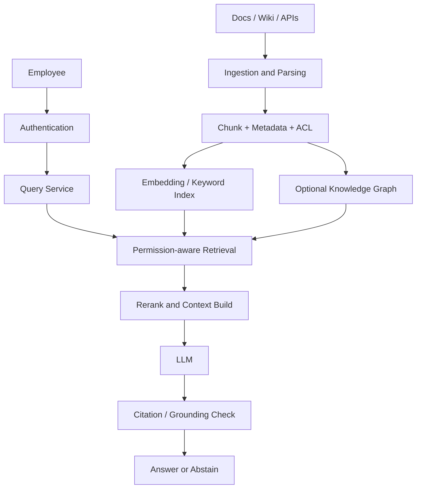

# 07. Module 3 Recap ও Interview Drill

এই chapter-এর কাজ শুধু RAG, Retrieval, Knowledge Graph ও GraphRAG-এর definition মুখস্থ করানো নয়। এগুলোকে একটি end-to-end knowledge system হিসেবে বুঝতে হবে: কোন তথ্য model-এর learned knowledge থেকে আসবে, কোনটি external source থেকে retrieve হবে, source কীভাবে search-ready হবে, retrieval সঠিক কি না কীভাবে মাপবে এবং production-এ access, freshness ও failure কীভাবে সামলাবে।

Interview-তে এই পুরো lifecycle ব্যাখ্যা করতে পারলে তুমি শুধু “vector database ব্যবহার করেছি” বলার চেয়ে অনেক বেশি শক্ত architecture reasoning দেখাতে পারবে।

## 1. 90-second recap: Agent-এর উত্তর evidence-এর ওপর দাঁড়ায় কীভাবে?

LLM-এর **parametric knowledge** training থেকে আসে। কিন্তু private, changing বা current company knowledge-এর জন্য তা যথেষ্ট নয়। তাই application external source ব্যবহার করে **grounding** করতে পারে।

RAG-এর দুইটি lifecycle:
- **Indexing:** Source → Parse/Normalize → Chunk → Metadata/ACL → Embedding → Index।
- **Query time:** Question → Query Processing → Retrieval → Filter/Rerank → Context Build → LLM → Citation/Answer Validation।

Dense retrieval semantic similarity খোঁজে; keyword/BM25 exact term, ID ও rare phrase-এ শক্তিশালী; hybrid retrieval দুটো combine করে। Reranker candidate-কে আরও ভালোভাবে rank করতে পারে, কিন্তু retriever যে evidence আনেনি তা নিজে থেকে উদ্ধার করতে পারে না।

Knowledge Graph entity ও relationship-কে node-edge-property আকারে represent করে। তাই multi-hop relationship ও dependency query সহজ হতে পারে। GraphRAG graph-aware retrieval এবং document evidence একত্রে ব্যবহার করে। Production RAG-এ ACL, freshness, provenance, evaluation, prompt injection defense, cache isolation, observability ও safe abstention জরুরি।

## 2. Quick comparison: কোন concept কোন problem solve করে?

| Concept | মূল প্রশ্ন | কাজ |
|---|---|---|
| Parametric knowledge | Model training থেকে কী শিখেছে? | Learned model knowledge |
| External knowledge | Current/private fact কোন source-এ আছে? | Documents, DB, API, graph |
| Grounding | Answer কোন evidence-এর ওপর দাঁড়ানো? | Claim-evidence linkage |
| RAG | Evidence কীভাবে retrieve করে generation-এ যোগ হবে? | Retrieval-augmented generation |
| Embedding | Text-এর semantic representation কী? | Vector representation |
| Dense search | অর্থের দিক থেকে কাছের passage কোনগুলো? | Semantic retrieval |
| Keyword/BM25 | Exact term/identifier কোথায় আছে? | Lexical retrieval |
| Hybrid retrieval | Semantic ও lexical signal কীভাবে combine হবে? | Combined candidate retrieval |
| Reranking | Candidate-এর মধ্যে কোন evidence বেশি relevant? | Improved ranking |
| Knowledge Graph | Entity-গুলোর relationship কী? | Structured relationship model |
| GraphRAG | Graph ও document evidence একত্রে কীভাবে retrieve হবে? | Graph-aware retrieval + generation |

## 3. Interview answer কীভাবে সাজাবে?

প্রতিটি RAG/Knowledge architecture প্রশ্নে এই flow অনুসরণ করো:

1. **Definition:** Concept কী?
2. **Problem:** কোন সমস্যা সমাধান করে?
3. **Lifecycle:** Data কীভাবে ingest, store ও retrieve হয়?
4. **Boundary:** কোন source authoritative এবং ACL কোথায় enforce হয়?
5. **Trade-off:** Accuracy, latency, cost ও maintenance-এর ভারসাম্য কী?
6. **Failure:** কোন stage-এ ভুল হতে পারে?
7. **Evaluation:** কোন metric দিয়ে যাচাই করবে?
8. **Fallback:** Evidence না পেলে বা source unavailable হলে কী হবে?

# Part A: Grounding ও RAG Fundamentals

## Q1. RAG কী?

RAG হলো inference-time pattern যেখানে query অনুযায়ী external source থেকে evidence retrieve করে LLM-এর current context-এ যোগ করা হয়। Model সেই evidence ব্যবহার করে answer তৈরি করে। RAG সাধারণত model weights update করে না; source/index update করে changing knowledge সরবরাহ করা যায়।

Private, changing, domain-specific বা citation-backed answer-এর জন্য এটি উপযোগী। তবে retrieval quality, source authority, ACL ও freshness ঠিক না থাকলে RAG answer-ও ভুল হতে পারে।

## Q2. Parametric knowledge ও external knowledge-এর পার্থক্য কী?

Parametric knowledge model training থেকে শেখা এবং model parameters-এ encode থাকে। External knowledge document, database, API, search index বা Knowledge Graph-এ থাকে। Parametric knowledge general language/conceptual answer-এ উপকারী; current account balance, private policy বা latest product data-এর জন্য external source দরকার।

External knowledge মানেই সবসময় RAG নয়। Exact transactional state-এর জন্য API/database query বেশি উপযুক্ত।

## Q3. Grounding কী?

Grounding হলো answer-এর material claim-কে নির্দিষ্ট evidence/source-এর সঙ্গে যুক্ত করা। শুধু citation string দিলেই grounding নিশ্চিত হয় না; source claim support করে কি না, source current ও authoritative কি না এবং user-এর access আছে কি না যাচাই করতে হয়। Evidence না থাকলে abstain বা clarification দরকার।

## Q4. RAG pipeline-এর দুইটি lifecycle কী?

**Indexing:** Source collect, parse, normalize, chunk, metadata attach, embedding generate এবং search index তৈরি।

**Query time:** Query processing, retrieval, ACL filtering, reranking, context selection, LLM generation এবং citation validation।

Indexing-এ parsing/chunking ভুল হলে query time-এ সঠিক evidence পাওয়া কঠিন। Query-time retrieval ভালো হলেও stale index থাকলে answer outdated হতে পারে।

## Q5. Chunking কেন দরকার?

Chunk retrieval unit তৈরি করে, যাতে বড় document থেকে focused passage retrieve করা যায়। খুব ছোট chunk-এ heading, exception বা surrounding context হারাতে পারে; খুব বড় chunk-এ topic mix ও noise বাড়ে। Fixed-size, structure-aware ও semantic chunking compare করে corpus/query অনুযায়ী size ও overlap tune করতে হবে।

## Q6. Embedding কী?

Embedding হলো text-কে numeric vector representation-এ রূপান্তর করা, যেখানে semantic similarity আনুমানিক geometric proximity দিয়ে মাপা যায়। Embedding model-এর language/domain performance, dimension, max input, cost ও version গুরুত্বপূর্ণ। Model/version বদলালে সাধারণত corpus re-embed করতে হয়; পুরনো ও নতুন vector নির্বিচারে mix করা যাবে না।

# Part B: Retrieval Quality

## Q7. Dense বনাম sparse retrieval-এর পার্থক্য কী?

Dense retrieval embedding similarity দিয়ে semantic match খোঁজে; paraphrase ও synonym-এ উপকারী। Sparse/keyword retrieval BM25-এর মতো lexical matching দিয়ে exact term, ID, acronym ও rare code-এ শক্তিশালী। Query distribution-এ দুই ধরনের pattern থাকলে hybrid retrieval ব্যবহার করা যায়।

## Q8. Hybrid retrieval কেন?

Dense search natural-language meaning match করে, BM25 exact identifier ও phrase ধরে। দুই result combine করলে এক পদ্ধতির blind spot অন্যটি কিছুটা cover করতে পারে। Raw score scale ভিন্ন হলে normalization বা RRF-এর মতো rank fusion ব্যবহার করা যায়। Fusion strategy evaluation দিয়ে বেছে নিতে হবে।

## Q9. Reranker কী করে? এর সীমা কী?

Retriever দ্রুত candidate set আনে। Reranker query ও candidate একসঙ্গে দেখে relevance অনুযায়ী নতুন ranking দিতে পারে। Cross-encoder candidate-level relevance-এ ভালো হতে পারে, কিন্তু compute cost বেশি। Retriever relevant evidence একেবারেই না আনলে reranker সেটি খুঁজে পাবে না।

## Q10. Top-k ১০ থেকে ৫০ করলে quality বাড়বে?

অবশ্যই নয়। Recall বাড়তে পারে, কিন্তু irrelevant chunk, token cost, latency ও distraction বাড়ে। Candidate pool, reranker এবং final context budget আলাদা tune করতে হবে। Recall@k, nDCG, answer correctness, p95 latency ও cost একসঙ্গে মাপো।

## Q11. Retrieval quality কীভাবে evaluate করবে?

Recall@k relevant evidence কতটা এসেছে বোঝায়; Precision@k retrieved result-এর কতটা relevant বোঝায়; MRR প্রথম relevant result কত উপরে; nDCG graded relevance ও ranking position মাপে। এর পাশাপাশি answer correctness, citation correctness, missed-exception rate, ACL correctness, latency ও cost evaluate করতে হবে।

# Part C: Knowledge Graph ও GraphRAG

## Q12. Knowledge Graph কী?

Knowledge Graph entity/node এবং relationship/edge/property দিয়ে knowledge represent করে। এটি multi-hop query, dependency analysis, entity lineage ও relationship-centric search-এ কাজে লাগে। Graph fact-এর source, timestamp, version ও validity metadata থাকা দরকার।

## Q13. Graph DB কেন relational DB-এর চেয়ে ভালো?

সব ক্ষেত্রে ভালো নয়। Deep/variable traversal ও relationship-heavy query-তে graph natural হতে পারে। Transactional tabular data, aggregation ও relational constraints-এর জন্য relational DB ভালো fit হতে পারে। Query pattern, consistency, write workload ও operational cost দেখে নির্বাচন করতে হবে।

## Q14. Entity resolution কেন কঠিন?

এক entity বিভিন্ন alias-এ থাকতে পারে; একই নামের ভিন্ন entity-ও থাকতে পারে। Name similarity একা যথেষ্ট নয়। Stable ID, domain/type constraint, source system, scope, temporal information ও confidence দরকার। Ambiguous match human review-এ পাঠানো যেতে পারে।

## Q15. GraphRAG কী?

GraphRAG হলো graph structure ও document retrieval একত্রে ব্যবহার করে LLM-কে relationship, multi-hop context বা corpus-level pattern-সহ evidence দেওয়ার approach family। Implementation এক রকম নয়। Graph construction, graph-aware retrieval, evidence assembly ও LLM generation-এর সম্পর্ক মূল ধারণা।

## Q16. GraphRAG কি সবসময় Vector RAG-এর চেয়ে ভালো?

না। GraphRAG entity/relation extraction, resolution, storage ও refresh-এর extra cost আনে। Relationship-heavy বা corpus-level question-এ value দিতে পারে। Simple FAQ-তে Vector/Hybrid RAG যথেষ্ট হতে পারে। Baseline RAG-এর সঙ্গে measurable improvement না থাকলে graph complexity যোগ করব না।

## Q17. Graph fact trustworthy করবে কীভাবে?

Ontology/schema, provenance, extraction confidence, entity resolution, temporal validity, validation rule ও human review ব্যবহার করব। LLM-extracted edge authoritative নয়। High-impact relation official source বা owning service থেকে verify করব। Stale relation invalidate/version করতে হবে।

# Part D: Production RAG Security ও Operations

## Q18. RAG কি hallucination দূর করে?

না। Retrieval miss, stale/conflicting source, incomplete evidence এবং model misinterpretation হতে পারে। Evidence quality, abstention, citation validation ও retrieval/generation আলাদা evaluation দরকার। RAG hallucination risk কমাতে পারে, guarantee করে না।

## Q19. User অন্য department-এর document দেখতে চাইলে কী করবে?

Authenticated identity থেকে tenant/group/role resolve করব। Retrieval-এর আগেই trusted server-side ACL filter enforce করব। Vector, keyword, graph, cache, reranker ও citation path-এ একই scope বজায় রাখব। Client-provided filter বিশ্বাস করব না। Access revoke হলে cache/index-এ propagation দরকার।

## Q20. Retrieved document-এ prompt injection থাকলে?

Document content untrusted data; system instruction থেকে আলাদা। অপ্রয়োজনীয় secret context-এ দেব না। Tool permission server-side enforce করব; high-risk action-এ approval এবং adversarial corpus test রাখব। Prompt-এ malicious instruction ignore করতে বলা helpful, কিন্তু একা security boundary নয়।

## Q21. Source update হলে answer current কীভাবে থাকবে?

Version/hash, event বা batch incremental ingestion, update/delete propagation, freshness monitoring ও atomic index publish। Query-তে effective date/status filter। Source update event miss হলেও periodic reconciliation index ও source-এর version compare করে gap ধরতে পারে।

## Q22. RAG cache কীভাবে design করবে?

Cache key-তে normalized query ছাড়াও tenant/permission scope, corpus/index version ও locale বিবেচনা করব। Permission revoke/document update-এ invalidate করব। Personalized answer indiscriminately share করব না। Cache hit হলেও current authorization check দরকার হতে পারে।

## Q23. No relevant document পাওয়া গেলে কী করবে?

Abstain, clarification বা authoritative source/tool-এ escalate। Company-specific policy parametric knowledge দিয়ে অনুমান করানো উচিত নয়। Answerable/unanswerable query set দিয়ে abstention quality evaluate করব।

# Part E: System Design ও Deep Follow-ups

## Q24. Internal policy প্রতিদিন বদলায়। Fine-tune করবে, নাকি RAG?

RAG baseline বেছে নেব, কারণ policy update-এর সঙ্গে source/index update করা যায় এবং citation রাখা যায়। Fine-tuning factual update-এর primary mechanism নয়। Style/task behavior-এর জন্য fine-tuning আলাদাভাবে বিবেচনা করা যায়। Source-of-truth, version ও freshness SLA নির্ধারণ করব।

## Q25. RAG ভুল উত্তর দিয়েছে। Root cause কীভাবে বের করবে?

Stage ধরে trace করব:
1. Source-এ fact ছিল?
2. Parser ঠিক extract করেছে?
3. Index current ও complete?
4. Query rewrite intent ঠিক রেখেছে?
5. Retriever relevant chunk এনেছে?
6. ACL/filter কোনো result বাদ দিয়েছে?
7. Reranker/context builder evidence বাদ দিয়েছে?
8. Model evidence ভুল বুঝেছে?
9. Citation claim support করেছে?

Retrieval ও generation evaluation আলাদা রাখব। সব সমস্যা prompt change দিয়ে সমাধান হয় না।

## Q26. Knowledge Graph কেন, relational DB কেন নয়?

প্রথমে workload দেখি। Deep/variable traversal, dependency বা multi-hop path-এ graph natural হতে পারে। Transactional tabular data-তে relational DB উপযুক্ত। Hybrid architecture সম্ভব; graph maintenance ও consistency cost justify করতে হবে।

## Q27. Source update হলেও graph relation পুরনো থাকলে?

Source version ও relation validity track করব। Change event এলে affected node/edge update, expire বা rebuild করব। Graph ও text index atomic/versioned publish করব। Freshness lag monitor করব। Historical query-এর জন্য পুরনো relation মুছে না ফেলে validity interval রাখতে পারি।

## Q28. Retrieval ভালো হলেও final answer ভুল কেন হতে পারে?

Model evidence ভুল বুঝতে পারে, contradictory source resolve করতে না পারে, unsupported claim যোগ করতে পারে বা citation ভুল দিতে পারে। তাই retrieval metric ভালো হলেই generation correctness নিশ্চিত নয়। Claim-source validation, answer evaluation এবং insufficient evidence-এ abstention দরকার।

# Part F: System Design Exercise: Company Knowledge Assistant

Requirements:
- HR, Finance ও Engineering-এর private documents।
- Employee-specific permission।
- Daily policy update।
- Natural-language search।
- Citation সহ answer।
- Insufficient evidence-এ abstain।

### Ownership

- Source systems authoritative content।
- Ingestion pipeline parse/version/index।
- Identity service permission।
- Retriever ACL enforce।
- LLM answer draft।
- Citation validator claim-source support check।
- Runtime tool authorization আলাদা enforce।
- Graph builder entity/relation provenance maintain।

### Failure paths

- ACL service down → sensitive retrieval fail closed।
- Index stale → freshness policy/fallback।
- No evidence → abstain।
- Prompt injection → retrieved content untrusted।
- Cache stale → version/permission-aware invalidation।
- Graph stale → current source revalidation।
- Citation invalid → answer block/repair/escalate।

### Interviewer-এর follow-up challenge

**“HR employee-এর access revoke হয়েছে, কিন্তু vector cache-এ পুরনো chunk আছে।”**  
Current authorization check ছাড়া cache result return করব না। Revoke event-এ related cache/index invalidate করব। Invalidation lag থাকলে stale permission থেকে data leak যেন না হয়, fail-closed control রাখব। Deletion/revoke propagation time monitor করব।

**“RAG index unavailable, কিন্তু user company policy জানতে চায়।”**  
Model-এর parametric knowledge থেকে policy বানাতে দেব না। Approved fallback source/API থাকলে ব্যবহার করব; না হলে unavailable জানাব বা human support-এ escalate করব।

**“Graph বলছে service-এর owner Team A, কিন্তু source document-এ Team B।”**  
Source version, effective date ও authority যাচাই করব। Graph fact-এর provenance inspect করে stale edge update করব। Conflict unresolved হলে ownership নিশ্চিত বলে জানাব না।

## 3. Self-review checklist

- [ ] Parametric vs external knowledge
- [ ] Grounding ও RAG definition
- [ ] Indexing বনাম query-time
- [ ] Parsing/normalization
- [ ] Chunking/overlap
- [ ] Embedding/version compatibility
- [ ] Vector index/ANN
- [ ] Dense বনাম keyword retrieval
- [ ] Hybrid retrieval/RRF
- [ ] Reranking
- [ ] Metadata/ACL filtering
- [ ] Recall@k, Precision@k, MRR, nDCG
- [ ] Knowledge Graph node/edge/property
- [ ] Entity extraction/resolution
- [ ] Provenance/temporal validity
- [ ] GraphRAG local/global retrieval
- [ ] GraphRAG vs Vector RAG
- [ ] Prompt injection
- [ ] Freshness, deletion, caching
- [ ] Citation validation ও abstention
- [ ] Stage-wise observability ও failure recovery

## 4. Mock interview

**Interviewer:** “আমাদের company-তে হাজার হাজার document, service dependency, incident report ও policy আছে। একটি agent বানাতে হবে, যাতে employee প্রশ্ন করলে সঠিক source থেকে answer দেয়। Architecture কী হবে?”

উত্তর সাজাও:

1. Query type ও data source classify।
2. Document RAG baseline তৈরি।
3. Structured/current state-এর জন্য API/SQL।
4. Relationship-heavy question-এর জন্য Knowledge Graph/GraphRAG।
5. Ingestion, metadata, ACL ও freshness।
6. Hybrid retrieval ও reranking।
7. Context, citation ও abstention।
8. Security ও prompt injection defense।
9. Evaluation, observability ও cost।
10. Incremental rollout ও baseline comparison।

Framework-এর নামের চেয়ে data lifecycle, trust boundary, ownership, failure mode ও evaluation strategy ব্যাখ্যা করা বেশি গুরুত্বপূর্ণ।

## 5. Oral practice rubric

প্রতিটি উত্তরে যাচাই করো:

1. Concept সঠিকভাবে define করেছি?
2. End-to-end flow বুঝিয়েছি?
3. Trade-off বা কখন ব্যবহার করব না বলেছি?
4. Failure mode ও mitigation বলেছি?
5. বাস্তব উদাহরণ বা metric দিয়েছি?
6. Data access ও source authority কোথায় enforce হবে বলেছি?

শুধু “RAG মানে vector database + LLM” বললে উত্তর অসম্পূর্ণ। একজন engineer হিসেবে তোমাকে ব্যাখ্যা করতে হবে source কোথা থেকে আসে, কীভাবে search-ready হয়, user কী দেখতে পারে, evidence কীভাবে verify হয় এবং failure হলে system কীভাবে নিরাপদে থামে।
